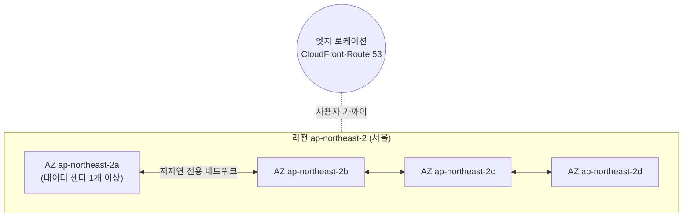

# M00-01. 클라우드와 AWS 글로벌 인프라
> 도메인: D1, D2 (기초) · 예상 시간: 35분 · 실습 등급: 🟢

## 왜 필요한가

TodayOrder(오늘의 주문)는 지금 사무실 구석의 서버 한 대에서 돌아간다. 정전 한 번, 디스크 고장 한 번이면 주문이 멈춘다. 팀장은 "AWS로 옮기자"고 했지만, 막상 콘솔을 열면 첫 화면부터 **리전**을 고르라고 한다. 서울? 버지니아? 어디에 둬야 하고, 무엇이 달라지는가? 그리고 AWS로 옮기면 보안은 누가 책임지는가?

## 핵심 개념

**클라우드 컴퓨팅**: 서버·스토리지·DB 같은 IT 자원을 필요할 때 API 호출로 빌려 쓰고, 쓴 만큼 내는 방식. 서버를 사서 설치하는 대신 `RunInstances` 같은 API를 부른다. 이 커리큘럼의 모든 실습이 "API 호출"인 이유다.

### 리전(Region)과 가용 영역(Availability Zone, AZ)



- **리전**: 지리적으로 떨어진 AWS 데이터 센터 묶음. 코드로 부른다(`us-east-1` = 버지니아 북부, `ap-northeast-2` = 서울). 리전끼리는 독립적이라 한 리전의 장애가 다른 리전으로 번지지 않게 설계되어 있다. 대부분의 리소스(EC2, RDS, VPC…)는 **리전에 속한다**. IAM처럼 리전이 없는 글로벌 서비스도 있다.
- **가용 영역(AZ)**: 리전 안에서 전원·냉각·네트워크가 분리된 하나 이상의 데이터 센터. **모든 리전에는 AZ가 최소 3개 있다.** AZ끼리는 저지연 전용망으로 연결되어 있어서, 서버를 두 AZ에 나눠 두면 한 AZ가 통째로 멈춰도 서비스가 산다. SAA 시험의 "고가용성" 문제 대부분은 결국 "여러 AZ에 나눠 두었는가"를 묻는다.
- **AZ 이름과 AZ ID**: `us-east-1a` 같은 이름은 (오래된 계정·리전에서는) 계정마다 다른 물리 AZ에 대응될 수 있다. 계정을 넘어 같은 물리 위치를 가리키려면 `use1-az1` 같은 **AZ ID**를 쓴다.

리전을 고르는 네 가지 기준(시험 단골):

| 기준 | 질문 |
|---|---|
| 규정 준수·데이터 주권 | 이 데이터가 국외로 나가도 되는가? (가장 먼저 본다) |
| 지연 시간 | 사용자와 가까운가? |
| 서비스 제공 여부 | 쓰려는 서비스·기능이 그 리전에 있는가? |
| 비용 | 같은 서비스도 리전마다 가격이 다르다 |

### 엣지와 리전 밖으로 뻗은 인프라

| 이름 | 무엇 | 언제 |
|---|---|---|
| 엣지 로케이션(Edge Location) | 전 세계 주요 도시에 있는 접속 지점(PoP). CloudFront 캐시, Route 53 DNS, Global Accelerator 진입점이 여기서 돈다 | 정적 콘텐츠·DNS를 사용자 가까이에서 응답 (M08) |
| Local Zones | 특정 대도시에 놓인 **리전의 확장**. 부모 리전의 VPC에 Local Zone 서브넷을 만들어 EC2·EBS 등 일부 서비스를 쓴다 | 그 도시 사용자에게 한 자릿수 밀리초 지연이 필요한 게임·미디어·실시간 처리 |
| Wavelength Zones | **통신사 5G 네트워크 안**에 놓인 AWS 인프라. 모바일 트래픽이 인터넷을 거치지 않고 바로 닿는다 | 5G 단말 대상 초저지연 앱 (AR/VR, 커넥티드 카) |
| Outposts | AWS 하드웨어를 **내 데이터 센터**에 들여놓는 것 | 데이터가 온프레미스에 있어야 하지만 AWS API로 관리하고 싶을 때 |

> 숫자(리전·AZ 수)는 계속 늘어난다. 2026년 11월 기준 AWS 공식 페이지는 39개 리전, 124개 AZ라고 밝히고 있다. 시험은 숫자보다 "AZ는 최소 3개, 리전은 서로 독립"을 묻는다.

### 공동 책임 모델(Shared Responsibility Model)

AWS는 **클라우드의 보안(Security OF the cloud)**, 고객은 **클라우드 안에서의 보안(Security IN the cloud)** 을 책임진다.

| 영역 | AWS 책임 | 고객 책임 |
|---|---|---|
| 물리 시설·하드웨어·글로벌 네트워크 | ✅ | |
| 하이퍼바이저, 관리형 서비스의 기반 OS | ✅ | |
| EC2 게스트 OS 패치, 그 위의 앱 | | ✅ |
| 보안 그룹·NACL 규칙, IAM 사용자·정책 | | ✅ |
| 데이터 암호화 설정, 데이터 분류 | | ✅ |
| RDS의 DB 엔진 패치 | ✅ (유지 관리 기간에 적용) | 유지 관리 기간 선택, DB 사용자·네트워크 접근 |
| Lambda 런타임·서버 | ✅ | 함수 코드, 실행 역할 권한 |

규칙: **관리형일수록 AWS 몫이 커진다** (EC2 → RDS → Lambda/S3/DynamoDB 순). 하지만 "누가 내 데이터에 접근할 수 있는가(IAM)"와 "데이터를 암호화할 것인가"는 어떤 서비스든 고객 몫이다.

## 직접 해 보기

에뮬레이터도 EC2 API로 리전과 AZ를 보여 준다. ([레슨 3](./03-environment-setup.md)을 먼저 끝내고 `source scripts/env.sh` 한 셸에서 실행)

```bash
aws ec2 describe-availability-zones \
  --query "AvailabilityZones[].{ZoneName:ZoneName,ZoneId:ZoneId,Type:ZoneType}" --output table
```

```
-------------------------------------------------
|           DescribeAvailabilityZones           |
+-------------------+------------+--------------+
|       Type        |  ZoneId    |  ZoneName    |
+-------------------+------------+--------------+
|  availability-zone|  use1-az1  |  us-east-1a  |
|  availability-zone|  use1-az2  |  us-east-1b  |
|  availability-zone|  use1-az3  |  us-east-1c  |
+-------------------+------------+--------------+
```

방금 본 것: `ZoneName`(계정마다 다를 수 있는 이름)과 `ZoneId`(물리 위치)가 따로 있다. 이 커리큘럼은 리전을 `us-east-1` 하나로 고정한다.

```bash
aws ec2 describe-regions --query 'length(Regions)'
aws ec2 describe-availability-zones --region ap-northeast-2 --query "AvailabilityZones[].ZoneName" --output text
```

```
17
ap-northeast-2a	ap-northeast-2b	ap-northeast-2c
```

방금 본 것: 에뮬레이터는 리전 17개, 리전마다 AZ 3개를 **고정 목록으로** 돌려준다. 실제 AWS의 숫자(예: `us-east-1`은 AZ 6개, 서울은 4개)와 다르다. 에뮬레이터가 보여 주는 숫자를 외우지 말 것.

## 실제 AWS에서는

- `describe-regions`는 기본적으로 **내 계정에서 활성화된** 리전만 보여 준다. 2019년 이후 생긴 리전(예: 홍콩, 바레인)은 계정에서 직접 활성화(opt-in)해야 쓸 수 있다.
- `describe-availability-zones`에 `--filters` 를 빼면 활성화한 Local Zones·Wavelength Zones도 함께 나온다(`ZoneType`이 `local-zone`, `wavelength-zone`).
- 에뮬레이터는 리전을 분리하지 않는다. `--region ap-northeast-2`로 요청해도 받아 주지만 리소스를 리전별로 나눠 보관하지 않는다. 실제 AWS에서는 리전마다 리소스가 완전히 따로 있어서, 버지니아에 만든 VPC는 서울 리전 API로 조회되지 않는다. 그래서 M12의 다중 리전 실습은 에뮬레이터를 포트 두 개로 띄워 "리전 2개"를 흉내 낸다.
- 리전·AZ 목록을 보는 것만으로는 요금이 나오지 않는다. 실제 계정에서 해 보려면 위 두 명령을 그대로 실행하면 된다(정리할 리소스 없음).

## 시험 포인트

- "한 AZ 장애에도 서비스 유지" → **Multi-AZ** 배치 (리전 하나로 충분). "리전 장애에도 유지" → 다중 리전(DR, M12).
- "데이터가 특정 국가를 벗어나면 안 된다" → 리전 선택이 먼저. 다른 기준보다 우선한다.
- "특정 도시 사용자에게 한 자릿수 ms 지연" → **Local Zones**. "5G 모바일 단말 초저지연" → **Wavelength**. "온프레미스에서 AWS 서비스" → **Outposts**.
- "정적 콘텐츠를 전 세계에 빠르게" → 엣지 로케이션을 쓰는 **CloudFront** (M08).
- 공동 책임: EC2 게스트 OS 패치는 **고객**, RDS 엔진 패치·물리 보안은 **AWS**, 보안 그룹·IAM·암호화 설정은 **항상 고객**.

## 스스로 확인

1. TodayOrder가 "서울 사용자 대상, 개인정보는 국내 보관" 요구를 받았다. 리전 선택에서 가장 먼저 고려할 기준과 고를 리전은?
2. 같은 리전의 서로 다른 계정 두 개가 "같은 물리 AZ"에 서브넷을 두고 싶다. AZ 이름(`us-east-1a`)을 맞추면 될까?
3. EC2와 RDS에서 "DB 소프트웨어 보안 패치"는 각각 누구 책임인가?

<details><summary>답</summary>

1. 규정 준수(데이터 주권)가 먼저다. 국내 보관이 요구되므로 서울 리전(`ap-northeast-2`). 지연 시간도 유리하다.
2. 아니다. 오래된 리전·계정에서는 AZ 이름이 계정마다 다른 물리 AZ에 매핑될 수 있다. AZ ID(`use1-az1` 등)로 맞춘다.
3. EC2에 직접 설치한 DB는 고객이 OS와 DB를 모두 패치한다. RDS는 AWS가 엔진 패치를 제공·적용한다(고객은 유지 관리 기간을 정한다).

</details>
