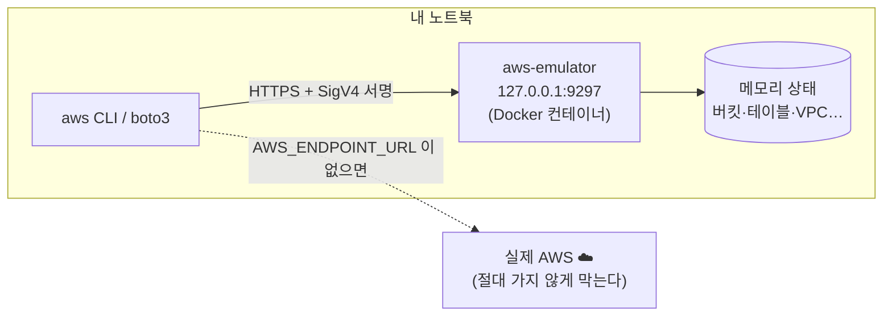

# M00-02. aws-emulator란 무엇이고 무엇이 아닌가
> 도메인: – (학습 도구) · 예상 시간: 30분 · 실습 등급: 🟢

## 왜 필요한가

AWS를 배우는 가장 확실한 방법은 직접 만들어 보는 것이지만, 실제 계정에서는 NAT 게이트웨이 하나만 잊고 켜 둬도 요금이 나온다. 신입에게 회사 계정을 마음껏 쓰라고 할 수도 없다. 그래서 이 커리큘럼은 내 노트북에서 도는 **aws-emulator**로 실습한다. 다만 에뮬레이터는 AWS가 아니므로, "어디까지 믿어도 되는가"를 먼저 알아야 잘못 배우지 않는다.

## 핵심 개념

**aws-emulator**는 AWS가 공개한 로컬 에뮬레이터다. AWS API 모델(서비스별 요청·응답 형식 정의)이 있는 서비스의 API를 `https://127.0.0.1:<포트>` 한 곳에서 흉내 낸다. AWS CLI와 SDK는 엔드포인트만 바꾸면 그대로 쓸 수 있다.



### 컨트롤 플레인 vs 데이터 플레인

| | 컨트롤 플레인(Control plane) | 데이터 플레인(Data plane) |
|---|---|---|
| 뜻 | 리소스를 만들고·조회하고·바꾸고·지우는 API | 그 리소스의 본래 기능 |
| 예 | `CreateBucket`, `CreateTable`, `CreateVpc`, `RunInstances` | `PutObject`/`GetObject`, `PutItem`, 패킷이 라우팅되는 것, 인스턴스가 부팅되는 것 |
| 에뮬레이터 충실도 | **가장 높다** | 서비스마다 다르다 |

공식 문서 표현을 빌리면 에뮬레이터는 "컨트롤 플레인 API에서 AWS와 가장 가깝고, 데이터 플레인과 IaC 지원은 서비스마다 다르다". 예를 들어 S3 객체 저장·조회(데이터 플레인)는 잘 되지만, VPC 라우팅 테이블을 만든다고 패킷이 실제로 흐르지는 않는다.

### 에뮬레이터가 아닌 것

- **권한 시스템이 아니다.** IAM 정책은 일부 서비스에서만, AWS와 다른 방식으로 평가된다. 공식 문서는 "에뮬레이터로 보안(IAM 정책, 버킷 정책, KMS 키 정책 등)을 테스트하지 말라"고 못 박는다.
- **여러 계정·리전이 아니다.** 계정은 항상 `000000000000`, 리전을 바꿔도 리소스를 따로 보관하지 않는다.
- **영속 저장소가 아니다.** 모든 상태는 메모리에 있다. 에뮬레이터를 끄면 사라진다. 상태를 비우는 API도 없어서, **재시작이 곧 초기화**다(`scripts/emulator-reset.sh`).
- **모든 API가 구현된 것이 아니다.** 미구현 오퍼레이션은 HTTP 501과 오류 코드 `NotImplemented`를 돌려준다.

반대로 **생각보다 많이 "진짜로" 하는 것**도 있다(탐침으로 확인, [FIDELITY.md](../../docs/FIDELITY.md)): SNS에 발행한 메시지가 구독한 SQS 큐에 실제로 도착하고, Step Functions 실행이 끝까지 돌고, Lambda `Invoke`는 **함수 코드를 실제로 실행**한다. RDS 인스턴스를 만들면 컨테이너 안에 실제 DB 엔진이 뜨고, ALB는 HTTP 응답을 한다. 다만 이런 "리소스 자체의 포트"(RDS 엔드포인트, ALB DNS 이름)는 에뮬레이터 컨테이너 **안에서만** 열려 있어 내 Mac에서는 접속할 수 없다. 또 공식 문서는 "에뮬레이터가 실행하는 코드(예: 함수 코드)는 격리되지 않는다"고 경고한다. 믿을 수 있는 코드만 넣자.

### 충실도 등급

그래서 이 커리큘럼은 모든 실습에 등급을 붙인다([CURRICULUM.md 3장](../../docs/CURRICULUM.md#3-에뮬레이터-충실도-등급)).

| 등급 | 의미 | 실습 형태 |
|---|---|---|
| 🟢 재현 | API와 동작이 실제처럼 관찰된다 | 끝까지 실행하고 검증 |
| 🟡 부분 | 리소스는 만들어지지만 동작(실행·전달·차단)은 일어나지 않는다 | 구성까지 실습 + "실제 AWS에서는" |
| 🔴 개념 | 에뮬레이터로 볼 수 없다 | 개념·다이어그램·워크시트 |

등급의 근거는 [docs/FIDELITY.md](../../docs/FIDELITY.md)다. 이 저장소의 탐침(`tools/probe/probe.py`)이 커리큘럼에 나오는 오퍼레이션과 서비스 간 동작을 실제로 호출해 본 결과를 정리한 문서로, 에뮬레이터가 업데이트되면 다시 만든다.

## 직접 해 보기

[lab05-emulator-limits.sh](./labs/lab05-emulator-limits.sh)가 아래 과정을 재현한다.

**1) 미구현 오퍼레이션** — 조직의 SCP(서비스 제어 정책, M01에서 배운다)를 만들어 본다.

```bash
aws organizations create-policy --name todayorder-scp --type SERVICE_CONTROL_POLICY \
  --description demo --content '{"Version":"2012-10-17","Statement":[]}'
```

```
aws: [ERROR]: An error occurred (NotImplemented) when calling the CreatePolicy operation: operation CreatePolicy is scaffolded but not implemented in this emulator
```

방금 본 것: API 모양은 있지만(scaffolded) 동작이 없다. 이런 실습은 🔴로 분류하고 개념으로 배운다.

**2) 정책이 하나도 없는 사용자** — 인턴 계정을 만들고 그 키로 요청해 본다. 실제 AWS라면 정책이 없으니 **모든 요청이 거부**되어야 한다(암묵적 거부).

```bash
aws iam create-user --user-name todayorder-intern --query User.Arn --output text
aws iam create-access-key --user-name todayorder-intern \
  --query 'AccessKey.[AccessKeyId,SecretAccessKey]' --output text   # 출력한 키를 아래에 넣는다
AWS_ACCESS_KEY_ID=<키> AWS_SECRET_ACCESS_KEY=<비밀 키> aws iam list-users
AWS_ACCESS_KEY_ID=<키> AWS_SECRET_ACCESS_KEY=<비밀 키> aws s3 mb s3://todayorder-intern-bucket
```

```
arn:aws:iam::000000000000:user/todayorder-intern

aws: [ERROR]: An error occurred (AccessDenied) when calling the ListUsers operation: User: arn:aws:iam::000000000000:user/todayorder-intern is not authorized to perform: iam:ListUsers on resource: arn:aws:iam::000000000000:user/ because no identity-based policy allows the iam:ListUsers action
make_bucket: todayorder-intern-bucket
```

방금 본 것: 같은 사용자인데 **IAM API는 거부되고, S3 버킷 생성은 통과했다.** 에뮬레이터는 서비스마다 정책 평가 여부가 다르다(탐침 결과: 사용자에게 붙인 IAM 정책을 IAM·EC2·KMS는 평가하고 S3·SQS·DynamoDB는 평가하지 않는다. 그런데 S3 **버킷 정책**의 명시적 Deny는 집행됐다 — [FIDELITY.md](../../docs/FIDELITY.md)). 에뮬레이터에서 "통과했다"는 것이 "권한 설계가 맞다"는 뜻이 아님을 기억하자.

## 실제 AWS에서는

- 정책이 없는 IAM 사용자는 S3 버킷도 만들 수 없다(`AccessDenied`). 권한 설계는 반드시 실제 AWS에서 검증한다. M01은 이 차이를 **손으로 판정하는 워크시트**로 메운다.
- 실제 AWS는 리소스마다 요금이 붙고, 리소스를 지우기 전까지 계속 청구된다. 에뮬레이터는 무료이고 끄면 사라진다.
- 실제 AWS에서 이 실습(IAM 사용자 + 액세스 키)을 해 보려면: IAM은 무료이지만 **액세스 키는 유출 시 위험**하므로 실습 후 즉시 지운다 — `aws iam delete-access-key --user-name todayorder-intern --access-key-id <키>` → `aws iam delete-user --user-name todayorder-intern`. 사람에게는 액세스 키 대신 IAM Identity Center를 쓰는 것이 권장된다(M01).

## 시험 포인트

- 이 레슨 자체는 시험 범위가 아니다. 다만 "컨트롤 플레인 vs 데이터 플레인" 구분은 장애 격리·복원력 문제(M12)에서 다시 나온다.
- "권한이 없으면 기본은 거부(암묵적 Deny)" — 에뮬레이터가 S3에서 보여 준 동작은 **시험의 정답이 아니다**.

## 스스로 확인

1. 에뮬레이터에서 `aws s3 cp`로 파일을 올리고 내려받는 실습은 컨트롤 플레인인가 데이터 플레인인가? 등급은 어떻게 판단하나?
2. 에뮬레이터를 껐다 켜면 어제 만든 DynamoDB 테이블은 어떻게 되는가? 왜?
3. 팀 동료가 "에뮬레이터에서 버킷 정책으로 막았는데 잘 막히더라/안 막히더라"라고 말한다. 둘 중 무엇을 믿어야 하나?

<details><summary>답</summary>

1. 객체를 넣고 꺼내는 것은 데이터 플레인이다. 등급은 추측하지 않고 FIDELITY.md와 직접 실행 결과로 정한다(S3 객체 CRUD는 🟢).
2. 사라진다. 에뮬레이터는 모든 상태를 메모리에만 두고, 재시작하면 깨끗한 상태로 시작한다.
3. 둘 다 믿지 않는다. 공식 문서는 에뮬레이터가 버킷 정책을 확인하지 않는다고 하는데, 이 저장소의 탐침에서는 명시적 Deny가 집행됐다. 버전에 따라 달라질 수 있다는 뜻이다. 공식 문서의 결론대로 보안 통제는 실제 AWS에서 테스트한다.

</details>
