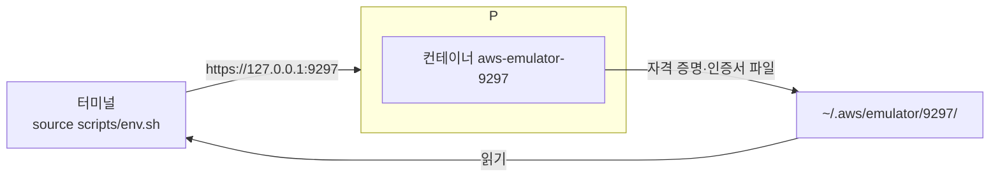

# M00-03. 환경 설치
> 도메인: – (실습 환경) · 예상 시간: 40분 (다운로드 시간 포함) · 실습 등급: 🟢

## 왜 필요한가

이 레슨이 끝나면 내 노트북에서 "AWS처럼 대답하는 서버"가 돌고, 터미널의 `aws` 명령과 Python 코드가 **실제 AWS가 아니라 그 서버로만** 요청을 보내게 된다. 이후 모든 모듈은 이 환경 위에서 진행한다. 첫날 끝내 두자.

## 핵심 개념

설치할 것과 이유:

| 구성 요소 | 역할 | 왜 필요한가 |
|---|---|---|
| Docker CLI + **Colima** | 컨테이너 실행 환경 | macOS에서는 에뮬레이터를 Docker 컨테이너로 돌린다. Colima는 Docker Desktop 대신 쓸 수 있는 가벼운 무료 런타임(리눅스 VM)이다 |
| **aws-emulator 이미지** | 에뮬레이터 본체 | AWS는 **완성된 이미지를 배포하지 않는다.** 공식 RPM 패키지를 설치하는 짧은 Dockerfile([scripts/docker/Dockerfile](../../scripts/docker/Dockerfile))로 **내 컴퓨터에서 직접 빌드**한다 |
| **AWS CLI v2** (2.13 이상) | 터미널에서 AWS API 호출 | `AWS_ENDPOINT_URL` 환경 변수를 2.13부터 지원한다 |
| **uv** + boto3 | Python 실행·패키지 관리 | `uv run python …` 한 줄로 저장소의 Python 예제를 실행한다 |



에뮬레이터는 시작할 때마다 **새 액세스 키와 새 TLS 인증서**를 만들어 `~/.aws/emulator/<포트>/`에 쓴다. `scripts/env.sh`는 CLI·boto3가 그 파일을 쓰도록 환경 변수를 맞추고, 실제 AWS로 나갈 위험이 있으면 멈춘다.

## 직접 해 보기

### 0) 준비물

- macOS(Apple silicon 또는 Intel)와 [Homebrew](https://brew.sh). Linux·WSL도 동작한다(아래 "Linux·WSL" 참고).
- 디스크 여유 5 GB 이상, 메모리 8 GB 이상 권장.
- 저장소를 받아 둔다: `git clone https://github.com/Ring-wdr/aws-newbie-guide.git && cd aws-newbie-guide`

> ⚠️ 이미 실제 AWS 자격 증명(`~/.aws/credentials`)이 있어도 괜찮다. 이 저장소의 스크립트는 `~/.aws/emulator/` 밖의 파일을 읽거나 고치지 않고, `env.sh`가 실제 자격 증명 환경 변수를 지운다.

### 1) 설치 스크립트 실행

```bash
scripts/install.sh
```

처음 실행하면 빠진 프로그램을 `brew install`로 설치하고(Colima, docker, awscli, uv, jq, python3 중 없는 것만. jq·python3는 실습 스크립트가 직접 부른다. jq는 macOS 15부터 기본으로 들어 있고, python3는 Xcode 명령줄 도구가 있으면 이미 있다), Colima VM을 켜고(CPU 2개, 메모리 4 GiB, 디스크 30 GiB — `COLIMA_CPU`·`COLIMA_MEMORY`·`COLIMA_DISK`로 바꿀 수 있다), 에뮬레이터 이미지를 빌드한다. 처음에는 VM 생성과 이미지 빌드에 몇 분 걸린다. 빌드 중 마지막 줄은 이렇게 끝난다.

```
Successfully built c891f5ea0f36
Successfully tagged aws-emulator:latest
```

두 번째부터는 이미 있는 것을 건너뛴다. 다 갖춰진 상태에서의 실제 출력:

```
▶ 1/5 필수 프로그램 확인
aws-cli 2.40.1 · uv 0.13.1 (Homebrew 2026-10-14 aarch64-apple-darwin) · Docker version 29.9.3, build 5457199aa5

▶ 2/5 컨테이너 런타임
Docker 데몬 연결됨 (colima)

▶ 3/5 에뮬레이터 이미지 (aws-emulator)
이미 있습니다. 최신 에뮬레이터로 다시 빌드하려면: scripts/install.sh --rebuild
Version: 1.0.322

▶ 4/5 Python 의존성 (uv sync)
Python 3.15.0 · boto3 1.44.1

▶ 5/5 완료
다음 단계:
  scripts/emulator-up.sh            # 에뮬레이터 시작 (포트 9297)
  source scripts/env.sh             # 현재 셸을 에뮬레이터에 연결
  aws sts get-caller-identity       # Account 가 000000000000 이면 성공
```

방금 본 것: 버전 숫자는 여러분의 환경과 다를 수 있다. 에뮬레이터 이미지는 `aws-emulator` 라는 이름으로 내 Docker에만 존재한다(어디에서 pull 한 것이 아니다).

### 2) 에뮬레이터 시작

```bash
scripts/emulator-up.sh
```

```
에뮬레이터를 시작합니다: aws-emulator-9297 (포트 9297, 메모리 상한 2g, DNS 127.0.0.1)
준비 완료: https://127.0.0.1:9297  (헬스 체크: ok)

다음 명령으로 현재 셸을 이 에뮬레이터에 연결하세요:
  export EMULATOR_PORT=9297
  source scripts/env.sh
```

방금 본 것: 스크립트가 공식 가이드의 `docker run` 명령을 대신 실행했다. 핵심 옵션은 다음과 같다.

| 옵션 | 의미 |
|---|---|
| `-p 127.0.0.1:9297:9297` | **내 컴퓨터에서만** 접속 가능하게 연다 (`-p 9297:9297`로 쓰면 같은 네트워크의 다른 컴퓨터도 접속할 수 있다) |
| `-v ~/.aws/emulator:~/.aws/emulator`, `-e HOME=$HOME` | 에뮬레이터가 만든 키·인증서 파일을 내 홈 디렉터리에서 그대로 읽게 한다 |
| `--memory=2g --memory-swap=2g` | 메모리 상한 2 GiB, 스왑 없음 (공식 가이드와 같음). Lambda를 많이 호출하면 에뮬레이터 메모리가 계속 늘어나므로 넉넉히 둔다(아래 "문제 해결"). 바꾸려면 `EMULATOR_MEMORY=3g scripts/emulator-up.sh` |
| `--telemetry off` | 사용 통계 전송을 끈다 (아래 "텔레메트리") |
| `--pull never` | 로컬에서 빌드한 이미지만 쓴다. 이미지가 없을 때 Docker가 레지스트리(Docker Hub)에서 같은 이름을 찾으러 가지 않는다 |
| `--dns 127.0.0.1` | **기본값.** 컨테이너 안의 이름 해석을 모두 막아, 에뮬레이터가 실제 AWS 형식 이름(예: ElastiCache가 돌려주는 `*.cache.amazonaws.com`)이나 실습 값에 들어간 이름을 해석하러 바깥 DNS에 묻는 일이 없게 한다. 모든 모듈의 실습이 이 설정에서 통과한다. 문제를 가려내려고 Docker 기본 리졸버로 돌려 봐야 할 때만 `EMULATOR_DNS=host scripts/emulator-reset.sh`로 끈다(다시 켜려면 `EMULATOR_DNS` 없이 `scripts/emulator-reset.sh`). 지금 설정은 `scripts/emulator-status.sh`의 DNS 열에 보인다 |

이미 떠 있을 때 다시 실행해도 안전하다("이미 실행 중입니다"를 출력하고 끝난다).

### 3) 셸 연결과 안전 장치

```bash
source scripts/env.sh
aws sts get-caller-identity
```

```
[env.sh] 포트 9297 의 에뮬레이터에 연결됨: https://127.0.0.1:9297 (Account 000000000000, us-east-1)
{
    "UserId": "AIDAH5I7GEMO7ADXNFAZU",
    "Account": "000000000000",
    "Arn": "arn:aws:iam::000000000000:user/emulator"
}
```

방금 본 것: `Account`가 **`000000000000`** 이면 에뮬레이터와 대화하고 있는 것이다. 실제 AWS 계정 ID는 절대 이 값이 될 수 없다. `env.sh`는 이 확인을 스스로 한 번 하고, 실패하면 0이 아닌 값으로 끝나 실습 스크립트를 멈춘다.

`env.sh`가 하는 일:

```bash
unset AWS_ACCESS_KEY_ID AWS_SECRET_ACCESS_KEY AWS_SESSION_TOKEN AWS_PROFILE ...  # 실제 자격 증명 제거
export AWS_ENDPOINT_URL=https://127.0.0.1:9297                    # 모든 서비스를 에뮬레이터로
export AWS_SHARED_CREDENTIALS_FILE=~/.aws/emulator/9297/emulator_credentials
export AWS_CONFIG_FILE=~/.aws/emulator/9297/config
export AWS_CA_BUNDLE=~/.aws/emulator/9297/ca.pem                 # 에뮬레이터의 자체 서명 인증서 신뢰
export AWS_EC2_METADATA_DISABLED=true                            # EC2 메타데이터에서 자격 증명 찾지 않기
export AWS_DISABLE_HOST_PREFIX_INJECTION=true                    # 호스트명 접두사 붙이지 않기 (에뮬레이터 전용)
export AWS_S3_DISABLE_MULTIREGION_ACCESS_POINTS=true             # S3 다중 리전 액세스 포인트 ARN 끄기 (아래 참고)
export BOTO_CONFIG=/dev/null/aws-emulator-disconnected/boto      # ~/.boto 같은 옛 방식 자격 증명 파일 끄기
export AWS_REGION=us-east-1 AWS_DEFAULT_REGION=us-east-1
export AWS_PAGER=""                                              # CLI 출력이 less로 넘어가 멈추지 않게
# → aws sts get-caller-identity 로 Account 000000000000 확인, 아니면 중단
```

**거부하면 셸을 AWS에서 끊는다.** `env.sh`는 맨 먼저 이 셸을 AWS에서 끊어 두고, 계정 확인이 통과한 **뒤에만** 에뮬레이터 설정을 넣는다. 그래서 어떤 이유로 거부하든(포트 오류, 에뮬레이터 꺼짐, 서명 거부 등) 도중에 Ctrl-C로 멈추든, 셸은 끊긴 상태로 남는다. 끊긴 상태에서는 다음과 같다.

- `AWS_CONFIG_FILE`·`AWS_SHARED_CREDENTIALS_FILE`·`BOTO_CONFIG`·`AWS_CA_BUNDLE`이 `/dev/null/` 아래의 **만들 수 없는** 경로를 가리킨다. 설정·자격 증명이 항상 "없음"이 되고, `aws configure`도 거기에 키를 쓰지 못한다. 끊는 첫 단계가 이 값들을 한 번에 바꾸므로, 그 뒤 어디서 멈춰도 이 상태다.
- 실제 자격 증명·프로필 변수(`AWS_PROFILE`, `AWS_ACCESS_KEY_ID` 등)가 지워지고, 옛 방식 자격 증명(`~/.boto`, `AWS_CREDENTIAL_FILE`)이 꺼진다.
- `AWS_ENDPOINT_URL`은 닫힌 포트 `https://127.0.0.1:9`를 가리킨다. S3 다중 리전 액세스 포인트(MRAP) ARN은 꺼진다.
- 연결돼 있던 두 번째 사이트(`DR_AWS_*`)도 지운다.

이렇게 해서 **보장하는 것**은 두 가지다.

- 서명이 필요한 요청은 자격 증명이 없어 보내기 전에 실패한다.
- 나머지 요청은 닫힌 로컬 포트로 간다.

**남은 예외**도 있다. SDK가 엔드포인트 설정을 무시하고 AWS 호스트명을 직접 만드는 기능이 그렇다. 예를 들어 Kinesis `--stream-id`는 `*.control-kinesis.<리전>.amazonaws.com`으로 간다. 이런 기능에 서명 없는 요청(`--no-sign-request`)을 보내면, 실제 AWS 호스트에 DNS를 조회하고 연결을 **시도한다**. 다만 믿는 인증서가 없어 TLS 단계에서 끊기므로 HTTP 요청은 전달되지 않는다. `--no-verify-ssl`을 붙이면 이 마지막 단계도 꺼진다.

`env.sh`는 `~/.aws`의 `config`·`credentials`를 읽지도 고치지도 않는다. 다만 `aws` CLI 자신은 실행할 때마다 `~/.aws/cli/cache/`에 캐시를 쓴다. 에뮬레이터를 켜지 않은 채 회사 프로필이 설정된 셸에서 source 한 경우:

```bash
export AWS_PROFILE=my-company      # (원래 셸에 있던 실제 프로필이라고 하자)
source scripts/env.sh
aws sts get-caller-identity
aws s3 ls --no-sign-request
```

```
[env.sh] 포트 9298 의 에뮬레이터 파일(~/.aws/emulator/9298)이 없습니다. 에뮬레이터가 꺼져 있습니다.
         먼저 실행하세요: scripts/emulator-up.sh 9298
[env.sh] 이 셸은 AWS에서 끊겼습니다: 실제 자격 증명·프로필 변수와 ~/.boto 같은 옛 방식 자격 증명을 끄고, 엔드포인트를 닫힌 로컬 포트(127.0.0.1:9)로, 인증서 묶음을 빈 경로로 돌렸습니다 — 서명이 필요한 aws 요청은 보내기 전에 실패하고, 실제 AWS에는 요청이 전달되지 않습니다(예외·자세히: M00 레슨 3). 에뮬레이터는 원인을 고친 뒤 다시 source scripts/env.sh, 실제 AWS는 새 셸을 여세요.

aws: [ERROR]: An error occurred (NoCredentials): Unable to locate credentials. You can configure credentials by running "aws login".

aws: [ERROR]: Could not connect to the endpoint URL: "https://127.0.0.1:9/"
```

방금 본 것: 서명이 필요한 요청은 자격 증명이 없어 보내기 전에 실패했고, 서명이 필요 없는 요청도 닫힌 로컬 포트로 가서 실패했다(이 출력은 `EMULATOR_PORT=9298`로 꺼진 에뮬레이터를 가리켜 얻었다). 에뮬레이터를 켜고 다시 `source scripts/env.sh` 하면 정상으로 연결된다. 실제 AWS를 다시 쓰려면 새 터미널을 연다. `dr-env.sh`도 거부하면 `DR_AWS_*`를 지워 `dr_aws`와 `emulator_site("DR_")`가 거부되게 한다. 주 사이트가 끊긴 셸(위처럼 `env.sh`가 거부한 셸)에서는 `dr-env.sh` 자체가 거부한다.

**연결된 셸에서도 남는 예외.** 위와 같은 기능(MRAP ARN, Kinesis `--stream-id`)은 연결된 셸에서도 에뮬레이터 엔드포인트를 무시하고 실제 AWS 호스트명을 만든다.

- MRAP는 `env.sh`가 끄므로 로컬에서 거부된다.
- Kinesis `--stream-id`는 실제 AWS 호스트에 연결을 시도한다. 하지만 `AWS_CA_BUNDLE`이 에뮬레이터 인증서만 믿기 때문에 TLS 단계에서 끊기고, 에뮬레이터 키로 서명한 요청은 전달되지 않는다.
- 실습에는 이런 형식의 호출이 없다. 쓰지 않는다.

엔드포인트는 반드시 **`127.0.0.1`** 이다. `localhost`를 쓰면 JavaScript·Java·Go SDK는 S3 버킷 이름을 호스트명에 붙여(`<버킷>.localhost`) 요청하는데, 에뮬레이터는 그런 요청을 받지 않는다.

**어느 포트에 연결되나?** `EMULATOR_PORT`가 있으면 그 포트, 없으면 **터미널에서 직접 실행할 때만** 기본값 9297이다. 여러분이 터미널에 `source scripts/env.sh`나 `bash curriculum/m00-orientation/labs/lab01-emulator-health.sh`를 치는 경우는 모두 9297로 동작한다. 반대로 AI 에이전트·CI처럼 표준 입력이 터미널이 아닌 곳에서는 `EMULATOR_PORT`가 없으면 `env.sh`·lab·`verify.sh`·`emulator-reset.sh`·`emulator-down.sh`가 모두 거부한다. 여러 작업이 에뮬레이터를 나눠 쓸 때 남의 9297을 지우는 사고를 막기 위해서다.

### 4) 확인 실습

```bash
curriculum/m00-orientation/labs/lab01-emulator-health.sh
```

[lab01](./labs/lab01-emulator-health.sh)은 헬스 체크, 에뮬레이터가 만든 파일, 호출자 신원, CLI 설정을 차례로 보여 주고 `LAB01 OK`로 끝난다.

```
== 1. 헬스 체크 (/__admin/health)
ok
== 2. 에뮬레이터가 만든 파일 (~/.aws/emulator/9297/)
ca.pem
config
emulator_credentials
truststore.p12
...
== 4. CLI가 읽은 설정
NAME       : VALUE                    : TYPE             : LOCATION
profile    : <not set>                : None             : None
access_key : ****************AEA2     : shared-credentials-file : 
secret_key : ****************4022     : shared-credentials-file : 
region     : us-east-1                : env              : ['AWS_REGION', 'AWS_DEFAULT_REGION']
LAB01 OK
```

방금 본 것: `access_key`의 TYPE이 `shared-credentials-file`이다. 키가 환경 변수가 아니라 에뮬레이터가 만든 파일에서 왔다는 뜻이다. 키 끝자리는 에뮬레이터를 켤 때마다 바뀐다.

### 5) 상태 보기, 초기화, 끄기

```bash
scripts/emulator-status.sh     # 떠 있는 에뮬레이터, DNS 설정, 메모리 사용량
scripts/emulator-reset.sh      # 재시작 = 깨끗한 상태 (모든 리소스 삭제)
scripts/emulator-down.sh       # 끄기  (--all: 이 저장소로 띄운 모든 에뮬레이터 — 다른 작업 것까지 끈다)
```

```
  PROFILE    STATUS     ARCH       CPUS    MEMORY    DISK     RUNTIME    ADDRESS
  default    Running    aarch64    4       8GiB      60GiB    docker     

CONTAINER            PORT   STATE      HEALTH   DNS        MEMORY(USED / LIMIT)
aws-emulator-9297    9297   running    ok       127.0.0.1  173MiB / 2GiB
```

방금 본 것: 첫 표는 Colima VM, 두 번째 표는 에뮬레이터 컨테이너다(이 출력은 CPU 4개·8 GiB로 켠 VM에서 얻었다). DNS 열의 `127.0.0.1`은 컨테이너 안 이름 해석이 막힌 기본 상태이고, `EMULATOR_DNS=host`로 띄운 컨테이너는 `host`로 보인다. 공부를 마치면 `scripts/emulator-down.sh`로 끄고, 노트북 자원을 돌려받으려면 `colima stop`.

### 6) 여러 에뮬레이터 동시에 (M12에서 사용)

포트만 다르게 주면 서로 완전히 분리된 에뮬레이터가 뜬다.

```bash
scripts/emulator-up.sh 9298
EMULATOR_PORT=9298 source scripts/env.sh    # 이 셸은 이제 9298을 본다
```

```bash
# 9297에 버킷을 만들고 9298에서 목록을 보면
aws s3 mb s3://only-on-9297          # (9297에 연결된 셸)
aws s3 ls | wc -l                    # (9298에 연결된 셸)
```

```
       0
```

두 번째 에뮬레이터를 한 셸에서 함께 쓰려면(M12 다중 리전 DR) `scripts/dr-env.sh`를 쓴다. `env.sh`를 source 한 셸에서 실행하며, 포트는 `DR_EMULATOR_PORT`다. 없으면 **터미널에서 직접 실행할 때만** `EMULATOR_PORT + 1`을 쓰고, 비대화형(AI 에이전트·CI)에서는 거부한다 — 에이전트 포트는 연달아 배정되므로 +1이 다른 에이전트의 에뮬레이터일 수 있기 때문이다. 실패하면 이전에 만든 `DR_AWS_*` 변수도 지운다. 기본 변수는 그대로 두고 `DR_AWS_ENDPOINT_URL` 등을 따로 만들며, 같은 안전 장치(다른 포트인지, 계정 000000000000인지)를 거친다. CLI는 `dr_aws <명령>`, boto3는 레슨 5의 `emulator_site("DR_")`.

```bash
scripts/emulator-up.sh 9298
source scripts/env.sh && source scripts/dr-env.sh
aws s3 ls        # 9297
dr_aws s3 ls     # 9298
```

### 텔레메트리

aws-emulator는 기본적으로 사용 통계(오퍼레이션별 호출 수, 성공/오류 범주 등. 요청 내용·자격 증명·리소스 이름은 보내지 않는다고 문서화됨)를 AWS로 보낸다. 이 저장소의 스크립트는 **기본으로 끈다**(`--telemetry off`). 켜서 개선에 기여하고 싶다면:

```bash
scripts/emulator-down.sh && EMULATOR_TELEMETRY=on scripts/emulator-up.sh
```

시작 로그의 첫 줄에서 상태를 확인할 수 있다(`docker logs aws-emulator-9297 2>&1 | head -2`).

### Linux·WSL

`scripts/install.sh`는 Linux에서 docker·aws·uv·jq·python3 중 없는 것이 있으면 설치 안내를 출력하고 멈춘다(배포판마다 방법이 달라 직접 설치하지 않는다). 설치 후 다시 실행하면 이미지 빌드부터 진행한다. Ubuntu 24.04(ARM, 일반 사용자)에서 확인한 순서다. AWS CLI v2만은 공식 설치 프로그램 대신 같은 버전의 소스로 설치해 확인했다.

<!-- external-host-ok: 사람이 실행하는 설치 명령(apt 패키지 이름 docker.io, uv 설치 스크립트) — 실습 중에는 호출하지 않는다 -->
```bash
sudo apt update
sudo apt install git curl jq python3 docker.io   # docker 는 공식 안내(docs.docker.com)의 docker-ce 도 된다
sudo usermod -aG docker $USER                     # 그 뒤 로그아웃했다가 다시 로그인
curl -LsSf https://astral.sh/uv/install.sh | sh   # uv. 안내대로 새 셸을 열거나 source $HOME/.local/bin/env
# AWS CLI v2: install.sh 가 출력하는 AWS 공식 설치 안내를 따른다 (Ubuntu 24.04 apt 에는 v2 패키지가 없다)
scripts/install.sh
```

Linux에서는 `emulator-up.sh`가 자동으로 `--user $(id -u):$(id -g)`를 붙여 `~/.aws/emulator/`의 파일이 내 소유가 되게 한다. Intel/AMD 머신은 `x86_64` RPM으로, ARM 머신은 `aarch64` RPM으로 빌드된다(아키텍처 자동 감지). VM 없이 도는 Linux에서는 위 "노트북 잠자기 뒤 시계" 문제가 호스트 시계(NTP)의 문제가 된다. WSL2는 그 자체가 VM이라 잠자기 뒤 시계가 어긋날 수 있지만, WSL은 이 저장소에서 시험하지 못했다.

## 문제 해결

실제로 환경을 만들며 겪은 문제들이다.

| 증상 | 원인 | 해결 |
|---|---|---|
| `failed to connect to the docker API at unix:///var/run/docker.sock ... no such file or directory` | Colima가 꺼져 있거나 docker 컨텍스트가 Colima가 아님 | `colima start`, 그래도 안 되면 `docker context use colima`. 이 저장소 스크립트는 "Colima가 꺼져 있는 것 같습니다"라고 알려 준다 |
| `install.sh`가 `Homebrew(/opt/homebrew/bin/brew)는 설치돼 있지만 PATH 에 없습니다` | Homebrew를 막 설치하고, 설치 프로그램이 마지막에 안내하는 `shellenv` 단계를 건너뛰었다 | 안내된 `eval "$(/opt/homebrew/bin/brew shellenv)"`를 실행하거나 새 터미널을 연 뒤 다시 `scripts/install.sh` |
| `install.sh`가 `Docker Desktop 이 설치돼 있지만 실행 중이 아닙니다` | Docker Desktop이 있는 맥에서는 Colima를 따로 설치하지 않는다(런타임이 둘이면 docker 컨텍스트가 엇갈린다) | Docker Desktop을 실행하고 다시 `scripts/install.sh`. Colima를 쓰고 싶으면 `brew install colima` 후 다시 실행 |
| 빌드 중 `DEPRECATED: The legacy builder is deprecated ... Install the buildx component` | Homebrew의 docker CLI에 buildx 플러그인이 없다 | 경고일 뿐 빌드는 성공한다. 없애려면 `brew install docker-buildx` 후 안내대로 설정 |
| `docker: unknown command: docker buildx` | 위와 같음 | 이 저장소는 buildx 없이 빌드하도록 되어 있다. 무시해도 된다 |
| `Bind for 127.0.0.1:9297 failed: port is already allocated` | 그 포트를 다른 컨테이너·프로그램이 쓰는 중 | `scripts/emulator-status.sh`, `lsof -i :9297`로 확인. 다른 포트를 쓰거나 기존 것을 내린다 |
| `[env.sh] 포트 9297 의 에뮬레이터 파일(...)이 없습니다` | 에뮬레이터가 꺼져 있다. 정상 종료(`scripts/emulator-down.sh`, `docker stop`, `colima restart`)되면 에뮬레이터가 자기 키·인증서 파일을 지우므로 이 메시지가 나온다 | `scripts/emulator-up.sh` |
| `[env.sh] 안전 장치: 요청이 에뮬레이터로 간다는 것을 확인하지 못했습니다 (Account='응답 없음')` | 파일은 남아 있는데 에뮬레이터 컨테이너가 없다(`docker rm -f`로 지웠거나, Colima VM이 비정상 종료돼 docker에 접속할 수 없는 등). 컨테이너가 강제 종료돼 남아 있으면 대신 "컨테이너가 종료돼 있습니다"가 나온다 | `scripts/emulator-reset.sh` (Colima가 꺼져 있으면 먼저 `colima start`) |
| `curl: (60) SSL certificate problem: self signed certificate` | 에뮬레이터는 자체 서명 인증서를 쓴다 | `curl --cacert "$AWS_CA_BUNDLE" ...` 처럼 인증서를 지정한다 |
| 에뮬레이터를 재시작한 뒤, 계속 떠 있던 Python 프로세스(예: Jupyter, 대화형 셸)에서 `SSLError ... CERTIFICATE_VERIFY_FAILED` 또는 `AccessDenied ... Sign the request with the emulator credentials` | 재시작하면 인증서와 키가 새로 생성된다. 이미 떠 있는 프로세스는 예전 인증서·키를 메모리에 들고 있다 | 그 프로세스를 다시 시작한다. 터미널은 다시 열 필요 없다(환경 변수는 파일 경로라 그대로 맞다) |
| `EMULATOR_PORT 가 설정되지 않았습니다. 비대화형 실행에서는 ...` | CI·AI 에이전트·`nohup`·`< /dev/null`처럼 표준 입력이 터미널이 아닌 곳에서 env.sh·lab·verify·reset·down을 포트 없이 실행 | `export EMULATOR_PORT=<포트>`. 다른 사람이 쓰는 9297을 실수로 건드리지 않게 하는 안전 장치다 |
| `[emulator_guard] AWS_ENDPOINT_URL 이 로컬 에뮬레이터(...)가 아닙니다` | `source scripts/env.sh` 없이 boto3 예제를 실행 | env.sh를 source 한 셸에서 실행한다 ([레슨 5](./05-cli-and-boto3-survival.md)) |
| 노트북을 덮었다(잠자기) 연 뒤 모든 요청이 `SignatureDoesNotMatch`(STS·boto3) 또는 `RequestTimeTooSkewed`(S3·DynamoDB 등), `env.sh`가 `[clock-check] 시계 어긋남 ...`을 출력 (env.sh 는 서명 거부 오류이고 시계 차이가 14분 이상일 때만 이렇게 진단한다. 그보다 작으면 측정값만 참고로 보여 준다) | 맥의 시계는 맞는데 Colima VM(=에뮬레이터 컨테이너)의 시계가 뒤처졌다. AWS 서명(SigV4)은 15분 넘게 어긋나면 거부된다. Colima 0.10(Lima 2.x)에서는 VM 안의 **게스트 에이전트가 맥 시각과 비교해 몇 초 안에 맞춘다** — 이 저장소를 만든 맥의 VM 기록에 잠자기 뒤 3~15분 어긋남을 스스로 맞춘 로그(`SyncTime: ... drift was -15m5s`)가 남아 있다. 그래서 대개 잠시 기다리면 풀린다 | 몇 초 기다려 다시 `source scripts/env.sh`. 그래도 그대로면 VM을 끄지 않고 바로 맞춘다: `colima ssh -- sudo systemctl restart systemd-timesyncd` (즉시 NTP 재동기화, 인터넷 필요) 또는 오프라인이면 `colima ssh -- sudo date -u -s "@$(date -u +%s)"` (맥 시각을 VM에 설정). 컨테이너는 VM 커널 시계를 그대로 쓰므로 **에뮬레이터를 재시작할 필요 없고 만든 리소스도 그대로다.** 최후 수단은 `colima restart`(에뮬레이터가 꺼지고 상태가 사라진다. 그 뒤 `scripts/emulator-up.sh`). 확인: `bash scripts/clock-check.sh` (아무것도 출력하지 않고 끝나면 정상. 에뮬레이터가 꺼져 있으면 `측정하지 못했습니다`를 출력하고 종료 코드 2). 맥의 언어가 한국어면 `date -u`가 시각 대신 `#오후`처럼 깨져 나오므로 직접 비교하려면 `LC_ALL=C date -u; colima ssh -- date -u`. ※ 세 방법 모두 VM 시계를 일부러 ±20분 바꿔(게스트 에이전트·timesyncd를 잠시 멈춘 상태) 확인했다. 실제 잠자기로 생긴 어긋남에 직접 써 본 것은 아니다 |
| 리소스가 "준비됨"이 된 **직후** 다음 호출이 가끔 실패하고, 다시 실행하면 통과한다 — 예: `aws dynamodb wait table-exists`가 끝났는데 바로 다음 `PutItem`·`BatchWriteItem`이 `ResourceNotFoundException`, Kinesis 스트림이 `ACTIVE`였다가 `CREATING`으로 돌아가고 `PutRecord`가 `ResourceNotFoundException`. `emulator-up.sh`·`emulator-status.sh`가 `[clock-check] VM 시계 불안정`을, M00 `verify.sh` 요약이 `이번 실행 동안 … VM 시계가 N번 옮겨졌습니다`를 출력 | Colima VM의 시계를 맞추는 것이 둘이다. Colima 게스트 에이전트는 10초마다 **맥의 시각**으로, VM 안의 `systemd-timesyncd`는 인터넷 **NTP 시각**으로 맞춘다. 게스트 에이전트는 차이가 0.1초를 넘으면 맞추므로, 맥 시계가 NTP와 0.1초 넘게 다르면 둘이 10초마다 VM 시계를 번갈아 옮긴다. 0.1\~0.14초 정도의 작은 보정은 흔하고(이 맥의 약 31시간치 VM 저널에 743번, 그중 724번이 어느 새벽 5시간 남짓에 몰려 있었다) 영향이 없었다. 문제는 한 번에 0.5초 이상 옮겨질 때다. 이 저장소를 만든 맥에서는 macOS 시간 서비스가 새벽에 맥 시계를 2.07초 뒤로 옮기고 45분 뒤에야 되돌렸다. 그동안 VM 시계는 10초마다 2초 뒤로 갔다가 0.2\~0.3초 만에 돌아왔다(270번). 에뮬레이터는 Kinesis 스트림과 DynamoDB 테이블이 준비됐는지를 VM 시계로 판단한다. 그래서 시계가 뒤로 간 그 순간에는 막 준비된 리소스를 "아직 준비 안 됨"으로 본다. VM 시계를 일부러 되돌려 보니, DynamoDB는 테이블이 `ACTIVE`가 된 직후 1초 이상 되돌리면 `PutItem`·`BatchWriteItem`이 매번 `ResourceNotFoundException`이었고(0.5초 이하는 영향 없음), Kinesis는 2초 되돌리면 스트림이 `CREATING`으로 돌아갔다. RDS·EC2·ElastiCache·Route 53·CloudFormation의 상태는 2초·5초를 되돌려도 바뀌지 않았다. 이 정도 차이는 서명 허용 범위(15분)보다 훨씬 작아서 `clock-check.sh` 기본 모드와 `env.sh`에는 보이지 않는다. 맥이 잠자기와 상관없이 깨어 있던 시간에 생겼다. 맥 시계가 왜 2초 틀린 시각을 받아들였는지는 알아내지 못했다 | 확인: `bash scripts/clock-check.sh --stability`. 최근 3분 동안 VM 저널에 남은 게스트 에이전트의 보정 기록 중 0.5초 이상인 것을 센다(작은 보정은 세지 않는다). 아무것도 출력하지 않으면 안정이다. 불안정하면 안내와 함께 종료 코드 4로 끝나고, Colima가 아니거나 `colima ssh`가 3초 안에 응답하지 않으면 확인하지 못해 종료 코드 2로 끝난다(`emulator-up.sh`·`emulator-status.sh`는 이때 아무 말 없이 넘어간다). 불안정하면 VM이 맥 시계만 따르게 한다: `colima ssh -- sudo systemctl stop systemd-timesyncd`. VM·에뮬레이터와 만든 리소스는 그대로이고, 다음 VM 재시작(`colima restart`·`colima stop`/`start`) 때 원래대로 돌아간다. 지금 되돌리려면 `colima ssh -- sudo systemctl start systemd-timesyncd`. 실패한 lab·`verify.sh`는 다시 실행한다. ※ 같은 상황을 VM 안에서 만들어 시험했다(timesyncd가 맥보다 2초 앞선 가짜 NTP 시각을 따르게 함). 그동안 "만들고 바로 쓰기" 42번 중 3번이 위와 같이 실패했다. timesyncd를 멈추자 보정이 한 번 더 있고 끝났고, 그 뒤 23번은 모두 통과했다. timesyncd를 멈춘 동안에도 게스트 에이전트가 VM 시계를 맥 시각으로 맞춘다. 맥 자체의 시계를 바로잡는 방법은 시험하지 않았다 |
| `aws cloudformation wait stack-create-complete` 같은 긴 간격의 waiter가 오래 걸리거나 실제와 다르게 끝난다 | waiter는 AWS 기준 간격(예: 30초)으로 폴링하고, 에뮬레이터의 상태 전이 타이밍은 실제와 다르다 | 짧은 간격으로 직접 상태를 폴링한다. 자세한 내용은 M10(CloudFormation)에서 |
| 잘 되던 명령이 갑자기 `Could not connect to the endpoint URL: "https://127.0.0.1:9297/"`, `env.sh`가 `메모리 상한을 넘어 강제 종료됐습니다 (... 137 ...)`, `emulator-status.sh`에 `OOM(137)` (도커가 `OOMKilled=true`로 기록한 경우만 OOM으로 표시한다. `docker kill`처럼 다른 이유로 137이면 "종료됨"으로 표시) | 에뮬레이터 컨테이너가 메모리 상한을 넘어 커널에 의해 종료됐다(OOM, 종료 코드 137). 에뮬레이터 1.0.322 에서는 **동기 Lambda 호출(`invoke`) 한 번마다 약 7 MiB가 회수되지 않고 쌓인다** — 측정: 빈 상태 175 MiB → 20회 327 MiB → 100회 883 MiB, 1 GiB 상한에서는 약 120회 만에 종료. M06·M07 실습을 리셋 없이 여러 번 돌리면 생긴다 | 리소스는 이미 사라졌다. `scripts/emulator-reset.sh`로 다시 띄운다(기본 상한 2 GiB에서는 약 270회까지 버틴다). Lambda 실습을 반복할 때는 중간중간 리셋하고, 자주 반복되면 `EMULATOR_MEMORY=3g scripts/emulator-reset.sh` |
| 이미 실제 AWS 프로필(`AWS_PROFILE`)을 쓰던 셸에서 `source scripts/env.sh` 뒤 실제 AWS를 다시 쓰고 싶다, 또는 `[env.sh] 이 셸은 AWS에서 끊겼습니다` 뒤 모든 `aws` 명령이 `NoCredentials`·`127.0.0.1:9` 연결 실패 | `env.sh`가 그 변수들을 지웠다(성공해도, 거부해도) | 새 터미널을 연다. 에뮬레이터용 셸과 실제 AWS용 셸을 섞지 않는 것이 가장 안전하다 |

## 실제 AWS에서는

- 실제 AWS에서는 이 레슨의 대부분이 필요 없다. `aws configure` 또는 IAM Identity Center(`aws configure sso`)로 자격 증명을 설정하면 CLI가 리전별 공식 엔드포인트(예: `https://sts.us-east-1.amazonaws.com`)로 요청한다.
- `AWS_DISABLE_HOST_PREFIX_INJECTION=true`는 **에뮬레이터 전용**이다. 실제 AWS에서 켜 두면 Step Functions `StartSyncExecution`처럼 호스트 접두사가 필요한 API가 실패한다. 에뮬레이터용 셸과 실제 AWS용 셸을 분리하는 이유 중 하나다.

## 시험 포인트

- 이 레슨은 시험 범위가 아니다. 다만 "CLI/SDK는 자격 증명을 **환경 변수 → 공유 자격 증명 파일 → … → 인스턴스 메타데이터** 순서로 찾는다"는 사실은 EC2 역할(M01, M03) 문제를 풀 때 쓰인다. 환경 변수가 파일보다 우선하기 때문에 `env.sh`가 그것들을 먼저 지운다.

## 스스로 확인

1. 새 터미널을 열고 `source scripts/env.sh` 없이 `aws s3 ls`를 실행하면 요청은 어디로 가는가? 왜 위험한가?
2. `env.sh`가 `AWS_ACCESS_KEY_ID`를 지우지 않으면 어떤 일이 생기는가?
3. 공식 가이드는 `-p 127.0.0.1:9297:9297`을 쓰라고 한다. `-p 9297:9297`과 무엇이 다른가?

<details><summary>답</summary>

1. `AWS_ENDPOINT_URL`이 없으므로 실제 AWS로 간다. `~/.aws`에 실제 자격 증명이 있으면 진짜 계정에 요청이 나가고, 리소스를 만들면 요금이 나올 수 있다. 그래서 실습 스크립트는 항상 `env.sh`를 먼저 source 하고, `env.sh`는 계정 ID를 확인한다.
2. 환경 변수 자격 증명이 파일보다 우선하므로 CLI가 (실제) 키로 서명한다. 에뮬레이터는 자신이 만든 키가 아닌 서명을 거부하므로 요청이 실패한다. 더 큰 문제는 엔드포인트 설정이 빠진 셸에서 그 키가 실제 AWS로 쓰인다는 점이다.
3. `127.0.0.1:`을 붙이면 내 컴퓨터(루프백)에서만 접속할 수 있다. 빼면 모든 네트워크 인터페이스에 열려 같은 와이파이의 다른 컴퓨터도 에뮬레이터를 호출할 수 있다.

</details>
