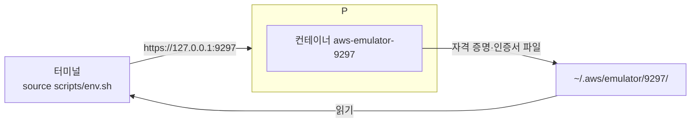

# M00-03. 환경 설치
> 도메인: – (실습 환경) · 예상 시간: 40분 (다운로드 시간 포함) · 실습 등급: 🟢

## 왜 필요한가

이 레슨이 끝나면 내 노트북에서 "AWS처럼 대답하는 서버"가 돌고, 터미널의 `aws` 명령과 Python 코드가 **실제 AWS가 아니라 그 서버로만** 요청을 보내게 된다. 이후 모든 모듈은 이 환경 위에서 진행한다. 첫날 끝내 두자.

## 핵심 개념

설치할 것과 이유:

| 구성 요소 | 역할 | 왜 필요한가 |
|---|---|---|
| Docker CLI + **Colima** | 컨테이너 실행 환경 | macOS에서는 에뮬레이터를 Docker 컨테이너로 돌린다. Colima는 Docker Desktop 대신 쓸 수 있는 가벼운 무료 런타임(리눅스 VM)이다 |
| **aws-emulator 이미지** | 에뮬레이터 본체 | AWS는 **완성된 이미지를 배포하지 않는다.** 공식 RPM 패키지를 설치하는 짧은 Dockerfile([scripts/docker/Dockerfile](../../scripts/docker/Dockerfile))로 **내 컴퓨터에서 직접 빌드**한다 |
| **AWS CLI v2** (2.13 이상) | 터미널에서 AWS API 호출 | `AWS_ENDPOINT_URL` 환경 변수를 2.13부터 지원한다 |
| **uv** + boto3 | Python 실행·패키지 관리 | `uv run python …` 한 줄로 저장소의 Python 예제를 실행한다 |



에뮬레이터는 시작할 때마다 **새 액세스 키와 새 TLS 인증서**를 만들어 `~/.aws/emulator/<포트>/`에 쓴다. `scripts/env.sh`는 CLI·boto3가 그 파일을 쓰도록 환경 변수를 맞추고, 실제 AWS로 나갈 위험이 있으면 멈춘다.

## 직접 해 보기

### 0) 준비물

- macOS(Apple silicon 또는 Intel)와 [Homebrew](https://brew.sh). Linux·WSL도 동작한다(아래 "Linux·WSL" 참고).
- 디스크 여유 5 GB 이상, 메모리 8 GB 이상 권장.
- 저장소를 받아 둔다: `git clone https://github.com/Ring-wdr/aws-newbie-guide.git && cd aws-newbie-guide`

> ⚠️ 이미 실제 AWS 자격 증명(`~/.aws/credentials`)이 있어도 괜찮다. 이 저장소의 스크립트는 `~/.aws/emulator/` 밖의 파일을 읽거나 고치지 않고, `env.sh`가 실제 자격 증명 환경 변수를 지운다.

### 1) 설치 스크립트 실행

```bash
scripts/install.sh
```

처음 실행하면 빠진 프로그램을 `brew install`로 설치하고(Colima, docker, awscli, uv 중 없는 것만), Colima VM을 켜고(CPU 2개, 메모리 4 GiB, 디스크 30 GiB — `COLIMA_CPU`·`COLIMA_MEMORY`·`COLIMA_DISK`로 바꿀 수 있다), 에뮬레이터 이미지를 빌드한다. 처음에는 VM 생성과 이미지 빌드에 몇 분 걸린다. 빌드 중 마지막 줄은 이렇게 끝난다.

```
Successfully built c891f5ea0f36
Successfully tagged aws-emulator:latest
```

두 번째부터는 이미 있는 것을 건너뛴다. 다 갖춰진 상태에서의 실제 출력:

```
▶ 1/5 필수 프로그램 확인
aws-cli 2.40.1 · uv 0.13.1 (Homebrew 2026-10-14 aarch64-apple-darwin) · Docker version 29.9.3, build 5457199aa5

▶ 2/5 컨테이너 런타임
Docker 데몬 연결됨 (colima)

▶ 3/5 에뮬레이터 이미지 (aws-emulator)
이미 있습니다. 최신 에뮬레이터로 다시 빌드하려면: scripts/install.sh --rebuild
Version: 1.0.322

▶ 4/5 Python 의존성 (uv sync)
Python 3.15.0 · boto3 1.44.1

▶ 5/5 완료
다음 단계:
  scripts/emulator-up.sh            # 에뮬레이터 시작 (포트 9297)
  source scripts/env.sh             # 현재 셸을 에뮬레이터에 연결
  aws sts get-caller-identity       # Account 가 000000000000 이면 성공
```

방금 본 것: 버전 숫자는 여러분의 환경과 다를 수 있다. 에뮬레이터 이미지는 `aws-emulator` 라는 이름으로 내 Docker에만 존재한다(어디에서 pull 한 것이 아니다).

### 2) 에뮬레이터 시작

```bash
scripts/emulator-up.sh
```

```
에뮬레이터를 시작합니다: aws-emulator-9297 (포트 9297, 메모리 상한 1g)
준비 완료: https://127.0.0.1:9297  (헬스 체크: ok)

다음 명령으로 현재 셸을 이 에뮬레이터에 연결하세요:
  export EMULATOR_PORT=9297
  source scripts/env.sh
```

방금 본 것: 스크립트가 공식 가이드의 `docker run` 명령을 대신 실행했다. 핵심 옵션은 다음과 같다.

| 옵션 | 의미 |
|---|---|
| `-p 127.0.0.1:9297:9297` | **내 컴퓨터에서만** 접속 가능하게 연다 (`-p 9297:9297`로 쓰면 같은 네트워크의 다른 컴퓨터도 접속할 수 있다) |
| `-v ~/.aws/emulator:~/.aws/emulator`, `-e HOME=$HOME` | 에뮬레이터가 만든 키·인증서 파일을 내 홈 디렉터리에서 그대로 읽게 한다 |
| `--memory=1g --memory-swap=1g` | 메모리 상한 (공식 가이드는 2g. 이 커리큘럼 실습에는 1g로 충분함을 측정했다 — [FIDELITY.md](../../docs/FIDELITY.md)) |
| `--telemetry off` | 사용 통계 전송을 끈다 (아래 "텔레메트리") |

이미 떠 있을 때 다시 실행해도 안전하다("이미 실행 중입니다"를 출력하고 끝난다).

### 3) 셸 연결과 안전 장치

```bash
source scripts/env.sh
aws sts get-caller-identity
```

```
[env.sh] 포트 9297 의 에뮬레이터에 연결됨: https://127.0.0.1:9297 (Account 000000000000, us-east-1)
{
    "UserId": "AIDAH5I7GEMO7ADXNFAZU",
    "Account": "000000000000",
    "Arn": "arn:aws:iam::000000000000:user/emulator"
}
```

방금 본 것: `Account`가 **`000000000000`** 이면 에뮬레이터와 대화하고 있는 것이다. 실제 AWS 계정 ID는 절대 이 값이 될 수 없다. `env.sh`는 이 확인을 스스로 한 번 하고, 실패하면 0이 아닌 값으로 끝나 실습 스크립트를 멈춘다.

`env.sh`가 하는 일:

```bash
unset AWS_ACCESS_KEY_ID AWS_SECRET_ACCESS_KEY AWS_SESSION_TOKEN AWS_PROFILE ...  # 실제 자격 증명 제거
export AWS_ENDPOINT_URL=https://127.0.0.1:9297                    # 모든 서비스를 에뮬레이터로
export AWS_SHARED_CREDENTIALS_FILE=~/.aws/emulator/9297/emulator_credentials
export AWS_CONFIG_FILE=~/.aws/emulator/9297/config
export AWS_CA_BUNDLE=~/.aws/emulator/9297/ca.pem                 # 에뮬레이터의 자체 서명 인증서 신뢰
export AWS_EC2_METADATA_DISABLED=true                            # EC2 메타데이터에서 자격 증명 찾지 않기
export AWS_DISABLE_HOST_PREFIX_INJECTION=true                    # 호스트명 접두사 붙이지 않기 (에뮬레이터 전용)
export AWS_REGION=us-east-1 AWS_DEFAULT_REGION=us-east-1
export AWS_PAGER=""                                              # CLI 출력이 less로 넘어가 멈추지 않게
# → aws sts get-caller-identity 로 Account 000000000000 확인, 아니면 중단
```

엔드포인트는 반드시 **`127.0.0.1`** 이다. `localhost`를 쓰면 JavaScript·Java·Go SDK는 S3 버킷 이름을 호스트명에 붙여(`<버킷>.localhost`) 요청하는데, 에뮬레이터는 그런 요청을 받지 않는다.

### 4) 확인 실습

```bash
curriculum/m00-orientation/labs/lab01-emulator-health.sh
```

[lab01](./labs/lab01-emulator-health.sh)은 헬스 체크, 에뮬레이터가 만든 파일, 호출자 신원, CLI 설정을 차례로 보여 주고 `LAB01 OK`로 끝난다.

```
== 1. 헬스 체크 (/__admin/health)
ok
== 2. 에뮬레이터가 만든 파일 (~/.aws/emulator/9297/)
ca.pem
config
emulator_credentials
truststore.p12
...
== 4. CLI가 읽은 설정
NAME       : VALUE                    : TYPE             : LOCATION
profile    : <not set>                : None             : None
access_key : ****************AEA2     : shared-credentials-file : 
secret_key : ****************4022     : shared-credentials-file : 
region     : us-east-1                : env              : ['AWS_REGION', 'AWS_DEFAULT_REGION']
LAB01 OK
```

방금 본 것: `access_key`의 TYPE이 `shared-credentials-file`이다. 키가 환경 변수가 아니라 에뮬레이터가 만든 파일에서 왔다는 뜻이다. 키 끝자리는 에뮬레이터를 켤 때마다 바뀐다.

### 5) 상태 보기, 초기화, 끄기

```bash
scripts/emulator-status.sh     # 떠 있는 에뮬레이터와 메모리 사용량
scripts/emulator-reset.sh      # 재시작 = 깨끗한 상태 (모든 리소스 삭제)
scripts/emulator-down.sh       # 끄기
```

```
  PROFILE    STATUS     ARCH       CPUS    MEMORY    DISK     RUNTIME    ADDRESS
  default    Running    aarch64    4       8GiB      60GiB    docker     

CONTAINER            PORT   STATE      HEALTH   MEMORY(USED / LIMIT)
aws-emulator-9297    9297   running    ok       173.8MiB / 1GiB
```

방금 본 것: 첫 표는 Colima VM, 두 번째 표는 에뮬레이터 컨테이너다(이 출력은 CPU 4개·8 GiB로 켠 VM에서 얻었다). 공부를 마치면 `scripts/emulator-down.sh`로 끄고, 노트북 자원을 돌려받으려면 `colima stop`.

### 6) 여러 에뮬레이터 동시에 (M12에서 사용)

포트만 다르게 주면 서로 완전히 분리된 에뮬레이터가 뜬다.

```bash
scripts/emulator-up.sh 9298
EMULATOR_PORT=9298 source scripts/env.sh    # 이 셸은 이제 9298을 본다
```

```bash
# 9297에 버킷을 만들고 9298에서 목록을 보면
aws s3 mb s3://only-on-9297          # (9297에 연결된 셸)
aws s3 ls | wc -l                    # (9298에 연결된 셸)
```

```
       0
```

### 텔레메트리

aws-emulator는 기본적으로 사용 통계(오퍼레이션별 호출 수, 성공/오류 범주 등. 요청 내용·자격 증명·리소스 이름은 보내지 않는다고 문서화됨)를 AWS로 보낸다. 이 저장소의 스크립트는 **기본으로 끈다**(`--telemetry off`). 켜서 개선에 기여하고 싶다면:

```bash
scripts/emulator-down.sh && EMULATOR_TELEMETRY=on scripts/emulator-up.sh
```

시작 로그의 첫 줄에서 상태를 확인할 수 있다(`docker logs aws-emulator-9297 2>&1 | head -2`).

### Linux·WSL

`scripts/install.sh`는 Linux에서 docker·aws·uv가 없으면 설치 안내 링크를 출력하고 멈춘다. 설치 후 다시 실행하면 이미지 빌드부터 진행한다. Linux에서는 `emulator-up.sh`가 자동으로 `--user $(id -u):$(id -g)`를 붙여 `~/.aws/emulator/`의 파일이 내 소유가 되게 한다. Intel/AMD 머신은 `x86_64` RPM으로 빌드된다(아키텍처 자동 감지).

## 문제 해결

실제로 환경을 만들며 겪은 문제들이다.

| 증상 | 원인 | 해결 |
|---|---|---|
| `failed to connect to the docker API at unix:///var/run/docker.sock ... no such file or directory` | Colima가 꺼져 있거나 docker 컨텍스트가 Colima가 아님 | `colima start`, 그래도 안 되면 `docker context use colima`. 이 저장소 스크립트는 "Colima가 꺼져 있는 것 같습니다"라고 알려 준다 |
| 빌드 중 `DEPRECATED: The legacy builder is deprecated ... Install the buildx component` | Homebrew의 docker CLI에 buildx 플러그인이 없다 | 경고일 뿐 빌드는 성공한다. 없애려면 `brew install docker-buildx` 후 안내대로 설정 |
| `docker: unknown command: docker buildx` | 위와 같음 | 이 저장소는 buildx 없이 빌드하도록 되어 있다. 무시해도 된다 |
| `Bind for 127.0.0.1:9297 failed: port is already allocated` | 그 포트를 다른 컨테이너·프로그램이 쓰는 중 | `scripts/emulator-status.sh`, `lsof -i :9297`로 확인. 다른 포트를 쓰거나 기존 것을 내린다 |
| `[env.sh] 포트 9297 의 에뮬레이터 파일(...)이 없습니다` | 에뮬레이터가 꺼져 있다 | `scripts/emulator-up.sh` |
| `[env.sh] 안전 장치: 요청이 에뮬레이터로 간다는 것을 확인하지 못했습니다 (Account='응답 없음')` | 파일은 남아 있는데 에뮬레이터가 죽었다(강제 종료·Colima 재시작 등) | `scripts/emulator-reset.sh` |
| `curl: (60) SSL certificate problem: self signed certificate` | 에뮬레이터는 자체 서명 인증서를 쓴다 | `curl --cacert "$AWS_CA_BUNDLE" ...` 처럼 인증서를 지정한다 |
| 에뮬레이터를 재시작한 뒤, 계속 떠 있던 Python 프로세스(예: Jupyter, 대화형 셸)에서 `SSLError ... CERTIFICATE_VERIFY_FAILED` 또는 `AccessDenied ... Sign the request with the emulator credentials` | 재시작하면 인증서와 키가 새로 생성된다. 이미 떠 있는 프로세스는 예전 인증서·키를 메모리에 들고 있다 | 그 프로세스를 다시 시작한다. 터미널은 다시 열 필요 없다(환경 변수는 파일 경로라 그대로 맞다) |
| `오류: EMULATOR_PORT 가 설정되지 않았습니다. 비대화형 실행에서는 ...` | 스크립트·CI·AI 에이전트처럼 터미널이 아닌 곳에서 reset/down/verify를 포트 없이 실행 | `export EMULATOR_PORT=<포트>`. 다른 사람이 쓰는 9297을 실수로 지우지 않게 하는 안전 장치다 |
| 컨테이너가 갑자기 사라지고 `docker ps -a`에 `Exited (137)` | 메모리 상한 초과(OOM) | 리소스가 사라졌으므로 `scripts/emulator-reset.sh`. 반복되면 `EMULATOR_MEMORY=2g scripts/emulator-reset.sh` |
| 이미 실제 AWS 프로필(`AWS_PROFILE`)을 쓰던 셸에서 `source scripts/env.sh` 뒤 실제 AWS를 다시 쓰고 싶다 | `env.sh`가 그 변수들을 지웠다 | 새 터미널을 연다. 에뮬레이터용 셸과 실제 AWS용 셸을 섞지 않는 것이 가장 안전하다 |

## 실제 AWS에서는

- 실제 AWS에서는 이 레슨의 대부분이 필요 없다. `aws configure` 또는 IAM Identity Center(`aws configure sso`)로 자격 증명을 설정하면 CLI가 리전별 공식 엔드포인트(예: `https://sts.us-east-1.amazonaws.com`)로 요청한다.
- `AWS_DISABLE_HOST_PREFIX_INJECTION=true`는 **에뮬레이터 전용**이다. 실제 AWS에서 켜 두면 Step Functions `StartSyncExecution`처럼 호스트 접두사가 필요한 API가 실패한다. 에뮬레이터용 셸과 실제 AWS용 셸을 분리하는 이유 중 하나다.

## 시험 포인트

- 이 레슨은 시험 범위가 아니다. 다만 "CLI/SDK는 자격 증명을 **환경 변수 → 공유 자격 증명 파일 → … → 인스턴스 메타데이터** 순서로 찾는다"는 사실은 EC2 역할(M01, M03) 문제를 풀 때 쓰인다. 환경 변수가 파일보다 우선하기 때문에 `env.sh`가 그것들을 먼저 지운다.

## 스스로 확인

1. 새 터미널을 열고 `source scripts/env.sh` 없이 `aws s3 ls`를 실행하면 요청은 어디로 가는가? 왜 위험한가?
2. `env.sh`가 `AWS_ACCESS_KEY_ID`를 지우지 않으면 어떤 일이 생기는가?
3. 공식 가이드는 `-p 127.0.0.1:9297:9297`을 쓰라고 한다. `-p 9297:9297`과 무엇이 다른가?

<details><summary>답</summary>

1. `AWS_ENDPOINT_URL`이 없으므로 실제 AWS로 간다. `~/.aws`에 실제 자격 증명이 있으면 진짜 계정에 요청이 나가고, 리소스를 만들면 요금이 나올 수 있다. 그래서 실습 스크립트는 항상 `env.sh`를 먼저 source 하고, `env.sh`는 계정 ID를 확인한다.
2. 환경 변수 자격 증명이 파일보다 우선하므로 CLI가 (실제) 키로 서명한다. 에뮬레이터는 자신이 만든 키가 아닌 서명을 거부하므로 요청이 실패한다. 더 큰 문제는 엔드포인트 설정이 빠진 셸에서 그 키가 실제 AWS로 쓰인다는 점이다.
3. `127.0.0.1:`을 붙이면 내 컴퓨터(루프백)에서만 접속할 수 있다. 빼면 모든 네트워크 인터페이스에 열려 같은 와이파이의 다른 컴퓨터도 에뮬레이터를 호출할 수 있다.

</details>
