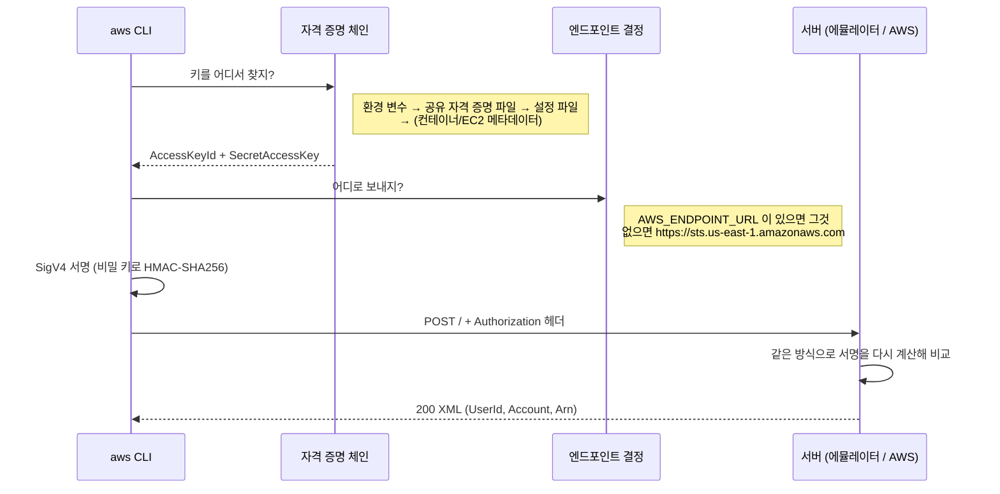

# M00-04. 첫 요청 해부: `aws sts get-caller-identity`
> 도메인: D1 (기초) · 예상 시간: 35분 · 실습 등급: 🟢

## 왜 필요한가

장애 대응 중 "권한이 없다(AccessDenied)", "토큰이 잘못됐다(InvalidClientTokenId)", "서명이 안 맞는다(SignatureDoesNotMatch)" 같은 오류를 만나면, 요청이 **누구의 이름으로, 어디로, 어떻게 서명되어** 나갔는지 알아야 원인을 찾을 수 있다. AWS API는 결국 HTTPS 요청 하나다. 가장 단순한 요청 하나를 끝까지 뜯어보자.

## 핵심 개념

### `sts get-caller-identity` — "나는 누구인가"

STS(Security Token Service)의 `GetCallerIdentity`는 **이 요청에 서명한 자격 증명이 누구인지** 돌려준다. 권한이 전혀 없어도 항상 성공하는 API라서, "지금 어느 계정의 누구로 요청하고 있나"를 확인하는 표준 방법이다. 실제 업무에서도 처음 보는 서버·CI에서 맨 먼저 치는 명령이다.

### 요청이 만들어지는 과정



### SigV4 서명

**SigV4(Signature Version 4)** 는 AWS API 요청 인증 방식이다. 비밀 키 자체는 절대 네트워크로 보내지 않는다. 대신:

1. 요청을 정해진 형식으로 정리한다 — **정규 요청(Canonical Request)**: 메서드, 경로, 쿼리, 서명할 헤더, 본문의 SHA-256 해시.
2. 정규 요청의 해시에 시각과 **자격 증명 범위(credential scope)** `날짜/리전/서비스/aws4_request` 를 붙인다 — **서명할 문자열(String to Sign)**.
3. 비밀 키에서 날짜·리전·서비스별 서명 키를 차례로 파생해 HMAC-SHA256으로 서명한다.
4. `Authorization` 헤더에 액세스 키 ID, 범위, 서명한 헤더 목록, 서명값을 담아 보낸다.

서버는 같은 계산을 다시 해 결과가 같으면 통과시킨다. 그래서 본문이나 헤더를 중간에 바꾸면 `SignatureDoesNotMatch`가 되고, 서명 시각이 서버 시계와 **15분 넘게** 차이 나면 거부된다(재전송 공격 방지).

## 직접 해 보기

`source scripts/env.sh` 한 셸에서:

```bash
aws sts get-caller-identity
```

```
{
    "UserId": "AIDAH5I7GEMO7ADXNFAZU",
    "Account": "000000000000",
    "Arn": "arn:aws:iam::000000000000:user/emulator"
}
```

방금 본 것: **ARN(Amazon Resource Name)** 은 AWS 리소스의 전역 주소다. 형식은 `arn:파티션:서비스:리전:계정:리소스`. IAM은 글로벌 서비스라 리전 칸이 비어 있다(`iam::`). `AIDA`로 시작하는 `UserId`는 IAM 사용자의 고유 ID다.

### `--debug`로 HTTP 들여다보기

`--debug`는 CLI가 하는 일을 전부 stderr로 쏟아낸다. 필요한 줄만 골라 보자.

```bash
aws sts get-caller-identity --debug 2>&1 \
  | grep -E "Found credentials|Endpoint provider result|Calculating signature|<GetCallerIdentityResponse" \
  | sed "s|$HOME|~|"
```

```
2026-11-12 19:53:08,117 - MainThread - botocore.credentials - INFO - Found credentials in shared credentials file: ~/.aws/emulator/9297/emulator_credentials
2026-11-12 19:53:08,137 - MainThread - botocore.regions - DEBUG - Endpoint provider result: https://127.0.0.1:9297
2026-11-12 19:53:08,137 - MainThread - botocore.auth - DEBUG - Calculating signature using v4 auth.
b'<GetCallerIdentityResponse xmlns="https://sts.amazonaws.com/doc/2011-06-15/"><GetCallerIdentityResult><UserId>AIDAH5I7GEMO7ADXNFAZU</UserId><Account>000000000000</Account><Arn>arn:aws:iam::000000000000:user/emulator</Arn></GetCallerIdentityResult><ResponseMetadata><RequestId>55016c39-60c0-43e6-aa44-6ae9365a7541</RequestId></ResponseMetadata></GetCallerIdentityResponse>'
```

방금 본 것:
- 키는 **공유 자격 증명 파일**(env.sh가 가리킨 에뮬레이터 파일)에서 왔다.
- 엔드포인트는 `AWS_ENDPOINT_URL` 덕분에 `https://127.0.0.1:9297`이다. 이 변수가 없었다면 `https://sts.us-east-1.amazonaws.com` 같은 실제 AWS 주소였을 것이다.
- STS는 오래된 **Query 프로토콜**이라 응답이 XML이다. CLI가 그것을 JSON으로 바꿔 보여 준 것이다(DynamoDB 같은 최신 서비스는 처음부터 JSON으로 주고받는다).

서명 과정도 그대로 찍힌다.

```bash
aws sts get-caller-identity --debug 2>&1 | sed -n '/CanonicalRequest:/,/Signature:/p'
```

```
... botocore.auth - DEBUG - CanonicalRequest:
POST
/

content-type:application/x-www-form-urlencoded; charset=utf-8
host:127.0.0.1:9297
x-amz-date:20261112T104754Z

content-type;host;x-amz-date
ab821ae955788b0e33ebd34c208442ccfc2d406e2edc5e7a39bd6458fbb4f843
... botocore.auth - DEBUG - StringToSign:
AWS4-HMAC-SHA256
20261112T104754Z
20261112/us-east-1/sts/aws4_request
3d52c9c1a2a87c05e9f59e5ec775d699e8bed5963045dad7506d63b1652b8381
... botocore.auth - DEBUG - Signature:
```

그리고 실제로 나간 헤더:

```
'Authorization': b'AWS4-HMAC-SHA256 Credential=EMULATOR1655F08F6659/20261112/us-east-1/sts/aws4_request, SignedHeaders=content-type;host;x-amz-date, Signature=5f7fdc7e8eb38799ff9957f24ab0e53495e3b7526d17fc8a7c01166c5927c743'
```

방금 본 것: `Credential=` 뒤에 **액세스 키 ID / 날짜 / 리전 / 서비스 / aws4_request** 가 있다. 비밀 키는 어디에도 없다. 에뮬레이터의 키 ID는 `EMULATOR`로 시작한다(실제 AWS 장기 키는 `AKIA`, 임시 키는 `ASIA`로 시작).

### 서명 없이 보내면?

같은 요청을 curl로, 서명 없이 보내 본다.

```bash
curl -s --cacert "$AWS_CA_BUNDLE" -d 'Action=GetCallerIdentity&Version=2011-06-15' "$AWS_ENDPOINT_URL/"
```

```
<?xml version="1.0"?><ErrorResponse><Error><Type>Sender</Type><Code>InvalidClientTokenId</Code><Message>The security token included in the request is invalid.</Message></Error><RequestId>854a7539-fcb4-4e17-9f00-de82ad71c7dd</RequestId></ErrorResponse>
```

HTTP 상태 코드는 `403`이었다. 방금 본 것: 에뮬레이터도 실제 AWS처럼 서명되지 않은 요청을 거부한다(인증 켜짐이 기본값). 그래서 로컬의 다른 프로그램이나 웹 페이지가 몰래 에뮬레이터를 조작할 수 없다.

### CLI 종료 코드

스크립트에서는 오류 메시지보다 **종료 코드**로 분기한다. [lab03](./labs/lab03-validation-error.sh)에서 본 것처럼 서비스가 오류를 돌려주면 `254`다.

| 코드 | 의미 |
|---|---|
| 0 | 성공 |
| 252 | 명령 문법 오류 (알 수 없는 옵션 등) |
| 253 | 환경·설정 오류 (자격 증명을 못 찾음 등) |
| 254 | 요청은 나갔고 **서비스가 오류를 돌려줌** (ValidationException, AccessDenied …) |
| 255 | 그 밖의 오류 (연결 실패 등) |

<!-- widget: request-journey -->

## 실제 AWS에서는

- 엔드포인트는 서비스·리전별 공식 주소(`https://sts.us-east-1.amazonaws.com` 등)다. 에뮬레이터는 모든 서비스를 **한 주소**에서 받는다.
- 실제 계정에서 `get-caller-identity`를 하면 `Account`가 12자리 실제 계정 ID, `Arn`이 내 사용자 또는 `assumed-role/...`(역할로 로그인한 경우)로 나온다. 요금은 나오지 않으며 정리할 것도 없다.
- `--debug` 출력에는 서명값과 액세스 키 ID가 찍힌다. 실제 자격 증명으로 만든 `--debug` 로그를 이슈·채팅에 그대로 붙이지 말 것(비밀 키는 없지만 키 ID와 계정 정보가 드러난다).

## 시험 포인트

- "애플리케이션이 지금 어떤 자격 증명을 쓰는지 확인" → `sts get-caller-identity`.
- 장기 자격 증명(액세스 키 `AKIA…`)보다 **임시 자격 증명**(STS, `ASIA…` + 세션 토큰)이 권장된다 — EC2는 인스턴스 프로파일(역할), 사람은 IAM Identity Center (M01).
- 자격 증명 탐색 순서에서 **환경 변수가 파일보다 우선**한다. "EC2에 역할을 붙였는데 다른 권한으로 동작한다" → 환경 변수나 자격 증명 파일에 키가 박혀 있는지 의심.
- 요청 시각이 크게 어긋나면(15분) 서명 오류 → 서버 시계 동기화.

## 스스로 확인

1. `--debug` 출력의 `Credential=EMULATOR.../20261112/us-east-1/sts/aws4_request`에서 `us-east-1`과 `sts`가 서명에 들어가는 이유는?
2. 서명 없는 curl 요청이 거부된 오류 코드는 무엇이었고, 그것이 의미하는 바는?
3. 회사 CI에서 `aws s3 ls`가 예상과 다른 계정의 버킷을 보여 준다. 가장 먼저 무엇을 실행하고 무엇을 확인하겠는가?

<details><summary>답</summary>

1. 서명 키를 날짜·리전·서비스별로 파생하기 때문이다. 다른 리전이나 다른 서비스로 같은 서명을 재사용할 수 없게 범위를 좁힌다.
2. `InvalidClientTokenId`(HTTP 403). 요청에 유효한 자격 증명이 없다는 뜻이다.
3. `aws sts get-caller-identity`로 Account와 Arn을 확인한다. 이어서 `aws configure list`로 자격 증명이 어디(환경 변수, 파일, 역할)에서 왔는지 본다.

</details>
