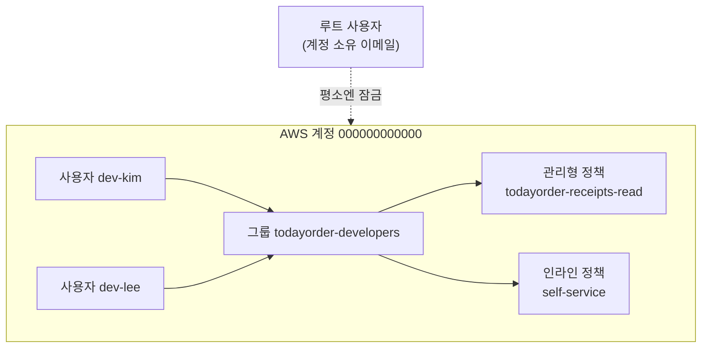

# M01-01. 루트 사용자, IAM 사용자, 그룹, MFA
> 도메인: D1 · 예상 시간: 45분 · 실습 등급: 🟢 (MFA 활성화만 🔴)

## 왜 필요한가

TodayOrder에 입사한 첫날, 팀장이 AWS 계정을 만든 이메일·비밀번호(루트 사용자)를 슬랙으로 보내 주며 "이걸로 들어가서 필요한 거 만들어 쓰세요"라고 한다. 이대로라면 신입 한 명의 노트북이 털리는 순간 회사 클라우드 전체가 넘어간다. 누가 무엇을 했는지 구분할 수도 없다. 이 레슨은 **사람마다 따로, 필요한 만큼만** 권한을 주는 첫 단계다.

## 핵심 개념

### 계정(Account)과 그 안의 "누구"

**AWS 계정**은 리소스와 청구서의 경계다. 계정 ID는 12자리 숫자(에뮬레이터는 `000000000000`)다. 계정 안에서 요청을 보내는 "누구"를 **주체(Principal)** 라고 부른다.

| 주체 | 무엇인가 | 자격 증명 | 언제 쓰나 |
|---|---|---|---|
| **루트 사용자** | 계정을 만든 이메일 주소. 모든 권한, 제한 불가(IAM 정책으로 못 막는다) | 이메일 + 암호 (+ MFA) | 루트만 가능한 작업에만. 평소에는 잠가 둔다 |
| **IAM 사용자** | 계정 안에 만든 장기 신원 | 콘솔 암호, 액세스 키(최대 2개) | 사람에게는 가급적 쓰지 않는다(아래). 외부 시스템이 장기 키를 꼭 요구할 때 |
| **IAM 그룹** | 사용자 묶음. 정책을 그룹에 붙이면 구성원 모두가 받는다 | 없음 — 그룹은 주체가 아니다 | "개발자", "운영자" 같은 직무별 권한 |
| **IAM 역할** | 맡았다 놓는 신원. 장기 키가 없다 | STS가 주는 임시 자격 증명 | 서버(EC2·Lambda), 다른 계정, SSO 사용자 → [레슨 04](./04-roles-and-sts.md) |



용어 한 줄 정의:
- **정책(Policy)**: "무엇을 허용/거부하는가"를 적은 JSON 문서. [레슨 02](./02-policy-anatomy.md)에서 해부한다.
- **관리형 정책(Managed)**: 독립된 리소스(ARN이 있음). 여러 사용자·그룹·역할에 붙일 수 있고 버전이 있다. AWS가 만든 **AWS 관리형**과 내가 만든 **고객 관리형**이 있다.
- **인라인 정책(Inline)**: 한 사용자·그룹·역할에만 박혀 있는 정책. 그 주체를 지우면 같이 사라진다.

### 루트 사용자는 왜 잠그는가

루트는 IAM 정책으로 제한할 수 없다(조직의 SCP는 멤버 계정의 루트도 제한한다 — [레슨 05](./05-organizations-scp.md)). 그래서 AWS 권장 사항은:

1. 루트에 **MFA**를 건다. AWS는 2024~2025년에 걸쳐 관리 계정·독립 계정·멤버 계정 모두의 루트 사용자에게 MFA 등록을 요구하도록 바꿨다.
2. 루트의 **액세스 키를 만들지 않는다**(있으면 지운다).
3. 일상 업무는 IAM Identity Center 사용자나 역할로 한다.
4. 루트로만 할 수 있는 일(예: 계정 해지, 루트 암호 변경, 일부 결제 설정, 지원 플랜 변경)에만 루트로 로그인한다.

Organizations를 쓰는 회사라면 관리 계정에서 **멤버 계정의 루트 자격 증명을 아예 없애는(중앙 루트 접근 관리)** 방법도 있다.

### 왜 사람에게 액세스 키를 주지 않는가

액세스 키(`AKIA…` + 비밀 키)는 **만료가 없는 비밀번호**다. 노트북의 `~/.aws/credentials`, CI 설정, 실수로 커밋한 `.env` 어디서든 새면 지울 때까지 유효하다. 그래서:

- **사람**은 IAM Identity Center(SSO)로 로그인해 **임시 자격 증명**을 받는다.
- **서버·Lambda**는 역할(인스턴스 프로파일·실행 역할)을 쓴다.
- **CI**(GitHub Actions 등)는 OIDC 연동으로 역할을 맡는다 → [레슨 06](./06-federation-and-directory.md).
- 장기 키가 꼭 필요하면 최소 권한 + 주기적 교체 + 사용 기록 감시(자격 증명 보고서, `GetAccessKeyLastUsed`).

### MFA

**MFA(Multi-Factor Authentication)** 는 "아는 것(암호)" 외에 "가진 것(장치)"을 하나 더 요구한다. IAM 사용자 한 명에 MFA 장치를 **최대 8개**까지 등록할 수 있다. 종류:

| 종류 | 예 |
|---|---|
| 패스키·보안 키 (FIDO2) | YubiKey, 기기 내장 패스키 |
| 가상 MFA 앱 (TOTP) | Google Authenticator, 1Password 등 6자리 코드 |
| 하드웨어 TOTP 토큰 | 키링형 토큰 |

정책에서는 **조건 키 `aws:MultiFactorAuthPresent`** 로 "MFA로 로그인한 세션만 허용"을 표현한다. 예: MFA 없이 인스턴스 종료 금지.

```json
{
  "Effect": "Deny",
  "Action": "ec2:TerminateInstances",
  "Resource": "*",
  "Condition": {"BoolIfExists": {"aws:MultiFactorAuthPresent": "false"}}
}
```

`BoolIfExists`를 쓰는 이유: 장기 액세스 키로 서명한 요청에는 이 키가 **아예 없다**. `Bool`만 쓰면 키가 없는 요청에는 조건이 맞지 않아 Deny가 적용되지 않는다(구멍). `...IfExists`는 "키가 없으면 조건을 참으로 본다"라서 장기 키 요청도 막는다.

## 직접 해 보기

전체 스크립트: [labs/lab01-users-groups-policies.sh](./labs/lab01-users-groups-policies.sh). 아래는 그 실행 결과를 단계별로 나눈 것이다.

```bash
export EMULATOR_PORT=9297   # 자기 포트
source scripts/env.sh
bash curriculum/m01-iam-identity/labs/lab01-users-groups-policies.sh
```

### 1) 계정 암호 정책

```bash
aws iam update-account-password-policy --minimum-password-length 14 \
  --require-symbols --require-numbers --require-uppercase-characters --require-lowercase-characters \
  --max-password-age 90 --password-reuse-prevention 5
```

출력은 없다(성공). 이 정책은 계정 전체의 **콘솔 암호**에 적용된다. 액세스 키와는 상관없다.

### 2) 그룹 + 고객 관리형 정책

```bash
aws iam create-group --group-name todayorder-developers --query 'Group.Arn' --output text
aws iam create-policy --policy-name todayorder-receipts-read --policy-document file://receipts-read.json \
  --query 'Policy.{Arn: Arn, DefaultVersionId: DefaultVersionId, AttachmentCount: AttachmentCount}'
aws iam attach-group-policy --group-name todayorder-developers \
  --policy-arn arn:aws:iam::000000000000:policy/todayorder-receipts-read
```

```
arn:aws:iam::000000000000:group/todayorder-developers
{
    "Arn": "arn:aws:iam::000000000000:policy/todayorder-receipts-read",
    "DefaultVersionId": "v1",
    "AttachmentCount": 0
}
```

방금 본 것: 관리형 정책은 자기 ARN과 **버전(v1)** 이 있다. 만든 직후에는 어디에도 붙어 있지 않다(`AttachmentCount: 0`).

### 3) 그룹 인라인 정책 — 정책 변수 `${aws:username}`

"각자 자기 사용자 정보와 자기 액세스 키만 관리"를 사용자마다 정책을 따로 쓰지 않고 **하나의 그룹 정책**으로 표현한다.

```json
{
  "Sid": "ManageOwnUserOnly",
  "Effect": "Allow",
  "Action": ["iam:GetUser", "iam:ListAccessKeys", "iam:CreateAccessKey", "iam:DeleteAccessKey"],
  "Resource": "arn:aws:iam::000000000000:user/${aws:username}"
}
```

### 4) 사용자 2명을 그룹에

```
arn:aws:iam::000000000000:user/todayorder-dev-kim
arn:aws:iam::000000000000:user/todayorder-dev-lee
[
    "todayorder-dev-kim",
    "todayorder-dev-lee"
]
1
```

마지막 `1`은 정책의 `AttachmentCount`다. 사용자 둘이 아니라 **그룹 하나**에 붙였기 때문이다. 사람이 늘어도 정책 연결은 그대로다 — 이것이 그룹을 쓰는 이유다.

### 5) 암호 정책이 실제로 적용된다

```bash
aws iam create-login-profile --user-name todayorder-dev-kim --password 'Short1!' --password-reset-required
```

```
aws: [ERROR]: An error occurred (PasswordPolicyViolation) when calling the CreateLoginProfile operation: Password should have a minimum length of 14
```

14자 이상으로 다시 만들면 `PasswordResetRequired: true`(첫 로그인 때 바꾸게 함)로 생성된다.

### 6) 김 개발자의 키로: 나는 보이고, 남은 안 보인다

```
자기 자신: arn:aws:iam::000000000000:user/todayorder-dev-kim
aws: [ERROR]: An error occurred (AccessDenied) when calling the GetUser operation: User: arn:aws:iam::000000000000:user/todayorder-dev-kim is not authorized to perform: iam:GetUser on resource: user todayorder-dev-lee because no identity-based policy allows the iam:GetUser action. ...
```

방금 본 것: `${aws:username}`이 요청한 사람 이름(`todayorder-dev-kim`)으로 바뀌어 평가됐다. 이 동료(`todayorder-dev-lee`)의 ARN은 정책의 Resource와 맞지 않아 **암묵적 거부**다. 에뮬레이터는 IAM API에 대해서는 정책을 실제로 평가한다.

### 7) 액세스 키는 2개까지

```
Active
aws: [ERROR]: An error occurred (LimitExceeded) when calling the CreateAccessKey operation: Cannot exceed quota for AccessKeysPerUser: 2
```

2개인 이유는 **무중단 교체**를 위해서다: 새 키 발급 → 앱에 배포 → 옛 키 비활성화(`update-access-key --status Inactive`) → 문제없으면 삭제.

### 8) 자격 증명 보고서

```bash
aws iam generate-credential-report      # COMPLETE 가 될 때까지 반복
aws iam get-credential-report --query Content --output text | base64 --decode | cut -d, -f1,4,8,9
```

```
user,password_enabled,mfa_active,access_key_1_active
<root_account>,not_supported,false,false
todayorder-dev-kim,true,false,true
todayorder-dev-lee,false,false,false
```

방금 본 것: 계정의 모든 사용자(루트 포함)에 대해 암호·MFA·액세스 키 상태를 CSV로 준다. 감사 때 "MFA 없는 콘솔 사용자", "오래 안 쓴 키"를 찾는 표준 도구다.

> lab01을 4시간 안에 다시 실행하면 에뮬레이터가 새 보고서 생성을 거부하므로(`LimitExceeded`), 스크립트는 `보고서 상태: COMPLETE(기존 보고서)`를 출력하고 **이전 실행 때 만든 보고서**를 읽는다. 그래서 사용자 행이 지금 상태와 다를 수 있다(예: 이미 지운 사용자가 보임). 스크립트의 단언은 언제나 있는 `<root_account>` 행만 확인한다.

### 9) 가상 MFA — 여기서 멈춘다 (🔴)

```bash
aws iam create-virtual-mfa-device --virtual-mfa-device-name todayorder-dev-kim \
  --outfile mfa-seed.txt --bootstrap-method Base32StringSeed
aws iam enable-mfa-device --user-name todayorder-dev-kim \
  --serial-number arn:aws:iam::000000000000:mfa/todayorder-dev-kim \
  --authentication-code1 123456 --authentication-code2 654321
```

```
{
    "VirtualMFADevice": {
        "SerialNumber": "arn:aws:iam::000000000000:mfa/todayorder-dev-kim"
    }
}
aws: [ERROR]: An error occurred (NotImplemented) when calling the EnableMFADevice operation: operation EnableMFADevice is scaffolded but not implemented in this emulator
```

장치는 만들어지지만(시드 파일도 생긴다) 사용자에게 **연결하는 API가 501**이다. `ListMFADevices`, `DeactivateMFADevice`, `DeleteVirtualMFADevice`도 501이라 한 번 만든 가상 MFA 장치는 에뮬레이터를 재시작할 때까지 남는다(lab01은 이미 있으면 건너뛴다). MFA 조건이 정책에서 어떻게 판정되는지는 [레슨 03](./03-policy-evaluation.md)에서 시뮬레이터로 확인한다.

### 10) 지우는 순서

```
aws: [ERROR]: An error occurred (DeleteConflict) when calling the DeleteGroup operation: Cannot delete entity, must remove users from group first.
```

IAM은 연결이 남아 있으면 지우지 않는다. 사용자는 그룹 탈퇴·정책 분리·키·로그인 프로필을 먼저 지워야 하고, 관리형 정책은 모든 연결을 떼고 기본이 아닌 버전을 지워야 삭제된다(스크립트의 `_lib.sh` 정리 함수 참고).

## 실제 AWS에서는

- 실제로는 `EnableMFADevice`에 MFA 앱이 보여 주는 **연속된 두 코드**를 넣어 활성화한다. 그 뒤 MFA로 얻은 세션(`sts get-session-token --serial-number ... --token-code ...`)에만 `aws:MultiFactorAuthPresent=true`가 붙는다.
- 실제 액세스 키 ID는 `AKIA`로, 임시 키는 `ASIA`로 시작한다. 에뮬레이터는 둘 다 `EMULATOR`로 시작한다.
- 에뮬레이터에서 **비활성(Inactive)으로 바꾼 키**는 IAM API만 거부했다(`iam list-users` → `InvalidClientTokenId`). STS(`get-caller-identity`, **`assume-role`도 성공해 임시 자격 증명을 받을 수 있었다**), EC2, S3, SQS, KMS, DynamoDB, Lambda는 그 키를 그대로 받아들였다. 삭제한 키는 STS도 `InvalidClientTokenId`로 거부했다. 실제 AWS는 비활성 키로 서명한 요청을 모든 서비스에서 거부한다.
- 에뮬레이터는 `GetAccountSummary`, `GetAccountPasswordPolicy`를 모른다(`InvalidAction`). 실제 AWS에서는 둘 다 동작하며, 계정 요약에서 루트 MFA 여부(`AccountMFAEnabled`)를 볼 수 있다.
- 자격 증명 보고서는 실제 AWS에서 4시간마다 새로 만들 수 있다. 에뮬레이터는 4시간 안에 다시 생성을 요청하면 `LimitExceeded`로 거부한다(lab01은 이때 기존 보고서를 읽는다).
- IAM 사용자·그룹·정책 자체에는 요금이 없다. 만든 액세스 키는 실습 직후 반드시 지운다.

**실제 AWS에서 해 보려면 (MFA 부분 🔴)**

- 비용: IAM 사용자·그룹·정책·가상 MFA 장치는 **무료**다(프리 티어와 무관). 하드웨어 보안 키만 직접 사야 한다.
- 루트 사용자 MFA로 연습하지 말 것 — 잘못 설정하면 계정 복구 절차가 필요하다. **연습용 IAM 사용자**를 따로 만든다.
- 순서:
  1. 연습용 사용자 생성, 콘솔 암호(`create-login-profile`)와 액세스 키(`create-access-key`) 발급.
  2. `aws iam create-virtual-mfa-device --virtual-mfa-device-name <사용자> --outfile qr.png --bootstrap-method QRCodePNG` 후 휴대폰 인증 앱으로 QR 코드를 스캔.
  3. 앱이 보여 주는 연속된 두 코드로 `aws iam enable-mfa-device --user-name <사용자> --serial-number arn:aws:iam::<계정>:mfa/<사용자> --authentication-code1 <코드1> --authentication-code2 <코드2>`.
  4. MFA 세션 받기: `aws sts get-session-token --serial-number arn:aws:iam::<계정>:mfa/<사용자> --token-code <현재 코드>`. 이 임시 자격 증명으로 호출한 요청에만 `aws:MultiFactorAuthPresent=true`가 붙는다. 레슨 03의 "MFA 없으면 TerminateInstances Deny" 같은 정책을 이 세션과 장기 키로 각각 시험해 보면 차이가 보인다(EC2를 실제로 종료하지 않으려면 `--dry-run`을 쓴다).
- 정리(순서대로):
  ```bash
  aws iam deactivate-mfa-device --user-name <사용자> --serial-number arn:aws:iam::<계정>:mfa/<사용자>
  aws iam delete-virtual-mfa-device --serial-number arn:aws:iam::<계정>:mfa/<사용자>
  aws iam delete-login-profile --user-name <사용자>
  aws iam delete-access-key --user-name <사용자> --access-key-id <키 ID>
  aws iam remove-user-from-group --user-name <사용자> --group-name <그룹>   # 그룹에 넣었다면
  aws iam delete-user-policy --user-name <사용자> --policy-name <정책>      # 인라인 정책이 있다면
  aws iam delete-user --user-name <사용자>
  ```

## 시험 포인트

- "루트 계정 보호" → **MFA + 루트 액세스 키 삭제 + 일상 업무에 쓰지 않기**. 루트로만 할 수 있는 작업이 나오면 그때만 루트.
- "여러 개발자에게 같은 권한" → **그룹에 정책**. 그룹은 중첩되지 않고(그룹 안에 그룹 불가), 정책의 Principal이 될 수 없다.
- "직원 로그인·여러 계정 SSO" → IAM 사용자가 아니라 **IAM Identity Center**. "앱/서버가 AWS 호출" → **역할**(키를 코드·AMI에 넣지 않기).
- "MFA를 한 세션만 위험 작업 허용" → 조건 키 `aws:MultiFactorAuthPresent`(장기 키 요청까지 막으려면 `BoolIfExists`).
- "오래된 키·MFA 미사용 사용자 감사" → **자격 증명 보고서**(계정 단위 CSV), 접근 기록 → 마지막 사용 정보·Access Advisor.
- 한계값: 사용자당 액세스 키 **2개**, 사용자당 그룹 **10개**, 계정당 사용자 **5,000명**, 사용자당 MFA 장치 **8개**.

## 스스로 확인

1. 그룹에 정책을 붙였더니 `AttachmentCount`가 1이었다. 개발자가 20명으로 늘면 이 값은 얼마인가? 그 점이 운영에 왜 좋은가?
2. 퇴사자의 IAM 사용자를 지우려 했더니 `DeleteConflict`가 났다. 무엇을 먼저 해야 하는가?
3. "MFA 없는 세션은 인스턴스 종료 금지" 정책에 `Bool` 대신 `BoolIfExists`를 쓰는 이유는?

<details><summary>답</summary>

1. 여전히 1이다. 정책은 그룹 하나에 붙어 있고 사람은 그룹에 넣고 빼기만 하면 된다. 권한 변경도 그룹 정책 한 곳만 고치면 된다.
2. 그룹에서 제거, 사용자에게 붙은 관리형 정책 분리·인라인 정책 삭제, 액세스 키·로그인 프로필(·MFA 장치·권한 경계) 삭제 후 사용자 삭제.
3. 장기 액세스 키로 서명한 요청에는 `aws:MultiFactorAuthPresent` 키가 없다. `Bool`은 키가 없으면 조건 불일치 → Deny가 적용되지 않는다. `BoolIfExists`는 키가 없을 때도 조건을 참으로 봐서 장기 키 요청까지 막는다.

</details>
