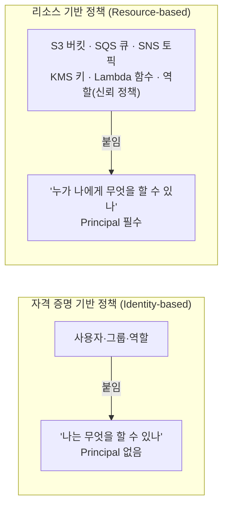

# M01-02. 정책 문서 해부 — 자격 증명 기반 vs 리소스 기반
> 도메인: D1 · 예상 시간: 45분 · 실습 등급: 🟢

## 왜 필요한가

TodayOrder 주문 워커가 S3에 영수증을 써야 한다. 선배가 "일단 `s3:*`, `Resource: *` 주고 나중에 줄이자"라고 한다. 나중은 오지 않는다. 6개월 뒤 워커 코드의 버그 하나가 상품 이미지 버킷을 통째로 지운다. 정책을 **읽고 쓸 줄 알아야** "이 워커는 정확히 이것만"을 표현할 수 있다.

## 핵심 개념

### 정책 한 장의 구조

정책은 JSON이고, **Statement(문장)** 의 목록이다. 문장 하나는 "누가(Principal) 무엇을(Action) 어디에(Resource) 어떤 조건에서(Condition) 허용/거부(Effect)"다. SQL로 치면 `GRANT SELECT ON orders TO worker WHERE ...` 한 줄과 비슷하다.

```json
{
  "Version": "2012-10-17",
  "Statement": [
    {
      "Sid": "ReadReceipts",
      "Effect": "Allow",
      "Action": ["s3:GetObject", "s3:ListBucket"],
      "Resource": ["arn:aws:s3:::todayorder-receipts", "arn:aws:s3:::todayorder-receipts/*"],
      "Condition": {"Bool": {"aws:SecureTransport": "true"}}
    }
  ]
}
```

| 요소 | 의미 | 주의 |
|---|---|---|
| `Version` | 정책 언어 버전. 항상 `"2012-10-17"` | 날짜가 아니라 문법 버전. 생략하면 정책 변수(`${...}`)가 동작하지 않는다 |
| `Sid` | 문장 이름(선택) | 사람이 읽고 로그에서 찾기 위함 |
| `Effect` | `Allow` 또는 `Deny` | 대소문자 정확히 |
| `Action` / `NotAction` | `서비스:API이름`. 와일드카드 `s3:Get*` 가능 | `NotAction`은 "이것들 **빼고** 전부" — Allow와 함께 쓰면 위험할 만큼 넓다 |
| `Resource` / `NotResource` | 대상 ARN. 와일드카드 가능 | 버킷(`arn:aws:s3:::b`)과 객체(`arn:aws:s3:::b/*`)는 다른 리소스다 |
| `Condition` | `{연산자: {키: 값}}` | 같은 블록 안의 키끼리는 AND, 한 키의 값 목록은 OR |
| `Principal` | 누구에게 | **리소스 기반 정책과 신뢰 정책에만** 쓴다. 사용자·그룹·역할에 붙이는 정책에는 없다 |

**ARN** 복습: `arn:파티션:서비스:리전:계정:리소스`. IAM·S3처럼 리전 칸이나 계정 칸이 비는 서비스가 있다(`arn:aws:s3:::todayorder-receipts`).

자주 쓰는 조건 키와 연산자:

| 조건 | 뜻 |
|---|---|
| `"Bool": {"aws:SecureTransport": "true"}` | HTTPS 요청만 |
| `"IpAddress": {"aws:SourceIp": "203.0.113.0/24"}` | 사무실 IP에서만 |
| `"StringEquals": {"aws:RequestedRegion": "ap-northeast-2"}` | 서울 리전 요청만 |
| `"StringEquals": {"aws:PrincipalOrgID": "o-xxxx"}` | 우리 조직 계정의 주체만 (리소스 정책에서 자주 씀) |
| `"BoolIfExists": {"aws:MultiFactorAuthPresent": "false"}` | MFA 없는 세션 (레슨 01) |
| `"StringEquals": {"sts:ExternalId": "..."}` | 제3자 역할 맡기의 외부 ID (레슨 04) |

정책 변수 `${aws:username}`은 요청한 사용자 이름으로 바뀐다 — [레슨 01](./01-root-users-groups-mfa.md)에서 "자기 자신만" 정책으로 확인했다.

### 자격 증명 기반 vs 리소스 기반



| | 자격 증명 기반 | 리소스 기반 |
|---|---|---|
| 붙는 곳 | IAM 사용자·그룹·역할 | 리소스 자체(버킷 정책, 큐 정책, 키 정책, 함수 정책, **역할의 신뢰 정책**) |
| `Principal` | 없음 (붙은 주체가 곧 주체) | 필수 |
| 다른 계정에 권한 주기 | 혼자서는 불가 | 가능 — 다른 계정·서비스(`sns.amazonaws.com`)를 Principal로 |
| 관리형/인라인 | 둘 다 | 항상 인라인(리소스에 박혀 있음) |

같은 계정 안에서는 **둘 중 하나만 허용해도** 통과한다(명시적 Deny가 없다면. 예외: KMS 키는 키 정책이 허용해야 한다 — M09). 다른 계정 사이에서는 **양쪽 모두**(내 계정의 자격 증명 정책 + 상대 리소스 정책) 허용해야 한다 → [레슨 03](./03-policy-evaluation.md), [04](./04-roles-and-sts.md).

### 관리형 vs 인라인, AWS 관리형 vs 고객 관리형

| | AWS 관리형 | 고객 관리형 | 인라인 |
|---|---|---|---|
| 만든 이 | AWS (`arn:aws:iam::aws:policy/...`) | 나 | 나 |
| 재사용 | 여러 주체 | 여러 주체 | 그 주체 하나 |
| 버전 | AWS가 갱신 | 최대 **5개** 보관, 기본 버전 전환으로 롤백 | 없음 |
| 언제 | 빠르게 시작(`ReadOnlyAccess` 등). 대개 넓다 | 표준 선택 — 최소 권한을 직접 | 주체와 생사를 같이해야 하는 엄격한 1:1 권한 |

크기 한도(공백 제외): 고객 관리형 **6,144자**, 인라인은 주체별 합계로 사용자 **2,048자** · 그룹 **5,120자** · 역할 **10,240자**. 붙일 수 있는 관리형 정책 수는 기본 사용자 10 · 그룹 10 · 역할 20(역할은 25, 사용자는 20까지 증설 가능).

## 직접 해 보기

### 1) AWS 관리형 정책 읽기

```bash
aws iam get-policy --policy-arn arn:aws:iam::aws:policy/AdministratorAccess --query Policy.DefaultVersionId
aws iam get-policy-version --policy-arn arn:aws:iam::aws:policy/AdministratorAccess --version-id v1 --query PolicyVersion.Document
```

```
"v1"
{
    "Version": "2012-10-17",
    "Statement": [
        {
            "Effect": "Allow",
            "Action": "*",
            "Resource": "*"
        }
    ]
}
```

방금 본 것: "관리자"는 마법이 아니라 `Action: *, Resource: *` 한 문장이다. 에뮬레이터에는 AWS 관리형 정책 63개가 들어 있다(`aws iam list-policies --scope AWS --query 'length(Policies)'` → `63`). 실제 AWS에는 훨씬 많다.

### 2) IAM은 문법을 검사한다

```bash
aws iam create-policy --policy-name bad --policy-document \
  '{"Version":"2012-10-17","Statement":[{"Effect":"Permit","Action":"s3:GetObject","Resource":"*"}]}'
aws iam create-policy --policy-name bad2 --policy-document \
  '{"Version":"2012-10-17","Statement":[{"Effect":"Allow","Action":"s3:GetObject"}]}'
aws iam create-policy --policy-name bad3 --policy-document 'not json'
```

```
aws: [ERROR]: An error occurred (MalformedPolicyDocument) when calling the CreatePolicy operation: The policy failed legacy parsing
aws: [ERROR]: An error occurred (MalformedPolicyDocument) when calling the CreatePolicy operation: Policy statement must contain resources.
aws: [ERROR]: An error occurred (MalformedPolicyDocument) when calling the CreatePolicy operation: Syntax errors in policy.
```

방금 본 것: `Effect`는 `Allow`/`Deny`만, 자격 증명 기반 정책 문장에는 `Resource`가 필수다. 문법 오류는 모두 `MalformedPolicyDocument`.

에뮬레이터가 놓치는 검사도 있다. `Principal`이 들어간 문서를 관리형 정책으로 만들면:

```bash
aws iam create-policy --policy-name t-withprincipal --policy-document \
  '{"Version":"2012-10-17","Statement":[{"Effect":"Allow","Principal":{"AWS":"*"},"Action":"s3:GetObject","Resource":"*"}]}' \
  --query Policy.Arn --output text
```

```
arn:aws:iam::000000000000:policy/t-withprincipal
```

에뮬레이터는 받아 준다. **실제 AWS는 `MalformedPolicyDocument`로 거부한다** — 자격 증명 기반 정책에는 `Principal`을 쓸 수 없다(아래 "스스로 확인" 2번).

### 3) 관리형 정책의 버전은 5개까지

lab01의 정책에 새 버전을 계속 만들어 본다.

```bash
for i in 2 3 4 5 6; do
  aws iam create-policy-version --policy-arn arn:aws:iam::000000000000:policy/todayorder-receipts-read \
    --policy-document file://receipts-read.json --set-as-default --query PolicyVersion.VersionId --output text
done
```

```
v2
v3
v4
v5

aws: [ERROR]: An error occurred (LimitExceeded) when calling the CreatePolicyVersion operation: A managed policy can have up to 5 versions. Before you create a new version, you must delete an existing version.
```

방금 본 것: 버전은 롤백 수단이다. 잘못 고친 정책은 `set-default-policy-version --version-id v1`로 즉시 되돌린다. 5개가 차면 오래된 버전을 지워야 한다.

### 4) 리소스 기반 정책의 Deny

자격 증명 정책 대신 **버킷 정책**으로 특정 사용자의 업로드를 막는다(레슨 01의 김 개발자, 버킷은 관리자가 만듦).

```bash
aws s3api put-bucket-policy --bucket todayorder-receipts --policy '{
  "Version":"2012-10-17",
  "Statement":[{"Effect":"Deny",
    "Principal":{"AWS":"arn:aws:iam::000000000000:user/todayorder-dev-kim"},
    "Action":"s3:PutObject","Resource":"arn:aws:s3:::todayorder-receipts/*"}]}'
# 김 개발자의 키로
aws s3 cp m01.txt s3://todayorder-receipts/b.txt
```

```
upload failed: ... An error occurred (AccessDenied) when calling the PutObject operation: User: arn:aws:iam::000000000000:user/todayorder-dev-kim is not authorized to perform: s3:PutObject on resource: "arn:aws:s3:::todayorder-receipts/b.txt" with an explicit deny in a resource-based policy
```

방금 본 것: 오류 메시지가 **어느 종류의 정책**이 막았는지(`resource-based policy`)까지 알려 준다. 리소스 기반 정책에는 `Principal`이 있다는 것도 눈여겨보자.

### 5) boto3: 최소 권한 정책 생성기

[sdk/least_privilege_policy.py](./sdk/least_privilege_policy.py)는 "주문 워커가 필요한 (액션, 리소스)" 목록에서 정책을 만들고, IAM에 넣어 문법을 검증한 뒤, 시뮬레이터로 "필요한 것은 허용, 나머지는 거부"를 확인한다.

```bash
uv run python curriculum/m01-iam-identity/sdk/least_privilege_policy.py
```

```
생성된 정책:
{
  "Version": "2012-10-17",
  "Statement": [
    {
      "Sid": "SqsTodayorderOrders",
      "Effect": "Allow",
      "Action": [
        "sqs:DeleteMessage",
        "sqs:GetQueueAttributes",
        "sqs:ReceiveMessage"
      ],
      "Resource": "arn:aws:sqs:us-east-1:000000000000:todayorder-orders"
    },
...
크기: 550자 (관리형 정책 한도 6144자)
와일드카드 거부 확인: 최소 권한 위반: 와일드카드 액션 's3:*'
CreatePolicy 통과: arn:aws:iam::000000000000:policy/todayorder-order-worker-least-privilege (v1)
잘못된 문서: MalformedPolicyDocument — Policy statement must contain resources.

시뮬레이션 — 필요한 권한:
  allowed       sqs:ReceiveMessage     arn:aws:sqs:us-east-1:000000000000:todayorder-orders
...
  allowed       s3:PutObject           arn:aws:s3:::todayorder-receipts/receipts/2026/11/A-1001.json
시뮬레이션 — 없어야 할 권한:
  implicitDeny  dynamodb:DeleteTable   arn:aws:dynamodb:us-east-1:000000000000:table/todayorder-orders
  implicitDeny  dynamodb:PutItem       arn:aws:dynamodb:us-east-1:000000000000:table/todayorder-payments
  implicitDeny  s3:GetObject           arn:aws:s3:::todayorder-receipts/receipts/A-1001.json
  implicitDeny  s3:PutObject           arn:aws:s3:::todayorder-images/logo.png
  implicitDeny  sqs:SendMessage        arn:aws:sqs:us-east-1:000000000000:todayorder-orders
  implicitDeny  iam:CreateUser         arn:aws:iam::000000000000:user/anyone
SDK least_privilege_policy OK
```

방금 본 것: "같은 버킷의 다른 액션(GetObject)", "같은 액션의 다른 리소스(images 버킷)" 모두 막혀 있다. 최소 권한은 **액션과 리소스 두 축을 모두 좁히는 것**이다.

## 실제 AWS에서는

- 실제 AWS에는 **IAM Access Analyzer**의 정책 검증(`aws accessanalyzer validate-policy`)과, CloudTrail 기록으로 정책을 만들어 주는 **정책 생성** 기능이 있다. 이 레슨의 생성기는 그 생각을 작게 흉내 낸 것이다.
- 버킷 정책 Deny는 에뮬레이터도 집행하지만, 공식 문서는 에뮬레이터를 보안 검증에 쓰지 말라고 한다. 정책의 실제 효과는 실제 계정에서 확인한다.
- 이 레슨의 IAM 작업은 비용이 들지 않는다. S3 버킷 정책 실습을 실제 계정에서 해 보면 프리 티어 범위 안이지만, 끝나면 `aws s3 rb s3://<버킷> --force`로 지운다.

## 시험 포인트

- 정책 문장 5요소: **Effect · Action · Resource · Condition (+ 리소스 기반·신뢰 정책에는 Principal)**. "Principal이 있는 정책" → 리소스 기반 정책.
- "다른 계정 사용자에게 내 S3 버킷 접근 허용" → **버킷 정책(리소스 기반)** 에 상대 계정을 Principal로 + 상대 계정에서도 자격 증명 정책으로 허용. 또는 역할 맡기(레슨 04).
- "HTTPS만 허용" → `aws:SecureTransport`, "조직 안의 계정만" → `aws:PrincipalOrgID`, "특정 IP만" → `aws:SourceIp`.
- 버킷(`arn:aws:s3:::b`)과 객체(`arn:aws:s3:::b/*`)는 다른 리소스 — `ListBucket`은 버킷, `GetObject`는 객체 ARN에.
- 재사용·버전 관리가 필요하면 **고객 관리형 정책**, 주체와 1:1로 묶어야 하면 **인라인**. 관리형 정책 버전은 최대 **5개**.
- 최소 권한: `"Action": "*"`, `"Resource": "*"` 조합은 감점. 시험의 "가장 안전한" 답은 액션·리소스를 좁힌 쪽.

## 스스로 확인

1. 버킷 목록을 보는 `s3:ListBucket`과 객체를 읽는 `s3:GetObject`를 한 문장에 넣으면서 `Resource`를 `arn:aws:s3:::todayorder-receipts/*` 하나만 쓰면 무엇이 안 되는가?
2. 자격 증명 기반 정책에 `Principal`을 쓰면 어떻게 되며, 그 이유는?
3. 정책 수정 후 장애가 났다. 고객 관리형 정책이라면 가장 빠른 복구 방법은?

<details><summary>답</summary>

1. `ListBucket`은 버킷 ARN(`arn:aws:s3:::todayorder-receipts`)에 대한 권한이라 목록 조회가 거부된다. 버킷 ARN과 객체 ARN을 둘 다 적어야 한다.
2. 문법 오류(`MalformedPolicyDocument`)다. 자격 증명 기반 정책은 붙은 주체가 곧 Principal이므로 따로 쓰지 않는다.
3. 이전 버전을 기본 버전으로 되돌린다(`aws iam set-default-policy-version --policy-arn ... --version-id v1`). 문서를 다시 쓰지 않아도 된다.

</details>
