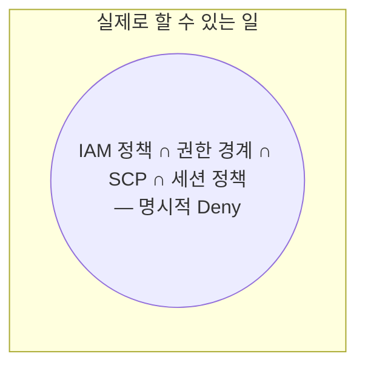

# M01-03. 정책 평가 로직 — 명시적 Deny, 권한 경계, SCP, 세션 정책
> 도메인: D1 · 예상 시간: 60분 · 실습 등급: 🟢 (IAM·EC2 거부 재현, 워크시트) / 🟡 (S3 대비)

## 왜 필요한가

TodayOrder 개발자 한 명에게 정책이 세 개 붙어 있다: 그룹의 "개발자 기본", 개인 인라인 "삭제 금지", 그리고 보안팀이 건 "권한 경계". 새벽 장애 중 그가 `AccessDenied`를 받았다. 어느 정책 때문인가? 정책이 여러 장 겹칠 때 AWS가 **어떤 순서로 판정하는지** 모르면, 권한 문제는 매번 감으로 고치게 된다.

## 핵심 개념

### 세 가지 결과

| 결과 | 뜻 | 오류 메시지의 단서 |
|---|---|---|
| **명시적 거부 (explicit deny)** | 적용되는 정책 어딘가에 `"Effect": "Deny"`가 맞았다 | `with an explicit deny in a ...` |
| **허용 (allowed)** | 필요한 모든 정책 종류가 허용했고 Deny가 없다 | — |
| **암묵적 거부 (implicit deny)** | 아무도 허용하지 않았다. **기본값** | `because no ... policy allows ...` |

규칙은 한 줄이다: **명시적 Deny > Allow > (기본) 암묵적 Deny.** Deny는 어떤 Allow로도 뒤집을 수 없다.

### 같은 계정 안의 요청 평가 순서

```mermaid
flowchart TD
  A[요청] --> B{어느 정책이든<br/>명시적 Deny?}
  B -- 예 --> D1[거부: explicit deny]
  B -- 아니오 --> C{조직 SCP가<br/>허용? (모든 계층)}
  C -- 아니오 --> D2[거부: implicit deny]
  C -- 예 --> E{리소스 기반 정책이<br/>이 주체를 허용?}
  E -- 예 --> OK1[허용 *]
  E -- 아니오 --> F{자격 증명 기반 정책이<br/>허용?}
  F -- 아니오 --> D3[거부: implicit deny]
  F -- 예 --> G{권한 경계가 있으면<br/>경계도 허용?}
  G -- 아니오 --> D4[거부: implicit deny]
  G -- 예 --> H{역할 세션이면<br/>세션 정책도 허용?}
  H -- 아니오 --> D5[거부: implicit deny]
  H -- 예 --> OK2[허용]
```

\* 같은 계정에서 리소스 기반 정책이 **IAM 사용자나 역할 세션 ARN**을 직접 허용하면, 자격 증명 정책 없이도 허용될 수 있다(권한 경계·세션 정책이 있으면 세부 규칙이 달라진다). 시험 수준에서는 "같은 계정이면 둘 중 하나만 허용해도 된다, 다른 계정이면 양쪽 모두 허용해야 한다"로 기억하면 된다.

핵심은 **교집합(∩)과 합집합(∪)** 이다.

| 정책 종류 | 권한을 **주는가**? | 결합 방식 |
|---|---|---|
| 자격 증명 기반 정책 (사용자·그룹·역할) | 준다 | 여러 장이면 합집합 |
| 리소스 기반 정책 | 준다 | 자격 증명 정책과 합집합(같은 계정) |
| **권한 경계 (Permissions boundary)** | **주지 않는다** — 상한선 | 자격 증명 정책 **∩** 경계 |
| **SCP (Service Control Policy)** | **주지 않는다** — 계정 전체의 상한선 | (모든 계층의 SCP) **∩** 나머지 |
| **세션 정책 (Session policy)** | **주지 않는다** — 이번 세션의 상한선 | 역할 권한 **∩** 세션 정책 |



### 권한 경계 — "위임해도 안전하게"

권한 경계는 **사용자나 역할에 거는 관리형 정책 한 장**이다. 그 주체가 가질 수 있는 최대치를 정한다. 쓰임새: 팀 리드에게 "IAM 역할을 만들 권한"을 주되, 그가 만드는 역할에 반드시 경계를 걸게 해서 **자기보다 큰 권한을 만들어 내지 못하게**(권한 상승 방지) 한다.

### SCP와 세션 정책

- **SCP**: AWS Organizations에서 OU·계정에 거는 정책. 멤버 계정의 모든 사용자·역할(멤버 계정의 루트 포함)의 상한선. **관리 계정에는 적용되지 않고**, 서비스 연결 역할에도 적용되지 않는다. 상세와 워크시트는 [레슨 05](./05-organizations-scp.md).
- **세션 정책**: `AssumeRole` 등으로 임시 자격 증명을 받을 때 `--policy`로 넘기는 정책. 이번 세션만 더 좁힌다. 실습은 [레슨 04](./04-roles-and-sts.md) lab02.

## 직접 해 보기

### Part A — 거부를 재현한다 (🟢)

전체 스크립트: [labs/lab03-access-denied.sh](./labs/lab03-access-denied.sh)

**1) 정책이 하나도 없는 인턴** — 암묵적 Deny

```
--- iam list-users
aws: [ERROR]: An error occurred (AccessDenied) when calling the ListUsers operation: User: arn:aws:iam::000000000000:user/todayorder-intern is not authorized to perform: iam:ListUsers on resource: arn:aws:iam::000000000000:user/ because no identity-based policy allows the iam:ListUsers action
--- ec2 describe-vpcs
aws: [ERROR]: An error occurred (UnauthorizedOperation) when calling the DescribeVpcs operation: You are not authorized to perform this operation. User: arn:aws:iam::000000000000:user/todayorder-intern is not authorized to perform: ec2:DescribeVpcs because no identity-based policy allows the ec2:DescribeVpcs action
```

방금 본 것: 서비스마다 오류 **코드**는 다르다(IAM `AccessDenied`, EC2 `UnauthorizedOperation`). 하지만 사유 문구 `no identity-based policy allows`는 같다 — "아무도 허용하지 않았다" = 암묵적 Deny.

**2) Allow를 붙이면 통과**

```
iam list-users → 사용자 2 명 · ec2 describe-vpcs → VPC 1 개
```

**3) 명시적 Deny가 Allow를 이긴다** — `ec2:Describe*` Allow는 그대로 두고 `ec2:DescribeVpcs` Deny를 추가

```
aws: [ERROR]: An error occurred (UnauthorizedOperation) when calling the DescribeVpcs operation: You are not authorized to perform this operation. User: arn:aws:iam::000000000000:user/todayorder-intern is not authorized to perform: ec2:DescribeVpcs with an explicit deny in an identity-based policy
ec2 describe-subnets (Deny 대상 아님) → 서브넷 3 개
```

방금 본 것: 사유가 `with an explicit deny`로 바뀌었다. Deny 범위 밖의 `DescribeSubnets`는 여전히 허용.

**4) 권한 경계** — AWS 관리형 `IAMReadOnlyAccess`를 경계로 건다

```
{
    "PermissionsBoundaryType": "Policy",
    "PermissionsBoundaryArn": "arn:aws:iam::aws:policy/IAMReadOnlyAccess"
}
aws: [ERROR]: An error occurred (UnauthorizedOperation) when calling the DescribeSubnets operation: You are not authorized to perform this operation. User: arn:aws:iam::000000000000:user/todayorder-intern is not authorized to perform: ec2:DescribeSubnets because no permissions boundary allows the ec2:DescribeSubnets action
iam list-users (정책 ∩ 경계 안) → 사용자 2 명
```

방금 본 것: 인라인 정책은 여전히 `ec2:Describe*`를 허용하지만, 경계(IAM 읽기만)에 없어서 거부됐다. 사유도 `no permissions boundary allows`. 정책 ∩ 경계 안에 있는 `iam:ListUsers`만 통과한다.

### Part B — 같은 인턴, S3에서는? (🟡 에뮬레이터 한계)

인턴에게 `s3:*` **명시적 Deny**까지 붙인 상태다. 실제 AWS라면 S3 호출은 전부 거부되어야 한다.

```
--- s3api create-bucket (실제 AWS: 거부)
/todayorder-intern-scratch (종료 코드 0)
--- s3api list-buckets (실제 AWS: 거부)
todayorder-intern-scratch	todayorder-m01-receipts (종료 코드 0)
--- s3api get-object (실제 AWS: 거부)
aws: [ERROR]: An error occurred (AccessDenied) when calling the GetObject operation: User: arn:aws:iam::000000000000:user/todayorder-intern is not authorized to perform: s3:GetObject on resource: "arn:aws:s3:::todayorder-m01-receipts/receipts/A-1001.json" with an explicit deny in an identity-based policy
```

방금 본 것: 에뮬레이터 1.0.322는 S3의 **버킷 관리 API**(`CreateBucket`·`ListBuckets`·`DeleteBucket` 등)에는 사용자 정책을 적용하지 않고, **객체 API**(`GetObject`·`PutObject`·`DeleteObject`·`ListObjectsV2`)에는 적용한다. SQS·DynamoDB도 같은 모양이다(큐·테이블 생성/목록은 통과, 메시지·아이템 작업은 평가). 그러니 이 에뮬레이터에서 "거부가 안 났다"는 "AWS에서도 허용된다"는 뜻이 **아니다**. 권한 설계의 정답은 다음 워크시트처럼 **시뮬레이터**로 확인한다.

### Part C — 정책 평가 워크시트 (🟢)

손으로 먼저 풀고, [labs/lab04-policy-worksheet.sh](./labs/lab04-policy-worksheet.sh)로 채점한다.

**상황**: 개발자 `todayorder-dev-park`은 그룹 `todayorder-ws-developers`에 속한다.

- 그룹 관리형 정책 [ws-dev-base.json](./labs/policies/ws-dev-base.json): 영수증 버킷 객체 `s3:GetObject`·`s3:PutObject` (`todayorder-receipts/*`), 주문 테이블 `dynamodb:GetItem`·`Query`·`PutItem`·`DeleteTable` (`table/todayorder-orders`), `ec2:Describe*` (`*`) 허용
- 사용자 인라인 정책 [ws-guardrail.json](./labs/policies/ws-guardrail.json): `s3:DeleteObject`·`dynamodb:DeleteTable` 전부 Deny, `todayorder-receipts/archive/*`에 `s3:PutObject` Deny
- 권한 경계 [ws-boundary.json](./labs/policies/ws-boundary.json): `s3:*`·`dynamodb:*`·`sqs:*` 만 허용

각 요청의 결과를 **A**(allowed) · **D**(explicitDeny) · **I**(implicitDeny)로 적어라.

| # | Action | Resource |
|---|---|---|
| Q1 | `s3:GetObject` | `arn:aws:s3:::todayorder-receipts/2026/11/A-1001.json` |
| Q2 | `s3:PutObject` | `arn:aws:s3:::todayorder-receipts/archive/2025.json` |
| Q3 | `s3:DeleteObject` | `arn:aws:s3:::todayorder-receipts/2026/11/A-1001.json` |
| Q4 | `dynamodb:PutItem` | `...:table/todayorder-orders` |
| Q5 | `dynamodb:DeleteTable` | `...:table/todayorder-orders` |
| Q6 | `dynamodb:PutItem` | `...:table/todayorder-payments` |
| Q7 | `ec2:DescribeInstances` | `*` |
| Q8 | `s3:GetObject` | `arn:aws:s3:::todayorder-images/logo.png` |
| Q9 | `sqs:SendMessage` | `arn:aws:sqs:us-east-1:000000000000:todayorder-orders` |
| Q10 | `s3:PutObject` | `arn:aws:s3:::todayorder-receipts/2026/11/A-1002.json` |

채점(내 답을 공백으로 구분해 넣는다):

```bash
MY_ANSWERS="A D I A D I A I I A" bash curriculum/m01-iam-identity/labs/lab04-policy-worksheet.sh
```

```
== 2. 시뮬레이터로 채점
#   Action                 Resource                                                         정답 시뮬 내 답
Q1  s3:GetObject           arn:aws:s3:::todayorder-receipts/2026/11/A-1001.json             A      A      A ✔
Q2  s3:PutObject           arn:aws:s3:::todayorder-receipts/archive/2025.json               D      D      D ✔
Q3  s3:DeleteObject        arn:aws:s3:::todayorder-receipts/2026/11/A-1001.json             D      D      I ✘
Q4  dynamodb:PutItem       arn:aws:dynamodb:us-east-1:000000000000:table/todayorder-orders  A      A      A ✔
Q5  dynamodb:DeleteTable   arn:aws:dynamodb:us-east-1:000000000000:table/todayorder-orders  D      D      D ✔
Q6  dynamodb:PutItem       arn:aws:dynamodb:us-east-1:000000000000:table/todayorder-payments I      I      I ✔
Q7  ec2:DescribeInstances  *                                                                I      I      A ✘
Q8  s3:GetObject           arn:aws:s3:::todayorder-images/logo.png                          I      I      I ✔
Q9  sqs:SendMessage        arn:aws:sqs:us-east-1:000000000000:todayorder-orders             I      I      I ✔
Q10 s3:PutObject           arn:aws:s3:::todayorder-receipts/2026/11/A-1002.json             A      A      A ✔
내 점수: 8 / 10
== 3. 근거 보기: Q2 는 어떤 정책 때문에 거부됐나 (MatchedStatements)
{
    "Decision": "explicitDeny",
    "Matched": [
        "user_todayorder-dev-park_guardrail"
    ]
}
LAB04 OK
```

(위는 일부러 두 문제를 틀린 답안이다.)

<details><summary>해설</summary>

- Q3: 허용한 정책이 없으니 I라고 생각하기 쉽지만, 인라인 정책의 `s3:DeleteObject` **Deny가 맞는다** → D. Deny는 Allow가 없어도 "명시적 거부"로 판정된다.
- Q5: 그룹 정책이 `DeleteTable`을 허용하지만 인라인 Deny가 이긴다 → D.
- Q6: 테이블 이름이 다르다(리소스 불일치) → I.
- Q7: 그룹 정책은 `ec2:Describe*`를 허용하지만 **권한 경계**에 EC2가 없다 → I. 경계는 Deny가 아니라 "허용 범위 밖"이라 암묵적 거부다.
- Q9: 경계는 `sqs:*`를 허용하지만, 경계는 권한을 **주지 않는다**. 자격 증명 정책에 SQS 허용이 없으므로 → I.

</details>

### Part D — 조건 키를 시뮬레이터로 (🟢)

MFA 장치를 실제로 활성화할 수는 없지만(레슨 01), 조건이 어떻게 판정되는지는 `--context-entries`로 확인할 수 있다.

```bash
P='{"Version":"2012-10-17","Statement":[{"Effect":"Allow","Action":"ec2:*","Resource":"*"},{"Effect":"Deny","Action":"ec2:TerminateInstances","Resource":"*","Condition":{"BoolIfExists":{"aws:MultiFactorAuthPresent":"false"}}}]}'
aws iam simulate-custom-policy --policy-input-list "$P" --action-names ec2:TerminateInstances ec2:RunInstances \
  --query 'EvaluationResults[].[EvalActionName,EvalDecision]' --output text
aws iam simulate-custom-policy --policy-input-list "$P" --action-names ec2:TerminateInstances \
  --context-entries ContextKeyName=aws:MultiFactorAuthPresent,ContextKeyValues=true,ContextKeyType=boolean \
  --query 'EvaluationResults[].[EvalActionName,EvalDecision]' --output text
aws iam simulate-custom-policy --policy-input-list "$P" --action-names ec2:TerminateInstances \
  --context-entries ContextKeyName=aws:MultiFactorAuthPresent,ContextKeyValues=false,ContextKeyType=boolean \
  --query 'EvaluationResults[].[EvalActionName,EvalDecision]' --output text
```

```
ec2:TerminateInstances	explicitDeny
ec2:RunInstances	allowed
ec2:TerminateInstances	allowed
ec2:TerminateInstances	explicitDeny
```

방금 본 것: 키가 **없을 때**(장기 액세스 키 요청과 같은 상황)와 `false`일 때 모두 Deny, MFA 세션(`true`)일 때만 허용 — `BoolIfExists`의 효과다.

## 실제 AWS에서는

- 실제 AWS의 S3·SQS·DynamoDB는 모든 API에 IAM 정책을 평가한다. Part B에서 통과한 `CreateBucket`·`ListBuckets`는 실제로는 `AccessDenied`다.
- 에뮬레이터는 EC2에 대해 **세션 정책을 적용하지 않았다**(IAM API에는 적용). 또 **`aws:RequestedRegion` 조건 키를 실제 요청에 채우지 않아**, 이 키로 리전을 제한하는 Deny 정책은 `us-east-1` 요청까지 막았다. 리전 제한은 시뮬레이터에 `--context-entries`로 리전을 넣어 확인한다(레슨 05 SCP 워크시트).
- 시뮬레이터(`simulate-principal-policy`)는 정책 변수 `${aws:username}`을 채우지 않았다(실제 호출에서는 동작). 변수 정책은 실제 호출로 확인한다.
- 실제 계정에서 이 레슨을 해 보려면: IAM 사용자·정책은 무료다. 인턴 사용자에 키를 만들어 시험한 뒤 `aws iam delete-access-key`, `delete-user-policy`, `delete-user-permissions-boundary`, `delete-user`로 정리한다. S3 버킷을 만들었다면 `aws s3 rb --force`.

## 시험 포인트

- **명시적 Deny > Allow > 암묵적 Deny.** "Allow가 있는데 왜 거부?" → 어딘가의 Deny, 또는 경계·SCP·세션 정책 밖.
- **권한 경계·SCP·세션 정책은 권한을 주지 않는다** — 상한선(교집합)일 뿐. "SCP로 S3를 허용했는데 사용자가 접근 못 함" → 자격 증명 정책에 Allow가 없다.
- "개발자에게 역할 생성 권한을 주되 자기보다 강한 역할은 못 만들게" → **권한 경계** + `iam:PermissionsBoundary` 조건으로 경계 부착 강제.
- "계정 전체(루트 포함)에서 특정 서비스·리전 금지" → **SCP** (경계는 사용자·역할 단위, SCP는 계정·OU 단위).
- 교차 계정 접근은 **양쪽 모두 허용**(내 자격 증명 정책 + 상대 리소스 정책 또는 역할 신뢰 정책). 같은 계정이면 어느 한쪽 허용으로 충분.
- 정책 디버깅 → **IAM 정책 시뮬레이터**(`simulate-principal-policy`), 오류 메시지의 `explicit deny in ...`/`no ... policy allows` 문구.

## 스스로 확인

1. 인턴에게 `ec2:Describe*` Allow와 `IAMReadOnlyAccess` 경계를 걸었다. `ec2:DescribeSubnets`의 판정과 그 근거 문구는?
2. 워크시트 Q9에서 경계가 `sqs:*`를 허용하는데도 거부된 이유는?
3. 이 에뮬레이터에서 S3 `CreateBucket`이 통과했다는 사실만으로 "실제 AWS에서도 이 사용자는 버킷을 만들 수 있다"고 말할 수 없는 이유와, 대신 무엇으로 확인하는지 설명하라.

<details><summary>답</summary>

1. 암묵적 거부. 오류 문구 `because no permissions boundary allows the ec2:DescribeSubnets action`. 자격 증명 정책은 허용하지만 경계에 없다.
2. 경계는 상한선일 뿐 권한을 주지 않는다. 자격 증명 정책(그룹·인라인)에 SQS 허용이 없으므로 암묵적 거부.
3. 에뮬레이터는 S3 버킷 관리 API에 사용자 정책을 평가하지 않는다(에뮬레이터 한계). 정책의 판정은 `iam simulate-principal-policy`로 확인하거나, 실제 계정에서 확인한다.

</details>
