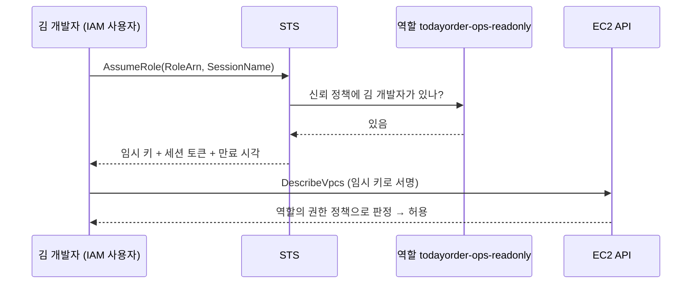
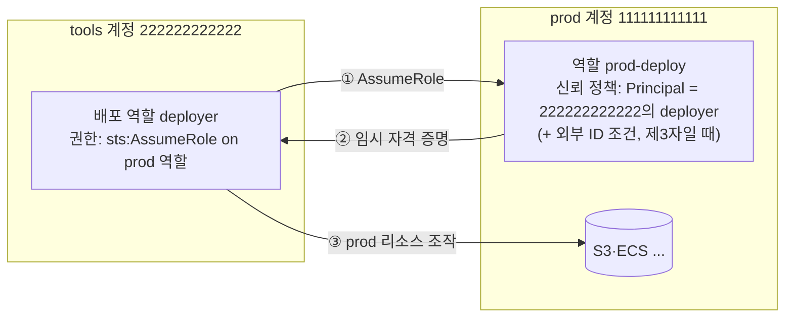

# M01-04. 역할과 STS — AssumeRole, 신뢰 정책, 임시 자격 증명
> 도메인: D1 · 예상 시간: 55분 · 실습 등급: 🟢

## 왜 필요한가

TodayOrder API 서버(EC2)가 S3에서 영수증을 읽어야 한다. 가장 쉬운 방법은 액세스 키를 `.env`에 넣는 것이다. 그런데 그 키는 AMI 스냅샷에도, 로그에도, 퇴사한 동료의 노트북에도 남는다. 또 운영 담당자에게는 평소엔 읽기만, 장애 때만 잠깐 넓은 권한을 주고 싶다. 둘 다 답은 같다: **장기 키 대신 역할(Role)을 맡아 임시 자격 증명을 받는다.**

## 핵심 개념

### 역할 = 신뢰 정책 + 권한 정책

**IAM 역할**은 장기 자격 증명이 없는 신원이다. 누군가 역할을 "맡으면(assume)" **STS(Security Token Service)** 가 그 역할 권한의 **임시 자격 증명**(액세스 키 ID + 비밀 키 + **세션 토큰**, 만료 시각 포함)을 발급한다.

| 문서 | 질문 | 종류 |
|---|---|---|
| **신뢰 정책 (Trust policy)** | **누가** 이 역할을 맡을 수 있나 | 역할에 붙는 **리소스 기반** 정책. `Principal` 필수, Action은 `sts:AssumeRole`(·`AssumeRoleWithWebIdentity`·`AssumeRoleWithSAML`) |
| **권한 정책 (Permissions policy)** | 맡으면 **무엇을** 할 수 있나 | 자격 증명 기반 정책 (관리형·인라인) |



**Principal** 종류:

| 신뢰 정책 Principal | 누가 맡나 | 예 |
|---|---|---|
| `{"AWS": "arn:aws:iam::111122223333:user/kim"}` | 특정 사용자·역할 | 운영 조회 역할 |
| `{"AWS": "arn:aws:iam::111122223333:root"}` | 그 **계정**(그 계정의 IAM 정책이 `sts:AssumeRole`을 허용한 주체) | 교차 계정 역할 |
| `{"Service": "ec2.amazonaws.com"}` | AWS 서비스 | EC2 인스턴스 역할, Lambda 실행 역할 |
| `{"Federated": "arn:aws:iam::...:oidc-provider/..."}` | 외부 IdP로 로그인한 사용자 | GitHub Actions, SAML SSO → [레슨 06](./06-federation-and-directory.md) |

### 임시 자격 증명의 수명

- `AssumeRole`의 `DurationSeconds`: **900초(15분) ~ 역할의 최대 세션 시간**. 최대 세션 시간은 1~12시간으로 설정(기본 1시간). 생략하면 1시간.
- **역할 체이닝**(역할로 받은 자격 증명으로 다시 다른 역할을 맡기)은 세션이 **최대 1시간**으로 제한된다.
- 만료되면 다시 맡아야 한다. SDK는 EC2·Lambda의 역할 자격 증명을 **자동 갱신**한다.

### 교차 계정 접근

TodayOrder가 계정을 prod(111111111111)와 tools(222222222222)로 나눴다고 하자. tools 계정의 배포 시스템이 prod에 배포하려면:



**양쪽이 모두 허용**해야 한다: tools 쪽 자격 증명 정책이 `sts:AssumeRole`을 허용하고, prod 쪽 신뢰 정책이 tools의 주체를 믿어야 한다.

**외부 ID(ExternalId)** 는 **제3자**(감사 SaaS, 모니터링 업체)에게 역할을 맡길 때 쓴다. 업체가 고객마다 다른 외부 ID를 붙여 요청하게 해서, 다른 고객이 우리 역할 ARN을 알아내 업체를 시켜 맡게 하는 **혼동된 대리인(confused deputy)** 문제를 막는다.

### 인스턴스 프로파일

EC2는 역할을 직접 받지 않고 **인스턴스 프로파일**(역할 하나를 담는 상자)을 통해 받는다. 인스턴스 안의 SDK는 **인스턴스 메타데이터 서비스(IMDS)** 에서 역할의 임시 자격 증명을 가져온다. IAM 콘솔에서 EC2용 역할을 **만들면** 같은 이름의 인스턴스 프로파일이 자동으로 생기지만, CLI·SDK·IaC로 역할을 만들 때는 프로파일을 직접 만들고 역할을 넣어야 한다. 인스턴스를 시작하거나 역할을 붙이는 사람에게는 **`iam:PassRole`** 권한이 필요하다(아무 역할이나 서버에 붙여 권한을 키우지 못하게).

## 직접 해 보기

전체 스크립트: [labs/lab02-role-assume-role.sh](./labs/lab02-role-assume-role.sh)

### 1) 역할 만들기

```bash
aws iam create-role --role-name todayorder-ops-readonly --assume-role-policy-document "$TRUST" \
  --query 'Role.{Arn: Arn, RoleId: RoleId, MaxSessionDuration: MaxSessionDuration}'
```

신뢰 정책은 김 개발자 한 명만 믿는다:

```json
{
  "Version": "2012-10-17",
  "Statement": [
    {
      "Effect": "Allow",
      "Principal": {"AWS": "arn:aws:iam::000000000000:user/todayorder-dev-kim2"},
      "Action": "sts:AssumeRole"
    }
  ]
}
```

```
{
    "Arn": "arn:aws:iam::000000000000:role/todayorder-ops-readonly",
    "RoleId": "AROABGXEQES5NRCCJJWAN",
    "MaxSessionDuration": 3600
}
```

권한 정책은 `ec2:Describe*`, `iam:ListRoles`만 허용한다. 역할 ID는 `AROA`로 시작한다(사용자는 `AIDA`).

### 2) 김 개발자가 역할을 맡는다

```bash
aws sts assume-role --role-arn arn:aws:iam::000000000000:role/todayorder-ops-readonly \
  --role-session-name kim-oncall --duration-seconds 900     # 김 개발자의 키로
```

```
AccessKeyId     : EMULATORASLJNSWT6WUL
SecretAccessKey : HOzt... (40자)
SessionToken    : EN+eCBY0tiI0... (712자)
Expiration      : 2026-11-12T12:20:01+00:00
AssumedRoleUser : arn:aws:sts::000000000000:assumed-role/todayorder-ops-readonly/kim-oncall
```

방금 본 것: 임시 자격 증명은 **세 조각**이다. 세션 토큰이 없으면 서명이 통과하지 않는다. 만료 시각은 요청한 15분 뒤다. 에뮬레이터의 임시 키 ID는 `EMULATOR`로 시작한다(실제 AWS는 `ASIA`).

### 3) 임시 자격 증명으로 호출

```bash
export AWS_ACCESS_KEY_ID=... AWS_SECRET_ACCESS_KEY=... AWS_SESSION_TOKEN=...   # 스크립트는 as_role 함수로
aws sts get-caller-identity --query Arn --output text
aws ec2 describe-vpcs --query 'length(Vpcs)'
aws iam create-user --user-name todayorder-should-not-exist
```

```
나는 누구: arn:aws:sts::000000000000:assumed-role/todayorder-ops-readonly/kim-oncall
ec2 describe-vpcs (역할 권한 안): VPC 1 개
aws: [ERROR]: An error occurred (AccessDenied) when calling the CreateUser operation: User: arn:aws:sts::000000000000:assumed-role/todayorder-ops-readonly/kim-oncall is not authorized to perform: iam:CreateUser on resource: user todayorder-should-not-exist because no identity-based policy allows the iam:CreateUser action
```

방금 본 것: 이제 "나"는 김 개발자가 아니라 **`assumed-role/역할/세션이름`** 이다. 세션 이름 덕분에 CloudTrail에서 "역할을 누가 맡아서 했는지" 구분된다.

### 4) 신뢰 정책에 없는 사람

```
aws: [ERROR]: An error occurred (AccessDenied) when calling the AssumeRole operation: User: arn:aws:iam::000000000000:user/todayorder-dev-lee2 is not authorized to perform: sts:AssumeRole on resource: arn:aws:iam::000000000000:role/todayorder-ops-readonly
```

### 5) 세션 정책으로 더 좁히기

```bash
aws sts assume-role --role-arn ... --role-session-name kim-narrow \
  --policy '{"Version":"2012-10-17","Statement":[{"Effect":"Allow","Action":"ec2:DescribeVpcs","Resource":"*"}]}'
```

```
세션 정책 없이 iam list-roles: 역할 1 개
aws: [ERROR]: An error occurred (AccessDenied) when calling the ListRoles operation: User: arn:aws:sts::000000000000:assumed-role/todayorder-ops-readonly/kim-narrow is not authorized to perform: iam:ListRoles on resource: arn:aws:iam::000000000000:role/ because no session policy allows the iam:ListRoles action
```

방금 본 것: 역할은 `iam:ListRoles`를 허용하지만 세션 정책에 없어서 거부 — **역할 권한 ∩ 세션 정책**. 사유 문구가 `no session policy allows`다.

### 6) 외부 ID

```
aws: [ERROR]: An error occurred (AccessDenied) when calling the AssumeRole operation: User: arn:aws:iam::000000000000:user/emulator is not authorized to perform: sts:AssumeRole on resource: arn:aws:iam::000000000000:role/todayorder-partner-audit
외부 ID를 맞게 주면: arn:aws:sts::000000000000:assumed-role/todayorder-partner-audit/audit
```

신뢰 정책의 조건 `"StringEquals": {"sts:ExternalId": "todayorder-audit-7f3a"}` 때문에, `--external-id` 없이는 계정 관리자라도 거부된다.

### 7) 최대 세션 시간

```
aws: [ERROR]: An error occurred (ValidationError) when calling the AssumeRole operation: The requested DurationSeconds exceeds the MaxSessionDuration set for this role.
```

7200초를 요청했지만 역할의 `MaxSessionDuration`이 3600이다. 늘리려면 `aws iam update-role --max-session-duration 43200`(최대 12시간).

### 8) EC2 역할과 인스턴스 프로파일

```bash
aws iam create-role --role-name todayorder-api-server --assume-role-policy-document '{... "Principal": {"Service": "ec2.amazonaws.com"} ...}'
aws iam create-instance-profile --instance-profile-name todayorder-api-server-profile
aws iam add-role-to-instance-profile --instance-profile-name todayorder-api-server-profile --role-name todayorder-api-server
aws ec2 run-instances --image-id "$AMI" --instance-type t3.micro --iam-instance-profile Name=todayorder-api-server-profile ...
aws ec2 describe-iam-instance-profile-associations --filters Name=instance-id,Values=$IID
```

```
arn:aws:iam::000000000000:role/todayorder-api-server
arn:aws:iam::000000000000:instance-profile/todayorder-api-server-profile
aws: [ERROR]: An error occurred (AccessDenied) when calling the AssumeRole operation: User: arn:aws:iam::000000000000:user/emulator is not authorized to perform: sts:AssumeRole on resource: arn:aws:iam::000000000000:role/todayorder-api-server
{
    "Instance": "i-00000000000000001",
    "Profile": "arn:aws:iam::000000000000:instance-profile/todayorder-api-server-profile",
    "State": "associating"
}
```

방금 본 것: 신뢰 정책이 `ec2.amazonaws.com`만 믿으므로 사람(관리자 포함)은 이 역할을 맡을 수 없다. 인스턴스에는 프로파일이 연결됐다(`State`는 실행 시점에 따라 `associating` 또는 `associated`).

### 9) boto3로: 역할을 맡아 새 세션 만들기

[sdk/assume_role_session.py](./sdk/assume_role_session.py)

```
원래 나: arn:aws:iam::000000000000:user/emulator
임시 키 ID: EMULATOR…  만료: 2026-11-12T12:26:02+00:00
역할을 맡은 나: arn:aws:sts::000000000000:assumed-role/todayorder-sdk-ops-readonly/sdk-oncall
ec2:DescribeVpcs 허용 — VPC 1개
iam:CreateUser 거부 — AccessDenied
SDK assume_role_session OK
```

## 실제 AWS에서는

- 임시 액세스 키 ID는 **`ASIA`** 로 시작한다. 에뮬레이터는 `EMULATOR`로 시작하므로, 키 접두사로 "임시냐 장기냐"를 가르는 코드는 에뮬레이터에서 다르게 동작한다.
- 에뮬레이터는 **계정을 분리하지 않는다**(모두 `000000000000`). 교차 계정 실습은 할 수 없다. 다른 계정(`111122223333`)을 Principal로 쓴 신뢰 정책은 현재 계정 주체의 AssumeRole을 `AccessDenied`로 거부하는 것까지만 확인했다.
- 에뮬레이터에서는 신뢰 정책이 **계정 루트**(`arn:aws:iam::000000000000:root`)를 믿을 때, `sts:AssumeRole` 자격 증명 정책이 **없는** 사용자도 역할을 맡을 수 있었다. 사용자에게 `sts:AssumeRole` **명시적 Deny**를 붙여도 맡았다 — 에뮬레이터의 AssumeRole은 신뢰 정책만 보고 호출자의 자격 증명 정책은 평가하지 않는다. 실제 AWS에서는 명시적 Deny가 있으면 항상 거부되고, 이 경우 그 사용자에게 `sts:AssumeRole` Allow가 있어야 한다(신뢰 정책이 사용자 ARN을 직접 지정했다면 같은 계정에서는 없어도 된다).
- 에뮬레이터는 `run-instances --iam-instance-profile`에 **`iam:PassRole`을 검사하지 않았다**. 실제 AWS는 PassRole이 없으면 거부한다.
- 인스턴스가 실제로 부팅되지 않으므로 IMDS(`http://169.254.169.254/latest/meta-data/iam/security-credentials/<역할>`)에서 자격 증명을 꺼내는 과정은 볼 수 없다.
- 실제 계정에서 해 보려면: IAM 역할·STS 호출은 무료다. EC2 단계는 프리 티어 대상 인스턴스 유형(계정 생성 시기에 따라 `t2.micro`/`t3.micro` 또는 크레딧 기반 프리 플랜)을 확인하고 쓰며, 끝나면 `aws ec2 terminate-instances`, `remove-role-from-instance-profile`, `delete-instance-profile`, `delete-role-policy`, `delete-role` 순서로 정리한다.

## 시험 포인트

- "EC2/Lambda가 S3 접근" → **역할**(인스턴스 프로파일/실행 역할). 액세스 키를 인스턴스·코드에 저장하는 답은 오답.
- "다른 계정의 리소스 접근" → 상대 계정에 역할 + 신뢰 정책, 내 쪽에서 `sts:AssumeRole` 허용. **양쪽 허용**.
- "제3자 업체에 계정 접근 허용" → 교차 계정 역할 + **외부 ID** (혼동된 대리인 방지). 업체에 IAM 사용자 키를 주는 답은 오답.
- 신뢰 정책 = 누가 맡나(리소스 기반, Principal), 권한 정책 = 맡으면 무엇을. "AssumeRole이 거부됨" → 신뢰 정책, "맡은 뒤 API가 거부됨" → 권한 정책.
- `AssumeRole` 세션 15분~12시간(역할 설정), 역할 체이닝은 1시간 상한. 세션 정책은 권한을 **좁히기만** 한다.
- 서버에 역할을 붙이는 사람에게는 **`iam:PassRole`** 이 필요하다.

## 스스로 확인

1. 임시 자격 증명으로 호출했더니 `InvalidClientTokenId`가 났다. `AWS_ACCESS_KEY_ID`·`AWS_SECRET_ACCESS_KEY`는 맞게 넣었다. 무엇이 빠졌을까?
2. "AssumeRole 자체가 거부된다"와 "역할을 맡은 뒤 S3 호출이 거부된다"는 각각 어느 정책을 봐야 하는가?
3. 모니터링 SaaS에 우리 계정 읽기 권한을 줘야 한다. 무엇을 만들고, 신뢰 정책에 어떤 조건을 넣는가?

<details><summary>답</summary>

1. `AWS_SESSION_TOKEN`. 임시 자격 증명은 키 ID + 비밀 키 + 세션 토큰 세 개가 있어야 서명이 유효하다.
2. 전자는 역할의 **신뢰 정책**(과 교차 계정이면 호출자 쪽 `sts:AssumeRole` 허용), 후자는 역할의 **권한 정책**(+ 세션 정책·경계·SCP).
3. SaaS 계정을 Principal로 믿는 역할 + 읽기 전용 권한 정책. 신뢰 정책에 `"StringEquals": {"sts:ExternalId": "<업체가 우리에게 준 고유 값>"}` 조건.

</details>
