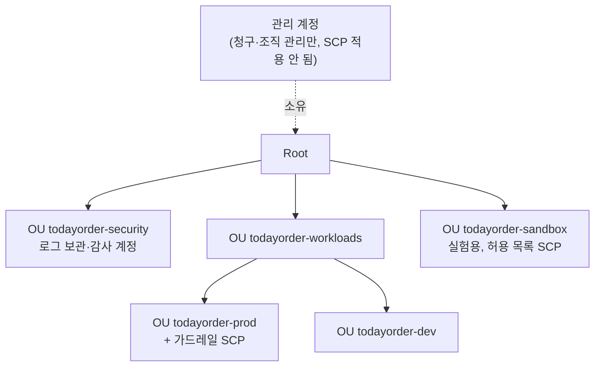

# M01-05. 조직 단위 관리 — Organizations, OU, SCP, 통합 결제, IAM Identity Center, Control Tower, RAM
> 도메인: D1, D4 · 예상 시간: 60분 · 실습 등급: 🟢 (OU) / 🔴 (SCP — 워크시트로 대체)

## 왜 필요한가

TodayOrder가 커지면서 운영(prod)과 개발(dev)을 **한 계정**에 섞어 둔 것이 문제가 됐다. 개발자의 실험 스크립트가 운영 테이블을 지울 뻔했고, 청구서에서 어느 팀이 얼마 썼는지 알 수 없다. 해결책은 **계정을 나누고**, 나뉜 계정들을 한곳에서 **묶어 관리**하는 것이다. 동시에 "어떤 계정이든 감사 로그(CloudTrail)는 못 끈다" 같은 회사 규칙을 계정마다 일일이 걸지 않고 위에서 한 번에 걸고 싶다.

## 핵심 개념

### AWS Organizations

여러 AWS 계정을 하나의 **조직(Organization)** 으로 묶는다.

- **관리 계정(management account)**: 조직을 만든 계정. 청구서를 받고, 계정을 만들고, 정책을 건다. 예전 이름은 "마스터 계정"(API에 `MasterAccountId`로 남아 있다). **워크로드를 두지 않는 것**이 권장 사항이다.
- **멤버 계정**: 조직에 속한 나머지 계정.
- **루트(Root)**: 조직 트리의 꼭대기 컨테이너(루트 사용자와 다른 것). 하나뿐이다.
- **OU(Organizational Unit)**: 계정을 담는 폴더. 중첩 가능(루트 아래 **최대 5단계**). 정책은 OU에 걸면 아래로 상속된다.



조직의 **기능 세트**는 두 가지다: **통합 결제만(Consolidated billing)** 또는 **모든 기능(All features)**. SCP 같은 정책은 "모든 기능"에서만 쓸 수 있다.

### 통합 결제 (Consolidated billing)

- 모든 멤버 계정의 요금이 관리 계정의 **청구서 한 장**으로 온다(계정별 내역은 따로 볼 수 있다).
- 사용량이 **합산**되어 S3 같은 계층 요금의 **볼륨 할인**을 더 빨리 받는다.
- 예약 인스턴스·Savings Plans 할인이 조직 안 다른 계정의 사용량에도 **공유**된다(계정별로 공유를 끌 수 있다).
- 자세한 비용 이야기는 M13.

### SCP (Service Control Policy)

**SCP는 권한을 주지 않는다.** 멤버 계정의 IAM 사용자·역할(멤버 계정의 루트 사용자 포함)이 **가질 수 있는 최대치**를 정한다. 문법은 IAM 정책과 거의 같다.

- 계정에 적용되는 SCP = 루트 → 각 OU → 계정, **모든 계층에서 허용**되어야 한다(계층마다 교집합).
- SCP를 켜면 모든 루트·OU·계정에 **`FullAWSAccess`**(`Allow * *`)가 기본으로 붙는다. 그래서 보통은 이것을 두고 **Deny를 추가하는 거부 목록(deny list) 전략**을 쓴다. 특정 OU에서 `FullAWSAccess`를 떼고 필요한 서비스만 Allow하면 **허용 목록(allow list) 전략**이다.
- **관리 계정에는 적용되지 않는다.** 서비스 연결 역할(service-linked role)에도 적용되지 않는다.
- 한도: SCP 문서 최대 **10,240자**, 루트·OU·계정마다 직접 붙일 수 있는 SCP **최대 10개**(최소 1개는 붙어 있어야 함).
- 최근에는 리소스 쪽 상한선인 **RCP(Resource Control Policy)** 도 있다. SCP는 "우리 주체가 할 수 있는 최대", RCP는 "우리 리소스에 누가 할 수 있는 최대"다.

**최종 권한 = 모든 계층 SCP ∩ (IAM 정책 ∩ 권한 경계 ∩ 세션 정책) — 어디든 명시적 Deny가 있으면 거부.**

### IAM Identity Center (구 AWS SSO)

직원이 **한 번 로그인해서 여러 계정**에 들어가게 하는 서비스. 사람에게 IAM 사용자를 만들지 않는 현재의 표준 방법이다.

- 사용자 원천(ID 소스): Identity Center 자체 디렉터리, Active Directory, 외부 IdP(Okta, Microsoft Entra ID 등, SAML 2.0 + SCIM).
- **권한 세트(Permission set)**: "개발자", "읽기 전용" 같은 권한 묶음. 사용자·그룹 × 계정 × 권한 세트를 할당하면, Identity Center가 각 계정에 역할(`AWSReservedSSO_...`)을 만들어 준다. 사용자는 그 역할의 임시 자격 증명으로 일한다.
- **조직 인스턴스**(Organizations 관리 계정에서 켬, 여러 계정 접근 가능)와 **계정 인스턴스**(한 계정 안의 앱 연결용, 권한 세트 없음)가 있다.

### AWS Control Tower

여러 계정 환경(**랜딩 존**)을 모범 사례대로 **자동 구성**한다: Organizations, 로그 보관·감사 계정, Identity Center, CloudTrail·Config를 한 번에 설정하고, **컨트롤(예전 이름 가드레일)** 을 건다.

| 컨트롤 종류 | 구현 | 하는 일 |
|---|---|---|
| 예방(preventive) | SCP·RCP 등 | 아예 못 하게 막음 |
| 탐지(detective) | AWS Config 규칙 | 위반을 찾아 보고 |
| 사전 예방(proactive) | CloudFormation Hooks | 배포 전에 템플릿 검사 |

**Account Factory**로 새 계정을 표준 설정 그대로 찍어 낸다.

### AWS RAM (Resource Access Manager)

계정을 나누면 "네트워크는 하나로 쓰고 싶다" 같은 요구가 생긴다. RAM은 리소스 자체를 **다른 계정·OU·조직 전체와 공유**한다. 대표 예:

- **VPC 서브넷 공유**: 네트워크 계정이 VPC를 소유하고, 앱 계정들이 그 서브넷에 자기 EC2·RDS를 띄운다 (M02).
- **Transit Gateway**, Route 53 Resolver 규칙, License Manager 구성 등.
- 조직 안에서 공유를 켜면 초대 수락 없이 바로 공유된다.

리소스 정책(버킷 정책 등)으로 계정 간 접근을 여는 것과 다르다: RAM은 "그 리소스를 상대 계정에서 **자기 것처럼** 쓰게" 한다.

## 직접 해 보기

### Part A — OU 트리 만들기 (🟢)

전체 스크립트: [labs/lab05-organizations-ou.sh](./labs/lab05-organizations-ou.sh)

**1) 조직과 루트** — 에뮬레이터에는 조직이 처음부터 있다.

```bash
aws organizations describe-organization \
  --query 'Organization.{Id: Id, FeatureSet: FeatureSet, MasterAccountId: MasterAccountId, PolicyTypes: AvailablePolicyTypes}'
aws organizations list-roots --query 'Roots[0].{Id: Id, Name: Name}'
```

```
{
    "Id": "o-8sh3tqaaaa",
    "FeatureSet": "ALL",
    "MasterAccountId": "000000000000",
    "PolicyTypes": [
        {
            "Type": "SERVICE_CONTROL_POLICY",
            "Status": "ENABLED"
        }
    ]
}
{
    "Id": "r-7qygd7aa",
    "Name": "Root"
}
```

방금 본 것: 기능 세트 `ALL`(모든 기능), 관리 계정은 우리 계정(`000000000000`). SCP 정책 유형이 `ENABLED`로 표시되지만 — 아래에서 보듯 SCP API 자체는 구현되어 있지 않다.

**2) OU 트리**

```bash
aws organizations create-organizational-unit --parent-id "$ROOT_ID" --name todayorder-workloads
aws organizations create-organizational-unit --parent-id "$WL" --name todayorder-prod
...
aws organizations list-organizational-units-for-parent --parent-id "$WL" --query 'OrganizationalUnits[].{Name: Name, Path: Path}'
```

```
security=ou-7qygd7aa-6ofuwnba workloads=ou-7qygd7aa-5mw7f4ba sandbox=ou-7qygd7aa-4kdlzkca prod=ou-7qygd7aa-3iuyi1ca dev=ou-7qygd7aa-2gbc2hda
[
    "todayorder-security",
    "todayorder-workloads",
    "todayorder-sandbox"
]
[
    {
        "Name": "todayorder-prod",
        "Path": "o-8sh3tqaaaa/r-7qygd7aa/ou-7qygd7aa-5mw7f4ba/ou-7qygd7aa-3iuyi1ca/"
    },
    {
        "Name": "todayorder-dev",
        "Path": "o-8sh3tqaaaa/r-7qygd7aa/ou-7qygd7aa-5mw7f4ba/ou-7qygd7aa-2gbc2hda/"
    }
]
```

방금 본 것: OU ID는 `ou-<루트ID 일부>-<무작위>` 형식이고, `Path`가 조직 → 루트 → 상위 OU → 자신의 경로를 보여 준다. 정책 상속도 이 경로를 따라 내려간다.

**3) 규칙 확인**

```
aws: [ERROR]: An error occurred (DuplicateOrganizationalUnitException) when calling the CreateOrganizationalUnit operation: An OU with the same name already exists.
aws: [ERROR]: An error occurred (OrganizationalUnitNotEmptyException) when calling the DeleteOrganizationalUnit operation: The specified OU is not empty. Move all accounts to another root or to other OUs, remove all child OUs, and try the operation again.
```

같은 부모 아래 이름 중복 금지, 하위 OU나 계정이 있는 OU는 삭제 불가.

**4) SCP·계정 API — 501**

```
aws: [ERROR]: An error occurred (NotImplemented) when calling the CreatePolicy operation: operation CreatePolicy is scaffolded but not implemented in this emulator
aws: [ERROR]: An error occurred (NotImplemented) when calling the AttachPolicy operation: operation AttachPolicy is scaffolded but not implemented in this emulator
aws: [ERROR]: An error occurred (NotImplemented) when calling the ListPolicies operation: operation ListPolicies is scaffolded but not implemented in this emulator
aws: [ERROR]: An error occurred (NotImplemented) when calling the ListAccounts operation: operation ListAccounts is scaffolded but not implemented in this emulator
```

SCP를 만들 수도, 붙일 수도, 계정을 만들거나 OU로 옮길 수도 없다. 그래서 SCP는 Part B의 워크시트로 익힌다.

**5) IAM Identity Center 읽기**

```
{
    "Name": "IdentityCenter",
    "Status": "ACTIVE",
    "IdentityStoreId": "d-9067f3a1c2",
    "Owner": "000000000000"
}
--- 권한 세트 만들기
aws: [ERROR]: An error occurred (ValidationException) when calling the CreatePermissionSet operation: This operation is not supported for account instances of IAM Identity Center.
```

방금 본 것: 에뮬레이터의 Identity Center는 **계정 인스턴스**다. 실제 AWS와 같은 규칙으로, 계정 인스턴스에는 권한 세트(=여러 계정 접근)가 없다. 여러 계정 SSO는 조직 인스턴스의 기능이다.

### Part B — SCP 워크시트 (🔴 대체 실습)

SCP를 실제로 붙일 수 없으니, **SCP JSON을 직접 쓰고** 판정을 손으로 한 뒤 [labs/lab06-scp-worksheet.sh](./labs/lab06-scp-worksheet.sh)로 채점한다. 스크립트는 각 계층의 SCP와 IAM 정책을 `iam simulate-custom-policy`로 **따로** 평가하고 교집합을 계산한다 — 실제 AWS의 판정 논리와 같다.

**정책 (원문은 [labs/policies/](./labs/policies/))**

| 계층 | 붙은 SCP |
|---|---|
| Root | [scp-full-aws-access](./labs/policies/scp-full-aws-access.json) (`Allow * *`) |
| workloads OU | scp-full-aws-access |
| prod OU (workloads 아래) | scp-full-aws-access + [scp-prod-guardrails](./labs/policies/scp-prod-guardrails.json) |
| sandbox OU | [scp-sandbox-allow-list](./labs/policies/scp-sandbox-allow-list.json) (FullAWSAccess를 떼고 `s3`·`dynamodb`·`lambda`·`logs`·`cloudwatch`만 허용) |

`scp-prod-guardrails`의 내용:

```json
{
  "Version": "2012-10-17",
  "Statement": [
    {"Sid": "ProtectAuditTrail", "Effect": "Deny",
     "Action": ["cloudtrail:StopLogging", "cloudtrail:DeleteTrail"], "Resource": "*"},
    {"Sid": "StayInOrganization", "Effect": "Deny",
     "Action": "organizations:LeaveOrganization", "Resource": "*"},
    {"Sid": "SeoulAndVirginiaOnly", "Effect": "Deny",
     "NotAction": ["iam:*", "organizations:*", "sts:*", "support:*", "cloudfront:*", "route53:*"],
     "Resource": "*",
     "Condition": {"StringNotEquals": {"aws:RequestedRegion": ["ap-northeast-2", "us-east-1"]}}}
  ]
}
```

세 번째 문장은 "서울·버지니아 밖의 요청은 거부하되, 글로벌 서비스(IAM·STS·CloudFront·Route 53 등)는 예외"라는 흔한 패턴이다. `NotAction` + `Deny` = "이 목록 **빼고** 다 거부".

IAM 정책: [iam-admin](./labs/policies/iam-admin.json)(`Allow * *`), [iam-orders-dev](./labs/policies/iam-orders-dev.json)(주문 테이블 DynamoDB 읽기·쓰기 + `ec2:RunInstances`·`ec2:Describe*`), `none`(정책 없음).

**문제**: 결과를 A(허용) · D(명시적 Deny로 거부) · I(암묵적 Deny로 거부)로 적어라.

| # | 계정 위치 | IAM 정책 | Action | 요청 리전 |
|---|---|---|---|---|
| S1 | prod | iam-admin | `cloudtrail:StopLogging` | ap-northeast-2 |
| S2 | prod | iam-admin | `ec2:RunInstances` | ap-northeast-2 |
| S3 | prod | iam-admin | `ec2:RunInstances` | eu-west-1 |
| S4 | prod | iam-admin | `iam:CreateRole` | eu-west-1 |
| S5 | sandbox | iam-admin | `ec2:RunInstances` | ap-northeast-2 |
| S6 | sandbox | iam-admin | `s3:PutObject` | ap-northeast-2 |
| S7 | sandbox | iam-orders-dev | `s3:PutObject` | ap-northeast-2 |
| S8 | prod | (없음) | `dynamodb:Query` | ap-northeast-2 |
| S9 | **관리 계정** | iam-admin | `cloudtrail:StopLogging` | ap-northeast-2 |
| S10 | prod | iam-admin | `organizations:LeaveOrganization` | us-east-1 |

채점:

```bash
MY_ANSWERS="D A D A I A I I A D" bash curriculum/m01-iam-identity/labs/lab06-scp-worksheet.sh
```

`MY_ANSWERS` 없이 실행한 결과(정답표와 계산 결과만 비교, `내 답` 열은 `-`):

```
== SCP 워크시트 채점 (SCP 계층별 판정 · IAM 판정 · 최종)
#    계정     IAM             Action                            Region          SCP(계층별)                     IAM           최종 정답 내 답
S1   prod       iam-admin       cloudtrail:StopLogging            ap-northeast-2  allowed/allowed/explicitDeny       allowed       D     D     -
S2   prod       iam-admin       ec2:RunInstances                  ap-northeast-2  allowed/allowed/allowed            allowed       A     A     -
S3   prod       iam-admin       ec2:RunInstances                  eu-west-1       allowed/allowed/explicitDeny       allowed       D     D     -
S4   prod       iam-admin       iam:CreateRole                    eu-west-1       allowed/allowed/allowed            allowed       A     A     -
S5   sandbox    iam-admin       ec2:RunInstances                  ap-northeast-2  allowed/implicitDeny               allowed       I     I     -
S6   sandbox    iam-admin       s3:PutObject                      ap-northeast-2  allowed/allowed                    allowed       A     A     -
S7   sandbox    iam-orders-dev  s3:PutObject                      ap-northeast-2  allowed/allowed                    implicitDeny  I     I     -
S8   prod       none            dynamodb:Query                    ap-northeast-2  allowed/allowed/allowed            implicitDeny  I     I     -
S9   management iam-admin       cloudtrail:StopLogging            ap-northeast-2  (적용 안 됨)                   allowed       A     A     -
S10  prod       iam-admin       organizations:LeaveOrganization   us-east-1       allowed/allowed/explicitDeny       allowed       D     D     -
```

`SCP(계층별)` 열은 루트/OU/하위 OU 순서의 판정이다.

<details><summary>해설</summary>

- **S1·S10**: 관리자(`Allow * *`)라도 prod OU의 SCP Deny가 이긴다 → D. "IAM 관리자도 CloudTrail을 못 끈다"가 SCP의 존재 이유다.
- **S3 vs S4**: 같은 eu-west-1이지만 IAM은 `NotAction` 목록에 있어 Deny 대상이 아니다 → S3는 D, S4는 A.
- **S5**: 샌드박스 OU의 허용 목록에 EC2가 없다. Deny가 아니라 "허용 안 됨" → I. 관리자 IAM 정책도 소용없다.
- **S7**: SCP는 S3를 허용하지만 **SCP는 권한을 주지 않는다.** IAM 정책에 S3가 없으니 → I.
- **S8**: SCP가 모두 허용해도 IAM 정책이 없으면 → I.
- **S9**: **관리 계정에는 SCP가 적용되지 않는다** → A. 그래서 관리 계정에 워크로드를 두지 말고, 관리 계정 접근은 극소수로 제한한다.

</details>

스크립트 끝에는 같은 판정을 **권한 경계 입력**으로 흉내 내는 방법도 보여 준다(SCP와 경계는 둘 다 "허용 범위의 상한"이라 S5의 결과가 같다):

```
[
    {
        "Action": "ec2:RunInstances",
        "Decision": "implicitDeny",
        "AllowedByBoundary": false
    },
    {
        "Action": "s3:PutObject",
        "Decision": "allowed",
        "AllowedByBoundary": true
    }
]
```

## 실제 AWS에서는

- 실제로는 `aws organizations create-policy --type SERVICE_CONTROL_POLICY ...`로 SCP를 만들고 `attach-policy --target-id <OU ID>`로 붙인다. 붙이는 즉시 그 OU의 모든 계정에 적용되므로 AWS는 **루트에 바로 붙이지 말고 시험용 OU에서 먼저 확인**하라고 권한다.
- 에뮬레이터에서 501이었던 것: `CreatePolicy`·`AttachPolicy`·`ListPolicies`·`ListPoliciesForTarget`(SCP), `CreateAccount`·`ListAccounts`·`DescribeAccount`·`ListAccountsForParent`·`MoveAccount`(계정), `ListChildren`·`ListParents`·`UpdateOrganizationalUnit`(OU 탐색·이름 변경). `describe-organization`은 SCP를 `ENABLED`로 보여 주지만 실제로 쓸 수는 없다.
- 에뮬레이터의 Identity Center는 계정 인스턴스라 권한 세트를 만들 수 없다. RAM·Directory Service·Control Tower API는 호출은 되지만(빈 목록) 이 모듈에서는 개념만 다룬다.
- **실제 AWS에서 해 보려면**: Organizations·SCP·OU 자체는 무료다. 다만 새 멤버 계정을 만들면 그 계정을 닫는 데 절차와 대기 기간(닫은 뒤 90일 사후 기간)이 있으므로, 연습은 **OU 생성과 SCP 작성·연결**까지만 권한다. 개인 계정에서 조직을 만들면 그 계정이 관리 계정이 되어 SCP가 자신에게는 적용되지 않으므로, SCP 효과를 보려면 멤버 계정이 필요하다. 정리: `aws organizations detach-policy`, `delete-policy`, `delete-organizational-unit`. Control Tower는 여러 서비스(Config·CloudTrail 등)를 켜서 **요금이 발생**하니 연습용으로 켜지 말 것.

## 시험 포인트

- "모든 계정(루트 사용자 포함)에서 특정 서비스·리전·작업 금지" → **SCP**. "SCP로 허용했는데 안 된다" → SCP는 권한을 주지 않는다, IAM 정책도 필요.
- "관리 계정의 사용자를 SCP로 제한" → **불가능**. 관리 계정에는 SCP가 적용되지 않는다.
- "계정 여러 개의 청구서를 하나로, 볼륨 할인·RI 공유" → **Organizations 통합 결제**.
- "직원이 한 번 로그인해서 여러 계정 접근, 기존 AD/IdP 연동" → **IAM Identity Center**(권한 세트). IAM 사용자를 계정마다 만드는 답은 오답.
- "모범 사례대로 다계정 환경을 빠르게, 가드레일·계정 자동 발급" → **Control Tower**(랜딩 존, Account Factory, 예방/탐지 컨트롤).
- "다른 계정에서 같은 서브넷·Transit Gateway 사용" → **AWS RAM**(VPC 공유).
- "SCP로 리전 제한" → `aws:RequestedRegion` + `NotAction`으로 글로벌 서비스 예외.

## 스스로 확인

1. S5(샌드박스 + 관리자 + EC2)가 D가 아니라 I인 이유는?
2. 보안팀이 "어떤 계정의 누구도 CloudTrail을 끄지 못하게" 하려 한다. IAM 권한 경계와 SCP 중 무엇이 맞고, 왜인가? 그리고 그 규칙이 적용되지 않는 계정은?
3. 개발팀 계정 10개의 개발자들이 각 계정에 IAM 사용자를 따로 갖고 있다. 이를 개선하는 서비스와 핵심 개념 두 가지를 말하라.

<details><summary>답</summary>

1. 샌드박스 OU의 SCP는 허용 목록이라 EC2를 **허용하지 않을 뿐** Deny 문장이 없다. 허용이 없어서 거부 = 암묵적 Deny.
2. SCP. 경계는 사용자·역할 하나하나에 걸어야 하고 루트 사용자에는 걸 수 없지만, SCP는 OU 단위로 멤버 계정의 모든 주체(루트 포함)에 적용된다. 관리 계정에는 적용되지 않는다.
3. IAM Identity Center. 사용자·그룹(ID 소스)과 권한 세트를 계정에 할당하면 각 계정에 역할이 생기고, 직원은 한 번 로그인해 임시 자격 증명으로 일한다.

</details>
