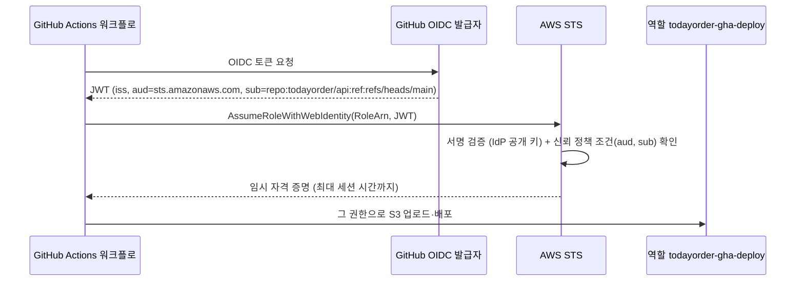

# M01-06. 자격 증명 연동 — SAML·OIDC, Cognito와의 구분, AWS Directory Service
> 도메인: D1 · 예상 시간: 40분 · 실습 등급: 🟡 (OIDC 공급자·역할 구성까지)

## 왜 필요한가

TodayOrder 직원 계정은 이미 회사 Google Workspace(또는 사내 Active Directory)에 있다. AWS에 사람마다 IAM 사용자를 또 만들면 퇴사자 처리 때 두 곳을 지워야 하고, 하나를 빠뜨리면 사고다. 또 GitHub Actions 배포 파이프라인에 넣어 둔 장기 액세스 키가 저장소 설정 화면 너머에서 계속 신경 쓰인다. 답은 **이미 있는 신원(IdP)을 믿고, AWS는 역할의 임시 자격 증명만 준다**는 연동(federation)이다.

## 핵심 개념

### 연동(Federation)이란

외부 **IdP(Identity Provider, 신원 공급자)** 가 "이 사람(또는 이 워크플로)은 누구다"를 서명된 문서(토큰·어서션)로 증명하면, AWS STS가 그것을 검증하고 **역할의 임시 자격 증명**을 내준다. AWS 안에는 IAM 사용자가 생기지 않는다.



| 방식 | 표준 | STS API | 대표 용도 |
|---|---|---|---|
| **SAML 2.0** | XML 어서션 | `AssumeRoleWithSAML` | 기업 IdP(AD FS, Okta, Entra ID) → 직원의 AWS 콘솔·CLI 접근. 지금은 대개 **IAM Identity Center**를 통해 연결 |
| **OIDC (웹 ID)** | JWT | `AssumeRoleWithWebIdentity` | CI/CD(GitHub Actions, GitLab), **EKS 파드의 서비스 계정**, 모바일 앱(대개 Cognito 경유) |
| **IAM Identity Center** | SAML·SCIM을 감싸서 관리 | (내부적으로 역할 세션) | 직원 SSO의 표준. 여러 계정 + 권한 세트 ([레슨 05](./05-organizations-scp.md)) |

IAM에 등록하는 것은 **공급자 객체**다: `aws iam create-saml-provider`(IdP 메타데이터 XML) 또는 `aws iam create-open-id-connect-provider`(발급자 URL·대상(aud)). 역할의 신뢰 정책 `Principal`이 `{"Federated": "<공급자 ARN>"}`이 된다.

### Cognito와의 구분

"로그인"이라는 말이 겹쳐서 헷갈리는 지점이다.

| | IAM 연동 / Identity Center | Amazon Cognito **사용자 풀** | Amazon Cognito **자격 증명 풀** |
|---|---|---|---|
| 누구의 신원? | **직원·CI** — AWS를 운영하는 쪽 | **우리 앱의 고객** (가입·로그인·소셜 로그인) | 로그인한(또는 비로그인) 앱 사용자 |
| 결과물 | AWS 역할 임시 자격 증명 | **JWT** (ID·액세스 토큰) — 우리 API가 검증 | **AWS 임시 자격 증명** — 앱이 S3 등 AWS를 **직접** 호출 |
| 규모 | 직원 수 | 수백만 사용자 | 수백만 사용자 |

TodayOrder 예: 개발자가 콘솔에 들어가는 것 → Identity Center. 고객이 앱에 가입·로그인 → Cognito 사용자 풀. 고객 앱이 자기 프로필 사진을 S3에 직접 올리기 → Cognito 자격 증명 풀(사용자 풀 토큰을 AWS 자격 증명으로 교환). Cognito 실습은 M07.

### AWS Directory Service — Active Directory가 필요할 때

윈도 서버, SQL Server, 사내 그룹 정책처럼 **Active Directory 자체**가 필요한 워크로드가 있다.

| 서비스 | 무엇 | 언제 |
|---|---|---|
| **AWS Managed Microsoft AD** | AWS가 운영하는 **진짜 Microsoft AD**(Standard: 직원 약 5,000명·객체 약 30,000개, Enterprise: 객체 약 500,000개). 온프레미스 AD와 **신뢰(trust)** 관계 가능, MFA 지원 | 클라우드에 AD가 필요(RDS for SQL Server의 Windows 인증, 도메인 가입 EC2), 온프레미스 AD와 연결 |
| **AD Connector** | 온프레미스 AD로 인증 요청을 **전달만 하는 프록시**. AWS에 디렉터리 데이터를 저장하지 않는다. 온프레미스와 VPN/Direct Connect 연결 필요 | 기존 사내 AD 계정으로 AWS 앱(WorkSpaces 등)·콘솔에 로그인, EC2 도메인 가입. 새 디렉터리를 만들고 싶지 않을 때 |
| **Simple AD** | Samba 4 기반 **AD 호환** 저가 디렉터리 | 소규모, 기본 AD 기능만. 신뢰 관계·MFA·스키마 확장 **불가**, RDS SQL Server와 호환 안 됨 |

선택 요령: "온프레미스 AD를 그대로 쓰고 AWS에 데이터를 두지 마라" → **AD Connector**. "AWS에 실제 AD + 온프레미스와 신뢰" → **Managed Microsoft AD**. "작고 싸게, AD 호환이면 충분" → **Simple AD**. "고객 수백만 명 가입·로그인" → 디렉터리 서비스가 아니라 **Cognito**.

## 직접 해 보기

전체 스크립트: [labs/lab07-oidc-federation.sh](./labs/lab07-oidc-federation.sh)

### 1) OIDC 공급자 등록

```bash
aws iam create-open-id-connect-provider --url https://token.actions.githubusercontent.com \
  --client-id-list sts.amazonaws.com \
  --thumbprint-list 6938fd4d98bab03faadb97b34396831e3780aea1
aws iam list-open-id-connect-providers --query 'OpenIDConnectProviderList[].Arn'
```

```
{
    "OpenIDConnectProviderArn": "arn:aws:iam::000000000000:oidc-provider/token.actions.githubusercontent.com"
}
[
    "arn:aws:iam::000000000000:oidc-provider/token.actions.githubusercontent.com"
]
```

방금 본 것: 공급자 ARN은 발급자 호스트 이름으로 만들어진다. `client-id-list`는 토큰의 `aud`(대상)로 받아 줄 값이다.

### 2) 배포 역할 — "이 저장소의 main 브랜치만"

```
arn:aws:iam::000000000000:role/todayorder-gha-deploy
{
    "Effect": "Allow",
    "Principal": {
        "Federated": "arn:aws:iam::000000000000:oidc-provider/token.actions.githubusercontent.com"
    },
    "Action": "sts:AssumeRoleWithWebIdentity",
    "Condition": {
        "StringEquals": {
            "token.actions.githubusercontent.com:aud": "sts.amazonaws.com"
        },
        "StringLike": {
            "token.actions.githubusercontent.com:sub": "repo:todayorder/api:ref:refs/heads/main"
        }
    }
}
```

방금 본 것: 조건 키 이름이 `<발급자>:aud`, `<발급자>:sub`다. **`sub` 조건이 핵심 보안 장치**다. 이것을 빼거나 `repo:*`처럼 넓히면 GitHub의 **아무 저장소**의 워크플로나 이 역할을 맡을 수 있다.

### 3) 일반 AssumeRole로는 못 맡는다

```
aws: [ERROR]: An error occurred (AccessDenied) when calling the AssumeRole operation: User: arn:aws:iam::000000000000:user/emulator is not authorized to perform: sts:AssumeRole on resource: arn:aws:iam::000000000000:role/todayorder-gha-deploy
```

신뢰 정책의 주체가 `Federated`이고 액션이 `sts:AssumeRoleWithWebIdentity`이므로, IAM 사용자(관리자 포함)의 `AssumeRole`은 거부된다.

### 여기서 멈추는 이유 (🟡)

토큰 교환(`AssumeRoleWithWebIdentity`)은 실습하지 않는다. 에뮬레이터는 토큰 서명을 검증하려고 **발급자의 공개 키를 가져오려 한다**. 임의로 만든 토큰을 넣어 보면 `InvalidIdentityToken: Couldn't retrieve verification key from your identity provider`로 끝나고, 그 과정에서 외부(GitHub)로 요청을 시도할 수 있다. 이 커리큘럼의 실습은 외부로 나가는 요청을 만들지 않는다.

SAML 공급자도 만들지 않았다: `create-saml-provider`는 1,000자 이상의 IdP 메타데이터 XML이 필요하다(에뮬레이터도 길이를 검사한다).

## 실제 AWS에서는

- GitHub Actions에서는 워크플로에 `permissions: id-token: write`를 주고 `aws-actions/configure-aws-credentials` 액션에 `role-to-assume`을 넘기면 위 흐름이 자동으로 일어난다. 저장소 비밀 값에 액세스 키를 넣을 필요가 없다.
- GitHub처럼 널리 쓰이는 OIDC 공급자는 AWS가 자체 신뢰 루트로 검증하므로 지문(thumbprint) 값이 실제 검증에 쓰이지 않는다(그래도 API는 값을 받는다).
- **실제 AWS에서 해 보려면**: OIDC 공급자·역할은 무료다. 개인 저장소에 워크플로를 만들고 `aws sts get-caller-identity`만 실행해 보는 것이 가장 안전한 연습이다. 끝나면 `aws iam delete-role-policy`, `delete-role`, `delete-open-id-connect-provider`. Directory Service(Managed Microsoft AD, Simple AD, AD Connector)는 **시간당 요금**이 붙으니 연습용으로 만들지 않는다.

## 시험 포인트

- "직원이 기존 회사 계정(AD/IdP)으로 AWS 콘솔에 로그인" → **IAM Identity Center**(또는 SAML 2.0 연동). IAM 사용자를 새로 만드는 답은 오답.
- "CI/CD·EKS 파드·모바일 앱이 장기 키 없이 AWS 호출" → **OIDC 연동 + AssumeRoleWithWebIdentity**(모바일은 Cognito 자격 증명 풀).
- "고객 가입·로그인·소셜 로그인·JWT" → **Cognito 사용자 풀**. "고객 앱이 AWS 리소스를 직접 호출" → **Cognito 자격 증명 풀**.
- "온프레미스 AD 사용, 클라우드에 디렉터리 데이터 저장 금지" → **AD Connector**. "AWS에 진짜 AD + 온프레미스와 신뢰 관계" → **Managed Microsoft AD**. "작고 싼 AD 호환" → **Simple AD**(신뢰·MFA 불가).
- 연동된 사용자의 권한 = 그가 맡은 **역할**의 권한(+ 세션 정책). 연동 사용자는 IAM 사용자가 아니다.

## 스스로 확인

1. OIDC 신뢰 정책에서 `sub` 조건을 빼면 어떤 위험이 생기는가?
2. "고객 앱 로그인"과 "직원의 AWS 콘솔 로그인"에 각각 어떤 서비스를 쓰는가?
3. 회사가 온프레미스 AD를 유지하면서 Amazon WorkSpaces 로그인에 그 계정을 그대로 쓰고 싶다. AWS 쪽에 디렉터리 사본을 두고 싶지 않다. 무엇을 고르는가?

<details><summary>답</summary>

1. 같은 발급자(GitHub)의 토큰이면 어느 저장소·브랜치의 워크플로든 `aud`만 맞추면 역할을 맡을 수 있다. 남의 저장소에서 우리 계정으로 배포할 수 있게 된다.
2. 고객 앱 로그인 → Cognito 사용자 풀. 직원 콘솔 로그인 → IAM Identity Center(회사 IdP 연동).
3. AD Connector. 인증 요청을 온프레미스 AD로 전달하는 프록시라 AWS에 디렉터리 데이터를 저장하지 않는다(온프레미스와 네트워크 연결 필요).

</details>
