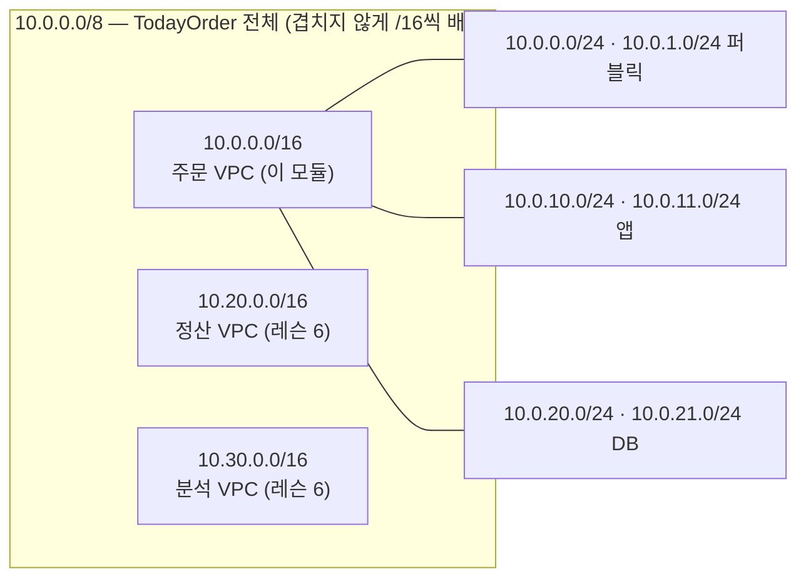

# M02-01. IP와 CIDR 속성 과외
> 도메인: D1, D2 · 예상 시간: 50분 · 실습 등급: 🟢

## 왜 필요한가

TodayOrder의 첫 네트워크를 만들 차례다. AWS 콘솔은 VPC를 만들 때 맨 먼저 `IPv4 CIDR 블록`을 묻는다. 여기서 `10.0.0.0/16`과 `10.0.0.0/24`의 차이를 모르고 아무 값이나 넣으면, 반년 뒤 서버를 늘릴 자리가 없거나(VPC의 주 CIDR은 나중에 바꿀 수 없다) 정산팀 VPC·본사 네트워크와 주소가 겹쳐 연결 자체가 불가능해진다. 네트워크 설계에서 되돌리기 가장 어려운 결정이 바로 이 숫자다. 그래서 이 모듈은 계산부터 시작한다.

## 핵심 개념

### IPv4 주소는 32비트 정수다

`10.0.10.25`는 8비트씩 끊어 10진수로 쓴 32비트 숫자다.

```
10       .0        .10       .25
00001010 .00000000 .00001010 .00011001
```

### CIDR = "앞에서 몇 비트가 네트워크인가"

`10.0.10.0/24`의 `/24`는 **접두사 길이**다. 앞 24비트(`10.0.10`)는 고정이고 뒤 8비트가 자유롭다. 자유로운 비트가 h개면 주소는 2^h개다.

| 표기 | 고정 비트 | 자유 비트 | 주소 수 | 범위 |
|---|---|---|---|---|
| `10.0.0.0/16` | 16 | 16 | 65,536 | 10.0.0.0 ~ 10.0.255.255 |
| `10.0.10.0/24` | 24 | 8 | 256 | 10.0.10.0 ~ 10.0.10.255 |
| `10.0.0.0/23` | 23 | 9 | 512 | 10.0.0.0 ~ 10.0.1.255 |
| `10.0.17.64/28` | 28 | 4 | 16 | 10.0.17.64 ~ 10.0.17.79 |

외울 것은 하나다: **접두사가 1 커지면 주소 수가 반으로, 1 작아지면 두 배로.** /24가 256이면 /25는 128, /23은 512.

### 서브넷 마스크와 "블록 크기 = 256 − 마스크 옥텟" 요령

같은 정보를 옛 표기인 **서브넷 마스크**로 쓰기도 한다(OS의 `ifconfig`·`ip addr`, 온프렘 장비 설정에서 자주 본다). 접두사 길이만큼 앞에서부터 1을 채운 32비트 값이다.

| 접두사 | 서브넷 마스크 | 걸리는 옥텟 | 블록 크기 (256 − 마스크 옥텟) |
|---|---|---|---|
| /16 | `255.255.0.0` | 2번째 옥텟 경계 | 3번째 옥텟 0~255 전체 |
| /20 | `255.255.240.0` | 3번째 (240) | 16 → `x.x.0`, `x.x.16`, `x.x.32`, … |
| /23 | `255.255.254.0` | 3번째 (254) | 2 → `x.x.0`, `x.x.2`, `x.x.4`, … |
| /24 | `255.255.255.0` | 4번째 경계 | 4번째 옥텟 0~255 전체 |
| /26 | `255.255.255.192` | 4번째 (192) | 64 → `.0`, `.64`, `.128`, `.192` |
| /28 | `255.255.255.240` | 4번째 (240) | 16 → `.0`, `.16`, `.32`, … |

요령: 마스크에서 **255도 0도 아닌 옥텟**(걸리는 옥텟)을 찾고, 256에서 그 값을 뺀 것이 그 옥텟에서의 **블록 크기**다. 주소의 그 옥텟을 블록 크기의 배수로 내림하면 네트워크 주소, 거기에 블록 크기 − 1을 더하면 마지막 주소다. 비트를 쓰지 않고도 아래 예제를 다 풀 수 있다.

### 손으로 푸는 예제 4개

**예제 1 — 이 IP는 이 서브넷에 속하나?** `10.0.1.200`은 `10.0.0.0/23` 안인가?

/23은 자유 비트 9개 → 512개 = 세 번째 옥텟 기준으로 **2칸**(256 × 2). 블록은 `10.0.0.x ~ 10.0.1.x`. `10.0.1.200`은 그 안이다 → **예**.

**예제 2 — 블록 경계 찾기.** `172.16.5.130/26`의 네트워크 주소와 마지막 주소는?

/26은 마지막 옥텟에서 자유 비트 6개 → 블록 크기 64. 130을 64로 나눈 몫 2 → 시작 2 × 64 = 128. 범위는 `172.16.5.128 ~ 172.16.5.191`. AWS 서브넷이라면 쓸 수 있는 주소는 `.132 ~ .190`(아래 예약 5개 참고)으로 59개.

**예제 3 — 나누기.** `10.0.0.0/16`을 /20 서브넷으로 나누면 몇 개, 각각 어디서 시작하나?

/16 → /20은 4비트 더 고정 → 2^4 = **16개**, 각 4,096개. 세 번째 옥텟 기준 블록 크기는 4,096 ÷ 256 = 16칸 → `10.0.0.0/20`, `10.0.16.0/20`, `10.0.32.0/20`, …, `10.0.240.0/20`.

**예제 4 — 겹침 확인.** `10.0.0.0/16`과 `10.0.128.0/17`은 겹치나? `10.0.0.0/16`과 `10.1.0.0/16`은?

첫째: `10.0.128.0/17`의 범위 `10.0.128.0 ~ 10.0.255.255`가 `10.0.0.0/16`(`10.0.0.0 ~ 10.0.255.255`) 안에 통째로 들어 있다 → **겹친다.** 둘째: 두 번째 옥텟이 0과 1로 다르고 /16은 앞 두 옥텟이 고정 → **안 겹친다.**

### 사설 대역(RFC 1918)

인터넷에서 라우팅되지 않는, 누구나 내부용으로 쓰는 대역이다. VPC는 보통 여기서 고른다.

| 대역 | 크기 | 메모 |
|---|---|---|
| `10.0.0.0/8` | 1,677만 개 | 가장 넓다. 회사 전체 계획을 세우기 좋다 |
| `172.16.0.0/12` | 104만 개 | `172.16.0.0 ~ 172.31.255.255`. AWS **기본 VPC는 `172.31.0.0/16`** |
| `192.168.0.0/16` | 6.5만 개 | 집 공유기 대역. 직원 재택 VPN과 겹치기 쉬워 피하는 편이 낫다 |

(AWS는 RFC 1918 밖의 대역도 VPC에 허용하지만, 그 대역의 실제 인터넷 주소와 통신할 수 없게 되므로 특별한 이유가 없으면 쓰지 않는다.)

### AWS의 크기 제한과 예약 주소 5개

- VPC와 서브넷의 IPv4 CIDR은 모두 **/16 ~ /28** 이다. /16보다 크거나(/15) /28보다 작으면(/29) 거부된다.
- 서브넷은 VPC CIDR 안에 있어야 하고, 같은 VPC의 다른 서브넷과 겹칠 수 없다.
- **서브넷마다 5개는 쓸 수 없다.** `10.0.10.0/24`라면:

| 주소 | 용도 |
|---|---|
| `10.0.10.0` | 네트워크 주소 |
| `10.0.10.1` | VPC 라우터 |
| `10.0.10.2` | DNS 서버 (정확히는 "VPC CIDR 시작 + 2"가 Amazon DNS. 각 서브넷의 +2도 예약) |
| `10.0.10.3` | 향후 사용 예약 |
| `10.0.10.255` | 네트워크 브로드캐스트 주소 (VPC는 브로드캐스트를 지원하지 않지만 예약) |

그래서 **사용 가능 IP = 2^(32 − 접두사) − 5.** /24 → 251, /28 → 11.

### TodayOrder의 주소 계획



세 번째 옥텟에 의미를 담았다(0\~9 퍼블릭, 10\~19 앱, 20\~29 DB). 서브넷 6개는 VPC의 65,536개 중 1,536개만 쓴다 — **남겨 두는 것이 계획이다.** AZ를 하나 더 쓰거나 티어를 추가할 때 같은 규칙으로 이어 붙일 수 있다. 전체 표는 [README의 CIDR 계획](./README.md#cidr-계획).

## 직접 해 보기

[lab01-cidr-basics.sh](./labs/lab01-cidr-basics.sh)는 연습용 VPC `10.99.0.0/16`에 크기가 다른 서브넷 4개를 만들고, **손계산(2^(32−n) − 5)과 에뮬레이터의 `AvailableIpAddressCount`를 나란히** 보여 준다. 그다음 규칙 위반 네 가지를 일부러 시도한다.

```bash
bash curriculum/m02-vpc-networking/labs/lab01-cidr-basics.sh
```

```
== 1. 연습용 VPC 10.99.0.0/16 (2^16 = 65,536개 주소)
   vpc-00000000000000080
== 2. 크기가 다른 서브넷 4개: 손계산 vs AvailableIpAddressCount
   CIDR                total   2^(32-n)-5   AvailableIpAddressCount
   10.99.0.0/20         4096         4091                      4091
   10.99.16.0/24         256          251                       251
   10.99.17.0/26          64           59                        59
   10.99.17.64/28         16           11                        11
== 3. 서브넷은 /28 보다 작을 수 없다 (/29 시도)
aws: [ERROR]: An error occurred (InvalidSubnet.Range) when calling the CreateSubnet operation: The CIDR '10.99.18.0/29' is invalid.
== 4. VPC 범위(10.99.0.0/16) 밖의 서브넷 (10.100.0.0/24 시도)
aws: [ERROR]: An error occurred (InvalidSubnet.Range) when calling the CreateSubnet operation: The CIDR '10.100.0.0/24' is invalid.
== 5. 이미 있는 서브넷(10.99.16.0/24)과 겹치는 CIDR (10.99.16.128/25 시도)
aws: [ERROR]: An error occurred (InvalidSubnet.Conflict) when calling the CreateSubnet operation: The CIDR '10.99.16.128/25' conflicts with another subnet
== 6. VPC 자체도 /16 ~ /28 (/15, /29 시도)
aws: [ERROR]: An error occurred (InvalidVpc.Range) when calling the CreateVpc operation: The CIDR '10.0.0.0/15' is invalid.
aws: [ERROR]: An error occurred (InvalidVpc.Range) when calling the CreateVpc operation: The CIDR '10.0.0.0/29' is invalid.
== 7. 정리
  (정리) todayorder-cidr-lab (vpc-00000000000000080) 와 의존 리소스를 지웁니다
LAB01 OK
```

방금 본 것:
- 네 줄 모두 손계산과 에뮬레이터 값이 같다. `/20`의 4,091은 실제 AWS 기본 VPC 서브넷의 사용 가능 IP와 같은 숫자다.
- `/29` 서브넷과 VPC 밖(`10.100.0.0/24`) 서브넷은 둘 다 `InvalidSubnet.Range`, 기존 서브넷과 겹치면 `InvalidSubnet.Conflict`. VPC는 `/15`·`/29` 모두 `InvalidVpc.Range`.
- 실습용 VPC는 마지막에 지운다. 서브넷이 남아 있으면 VPC를 지울 수 없으므로(`DependencyViolation`) lab이 서브넷부터 지운다(`_lib.sh`의 `teardown_vpc`).

**손으로 더 풀어 보기** — 답을 적고 lab01처럼 에뮬레이터로 확인해 보자(`aws ec2 create-subnet ... --query Subnet.AvailableIpAddressCount`).

1. `10.99.0.0/16` 안에 `/27` 서브넷을 만들면 사용 가능 IP는?
2. `10.99.17.0/26`(lab01에서 만든 것)과 `10.99.17.32/27`은 겹치는가?
3. `10.0.0.0/16`을 AZ 3개 × 티어 3개 = 서브넷 9개로 **같은 크기로** 나눈다. 서브넷 하나를 가능한 한 크게 하면 /몇인가?
4. `10.0.10.0/24`를 같은 크기의 서브넷 4개로 나눠라. 각각의 CIDR과 AWS에서 쓸 수 있는 IP 수는?
5. 어떤 인스턴스의 IP가 `10.0.37.200`, 마스크가 `255.255.240.0`이다. 이 서브넷의 CIDR 표기와 주소 범위는?
6. `10.0.20.0/22`를 /23 하나와 /24 두 개로 겹치지 않게 나눠라.

<details><summary>답</summary>

1. 2^5 − 5 = **27**.
2. **겹친다.** `/26`의 범위는 `10.99.17.0 ~ 10.99.17.63`이고 `10.99.17.32 ~ .63`이 그 안에 있다 → `InvalidSubnet.Conflict`.
3. 9개를 담으려면 2의 거듭제곱 중 9 이상인 16개로 나눠야 하므로 /16 + 4 = **/20**(각 4,096개). 7개는 남겨 둔다.
4. 4개 = 2^2 → 접두사 +2 = **/26**, 마스크 `255.255.255.192`, 블록 크기 256 − 192 = 64: `10.0.10.0/26`, `10.0.10.64/26`, `10.0.10.128/26`, `10.0.10.192/26`. 각 64 − 5 = **59개**.
5. 걸리는 옥텟은 3번째(240) → 블록 크기 16. 37을 16의 배수로 내림 → 32. **`10.0.32.0/20`**, 범위 `10.0.32.0 ~ 10.0.47.255`(32 + 16 − 1 = 47).
6. 큰 것부터 경계에 맞춰 놓는다: **`10.0.20.0/23`**(`10.0.20.0 ~ 10.0.21.255`), **`10.0.22.0/24`**, **`10.0.23.0/24`**. (/24 두 개를 앞에 두고 /23을 `10.0.22.0/23`에 놓아도 된다 — /23의 시작이 블록 크기 2의 배수(22)이기 때문. 반대로 `10.0.21.0/23` 같은 시작은 경계가 아니라 성립하지 않는다.)

</details>

## 실제 AWS에서는

- 계산 규칙(크기 /16~/28, 예약 5개, 겹침 금지)은 에뮬레이터와 같다. VPC·서브넷 자체에는 요금이 없다.
- VPC의 **주 CIDR은 바꿀 수 없다.** 모자라면 보조 CIDR을 추가한다(기본 할당량은 VPC당 IPv4 CIDR 5개, 요청하면 최대 50개). 다만 이미 다른 네트워크와 연결 계획이 있다면 보조 CIDR도 겹치지 않아야 한다.
- 실제 계정에는 리전마다 **기본 VPC**(`172.31.0.0/16`, AZ마다 `/20` 기본 서브넷)가 이미 있다. 실습·운영 리소스는 기본 VPC가 아니라 직접 설계한 VPC에 두는 것이 좋다.
- 회사 네트워크가 크면 **Amazon VPC IPAM**으로 계정·리전 전체의 CIDR 할당을 중앙에서 관리한다(겹침 방지). 시험에는 "여러 계정의 IP 주소 계획을 중앙 관리" 같은 문장으로 나온다.

## 시험 포인트

- "서브넷에 호스트 N개" → 2^(32−n) − 5 ≥ N 인 가장 큰 n. 예: 500개 → /23(507), 250개 → /24(251). **5개를 빼는 것을 잊게 만드는 함정**이 단골이다.
- VPC·서브넷 크기는 **/16 ~ /28**. /28 서브넷의 사용 가능 IP는 **11**.
- 피어링·TGW·VPN으로 이을 네트워크는 **CIDR이 겹치면 안 된다** → "나중에 연결할 수 있게 설계" = 처음부터 겹치지 않는 대역 배정.
- VPC CIDR이 부족하다 → 새 VPC가 아니라 **보조 CIDR 추가**.
- 서브넷은 **AZ 하나에만** 속한다. 고가용성은 "AZ마다 서브넷"으로 만든다(레슨 2).

## 스스로 확인

1. 왜 VPC를 /16으로 크게 잡고 서브넷은 /24로 작게 나누는가? 반대로 VPC를 /24로 만들면 무엇이 곤란한가?
2. 운영팀이 "DB 서브넷에 IP가 251개나 필요 없으니 /28로 줄이자"고 한다. 무엇을 확인하고 답해야 하나?
3. 정산팀이 이미 `10.0.0.0/16`을 쓰는 VPC를 갖고 있다. 이 사실을 알게 된 시점이 TodayOrder VPC를 만들기 전과 후일 때 각각 어떤 선택지가 있나?

<details><summary>답</summary>

1. VPC의 주 CIDR은 바꿀 수 없으므로 크게 잡아 두고, 서브넷은 필요할 때 추가한다. VPC가 /24면 256개 안에서 AZ×티어 서브넷을 나눠야 해서(예: /28 16개, 각 11개) 금방 바닥난다.
2. 그 서브넷에 들어갈 ENI 수를 확인한다. RDS Multi-AZ·읽기 복제본·RDS Proxy·Lambda(VPC 연결) 같은 서비스도 서브넷 IP를 쓰고, 유지 관리·장애 조치 때 일시적으로 IP가 더 필요할 수 있다. /28(11개)은 여유가 거의 없다.
3. 만들기 전이면 겹치지 않는 대역(예: `10.20.0.0/16`)을 고르면 끝. 만든 뒤라면 피어링·TGW로 직접 이을 수 없으므로 새 VPC로 이전하거나, 겹치는 네트워크 사이에 프라이빗 NAT 게이트웨이(레슨 3)나 PrivateLink(레슨 5)처럼 주소 변환·서비스 단위 노출을 쓰는 우회 설계가 필요하다 — 비싸고 복잡하다.

</details>
