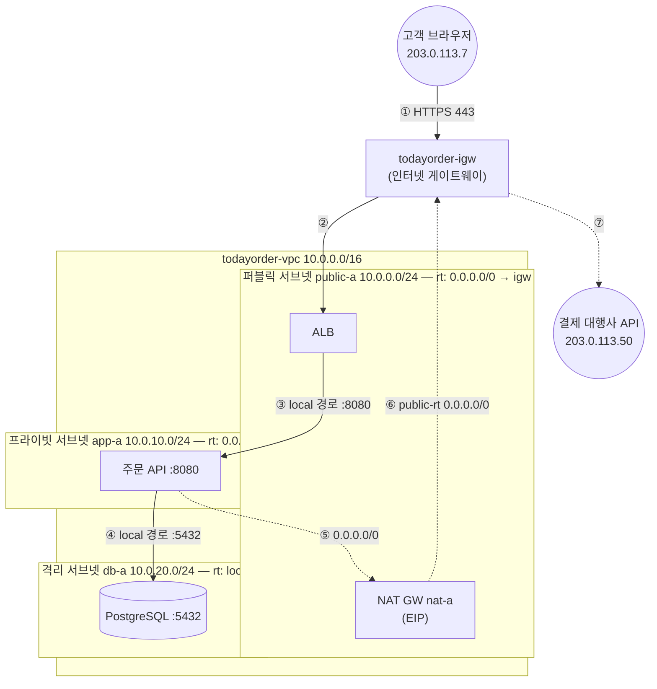
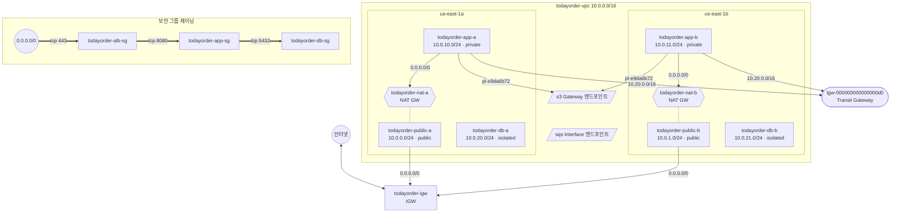

# M02-02. VPC, 서브넷, 라우팅 테이블, IGW — "퍼블릭 서브넷"의 정의
> 도메인: D1, D2 · 예상 시간: 60분 · 실습 등급: 🟢

## 왜 필요한가

지금 TodayOrder는 IDC 서버 한 대에 웹·API·DB가 다 들어 있고, 방화벽 하나로 22·80·5432를 열고 닫는다. AWS로 옮기면서 팀장이 정한 원칙은 하나다: **"DB는 인터넷에서 절대 닿을 수 없는 곳에, 고객이 닿는 것은 로드 밸런서뿐."** 이 원칙을 AWS에서는 방화벽 설정이 아니라 **네트워크 구조**로 표현한다. 어떤 서브넷이 인터넷과 통하고 어떤 서브넷이 갇혀 있는지는 오직 라우팅 테이블이 정한다. 이 레슨에서 그 구조를 직접 만들고, 패킷이 어디로 가는지 표를 읽어 따라가 본다.

## 핵심 개념

### 용어 다섯 개

| 용어 | 한 줄 정의 | IDC에 비유하면 |
|---|---|---|
| **VPC**(Virtual Private Cloud) | 리전 안에 만드는 나만의 격리된 사설 네트워크. CIDR 하나(이상)를 갖는다 | 건물 전체의 사내망 |
| **서브넷**(Subnet) | VPC CIDR의 일부를 잘라 **AZ 하나**에 둔 구역. 인스턴스·ALB·RDS의 ENI가 여기 놓인다 | 층별 네트워크 |
| **라우팅 테이블**(Route Table) | "목적지 CIDR → 다음 홉" 목록. 서브넷마다 정확히 하나가 적용된다 | 층별 라우터 설정 |
| **인터넷 게이트웨이**(IGW) | VPC와 인터넷을 잇는 문. VPC당 하나. 수평 확장·이중화되어 있어 병목·단일 장애점이 아니다 | 건물의 인터넷 회선 |
| **ENI**(Elastic Network Interface) | 사설 IP를 가진 가상 랜카드. 보안 그룹은 여기에 붙는다(레슨 4) | 서버의 랜카드 |

### 라우팅 테이블이 서브넷에 적용되는 규칙

- VPC를 만들면 **기본(main) 라우팅 테이블**이 자동으로 생기고, 거기에는 `VPC CIDR → local` 경로 하나만 있다. `local`은 "VPC 안이면 바로 전달"이며 지울 수 없다.
- 서브넷을 어떤 라우팅 테이블에 **명시적으로 연결**하면 그 테이블을 쓰고, 연결하지 않으면 main을 쓴다.
- 경로를 고를 때는 **최장 접두사 일치**(longest prefix match): 목적지에 맞는 경로 중 접두사가 가장 긴 것을 고른다. `10.0.21.10`은 `10.0.0.0/16`(/16)과 `0.0.0.0/0`(/0)에 모두 맞지만 /16이 이긴다 → `local`.

### "퍼블릭 서브넷"의 정의

> **서브넷에 적용되는 라우팅 테이블에 `0.0.0.0/0 → igw-…` 경로가 있으면 퍼블릭 서브넷, 없으면 프라이빗 서브넷이다.**

서브넷 이름, "퍼블릭 IP 자동 할당(`MapPublicIpOnLaunch`)" 설정은 정의가 아니다. 자동 할당은 "이 서브넷에서 뜨는 인스턴스에 공인 IP를 붙여 줄까?"라는 편의 설정일 뿐이고, 경로가 없으면 공인 IP가 있어도 인터넷과 통하지 않는다. 인스턴스 하나가 인터넷과 직접 통신하려면 네 가지가 모두 필요하다.

1. VPC에 IGW가 연결되어 있다.
2. 그 인스턴스 서브넷의 라우팅 테이블에 `0.0.0.0/0 → IGW`가 있다. ← **퍼블릭 서브넷**
3. 인스턴스가 공인 IPv4(자동 할당 또는 Elastic IP)를 갖고 있다. IGW가 사설 IP ↔ 공인 IP를 1:1로 바꿔 준다.
4. 보안 그룹·NACL이 허용한다(레슨 4).

### TodayOrder 3-티어 VPC와 패킷 경로



- **들어오는 길(실선)**: 고객 → IGW → 퍼블릭 서브넷의 ALB → (VPC 안이므로 `local`) → 앱 → (`local`) → DB. 앱·DB 서브넷에는 IGW 경로가 없으므로 인터넷에서 **직접** 닿을 길이 없다. 들어올 수 있는 유일한 입구는 퍼블릭 서브넷의 ALB다.
- **나가는 길(점선)**: 앱이 외부 결제 API를 부르면 앱 서브넷 라우팅 테이블의 `0.0.0.0/0`이 NAT 게이트웨이를 가리키고, NAT가 있는 퍼블릭 서브넷의 라우팅 테이블이 다시 IGW를 가리킨다. 응답은 같은 길로 돌아온다. 인터넷 쪽에서 **먼저** 앱에 연결을 걸 수는 없다(NAT의 성질 — 레슨 3).
- **DB는 나가는 길도 없다.** DB 라우팅 테이블에는 `local`뿐이다. RDS처럼 AWS가 패치를 관리하는 DB라면 인터넷 경로가 필요 없다.

에뮬레이터에서는 이 패킷들이 실제로 흐르지 않는다. 그래서 ①~⑦을 **라우팅 테이블을 읽어** 추적하는 것이 이 레슨의 실습이다. 각 홉에서 NACL·보안 그룹 판정까지 더한 완성판은 레슨 4의 ["한 요청을 끝까지 따라가기"](./04-security-group-vs-nacl.md#4-한-요청을-끝까지-따라가기) 표다.

### 왜 AZ마다 같은 구조를 두 벌 만드나

서브넷은 AZ 하나에 묶인다. us-east-1a 전체가 장애 나도 서비스가 살려면 1b에도 퍼블릭·앱·DB 서브넷이 하나씩 있어야 한다(ALB는 두 퍼블릭 서브넷에 걸쳐 두고, RDS Multi-AZ는 두 DB 서브넷을 쓴다 — M03·M05). 그래서 서브넷은 **2 AZ × 3 티어 = 6개**다.

## 직접 해 보기

### 1) 3-티어 VPC 만들기 — [lab02-three-tier-vpc.sh](./labs/lab02-three-tier-vpc.sh)

lab의 본체는 [`_lib.sh`의 `build_three_tier`](./labs/_lib.sh)다. 핵심 명령만 뽑으면 이렇다(`$VPC` 같은 변수는 앞 명령의 출력).

```bash
aws ec2 create-vpc --cidr-block 10.0.0.0/16 \
  --tag-specifications 'ResourceType=vpc,Tags=[{Key=Name,Value=todayorder-vpc}]' --query Vpc.VpcId --output text
aws ec2 wait vpc-available --vpc-ids $VPC
aws ec2 modify-vpc-attribute --vpc-id $VPC --enable-dns-hostnames
aws ec2 create-subnet --vpc-id $VPC --cidr-block 10.0.0.0/24 --availability-zone us-east-1a ...   # × 6
aws ec2 modify-subnet-attribute --subnet-id $PUBLIC_A --map-public-ip-on-launch                     # 퍼블릭 2개만
aws ec2 create-internet-gateway ...
aws ec2 attach-internet-gateway --internet-gateway-id $IGW --vpc-id $VPC
aws ec2 create-route-table --vpc-id $VPC ...                                                        # todayorder-public-rt
aws ec2 create-route --route-table-id $PUB_RT --destination-cidr-block 0.0.0.0/0 --gateway-id $IGW
aws ec2 associate-route-table --route-table-id $PUB_RT --subnet-id $PUBLIC_A                        # public-b 도
# NAT 게이트웨이·앱/DB 라우팅 테이블은 레슨 3
```

손으로 칠 때(그리고 실제 AWS에서)는 `aws ec2 wait vpc-available`이 맞는 도구다. lab 스크립트만 같은 조건(`State`가 `available`)을 1초 간격으로 확인하는 `wait_ec2_vpc_available`([`scripts/lab-wait.sh`](../../scripts/lab-wait.sh))을 쓴다. CLI waiter는 15초 간격으로 조회하는데, 에뮬레이터의 `create-vpc` 응답은 `pending`이라 첫 조회가 거의 늘 `pending`을 보고 15초를 통째로 기다리기 때문이다.

```bash
bash curriculum/m02-vpc-networking/labs/lab02-three-tier-vpc.sh
```

```
== VPC todayorder-vpc (10.0.0.0/16)
   vpc-00000000000000080
== 서브넷 6개 (2 AZ × 3 티어)
   todayorder-public-a  10.0.0.0/24   us-east-1a subnet-00000000000000088
   todayorder-public-b  10.0.1.0/24   us-east-1b subnet-0000000000000008a
   todayorder-app-a     10.0.10.0/24  us-east-1a subnet-0000000000000008c
   todayorder-app-b     10.0.11.0/24  us-east-1b subnet-0000000000000008e
   todayorder-db-a      10.0.20.0/24  us-east-1a subnet-00000000000000090
   todayorder-db-b      10.0.21.0/24  us-east-1b subnet-00000000000000092
== 인터넷 게이트웨이 + 퍼블릭 라우팅 테이블 (0.0.0.0/0 → IGW)
   igw-00000000000000094 → rtb-00000000000000095
== NAT 게이트웨이 2개 (AZ마다 하나, 각자 퍼블릭 서브넷에)
   todayorder-nat-a nat-0000000000000009a (EIP eipalloc-00000000000000098)
   todayorder-nat-b nat-0000000000000009e (EIP eipalloc-0000000000000009c)
== 앱 라우팅 테이블 (AZ별: 0.0.0.0/0 → 같은 AZ의 NAT)
   todayorder-app-rt-a rtb-000000000000000a0 → nat-0000000000000009a
   todayorder-app-rt-b rtb-000000000000000a2 → nat-0000000000000009e
== DB 라우팅 테이블 (local 경로만 — 인터넷으로 나가는 길이 없다)
   todayorder-db-rt rtb-000000000000000a4
== 결과 1. 서브넷 (이름·CIDR·AZ·사용 가능 IP·퍼블릭 IP 자동 할당)
-----------------------------------------------------------------------
|                           DescribeSubnets                           |
+----------------------+---------------+-------------+------+---------+
|  todayorder-public-a |  10.0.0.0/24  |  us-east-1a |  251 |  True   |
|  todayorder-public-b |  10.0.1.0/24  |  us-east-1b |  251 |  True   |
|  todayorder-app-a    |  10.0.10.0/24 |  us-east-1a |  251 |  False  |
|  todayorder-app-b    |  10.0.11.0/24 |  us-east-1b |  251 |  False  |
|  todayorder-db-a     |  10.0.20.0/24 |  us-east-1a |  251 |  False  |
|  todayorder-db-b     |  10.0.21.0/24 |  us-east-1b |  251 |  False  |
+----------------------+---------------+-------------+------+---------+
== 결과 2. 라우팅 테이블별 경로와 연결된 서브넷
[
    {
        "Name": null,
        "Main": true,
        "Routes": [
            "10.0.0.0/16 -> local"
        ],
        "Subnets": 0
    },
    {
        "Name": "todayorder-public-rt",
        "Main": false,
        "Routes": [
            "10.0.0.0/16 -> local",
            "0.0.0.0/0 -> igw-00000000000000094"
        ],
        "Subnets": 2
    },
    {
        "Name": "todayorder-app-rt-a",
        "Main": false,
        "Routes": [
            "10.0.0.0/16 -> local",
            "0.0.0.0/0 -> nat-0000000000000009a"
        ],
        "Subnets": 1
    },
    {
        "Name": "todayorder-app-rt-b",
        "Main": false,
        "Routes": [
            "10.0.0.0/16 -> local",
            "0.0.0.0/0 -> nat-0000000000000009e"
        ],
        "Subnets": 1
    },
    {
        "Name": "todayorder-db-rt",
        "Main": false,
        "Routes": [
            "10.0.0.0/16 -> local"
        ],
        "Subnets": 2
    }
]
== 결과 3. NAT 게이트웨이 (어느 서브넷·AZ에, 어떤 공인 IP로)
-----------------------------------------------------------------------------------------
|                                  DescribeNatGateways                                  |
+------------------+------------+----------------------------+-------------+------------+
|  todayorder-nat-a|  available |  subnet-00000000000000088  |  us-east-1a |  54.0.0.2  |
|  todayorder-nat-b|  available |  subnet-0000000000000008a  |  us-east-1b |  54.0.0.3  |
+------------------+------------+----------------------------+-------------+------------+
  ✔ 서브넷 수: 6
  ✔ /24 서브넷의 사용 가능 IP (256 - 예약 5): 251
  ✔ NAT 게이트웨이 available 수: 2
  ✔ public-a 의 기본 경로: igw-00000000000000094
  ✔ app-a 의 기본 경로 = 같은 AZ의 NAT(nat-a): nat-0000000000000009a
  ✔ db-a 에서 인터넷으로: DROP(경로 없음)
LAB02 OK
```

방금 본 것:
- 서브넷 6개 모두 /24 → 사용 가능 IP **251**. 퍼블릭 두 개만 `MapPublicIpOnLaunch=True`.
- 라우팅 테이블은 5개다. 이름 없는 하나(`"Main": true`, 연결된 서브넷 0개)가 VPC와 함께 생긴 main이다. **main은 `local`만 둔 채 손대지 않았다** — 실수로 연결을 빠뜨린 서브넷이 인터넷에 열리지 않게 하는 안전장치다.
- `todayorder-public-rt`에만 `0.0.0.0/0 -> igw-…`가 있다 → public-a·b가 퍼블릭 서브넷이다. 정의대로다.
- 마지막 단언 세 줄이 이 레슨의 결론이다: public-a의 기본 경로는 IGW, app-a는 같은 AZ의 NAT, db-a는 경로 없음(DROP).

### 2) 경로 추적 워크시트 — [lab03-route-trace.sh](./labs/lab03-route-trace.sh)

**먼저 손으로 풀자.** lab03이 맨 처음 출력하는 "재료"는 서브넷별로 실제 적용되는 라우팅 테이블과 경로다.

```
== 0. 재료: 서브넷별로 '실제로 적용되는' 라우팅 테이블과 그 경로
   (명시적으로 연결된 테이블이 없으면 VPC의 기본(main) 라우팅 테이블이 적용된다)
   todayorder-public-a  10.0.0.0/24   todayorder-public-rt  10.0.0.0/16->local 0.0.0.0/0->igw-00000000000000094
   todayorder-public-b  10.0.1.0/24   todayorder-public-rt  10.0.0.0/16->local 0.0.0.0/0->igw-00000000000000094
   todayorder-app-a     10.0.10.0/24  todayorder-app-rt-a   10.0.0.0/16->local 0.0.0.0/0->nat-0000000000000009a
   todayorder-app-b     10.0.11.0/24  todayorder-app-rt-b   10.0.0.0/16->local 0.0.0.0/0->nat-0000000000000009e
   todayorder-db-a      10.0.20.0/24  todayorder-db-rt      10.0.0.0/16->local
   todayorder-db-b      10.0.21.0/24  todayorder-db-rt      10.0.0.0/16->local
```

문제 (답을 적은 뒤 lab을 실행해 채점한다):

1. 6개 중 퍼블릭 서브넷은?
2. 고객(`203.0.113.7`)에게 ALB(public-a)가 응답을 보낼 때의 경로는?
3. 주문 API(app-a, `10.0.10.25`)가 DB(db-b, `10.0.21.10`)에 접속할 때의 경로는? (AZ가 다른데 괜찮은가?)
4. 주문 API(app-b)가 결제 대행사 API(`203.0.113.50`)를 부를 때의 경로는?
5. DB(db-a)가 OS 패치를 받으려고 `203.0.113.80`에 나가려 하면?
6. `10.0.21.10`에는 `10.0.0.0/16`과 `0.0.0.0/0`이 모두 일치한다. 왜 `local`이 이기는가?
7. 아무 라우팅 테이블에도 연결하지 않은 새 서브넷은 어느 테이블을 쓰나?

```bash
bash curriculum/m02-vpc-networking/labs/lab03-route-trace.sh
```

```
== 문제 1. 6개 서브넷 중 '퍼블릭 서브넷'은? (정의: 적용되는 라우팅 테이블에 0.0.0.0/0 → igw-* 경로가 있다)
   정답: todayorder-public-a todayorder-public-b
== 문제 2. 인터넷 사용자(203.0.113.7)에게 ALB(public-a)가 응답을 돌려보낼 때의 경로는?
   정답: todayorder-public-a —[todayorder-public-rt]→ todayorder-igw → 인터넷
== 문제 3. 주문 API(app-a, 10.0.10.25)가 DB(db-b, 10.0.21.10)에 접속할 때의 경로는?
   정답: todayorder-app-a —[todayorder-app-rt-a]→ local(VPC 안에서 바로 전달)
== 문제 4. 주문 API(app-b)가 외부 결제 대행사 API(203.0.113.50)를 호출할 때의 경로는?
   정답: todayorder-app-b —[todayorder-app-rt-b]→ todayorder-nat-b —[todayorder-public-rt]→ todayorder-igw → 인터넷
== 문제 5. DB(db-a)가 OS 패치를 받으려고 인터넷(203.0.113.80)에 나가려 하면?
   정답: todayorder-db-a —[todayorder-db-rt]→ DROP(경로 없음)
== 문제 6. 10.0.0.0/16 과 0.0.0.0/0 이 둘 다 10.0.21.10 에 일치한다. 왜 local 이 이기는가?
   정답: 최장 접두사 일치 — /16 이 /0 보다 구체적(접두사가 길다)이므로 local 경로가 선택된다.
== 문제 7. 연결이 없는 새 서브넷을 만들면 어느 라우팅 테이블을 쓰나? (실제로 만들어 확인)
   정답: 기본(main) 라우팅 테이블 rtb-00000000000000083 — 경로: DROP(경로 없음) (인터넷 경로가 없으니 '프라이빗'으로 시작한다)
  ✔ 퍼블릭 서브넷:  todayorder-public-a todayorder-public-b
  ✔ 새 서브넷에 적용되는 테이블 = main: rtb-00000000000000083
LAB03 OK
```

방금 본 것:
- lab03의 `trace` 함수는 VPC 라우터가 하는 일을 그대로 흉내 낸다: 서브넷에 적용되는 라우팅 테이블을 찾고(`effective_rtb` — 명시 연결이 없으면 main), 목적지와 일치하는 경로 중 **접두사가 가장 긴 것**을 고르고(`next_hop`), NAT 게이트웨이를 만나면 NAT가 놓인 서브넷의 테이블에서 다시 찾는다.
- 문제 3: AZ가 달라도 같은 VPC면 `local`이다. 서브넷 간 통신을 막는 것은 라우팅이 아니라 SG·NACL의 일이다.
- 문제 4: 앱 → NAT → IGW, 두 번의 라우팅 테이블 조회. 앞 그림의 ⑤~⑦이다.
- 문제 7: 새 서브넷은 main을 쓴다. main에 IGW 경로를 넣어 두면 **새로 만드는 모든 서브넷이 자동으로 퍼블릭**이 되므로 위험하다.

### 3) 그림으로 확인 — [sdk/vpc_to_mermaid.py](./sdk/vpc_to_mermaid.py)

boto3로 같은 정보를 읽어 Mermaid 다이어그램을 만든다. 서브넷 티어는 레슨의 정의대로 **기본 경로의 다음 홉**으로 판정한다(`igw` → public, `nat` → private, 없음 → isolated).

```bash
uv run python curriculum/m02-vpc-networking/sdk/vpc_to_mermaid.py
```

````

서브넷 6개 · 티어: isolated, isolated, private, private, public, public
SDK vpc_to_mermaid OK
````

출력의 ```` ```mermaid ```` 블록을 GitHub 이슈나 VS Code의 Markdown 미리보기에 붙이면 그림이 된다. lab04~lab07을 실행한 뒤라면 S3·SQS 엔드포인트, TGW, 보안 그룹 체이닝도 함께 그려진다.

## 실제 AWS에서는

- 라우팅 테이블·서브넷·IGW의 구성과 조회는 에뮬레이터와 같다. 다만 실제로는 이 경로를 따라 **패킷이 흐르고**, 에뮬레이터에서는 흐르지 않는다. 워크시트의 판정이 실제 AWS에서 일어나는 일이다.
- 실제 계정의 **기본 VPC**에는 IGW가 붙어 있고 main 라우팅 테이블에 `0.0.0.0/0 → igw`가 있어, 기본 서브넷 3개가 모두 퍼블릭이다. 에뮬레이터의 기본 VPC(`172.31.0.0/16`)에는 **IGW도 그 경로도 없다**(직접 확인: `aws ec2 describe-internet-gateways`가 빈 목록). 이 모듈은 기본 VPC를 쓰지 않는다.
- 2024년 2월부터 AWS는 **모든 공인 IPv4 주소**(EIP, 자동 할당 공인 IP 포함)에 시간당 요금을 받는다. 퍼블릭 서브넷의 "공인 IP 자동 할당"은 꼭 필요한 곳만 켜고, 서버는 프라이빗 서브넷에 두는 것이 비용 면에서도 맞다. 인터넷 연결(internet-facing) ALB도 AZ마다 공인 IPv4를 쓰며 **그 주소도 같은 요금 대상**이다 — AWS가 주소를 관리해 줄 뿐 무료는 아니다.
- **VPC Block Public Access**(VPC의 `BlockPublicAccessStates`)를 켜면 계정·리전 단위로 IGW를 통한 트래픽을 일괄 차단할 수 있다. 에뮬레이터 응답에도 이 필드(`InternetGatewayBlockMode: off`)가 보인다.
- 실제 AWS에서 해 보려면: VPC·서브넷·라우팅 테이블·IGW는 **무료**다. 이 레슨의 lab02는 NAT 게이트웨이 2개와 EIP 2개도 만들므로 **시간당 요금이 붙는다**(레슨 3 참고). NAT 없이 VPC·서브넷·IGW·라우팅 테이블까지만 만들어 보고, 끝나면 역순으로 지운다: `aws ec2 disassociate-route-table` → `delete-route-table` → `detach-internet-gateway` → `delete-internet-gateway` → `delete-subnet` → `delete-vpc`.

## 시험 포인트

- "퍼블릭 서브넷" = **라우팅 테이블에 IGW 경로가 있는 서브넷.** 인스턴스가 인터넷에 안 닿는다 → ① IGW 연결 ② 라우팅 테이블 ③ 공인 IP ④ SG/NACL 순으로 점검.
- **IGW는 VPC당 하나**, 수평 확장·고가용성이라 병목이 아니다. "IGW를 이중화하라"는 보기는 오답.
- 서브넷은 AZ 하나에 속한다 → "고가용성"이 나오면 **AZ마다 서브넷**(2개 이상의 AZ).
- 서브넷마다 라우팅 테이블은 **하나**, 라우팅 테이블 하나는 여러 서브넷에 연결할 수 있다. 연결 안 하면 main.
- 경로 선택은 **최장 접두사 일치**. `local`은 지울 수 없고, VPC 안 서브넷끼리는 항상 라우팅된다.
- 3-티어: 인터넷에 노출되는 것은 **ALB(퍼블릭 서브넷)**뿐, 앱·DB는 프라이빗. DB 서브넷은 인터넷 경로 자체가 없다.

## 스스로 확인

1. 동료가 "앱 서버에 공인 IP가 붙어 있으니 앱 서브넷은 퍼블릭 서브넷이에요"라고 한다. 어떻게 반박하고, 무엇을 확인해 보여 주겠는가?
2. main 라우팅 테이블에 `0.0.0.0/0 → IGW`를 넣고 퍼블릭 서브넷은 연결 없이 main을 쓰게 하는 설계가 있다. 지금 당장은 동작하는데, 무엇이 위험한가?
3. lab03 문제 5에서 DB가 인터넷에 못 나간다. 운영팀이 "DB에서 외부 백업 서버로 파일을 보내야 한다"고 하면, DB 라우팅 테이블에 IGW 경로를 넣는 것 말고 어떤 선택지가 있나?

<details><summary>답</summary>

1. 퍼블릭 서브넷의 정의는 공인 IP가 아니라 라우팅 테이블이다. `aws ec2 describe-route-tables --filters Name=association.subnet-id,Values=<앱 서브넷>`으로 적용 테이블을 보여 주고 `0.0.0.0/0`이 `nat-…`(또는 없음)임을 확인시킨다. 그 공인 IP는 IGW 경로가 없으니 쓸모가 없고 요금만 나간다.
2. 이후 만드는 **모든 서브넷**이 연결을 깜빡하면 자동으로 퍼블릭이 된다. DB용으로 만든 서브넷이 인터넷 경로를 갖게 될 수 있다. main은 가장 닫힌 상태(`local`만)로 두고 퍼블릭은 명시적으로 연결하는 것이 안전하다.
3. DB 라우팅 테이블에 NAT 경로를 넣어 아웃바운드만 허용하거나(레슨 3), 대상이 S3라면 게이트웨이 엔드포인트(레슨 5), 다른 VPC·온프렘이라면 TGW·VPN(레슨 6)처럼 인터넷을 거치지 않는 경로를 준다. RDS라면 자동 백업·스냅샷 기능을 쓰는 것이 우선이다.

</details>
