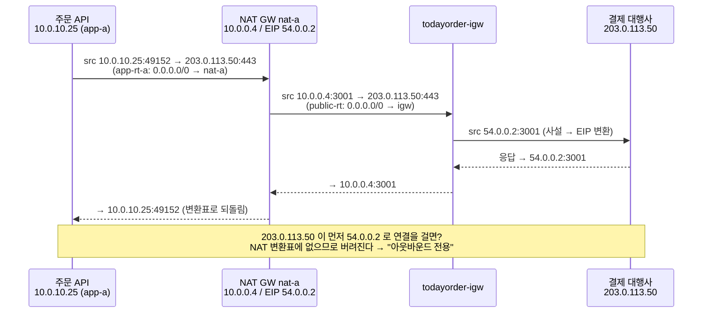
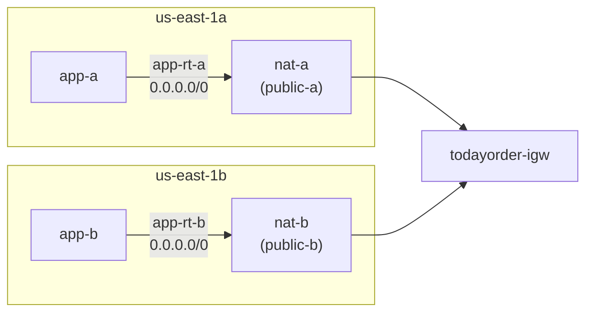

# M02-03. NAT 게이트웨이 vs NAT 인스턴스, Egress-only IGW, 고가용성 NAT
> 도메인: D2, D4 · 예상 시간: 40분 · 실습 등급: 🟢 (NAT 게이트웨이) / 🔴 (Egress-only IGW, 리전 NAT — 501)

## 왜 필요한가

주문 API는 프라이빗 서브넷에 숨겼다. 그런데 이 API는 결제 대행사 API를 호출하고, 배포할 때 패키지 저장소에서 라이브러리를 받는다. **나가는 길은 필요하지만 들어오는 길은 막아야 한다.** IDC에서 사내 PC들이 공유기 하나로 인터넷을 쓰는 것과 같은 일 — 주소 변환(NAT) — 을 AWS에서는 무엇으로 하고, 그 NAT가 죽으면 어떻게 되는지가 이 레슨의 주제다.

## 핵심 개념

### NAT 게이트웨이가 하는 일



- 앱 서브넷 라우팅 테이블의 `0.0.0.0/0`이 NAT 게이트웨이를 가리킨다. NAT 게이트웨이 자신은 **퍼블릭 서브넷**에 있고 Elastic IP를 가진다. 그 서브넷의 라우팅 테이블이 IGW를 가리킨다(레슨 2의 문제 4 경로).
- 연결은 **안에서 시작된 것만** 된다. 밖에서 먼저 걸어오는 연결은 NAT 변환표에 없으므로 들어올 수 없다.
- (위 그림의 포트 3001 같은 값은 설명용이다. 실제 NAT는 연결마다 포트를 고른다.)

### NAT 게이트웨이 vs NAT 인스턴스

NAT 인스턴스는 NAT 기능을 하도록 설정한 EC2 인스턴스다. 예전 방식이지만 시험에는 비교 문제로 나온다.

| | NAT 게이트웨이 | NAT 인스턴스 |
|---|---|---|
| 관리 | AWS 관리형 (패치·확장·AZ 안 이중화 자동) | 직접 (OS 패치, 장애 시 교체 스크립트) |
| 대역폭 | 5 Gbps에서 시작해 **100 Gbps까지 자동 확장** | 인스턴스 유형에 좌우 |
| 가용성 | 한 AZ 안에서 이중화 | 인스턴스 한 대 = 단일 장애점 |
| 보안 그룹 | **붙일 수 없다** (NACL로만 제어) | 붙일 수 있다 |
| 필수 설정 | EIP 연결 | **소스/대상 확인(Source/Dest Check) 끄기**, EIP |
| 배스천 겸용·포트 포워딩 | 불가 | 가능 |
| 비용 | 시간당 + 처리 GB당 | 인스턴스 요금 (작은 유형이면 더 쌀 수 있음) |

"관리 부담 최소, 대역폭 자동 확장" → NAT 게이트웨이. "아주 작은 트래픽, 비용 최소, 직접 관리 가능" → NAT 인스턴스(또는 아예 엔드포인트로 NAT 트래픽을 줄이기 — 레슨 5).

### 고가용성 NAT: AZ마다 하나씩

NAT 게이트웨이(zonal)는 **자기 AZ 안에서만** 이중화된다. 1a의 NAT 하나를 두 AZ가 같이 쓰면, 1a 장애 때 1b의 앱도 밖으로 나가지 못한다. 그래서 TodayOrder는 이렇게 만들었다.



- **앱 라우팅 테이블을 AZ별로 따로** 둔다(`app-rt-a`, `app-rt-b`). 하나의 테이블로는 "1a는 nat-a, 1b는 nat-b"를 표현할 수 없다.
- 같은 AZ의 NAT를 쓰면 AZ 간 데이터 전송 요금도 생기지 않는다.

**리전 NAT 게이트웨이**(regional availability mode): 최근 AWS는 NAT 게이트웨이 하나가 워크로드가 있는 AZ로 **자동 확장**하는 모드를 추가했다. 퍼블릭 서브넷이 필요 없고, 모든 프라이빗 서브넷이 같은 NAT ID를 가리키면 된다(`aws ec2 create-nat-gateway --vpc-id … --availability-mode regional`). 단 프라이빗 NAT는 지원하지 않는다. 시험 문제 대부분은 여전히 "AZ마다 NAT GW"를 정답으로 상정하므로 그 구성을 먼저 이해하고, 리전 모드는 "같은 목표를 관리형으로 이루는 새 선택지"로 알아 두자.

### 퍼블릭 NAT vs 프라이빗 NAT

`--connectivity-type private`인 **프라이빗 NAT 게이트웨이**는 EIP가 없고 IGW로 나가지 않는다. 다른 VPC나 온프렘(TGW·VPN 경유)으로 갈 때 출발지 주소를 NAT의 사설 IP로 바꿔 준다 — 예를 들어 CIDR이 겹치는 네트워크끼리 통신해야 할 때 쓴다.

### IPv6와 Egress-only 인터넷 게이트웨이

IPv6 주소는 모두 전역 주소라 NAT가 필요 없다. 대신 "아웃바운드만 허용"을 하는 IPv6 전용 게이트웨이가 **Egress-only IGW**다. 프라이빗 서브넷 라우팅 테이블에 `::/0 → eigw-…`를 넣는다. 상태 저장이라 응답은 들어오고, 밖에서 먼저 거는 연결은 막힌다.

| 요구 | IPv4 | IPv6 |
|---|---|---|
| 양방향 인터넷 | IGW | IGW |
| 아웃바운드만 | NAT 게이트웨이(+IGW) | **Egress-only IGW** |

## 직접 해 보기

### 1) AZ별 NAT 게이트웨이 — [lab02](./labs/lab02-three-tier-vpc.sh)의 NAT 부분

```bash
aws ec2 allocate-address --domain vpc --tag-specifications '...todayorder-nat-a-eip...' --query AllocationId --output text
aws ec2 create-nat-gateway --subnet-id $PUBLIC_A --allocation-id $EIP_A --tag-specifications '...todayorder-nat-a...'
aws ec2 wait nat-gateway-available --nat-gateway-ids $NAT_A $NAT_B     # pending → available 을 폴링
aws ec2 create-route --route-table-id $APP_RT_A --destination-cidr-block 0.0.0.0/0 --nat-gateway-id $NAT_A
```

NAT 게이트웨이는 만든 직후 `pending`이고, waiter가 `available`이 될 때까지 기다린다. lab02 실행 뒤 `aws ec2 describe-nat-gateways --filter Name=tag:Name,Values=todayorder-nat-a`의 결과:

```
{
    "NatGateways": [
        {
            "CreateTime": "2026-11-12T12:30:30.960709+00:00",
            "NatGatewayAddresses": [
                {
                    "AllocationId": "eipalloc-000000000000000a8",
                    "NetworkInterfaceId": "eni-000000000000000a9",
                    "PrivateIp": "10.0.0.4",
                    "PublicIp": "54.0.0.2",
                    "AssociationId": "eipassoc-000000000000000ab",
                    "IsPrimary": true,
                    "Status": "succeeded",
                    "AvailabilityZone": "us-east-1a",
                    "AvailabilityZoneId": "use1-az1"
                }
            ],
            "NatGatewayId": "nat-000000000000000aa",
            "State": "available",
            "SubnetId": "subnet-00000000000000098",
            "VpcId": "vpc-00000000000000090",
            "Tags": [
                {
                    "Key": "Name",
                    "Value": "todayorder-nat-a"
                },
                {
                    "Key": "Project",
                    "Value": "todayorder"
                }
            ],
            "ConnectivityType": "public",
            "AvailabilityMode": "zonal"
        }
    ]
}
```

lab02의 결과 표 3과 단언(레슨 2에서 본 출력):

```
== 결과 3. NAT 게이트웨이 (어느 서브넷·AZ에, 어떤 공인 IP로)
-----------------------------------------------------------------------------------------
|                                  DescribeNatGateways                                  |
+------------------+------------+----------------------------+-------------+------------+
|  todayorder-nat-a|  available |  subnet-00000000000000098  |  us-east-1a |  54.0.0.2  |
|  todayorder-nat-b|  available |  subnet-0000000000000009a  |  us-east-1b |  54.0.0.3  |
+------------------+------------+----------------------------+-------------+------------+
  ✔ 서브넷 수: 6
  ✔ /24 서브넷의 사용 가능 IP (256 - 예약 5): 251
  ✔ NAT 게이트웨이 available 수: 2
  ✔ public-a 의 기본 경로: igw-000000000000000a4
  ✔ app-a 의 기본 경로 = 같은 AZ의 NAT(nat-a): nat-000000000000000aa
  ✔ db-a 에서 인터넷으로: DROP(경로 없음)
LAB02 OK
```

방금 본 것: NAT는 각자 **퍼블릭 서브넷**(`subnet-…098`=public-a, `…09a`=public-b — lab02 서브넷 목록과 대조)에 있고, 각자의 AZ와 공인 IP(EIP)를 갖는다. `app-rt-a`는 `nat-a`를, `app-rt-b`는 `nat-b`를 가리킨다(레슨 2 lab03 문제 4: app-b → nat-b → public-rt → igw). `54.0.0.x`는 에뮬레이터가 지어낸 EIP다.

### 2) 볼 수 없는 것 — [lab10-not-implemented.sh](./labs/lab10-not-implemented.sh) 일부

```bash
aws ec2 create-egress-only-internet-gateway --vpc-id $VPC
aws ec2 create-nat-gateway --vpc-id $VPC --availability-mode regional
```

```
== [레슨 3] Egress-only 인터넷 게이트웨이 (IPv6 전용 아웃바운드)
   aws: [ERROR]: An error occurred (NotImplemented) when calling the CreateEgressOnlyInternetGateway operation: operation CreateEgressOnlyInternetGateway is scaffolded but not implemented in this emulator
== [레슨 3] 리전 NAT 게이트웨이 (--availability-mode regional)
   aws: [ERROR]: An error occurred (NotImplemented) when calling the CreateNatGateway operation: operation CreateNatGateway with a regional availability mode is scaffolded but not implemented in this emulator
```

방금 본 것: 두 기능 모두 API 모양만 있고(`scaffolded`) 동작이 없다(🔴). 개념은 위의 표와 다이어그램으로 익힌다.

## 실제 AWS에서는

- **NAT를 지우면 경로는 `blackhole`이 된다.** 실제 AWS에서는 NAT 게이트웨이를 삭제하면 그것을 가리키던 경로의 `State`가 `blackhole`로 바뀌고 패킷이 버려진다. 에뮬레이터는 NAT를 지워도 경로가 `active`로 남는다(직접 확인함). "프라이빗 서브넷이 갑자기 인터넷에 못 나간다 → 라우팅 테이블에 blackhole 경로가 있다"는 실제 장애 진단 패턴이다.
- 에뮬레이터는 `ReplaceRoute`가 501이다. 실제로는 `aws ec2 replace-route`로 NAT를 바꿀 때 경로를 지웠다 다시 만들 필요가 없다.
- NAT 게이트웨이는 연결마다 포트를 쓰므로, 같은 목적지(IP·포트·프로토콜)로 동시에 열 수 있는 연결 수에 한도가 있다(IP 하나당 55,000). 늘리려면 보조 IP를 붙인다.
- 실제 AWS에서 해 보려면: NAT 게이트웨이는 **프리 티어가 아니며 존재하는 동안 시간당 요금 + 처리 GB당 요금**이 붙고, EIP(공인 IPv4)도 시간당 요금이 붙는다. lab02를 그대로 실제 계정에서 돌리면 NAT 2개 + EIP 2개가 과금된다. 해 본다면 한 시간 안에 지운다: `aws ec2 delete-nat-gateway --nat-gateway-id <id>` → 상태가 `deleted`가 될 때까지 기다린 뒤 `aws ec2 release-address --allocation-id <eipalloc-id>`. Egress-only IGW는 자체 요금이 없다(데이터 전송 요금만).

## 시험 포인트

- "프라이빗 서브넷의 인스턴스가 인터넷에서 패치를 받아야 하지만 인바운드는 차단" → **NAT 게이트웨이(퍼블릭 서브넷에, EIP) + 프라이빗 라우팅 테이블 `0.0.0.0/0 → NAT`**.
- "같은 요구인데 IPv6" → **Egress-only IGW**.
- "NAT 고가용성" → **AZ마다 NAT GW + AZ별 라우팅 테이블**. NAT 하나를 여러 AZ가 공유하면 그 AZ가 단일 장애점.
- NAT 게이트웨이에는 **보안 그룹을 붙일 수 없다** → 트래픽 제어는 NACL 또는 앱 인스턴스의 SG. NAT 인스턴스는 **Source/Dest Check 끄기**.
- "NAT 데이터 처리 비용이 크다, 트래픽 대부분이 S3/DynamoDB" → NAT 대신 **게이트웨이 엔드포인트**(레슨 5).
- NAT 게이트웨이를 퍼블릭 서브넷이 아닌 프라이빗 서브넷에 두면(퍼블릭 NAT의 경우) 동작하지 않는다 — NAT 자신의 서브넷에 IGW 경로가 있어야 한다.

## 스스로 확인

1. NAT 게이트웨이를 앱 서브넷(프라이빗)에 만들고 앱 라우팅 테이블이 그것을 가리키게 했다. 무엇이 잘못되었나?
2. 비용을 줄이려고 NAT 게이트웨이를 1a에 하나만 두었다. 장애 시 영향 범위와, 비용·가용성 사이의 중간 선택지를 말해 보라.
3. 앱 서버가 결제 대행사 API를 호출할 때, 결제 대행사 입장에서 보이는 출발지 IP는 무엇인가? 대행사가 "허용 IP 목록에 등록할 고정 IP를 달라"고 하면 무엇을 알려 주는가?

<details><summary>답</summary>

1. 퍼블릭 NAT 게이트웨이는 **퍼블릭 서브넷**에 있어야 한다. NAT가 받은 패킷은 NAT가 놓인 서브넷의 라우팅 테이블로 다시 길을 찾는데, 앱 서브넷의 테이블은 `0.0.0.0/0 → NAT`라서 IGW로 나갈 길이 없다(자기 자신을 가리키는 꼴).
2. 1a 장애 시 1b의 앱도 외부 호출이 전부 실패한다(1b의 웹 요청 처리는 되더라도 결제가 막힌다). 중간 선택지: 개발·스테이징은 NAT 하나, 운영은 AZ마다 하나. 또는 S3·DynamoDB 트래픽을 게이트웨이 엔드포인트로 빼서 NAT 처리량을 줄이거나, 리전 NAT 게이트웨이로 관리형 다중 AZ를 쓴다.
3. NAT 게이트웨이의 **Elastic IP**(AZ마다 NAT가 있으면 EIP 2개 모두). EIP는 NAT를 지우지 않는 한 바뀌지 않으므로 허용 목록에 등록할 수 있다.

</details>
