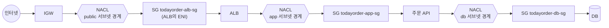
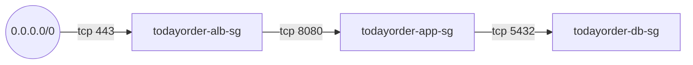

# M02-04. 보안 그룹 vs 네트워크 ACL
> 도메인: D1 · 예상 시간: 60분 · 실습 등급: 🟢 (규칙 구성·조회·오류 재현. 차단 동작은 판정 워크시트로)

## 왜 필요한가

레슨 2·3에서 길(라우팅)을 냈다. 하지만 길이 있다고 다 통과시키면 안 된다. 같은 VPC 안이면 `local` 경로 덕에 퍼블릭 서브넷의 ALB가 DB 서브넷의 PostgreSQL에 **경로상으로는** 닿을 수 있다. 팀장의 원칙("DB에는 주문 API만")을 지키려면 길 위에 검문소가 필요하다. AWS에는 검문소가 두 종류 — **보안 그룹**과 **네트워크 ACL** — 있고, 성격이 정반대라 시험에 반드시 나온다. 게다가 이번 주 로그에서 특정 대역 `203.0.113.0/24`의 무차별 대입 시도가 보였다. 그 대역을 통째로 막는 일은 둘 중 어느 쪽의 일일까?

## 핵심 개념

### 두 검문소의 위치



- **NACL(Network ACL)**: 서브넷 경계에서 패킷을 검사한다. 서브넷에 들어오고 나갈 때 각각.
- **보안 그룹(Security Group, SG)**: ENI(인스턴스·ALB·RDS·인터페이스 엔드포인트의 네트워크 카드)에 붙어 그 ENI로 들어오고 나가는 트래픽을 검사한다.

### 성격 비교

| | 보안 그룹 | 네트워크 ACL |
|---|---|---|
| 붙는 곳 | ENI (ENI당 기본 5개, 최대 16개) | 서브넷 (서브넷당 정확히 1개, NACL 하나는 여러 서브넷에) |
| **상태** | **상태 저장(stateful)**: 허용한 요청의 응답은 규칙과 상관없이 통과 | **상태 비저장(stateless)**: 응답도 반대 방향 규칙으로 따로 허용해야 함 |
| 규칙 종류 | **Allow만** | Allow와 **Deny** |
| 평가 | 모든 규칙 중 하나라도 맞으면 허용 | **번호가 작은 규칙부터** 보다가 처음 맞는 규칙으로 결정, 나머지는 안 봄 |
| 출처/대상 | CIDR, prefix list, **다른 SG의 ID** | CIDR만 |
| 기본 | 새 SG: 인바운드 없음(=전부 거부), 아웃바운드 전체 허용 | VPC 기본 NACL: 양방향 전부 허용 / **새 NACL: 양방향 전부 거부** |
| 마지막 규칙 | (암묵적 거부) | 번호 `*`(32767) Deny — 지울 수 없음 |

### 상태 비저장이 뜻하는 것: 임시 포트

앱(10.0.10.25)이 DB(10.0.20.30:5432)에 접속하면 TCP 연결은 이렇게 생긴다.

```
요청:  10.0.10.25:49152  →  10.0.20.30:5432
응답:  10.0.20.30:5432   →  10.0.10.25:49152
```

`49152`는 클라이언트 OS가 고른 **임시(ephemeral) 포트**다(Linux 기본 32768-60999, Windows 49152-65535 등 OS마다 다르다). 그래서 DB 서브넷 NACL에는

- 인바운드: `10.0.10.0/24`에서 tcp **5432** 허용
- 아웃바운드: `10.0.10.0/24`로 tcp **1024-65535** 허용 ← 이걸 빠뜨리면 요청은 들어가는데 응답이 못 나와 "타임아웃"

이 둘 다 필요하다. SG는 상태 저장이라 인바운드 5432만 열면 응답은 알아서 나간다.

### 보안 그룹 체이닝

SG 규칙의 출처에 IP 대신 **다른 SG의 ID**를 쓸 수 있다. "출처 = `todayorder-app-sg`"는 "**앱 SG가 붙은 ENI라면** IP가 무엇이든 허용"이다. Auto Scaling으로 앱 서버가 2대 → 20대가 되어도 DB SG 규칙은 그대로다.



### 언제 무엇을

- 기본 방어는 **보안 그룹**으로 한다. 최소 권한(필요한 포트, 필요한 출처 SG)만 연다.
- **특정 IP·대역을 차단**해야 하면 NACL(SG에는 Deny가 없다). 서브넷 전체에 일괄로 "이 대역은 절대 안 됨"을 걸 때도 NACL.
- 둘은 AND다. 패킷은 NACL과 SG를 **모두** 통과해야 한다.

## 직접 해 보기

### 1) SG 체이닝 — [lab04-security-group-chaining.sh](./labs/lab04-security-group-chaining.sh)

```bash
aws ec2 create-security-group --vpc-id $VPC --group-name todayorder-db-sg --description "..." --query GroupId --output text
aws ec2 authorize-security-group-ingress --group-id $DB \
  --ip-permissions "IpProtocol=tcp,FromPort=5432,ToPort=5432,UserIdGroupPairs=[{GroupId=$APP,Description=from order API}]"
```

```bash
bash curriculum/m02-vpc-networking/labs/lab04-security-group-chaining.sh
```

```
(준비) 3-티어 VPC vpc-00000000000000090 를 그대로 씁니다
== 1. 보안 그룹 3개
   alb=sg-000000000000000b9 app=sg-000000000000000bb db=sg-000000000000000bd
== 2. 인바운드 규칙: 인터넷→ALB 443, ALB SG→앱 8080, 앱 SG→DB 5432
sg-000000000000000b9	tcp	443	0.0.0.0/0
sg-000000000000000bb	tcp	8080	sg-000000000000000b9
sg-000000000000000bd	tcp	5432	sg-000000000000000bb
== 3. DB SG의 전체 규칙 (새 SG에는 '아웃바운드 전체 허용'이 기본으로 들어 있다)
------------------------------------------------------------------
|                   DescribeSecurityGroupRules                   |
+-----------+---------+------------------------+-------+---------+
|   Cidr    | Egress  |        FromSG          | Port  |  Proto  |
+-----------+---------+------------------------+-------+---------+
|  0.0.0.0/0|  True   |  None                  |  None |  -1     |
|  None     |  False  |  sg-000000000000000bb  |  5432 |  tcp    |
+-----------+---------+------------------------+-------+---------+
== 4. 같은 규칙을 한 번 더 추가하면?
aws: [ERROR]: An error occurred (InvalidPermission.Duplicate) when calling the AuthorizeSecurityGroupIngress operation: the specified rule "peer: 0.0.0.0/0, TCP, from port: 443, to port: 443, ALLOW" already exists
== 5. 앱 SG를 지우려 하면? (DB SG가 참조 중)
aws: [ERROR]: An error occurred (DependencyViolation) when calling the DeleteSecurityGroup operation: resource sg-000000000000000bb has a dependent object
== 6. SG에는 Deny 규칙이 없다 — 'Allow 목록'만 있고, 목록에 없으면 거부
   (CLI에도 deny 옵션 자체가 없다: authorize-* / revoke-* 뿐)
== 7. 워크시트: 규칙을 읽고 판정 (허용 = 인바운드 규칙 중 하나라도 일치)
   Q1 인터넷(203.0.113.7) → ALB:443          ALLOW
   Q2 ALB(SG sg-000000000000000b9) → 앱:8080   ALLOW
   Q3 ALB(SG sg-000000000000000b9) → DB:5432   DENY   (ALB가 DB에 직접 붙을 수는 없다)
   Q4 앱(SG sg-000000000000000bb) → DB:5432    ALLOW
   Q5 인터넷 → 앱:22(SSH)                    DENY
  ✔ DB SG 인바운드 출처: sg-000000000000000bb
  ✔ 판정 Q1~Q5: ALLOW ALLOW DENY ALLOW DENY
LAB04 OK
```

방금 본 것:
- DB SG의 인바운드 규칙에는 IP(`Cidr`)가 없고 `FromSG`에 앱 SG ID가 있다. 아웃바운드는 SG를 만들 때 자동으로 생긴 "전체 허용"(`-1`, `0.0.0.0/0`) 하나.
- 같은 규칙을 또 넣으면 `InvalidPermission.Duplicate`. 다른 SG가 참조 중인 SG는 지울 수 없다(`DependencyViolation`) — 체이닝된 SG를 정리할 때는 참조하는 규칙부터 걷어 내야 한다(lab04 첫 부분이 그렇게 한다).
- 워크시트 Q3이 핵심이다. ALB와 DB는 같은 VPC라 경로는 있지만(`local`), DB SG가 앱 SG만 허용하므로 **ALB가 DB에 직접 붙을 수는 없다**.

### 2) NACL — [lab05-nacl-rules.sh](./labs/lab05-nacl-rules.sh)

```bash
aws ec2 create-network-acl --vpc-id $VPC ...
aws ec2 create-network-acl-entry --network-acl-id $PUB_ACL --ingress --rule-number 90 \
  --rule-action deny --protocol -1 --cidr-block 203.0.113.0/24
aws ec2 create-network-acl-entry --network-acl-id $DB_ACL --egress --rule-number 100 \
  --rule-action allow --protocol tcp --cidr-block 10.0.10.0/24 --port-range From=1024,To=65535
aws ec2 replace-network-acl-association --association-id <서브넷의 현재 연결 ID> --network-acl-id $DB_ACL
```

서브넷은 항상 NACL 하나와 연결되어 있으므로 "연결"이 아니라 **"교체"**(`replace-network-acl-association`)한다.

```bash
bash curriculum/m02-vpc-networking/labs/lab05-nacl-rules.sh
```

```
(준비) 3-티어 VPC vpc-00000000000000090 를 그대로 씁니다
== 1. 기본 NACL(VPC와 함께 생김)은 '전부 허용', 새로 만든 NACL은 '전부 거부'로 시작한다
   기본  100	allow	-1	0.0.0.0/0
   기본  32767	deny	-1	0.0.0.0/0
   새것  32767	deny	-1	0.0.0.0/0
== 2. 퍼블릭 NACL 규칙
== 3. DB NACL 규칙 (상태 비저장 → 응답이 나갈 아웃바운드 임시 포트도 직접 열어야 한다)
== 4. 규칙 번호 오류: 같은 번호 중복, 범위(1~32766) 밖
aws: [ERROR]: An error occurred (NetworkAclEntryAlreadyExists) when calling the CreateNetworkAclEntry operation: The network acl entry identified by 100 already exists.
aws: [ERROR]: An error occurred (InvalidParameterValue) when calling the CreateNetworkAclEntry operation: Value (32767) for parameter ruleNumber is invalid. Rulenumber must be in range 1..32766
== 5. DB NACL 의 규칙 (describe-network-acls 출력 그대로 — 이걸 보고 아래 문제를 푼다)
--------------------------------------------------------------------
|                        DescribeNetworkAcls                       |
+-------+--------+--------+-----+---------------+--------+---------+
|  True |  100   |  allow |  6  |  10.0.10.0/24 |  1024  |  65535  |
|  False|  100   |  allow |  6  |  10.0.10.0/24 |  5432  |  5432   |
|  True |  110   |  allow |  6  |  10.0.11.0/24 |  1024  |  65535  |
|  False|  110   |  allow |  6  |  10.0.11.0/24 |  5432  |  5432   |
|  True |  32767 |  deny  |  -1 |  0.0.0.0/0    |  None  |  None   |
|  False|  32767 |  deny  |  -1 |  0.0.0.0/0    |  None  |  None   |
+-------+--------+--------+-----+---------------+--------+---------+
== 6. 워크시트: 어느 규칙이 판정하는가?
   Q1 203.0.113.9 → 퍼블릭:443 (인바운드)          90 deny
   Q2 198.51.100.20 → 퍼블릭:443 (인바운드)        100 allow
   Q3 198.51.100.20 → 퍼블릭:22 (인바운드)         32767 deny
   Q4 app-a 10.0.10.25 → DB:5432 (인바운드)        100 allow
   Q5 DB → app-a 10.0.10.25:49152 응답 (아웃바운드) 100 allow
   Q6 public-a 10.0.0.50 → DB:5432 (인바운드)      32767 deny
  ✔ DB 서브넷 2개가 DB NACL에 연결: 2
  ✔ Q1~Q6: 90 deny|100 allow|32767 deny|100 allow|100 allow|32767 deny
LAB05 OK
```

방금 본 것:
- 기본 NACL은 `100 allow` + `32767 deny`(전부 허용), 새 NACL은 `32767 deny`뿐(전부 거부). 에뮬레이터도 실제와 같다.
- 규칙 번호는 `1..32766`. 같은 방향에 같은 번호를 두 번 쓸 수 없다.
- 프로토콜 `tcp`는 출력에서 IANA 번호 **`6`** 으로, 모든 프로토콜은 **`-1`** 로 보인다.
- **Q1**: `203.0.113.9 → 443`은 100번(443 허용)에도 맞지만 **90번 deny가 먼저** 평가되어 거부된다. 번호를 110으로 줬다면 100번에서 허용되고 끝났을 것이다.
- **Q5**: DB의 응답(아웃바운드, 목적지 포트 49152)은 egress 100번이 허용한다. 이 규칙이 없으면 `32767 deny`.
- **Q6**: 퍼블릭 서브넷(`10.0.0.50`)에서 DB로 직접 오는 5432는 NACL 단계에서 이미 막힌다 — SG에서도 막히니 **이중 방어**다.

<!-- widget: nacl-sg-round-trip -->

### 3) 손으로 풀어 보기

아래는 어떤 서브넷의 NACL이다(인바운드만).

```
번호   동작   프로토콜  CIDR             포트
100    allow  tcp       0.0.0.0/0        443
110    deny   tcp       198.51.100.0/24  443
120    allow  tcp       10.0.0.0/16      22
*      deny   all       0.0.0.0/0        all
```

(a) `198.51.100.7 → 443`은? (b) `10.0.10.25 → 22`는? (c) 보안팀이 원한 것은 "198.51.100.0/24의 443 차단"이었다. 무엇이 잘못되었고 어떻게 고치나?

<details><summary>답</summary>

(a) **허용** — 100번에서 먼저 일치해 끝난다. 110번은 평가되지도 않는다.
(b) **허용** — 120번.
(c) Deny 규칙의 번호가 Allow보다 커서 효과가 없다. 110번을 지우고 **100보다 작은 번호**(예: 90)로 다시 만든다.

</details>

### 4) 한 요청을 끝까지 따라가기

이 모듈의 결론이다. 고객의 주문 요청 하나가 DB까지 갔다가 응답이 돌아오는 동안, **매 홉마다** 세 가지 — 라우팅 테이블(어디로?), NACL(서브넷 경계 통과?), 보안 그룹(ENI 통과?) — 이 판정한다. 아래 표의 판정은 모두 lab02~lab05가 만든 실제 구성(`describe-*` 출력)에서 나온다. IP 중 고객 `198.51.100.20`, ALB 사설 IP `10.0.0.50`, 앱 `10.0.10.25`, DB `10.0.20.30`과 임시 포트 번호는 설명용 예시다.

| # | 패킷 (출발 → 목적지) | 라우팅 테이블 판정 | NACL 판정 (나가는 서브넷 → 들어오는 서브넷) | 보안 그룹 판정 | 근거 lab |
|---|---|---|---|---|---|
| 1 | 고객 `198.51.100.20:51000` → ALB 공인 IP`:443` (IGW가 목적지를 ALB 사설 IP `10.0.0.50`으로 변환) | IGW로 들어온 패킷은 VPC 안 `local`로 전달 | 들어옴 public-nacl: `100 allow tcp 443` (90번 deny는 `203.0.113.0/24`만이라 불일치) | alb-sg 인바운드 `443 ← 0.0.0.0/0` **ALLOW** | lab05 Q2, lab04 Q1 |
| 2 | ALB `10.0.0.50:40000` → 앱 `10.0.10.25:8080` | public-rt: `10.0.0.0/16 → local` | 나감 public-nacl: egress `100 allow all` / 들어옴 app 서브넷 = 기본 NACL `100 allow all` | alb-sg 아웃바운드 전체 허용 → app-sg 인바운드 `8080 ← alb-sg` **ALLOW** | lab03 문제 3, lab04 Q2 |
| 3 | 앱 `10.0.10.25:49152` → DB `10.0.20.30:5432` | app-rt-a: `10.0.0.0/16 → local` (`0.0.0.0/0 → NAT`보다 구체적) | 나감 기본 NACL `allow` / 들어옴 db-nacl: `100 allow tcp 5432 ← 10.0.10.0/24` | app-sg 아웃바운드 전체 허용 → db-sg 인바운드 `5432 ← app-sg` **ALLOW** | lab05 Q4, lab04 Q4 |
| 4 | (응답) DB `10.0.20.30:5432` → 앱 `10.0.10.25:49152` | db-rt: `local` | 나감 db-nacl: egress `100 allow tcp 1024-65535 → 10.0.10.0/24` / 들어옴 기본 NACL `allow` | **상태 저장** — 3번 연결의 응답이므로 규칙과 무관하게 통과 | lab05 Q5 |
| 5 | (응답) 앱 `10.0.10.25:8080` → ALB `10.0.0.50:40000` | app-rt-a: `local` | 나감 기본 NACL `allow` / 들어옴 public-nacl: `110 allow tcp 1024-65535` | 상태 저장 — 통과 | lab05 (퍼블릭 NACL 110번) |
| 6 | (응답) ALB `10.0.0.50:443` → 고객 `198.51.100.20:51000` (IGW가 출발지를 공인 IP로 변환) | public-rt: `0.0.0.0/0 → igw` | 나감 public-nacl: egress `100 allow all` | 상태 저장 — 통과 | lab03 문제 2 |

같은 표로 "왜 안 되나"도 답할 수 있다.

- 고객이 `203.0.113.9`라면 **1번에서** public-nacl `90 deny`에 걸린다(lab05 Q1). SG까지 가지도 않는다.
- ALB가 DB에 직접 붙으려 하면(`10.0.0.50 → 10.0.20.30:5432`) 라우팅은 `local`로 통과하지만 db-nacl이 `32767 deny`(출처가 앱 서브넷이 아님 — lab05 Q6)이고, 설령 NACL을 통과해도 db-sg가 거부한다(lab04 Q3). **이중 방어**다.
- db-nacl의 egress `100`을 빠뜨리면 3번은 통과하지만 **4번에서** 응답이 버려진다 → 앱은 연결 타임아웃. SG는 상태 저장이라 이런 일이 없다.
- 앱이 결제 대행사로 나가는 길(`app-rt-a: 0.0.0.0/0 → nat-a`, `public-rt: 0.0.0.0/0 → igw`)과 그 응답이 public-nacl `110`(임시 포트)으로 들어오는 것도 같은 방식으로 표를 그려 보자(레슨 3의 시퀀스 다이어그램).

## 실제 AWS에서는

- 규칙의 생성·조회·오류는 에뮬레이터와 같다. 차이는 **실제로 패킷을 막느냐**다. 에뮬레이터는 규칙을 저장만 하고 아무것도 막지 않는다(패킷이 흐르지 않으니까). 위의 ALLOW/DENY 판정이 실제 AWS에서 일어나는 일이다.
- 실제 AWS에서는 SG 규칙을 바꾸면 **기존에 맺어진 연결은 추적 상태에 따라 바로 끊기지 않을 수 있다**(연결 추적). NACL 변경은 다음 패킷부터 적용된다.
- NAT 게이트웨이·ALB가 있는 퍼블릭 서브넷의 NACL은 특히 조심한다: NAT를 거쳐 나간 연결의 응답은 인터넷에서 임시 포트(1024-65535)로 **들어온다.** lab05의 퍼블릭 NACL 110번 규칙이 그 자리다. 이걸 빠뜨리면 "앱 서버가 갑자기 외부 API를 못 부른다".
- 실제 AWS에서 해 보려면: SG·NACL은 **무료**다. 프리 티어 t3.micro 인스턴스 하나와 함께 실험하면 차단을 직접 볼 수 있다(인스턴스는 끝나면 `aws ec2 terminate-instances`). NACL을 잘못 바꾸면 SSH가 끊기니, 기본 NACL로 되돌리는 명령(`replace-network-acl-association … --network-acl-id <기본 NACL>`)을 미리 적어 둔다. 정리는 `delete-network-acl`, `delete-security-group`(참조 규칙 먼저 `revoke-security-group-ingress`).

## 시험 포인트

- **상태 저장 = SG, 상태 비저장 = NACL.** "응답 트래픽이 막힌다/임시 포트" → NACL.
- "특정 IP(대역)를 **차단**" → **NACL Deny**(SG에는 Deny가 없다). Deny는 Allow보다 **작은 번호**로.
- "웹 → 앱 → DB 계층별로 앞 계층만 허용, 인스턴스 수가 변한다" → **SG 체이닝(출처에 SG ID)**.
- 기본 NACL = 전부 허용, 새 NACL = 전부 거부. 새 SG = 인바운드 없음·아웃바운드 전체.
- NACL은 **서브넷**, SG는 **ENI** 단위. NAT 게이트웨이에는 SG를 못 붙인다 → NACL로.
- 둘 다 통과해야 한다. "SG는 열었는데 안 된다" → NACL(특히 아웃바운드 임시 포트)과 라우팅 테이블을 의심.

## 스스로 확인

1. 웹 서버 SG가 인바운드 443만 열고 아웃바운드 규칙을 모두 지웠다. 고객의 HTTPS 요청에 응답할 수 있는가? 같은 상황이 NACL이라면?
2. 앱 SG가 `0.0.0.0/0`에서 8080을 허용하고 있다. 앱 서브넷이 프라이빗이라 인터넷에서 못 들어오니 괜찮다는 의견에 어떻게 답하겠는가?
3. DB NACL의 아웃바운드를 `10.0.10.0/24` tcp 5432로 잘못 넣었다. 증상은 무엇이고 무엇으로 고쳐야 하나?

<details><summary>답</summary>

1. SG면 **응답할 수 있다**. 상태 저장이라 허용된 인바운드 요청의 응답은 아웃바운드 규칙과 무관하게 나간다(서버가 먼저 밖으로 거는 연결만 막힌다). NACL이면 응답 패킷(목적지 = 고객의 임시 포트)이 아웃바운드 규칙에 걸려 **거부**된다.
2. 경로가 막혀 있어도 SG는 최소 권한이어야 한다. VPC 안의 다른 리소스(퍼블릭 서브넷의 침해된 인스턴스, 피어링·TGW로 연결된 VPC)가 8080에 접근할 수 있다. 출처를 `todayorder-alb-sg`로 좁힌다 — 심층 방어.
3. 요청은 DB에 도착하지만 DB의 응답(출발 포트 5432 → 목적지 포트 = 앱의 임시 포트)이 아웃바운드 규칙의 **포트**(5432)에 맞지 않아 거부된다 → 앱은 연결 타임아웃. NACL 규칙의 포트는 **목적지 포트** 기준이므로 아웃바운드를 tcp **1024-65535**로 고친다.

</details>
