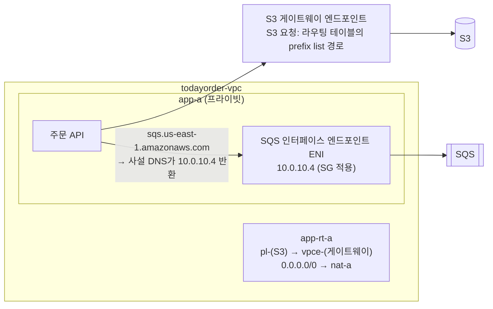

# M02-05. VPC 엔드포인트(게이트웨이 vs 인터페이스)와 PrivateLink
> 도메인: D1, D4 · 예상 시간: 40분 · 실습 등급: 🟢

## 왜 필요한가

첫 달 청구서에서 **NAT 게이트웨이 데이터 처리 요금**이 눈에 띈다. 원인은 주문 API가 영수증 PDF를 S3에 올리는 트래픽이었다. 프라이빗 서브넷에서 S3로 가는 길이 `0.0.0.0/0 → NAT`뿐이라, AWS 안에서 AWS 서비스로 가는 트래픽이 NAT를 거쳐 공인 엔드포인트로 나가고 있었다. 보안팀도 같은 지점을 지적했다: "S3 접근이 인터넷 경로를 타지 않게 하고, 우리 VPC에서만 영수증 버킷에 접근할 수 있게 하라." 둘 다 **VPC 엔드포인트**로 해결한다.

## 핵심 개념

### 엔드포인트 두 종류



| | 게이트웨이 엔드포인트 | 인터페이스 엔드포인트 |
|---|---|---|
| 지원 서비스 | **S3, DynamoDB 둘뿐** | 대부분의 AWS 서비스(SQS, SNS, KMS, Secrets Manager, ECR, SSM…). S3와 DynamoDB도 인터페이스 엔드포인트가 있다(DynamoDB는 2024년 3월부터, 사설 DNS 없이 엔드포인트 전용 DNS 이름으로 접근) |
| 동작 방식 | 지정한 **라우팅 테이블에 경로 추가**: 목적지 = 서비스의 접두사 목록(prefix list, `pl-…`), 대상 = `vpce-…` | 지정한 **서브넷마다 ENI**(사설 IP) 생성. 사설 DNS를 켜면 서비스의 기본 도메인이 그 사설 IP로 풀린다 |
| 접근 제어 | 엔드포인트 정책 | 엔드포인트 정책 + **보안 그룹**(ENI에 붙음) |
| 요금 | **무료** | 시간당(AZ마다) + 처리 GB당 |
| VPC 밖(온프렘·피어링 VPC)에서 사용 | **불가** (경로는 그 VPC의 라우팅 테이블에만 있다) | **가능** (VPN·DX·TGW로 ENI의 사설 IP에 도달) |

인터페이스 엔드포인트의 기반 기술이 **AWS PrivateLink**다. PrivateLink는 AWS 서비스뿐 아니라 **내가 만든 서비스**도 노출할 수 있다: 서비스 쪽 VPC에서 NLB(또는 GWLB) 앞에 **엔드포인트 서비스**를 만들고, 소비자 VPC가 인터페이스 엔드포인트로 붙는다. 양쪽 VPC의 CIDR이 겹쳐도 되고, VPC 전체가 아니라 **그 서비스 하나만** 노출된다는 점이 피어링과 다르다.

### 접두사 목록과 최장 접두사 일치

게이트웨이 엔드포인트가 넣는 경로의 목적지는 CIDR이 아니라 `pl-…`(관리형 접두사 목록) — "S3가 쓰는 공인 IP 대역 모음"이다. 앱 라우팅 테이블에 `0.0.0.0/0 → NAT`가 이미 있어도, S3 주소에는 접두사 목록의 구체적인 대역이 더 길게 일치하므로 **S3 트래픽만** 엔드포인트로 빠진다(레슨 2의 최장 접두사 일치).

### 엔드포인트 정책과 버킷 정책

- **엔드포인트 정책**: "이 엔드포인트를 통해서는 어떤 리소스에 어떤 작업까지 허용" (기본값은 전체 허용 — 아래 출력의 `PolicyDocument`). 예: 회사 버킷 외 다른 S3 버킷으로의 업로드(데이터 유출) 차단.
- **버킷 정책**의 조건 키 `aws:SourceVpce`(특정 엔드포인트 ID) 또는 `aws:SourceVpc`(특정 VPC)로 "이 엔드포인트로 들어온 요청만 허용"을 강제한다. 보안팀의 두 번째 요구가 이것이다(M04에서 버킷 정책을 다룬다).

## 직접 해 보기

[lab06-vpc-endpoints.sh](./labs/lab06-vpc-endpoints.sh)는 엔드포인트를 만들기 **전과 후의 경로**를 비교한다.

```bash
aws ec2 create-vpc-endpoint --vpc-id $VPC --vpc-endpoint-type Gateway --service-name com.amazonaws.us-east-1.s3 \
  --route-table-ids $APP_RT_A $APP_RT_B
aws ec2 create-vpc-endpoint --vpc-id $VPC --vpc-endpoint-type Interface --service-name com.amazonaws.us-east-1.sqs \
  --subnet-ids $APP_A $APP_B --security-group-ids $EP_SG --private-dns-enabled
```

```bash
bash curriculum/m02-vpc-networking/labs/lab06-vpc-endpoints.sh
```

```
(준비) 3-티어 VPC vpc-00000000000000100 를 그대로 씁니다
== 0. 엔드포인트가 없을 때: app-a 에서 S3(의 공인 IP)로 가는 길은 NAT 게이트웨이
   S3 접두사 목록 pl-e9da6b72 = 198.18.8.0/21  (예로 쓸 S3 주소: 198.18.8.10)
   app-rt-a 에서 198.18.8.10 의 다음 홉: nat-0000000000000011a
== 1. 어떤 서비스가 '게이트웨이' 엔드포인트를 지원하나?
-----------------------------------------------------------
|               DescribeVpcEndpointServices               |
+-----------------------------------+---------------------+
|  com.amazonaws.us-east-1.dynamodb |  Gateway            |
|  com.amazonaws.us-east-1.s3       |  Gateway,Interface  |
|  com.amazonaws.us-east-1.sqs      |  Interface          |
+-----------------------------------+---------------------+
== 2. S3 게이트웨이 엔드포인트를 앱 라우팅 테이블 2개에 연결
   vpce-00000000000000140
[
    {
        "DestinationCidrBlock": "10.0.0.0/16",
        "GatewayId": "local",
        "Origin": "CreateRouteTable",
        "State": "active"
    },
    {
        "DestinationCidrBlock": "0.0.0.0/0",
        "NatGatewayId": "nat-0000000000000011a",
        "Origin": "CreateRoute",
        "State": "active"
    },
    {
        "DestinationPrefixListId": "pl-e9da6b72",
        "GatewayId": "vpce-00000000000000140",
        "Origin": "CreateRoute",
        "State": "active"
    }
]
== 3. 다시 추적: 같은 S3 주소로 가는 다음 홉
   app-rt-a → 198.18.8.10 : vpce-00000000000000140   (prefix list 경로가 0.0.0.0/0 보다 구체적)
   app-rt-a → 203.0.113.50 : nat-0000000000000011a   (S3가 아닌 곳은 여전히 NAT)
   db-rt    → 198.18.8.10 : DROP(경로 없음)   (엔드포인트를 연결하지 않은 라우팅 테이블에는 경로가 안 생긴다)
== 4. SQS는 게이트웨이 엔드포인트가 없다 (S3·DynamoDB 둘뿐)
aws: [ERROR]: An error occurred (InvalidServiceName) when calling the CreateVpcEndpoint operation: The Vpc Endpoint Service 'com.amazonaws.us-east-1.sqs' does not exist
== 5. SQS 인터페이스 엔드포인트: 앱 서브넷마다 ENI 하나, 보안 그룹은 VPC 안에서 오는 443만 허용
{
    "Type": "Interface",
    "State": "available",
    "PrivateDns": true,
    "ENIs": [
        "eni-00000000000000144",
        "eni-00000000000000145"
    ],
    "DnsNames": [
        "sqs.us-east-1.amazonaws.com",
        "vpce-00000000000000146.sqs.us-east-1.vpce.amazonaws.com",
        "vpce-00000000000000146-us-east-1a.sqs.us-east-1.vpce.amazonaws.com",
        "vpce-00000000000000146-us-east-1b.sqs.us-east-1.vpce.amazonaws.com"
    ]
}
   ENI 가 놓인 서브넷과 사설 IP:
   subnet-0000000000000010c	10.0.10.4
   subnet-0000000000000010e	10.0.11.4
== 6. 라우팅 테이블은? 인터페이스 엔드포인트는 경로를 추가하지 않는다 (DNS가 ENI의 사설 IP를 돌려준다)
   app-rt-a 경로 수: 인터페이스 엔드포인트 생성 전 3 → 후 3 (변화 없음)
   그중 vpce-* 를 가리키는 경로: 1 개 (S3 게이트웨이 엔드포인트의 prefix list 경로 하나뿐)
  ✔ 엔드포인트 후 S3 다음 홉: vpce-00000000000000140
  ✔ db-rt 의 S3 경로: DROP(경로 없음)
  ✔ 인터페이스 엔드포인트 ENI 수(서브넷 2개): 2
  ✔ 인터페이스 엔드포인트 생성 전후 app-rt-a 경로 수: 3
  ✔ app-rt-a 에서 vpce-* 를 가리키는 경로 수: 1
LAB06 OK
```

방금 본 것:
- **0번 → 3번**: 같은 S3 주소의 다음 홉이 NAT → 게이트웨이 엔드포인트로 바뀌었다. S3가 아닌 목적지는 여전히 NAT다. 라우팅 테이블에 `DestinationPrefixListId` 경로가 하나 생긴 것이 전부다.
- 엔드포인트를 연결하지 않은 `db-rt`에는 경로가 생기지 않는다. 게이트웨이 엔드포인트는 **지정한 라우팅 테이블에만** 작용한다.
- **1번 표**: S3는 Gateway·Interface 둘 다, SQS는 Interface만. SQS로 게이트웨이 엔드포인트를 만들면 `InvalidServiceName`(4번). 에뮬레이터 목록에서 DynamoDB는 Gateway만 보이지만, 실제 AWS의 DynamoDB는 2024년부터 Interface 엔드포인트(PrivateLink)도 지원한다.
- **5번**: 인터페이스 엔드포인트는 서브넷마다 ENI 하나(앱 서브넷 2개 → ENI 2개, 각 서브넷의 사설 IP). DNS 이름은 서비스 기본 이름(`sqs.us-east-1.amazonaws.com` — 사설 DNS), 엔드포인트 전용 이름, AZ별 이름이 함께 나온다.
- **6번**: 인터페이스 엔드포인트는 라우팅 테이블을 건드리지 않는다(만들기 전후 경로 수가 같고, `vpce-`로 가는 경로는 게이트웨이 엔드포인트의 것 하나뿐 — lab07을 먼저 실행했다면 TGW 경로가 하나 더 있어 경로 수는 4로 보인다). 앱이 평소처럼 `sqs.us-east-1.amazonaws.com`에 요청하면 **DNS가** ENI의 사설 IP를 돌려주어 VPC 안에서 끝난다.
- 접두사 목록의 CIDR `198.18.8.0/21`은 에뮬레이터가 만든 테스트용 대역이다. 실제 S3 접두사 목록에는 실제 S3 공인 대역이 여러 개 들어 있다.

## 실제 AWS에서는

- 에뮬레이터는 구성과 경로까지 실제와 같다. 실제 AWS에서는 이 경로대로 트래픽이 S3로 가고, 엔드포인트 정책·`aws:SourceVpce` 버킷 정책이 실제로 평가된다.
- 게이트웨이 엔드포인트는 **같은 리전**의 S3·DynamoDB에만 쓰인다. 다른 리전 버킷으로 가는 트래픽은 여전히 NAT/IGW로 나간다.
- 인터페이스 엔드포인트의 사설 DNS를 쓰려면 VPC의 `enableDnsSupport`와 `enableDnsHostnames`가 모두 켜져 있어야 한다. lab02가 `enableDnsHostnames`를 켠 이유다.
- 실제 AWS에서 해 보려면: 게이트웨이 엔드포인트는 **무료**라 부담 없이 만들어 볼 수 있다. 인터페이스 엔드포인트는 프리 티어가 아니고 **AZ마다 시간당 요금**이 붙으므로 확인 후 바로 지운다: `aws ec2 delete-vpc-endpoints --vpc-endpoint-ids <vpce-id>`.

## 시험 포인트

- "프라이빗 서브넷에서 S3/DynamoDB 접근, 인터넷 경유 없이, **가장 비용 효율적**" → **게이트웨이 엔드포인트**(무료).
- "그 밖의 AWS 서비스(SQS, KMS, Secrets Manager, ECR…)를 사설로" → **인터페이스 엔드포인트**.
- "**온프렘**(DX/VPN)이나 다른 VPC에서 S3·DynamoDB에 사설 접근" → **인터페이스** 엔드포인트(게이트웨이는 VPC 밖에서 못 쓴다).
- "버킷을 특정 VPC/엔드포인트에서만 접근" → 버킷 정책 `aws:SourceVpce` / `aws:SourceVpc`.
- "내 서비스를 다른 계정/VPC 수백 곳에 노출, CIDR 겹침, VPC 전체가 아니라 서비스만" → **PrivateLink 엔드포인트 서비스**(NLB 앞).
- "NAT 게이트웨이 비용이 크다" → 트래픽의 정체를 보고 S3·DynamoDB면 게이트웨이 엔드포인트로 빼기.

## 스스로 확인

1. 게이트웨이 엔드포인트를 만들었는데 앱이 여전히 NAT로 S3에 나간다. 무엇부터 확인하겠는가?
2. 같은 VPC에 S3 게이트웨이 엔드포인트와 S3 인터페이스 엔드포인트를 둘 다 둘 수 있다. 각각은 누구를 위한 것인가?
3. 인터페이스 엔드포인트 ENI의 보안 그룹은 무엇을 허용해야 하나? (lab06의 `todayorder-endpoint-sg`를 보라)

<details><summary>답</summary>

1. 엔드포인트를 **앱 서브넷에 적용되는 라우팅 테이블**에 연결했는지(`RouteTableIds`), 그 테이블에 `pl-… → vpce-…` 경로가 생겼는지, 버킷이 같은 리전인지, 엔드포인트 정책이 거부하지 않는지.
2. 게이트웨이(무료)는 VPC 안의 워크로드용, 인터페이스는 온프렘·피어링 VPC처럼 VPC 밖에서 사설로 S3에 닿아야 하는 클라이언트용.
3. 엔드포인트를 쓸 클라이언트(앱 서브넷 또는 앱 SG)에서 오는 **tcp 443**(AWS API는 HTTPS). lab06은 VPC CIDR 전체에서 오는 443을 허용했다.

</details>
