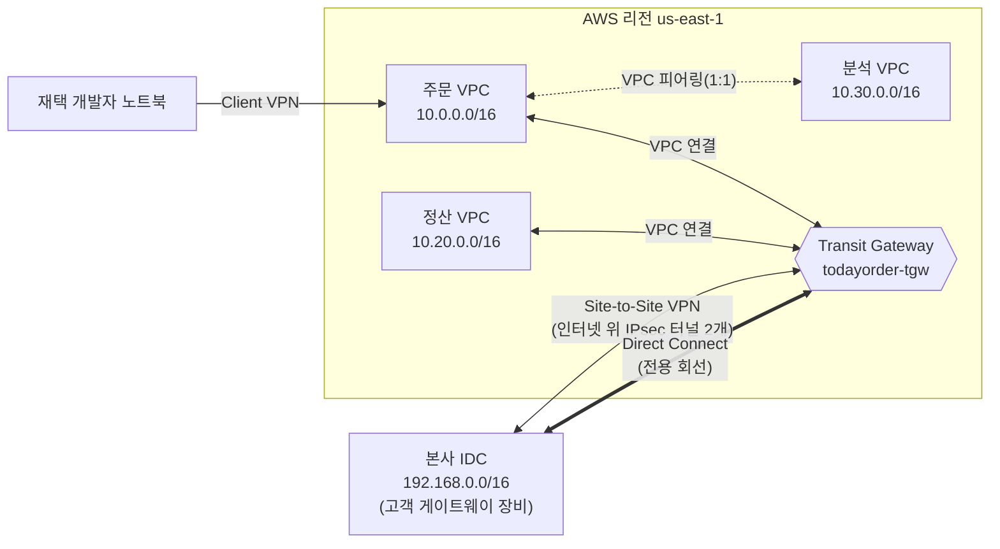

# M02-06. VPC 간·온프레미스 연결 (Peering, Transit Gateway, Site-to-Site VPN, Client VPN, Direct Connect)
> 도메인: D1, D2 · 예상 시간: 60분 · 실습 등급: 🟢 (Transit Gateway) / 🟡 (피어링 요청) / 🔴 (피어링 수락·VPN·Client VPN — 501)

## 왜 필요한가

TodayOrder가 커지면서 네트워크가 하나로 끝나지 않는다. 정산팀은 자기 VPC(`10.20.0.0/16`)에서 정산 배치를 돌리고 주문 API를 호출해야 한다. 데이터팀은 분석 VPC(`10.30.0.0/16`)를 만들었다. 본사에는 아직 회계 시스템이 IDC에 남아 있고, 재택 개발자는 노트북에서 VPC 안의 스테이징 서버에 접속해야 한다. "어떻게 잇는가"에는 선택지가 여섯 가지쯤 있고, 시험은 그중 **요구에 맞는 하나를 고르게** 한다.

## 핵심 개념

### 한 장으로 보는 연결 지도



### VPC 피어링(VPC Peering)

- 두 VPC를 **1:1**로 잇는다. 같은 계정·다른 계정·다른 리전 모두 가능. 요청 → 상대가 **수락** → 양쪽 라우팅 테이블에 "상대 CIDR → `pcx-…`" 경로 추가, 이 세 단계가 다 있어야 통신한다.
- **CIDR이 겹치면 만들 수 없다.**
- **전이적 라우팅이 없다.** A–B, B–C를 피어링해도 A↔C는 안 된다. 또 상대 VPC의 IGW·NAT·VPN·DX·게이트웨이 엔드포인트를 빌려 쓸 수 없다(edge-to-edge 라우팅 불가).
- 별도 게이트웨이가 없어 대역폭 병목·단일 장애점이 없다. 시간당 요금도 없다(데이터 전송 요금만).
- VPC가 n개면 모두 이으려면 n(n−1)/2개. 10개면 45개 — 여기서부터 TGW를 생각한다.

### Transit Gateway(TGW)

- 리전 단위의 **허브 라우터**. VPC·VPN·Direct Connect 게이트웨이·다른 리전의 TGW(피어링)를 **연결(attachment)** 로 붙인다. 허브를 거쳐 **전이적으로** 통신한다.
- TGW에는 **자기 라우팅 테이블**이 있다. 두 동작을 구분하자.
  - **연결(association)**: "이 attachment로 **들어온** 패킷은 이 TGW 라우팅 테이블로 길을 찾는다." attachment 하나는 테이블 하나에만 연결된다.
  - **전파(propagation)**: "이 attachment **뒤에 있는 CIDR**을 이 테이블에 자동으로 넣는다." 여러 테이블에 전파할 수 있다.
  - 테이블을 여러 개 두면 "개발 VPC는 운영 VPC에 못 간다" 같은 **분리(segmentation)** 를 라우팅으로 표현할 수 있다.
- VPC 쪽 라우팅 테이블에도 "상대 CIDR → `tgw-…`" 경로를 **직접** 넣어야 한다. TGW에 붙였다고 VPC가 저절로 길을 알지 않는다.
- 연결당·처리 GB당 요금이 있다. 대신 수천 개의 연결(기본 할당량 TGW당 5,000)을 한곳에서 관리한다.

### Site-to-Site VPN

- 온프렘과 AWS를 **인터넷 위의 IPsec 터널**로 잇는다. 몇 분~몇 시간이면 구성된다.
- 온프렘 쪽 장비를 AWS에 등록한 것이 **고객 게이트웨이(CGW)**, AWS 쪽 종단은 VPC 하나에 붙는 **가상 프라이빗 게이트웨이(VGW)** 또는 **TGW**다.
- VPN 연결 하나에 **터널 2개**(AWS 쪽 서로 다른 엔드포인트)가 있어 한쪽이 유지 보수 중이어도 이어진다. 표준 터널 하나는 최대 **1.25 Gbps**, 대역폭 큰(large bandwidth) 터널은 최대 5 Gbps. 더 필요하면 TGW + 여러 VPN + **ECMP**(동적 라우팅·BGP 필요)로 묶는다.
- 인터넷 품질에 따라 지연·대역폭이 흔들린다. **Accelerated VPN**은 AWS Global Accelerator 네트워크로 진입시켜 개선한다(TGW 연결에서).
- VGW에서 **경로 전파**를 켜면 온프렘이 BGP로 알려 준 경로가 VPC 라우팅 테이블에 자동으로 들어온다.

### Client VPN

- 사람(노트북)이 VPC에 붙는 **관리형 원격 접속 VPN**(OpenVPN 기반 클라이언트). 인증서·Active Directory·SAML 인증. Site-to-Site VPN(네트워크 ↔ 네트워크)과 헷갈리지 말 것.

### Direct Connect(DX)

- 온프렘과 AWS를 **전용 물리 회선**으로 잇는다. 인터넷을 거치지 않아 대역폭·지연이 일정하다. 대신 **개통에 수 주**가 걸린다.
- **전용(dedicated) 연결**: 포트 1 / 10 / 100 / 400 Gbps. **호스티드(hosted) 연결**: 파트너가 나눠 주는 50 Mbps ~ 25 Gbps.
- 회선 위에 **가상 인터페이스(VIF)** 를 만든다: Private VIF(VPC로 — VGW 또는 DX 게이트웨이), Public VIF(S3 같은 AWS 공개 엔드포인트로), Transit VIF(DX 게이트웨이 → TGW로).
- **DX 게이트웨이**: DX 하나로 여러 리전·계정의 VPC(VGW/TGW)에 닿게 하는 글로벌 리소스.
- **기본적으로 암호화되지 않는다.** 암호화가 요구되면 DX 위에 Site-to-Site VPN(IPsec)을 올리거나, 전용 연결에서 **MACsec**을 쓴다.

### 조합 패턴

| 요구 | 구성 |
|---|---|
| 지금 당장 + 저렴 | Site-to-Site VPN |
| 일정한 대역폭, 낮은 지연, 대용량 전송 | Direct Connect |
| DX 장애 대비를 **비용 효율적으로** | **DX(주) + Site-to-Site VPN(백업)** |
| 최고 수준의 복원력 | **서로 다른 DX 위치 두 곳**에 각각 연결(가능하면 위치마다 2회선) |
| DX인데 전송 중 암호화 필수 | DX + VPN(IPsec over DX) 또는 MACsec |
| 여러 리전의 VPC를 DX 하나로 | DX + DX 게이트웨이 |
| VPC 수십 개 + 온프렘 | TGW 허브 + VPN/DX 연결 |

## 직접 해 보기

### 1) Transit Gateway로 주문 VPC ↔ 정산 VPC — [lab07-transit-gateway.sh](./labs/lab07-transit-gateway.sh) 🟢

```bash
aws ec2 create-transit-gateway --options DefaultRouteTableAssociation=disable,DefaultRouteTablePropagation=disable ...
aws ec2 create-transit-gateway-route-table --transit-gateway-id $TGW ...
aws ec2 create-transit-gateway-vpc-attachment --transit-gateway-id $TGW --vpc-id $VPC --subnet-ids $APP_A $APP_B
aws ec2 associate-transit-gateway-route-table --transit-gateway-route-table-id $TRT --transit-gateway-attachment-id $ATT
aws ec2 enable-transit-gateway-route-table-propagation --transit-gateway-route-table-id $TRT --transit-gateway-attachment-id $ATT
aws ec2 create-route --route-table-id $APP_RT_A --destination-cidr-block 10.20.0.0/16 --transit-gateway-id $TGW
```

```bash
bash curriculum/m02-vpc-networking/labs/lab07-transit-gateway.sh
```

```
(준비) 3-티어 VPC vpc-00000000000000090 를 그대로 씁니다
== 1. 정산 VPC 10.20.0.0/16 (서브넷 2개, 라우팅 테이블 1개) — 주문 VPC와 CIDR이 겹치지 않게 설계
   vpc-000000000000000d1  subnets=subnet-000000000000000d9,subnet-000000000000000db  rt=rtb-000000000000000dd
== 2. Transit Gateway (기본 연결·전파는 끄고, 라우팅 테이블을 직접 관리한다)
--------------------------------------------------------------------------------
|                            DescribeTransitGateways                           |
+-------+---------------+--------------+-------------------------+-------------+
|  Asn  | DefaultAssoc  | DefaultProp  |           Id            |    State    |
+-------+---------------+--------------+-------------------------+-------------+
|  64512|  disable      |  disable     |  tgw-000000000000000e0  |  available  |
+-------+---------------+--------------+-------------------------+-------------+
== 3. TGW 라우팅 테이블
   tgw-rtb-000000000000000e1
== 4. VPC 연결(attachment): AZ마다 서브넷 하나씩 지정 (주문 VPC는 앱 서브넷, 정산 VPC는 자기 서브넷)
   order=tgw-attach-000000000000000e2 settlement=tgw-attach-000000000000000e3
== 5. 연결(association): 이 연결로 들어온 패킷은 이 TGW 라우팅 테이블로 길을 찾는다
      전파(propagation): 이 연결 뒤의 VPC CIDR을 TGW 라우팅 테이블에 자동으로 넣는다
   연결  tgw-attach-000000000000000e2	vpc-00000000000000090	associated
   연결  tgw-attach-000000000000000e3	vpc-000000000000000d1	associated
   전파  tgw-attach-000000000000000e2	vpc-00000000000000090	enabled
   전파  tgw-attach-000000000000000e3	vpc-000000000000000d1	enabled
== 6. 각 VPC 라우팅 테이블에 '상대 CIDR → TGW' 경로 (TGW에 붙였다고 VPC가 저절로 길을 아는 것은 아니다)
[
    "10.0.0.0/16 -> local",
    "0.0.0.0/0 -> nat-000000000000000aa",
    "pl-e9da6b72 -> vpce-000000000000000c8",
    "10.20.0.0/16 -> tgw-000000000000000e0"
]
== 7. 추적
   app-a → 정산 10.20.0.15     : tgw-000000000000000e0
   정산  → app-a 10.0.10.25    : tgw-000000000000000e0   (돌아오는 길도 경로가 있어야 한다)
   db-a  → 정산 10.20.0.15     : DROP(경로 없음)   (DB 라우팅 테이블에는 넣지 않았다 — 의도된 차단)
   app-a → db-b 10.0.21.10     : local   (VPC 안은 여전히 local 이 우선)
  ✔ app-a → 정산: tgw-000000000000000e0
  ✔ 정산 → app-a: tgw-000000000000000e0
  ✔ db-a → 정산: DROP(경로 없음)
  ✔ app-a → db-b: local
  ✔ 주문·정산 연결의 전파 상태: enabled enabled
LAB07 OK
```

방금 본 것:
- TGW·TGW 라우팅 테이블·VPC 연결이 모두 `pending → available`로 전이한다(lab은 상태를 폴링해 기다린다).
- 연결 단위로 **association**(`associated`)과 **propagation**(`enabled`)이 각각 보인다.
- 앱 라우팅 테이블에 `10.20.0.0/16 -> tgw-…`가 추가됐다. **돌아오는 길**(정산 라우팅 테이블의 `10.0.0.0/16 -> tgw`)도 넣어야 응답이 온다.
- DB 라우팅 테이블에는 넣지 않았으므로 DB → 정산은 DROP. 라우팅으로 "정산은 앱만 호출 가능"을 표현했다(물론 SG로도 막아야 한다).
- TGW VPC 연결의 서브넷은 AZ마다 하나씩 고른다. TGW는 그 서브넷에 ENI를 두고, 연결이 없는 AZ의 리소스는 TGW로 보낼 수 없다.

### 2) VPC 피어링: 요청까지 — [lab08-peering-request.sh](./labs/lab08-peering-request.sh) 🟡

```bash
aws ec2 create-vpc-peering-connection --vpc-id $ORDER_VPC --peer-vpc-id $ANALYTICS_VPC
aws ec2 accept-vpc-peering-connection --vpc-peering-connection-id $PCX     # 상대 VPC 소유자가 실행
```

```bash
bash curriculum/m02-vpc-networking/labs/lab08-peering-request.sh
```

```
(준비) 3-티어 VPC vpc-00000000000000090 를 그대로 씁니다
== 1. 상대 VPC 2개: 분석 VPC(10.30.0.0/16), 레거시 VPC(10.0.0.0/16 — 주문 VPC와 겹침)
   analytics=vpc-000000000000000e4 legacy=vpc-000000000000000ec
== 2. 피어링 요청: 주문 → 분석
----------------------------------------
|      CreateVpcPeeringConnection      |
+------------+-------------------------+
|  Accepter  |  vpc-000000000000000e4  |
|  Id        |  pcx-000000000000000f4  |
|  Requester |  10.0.0.0/16            |
|  Status    |  initiating-request     |
+------------+-------------------------+
{
    "Id": "pcx-000000000000000f4",
    "Status": {
        "Code": "pending-acceptance",
        "Message": "Pending Acceptance by 000000000000"
    },
    "Expires": "2026-11-19T12:33:11.130355+00:00"
}
== 3. 수락 (실제 AWS에서는 상대 VPC 소유자가 accept-vpc-peering-connection 을 호출한다)
aws: [ERROR]: An error occurred (NotImplemented) when calling the AcceptVpcPeeringConnection operation: operation AcceptVpcPeeringConnection is scaffolded but not implemented in this emulator
   → 수락이 안 되므로 상태는 계속 pending-acceptance. 수락 뒤의 일(양쪽 라우팅 테이블에 경로 추가)은 레슨 6의 다이어그램으로.
== 4. CIDR이 겹치는 VPC끼리 피어링: 주문(10.0.0.0/16) → 레거시(10.0.0.0/16)
{
    "Code": "failed",
    "Message": "Failed due to incorrect VPC-ID, Account ID, or overlapping CIDR range"
}
  ✔ 주문→분석 피어링 상태: pending-acceptance
  ✔ 겹치는 CIDR 피어링 상태: failed
  ✔ 수락은 에뮬레이터 미구현(501) — FIDELITY.md 와 같다
LAB08 OK
```

방금 본 것:
- 요청 응답은 `initiating-request`, 곧 `pending-acceptance`가 된다. 수락 대기에는 만료 시각(`ExpirationTime`, 일주일 뒤)이 있다.
- 에뮬레이터는 **수락이 501**이라 `active`가 되지 않는다. 그래서 수락 뒤의 일(양쪽 라우팅 테이블에 `상대 CIDR → pcx-…`)은 위의 개념 그림으로 배운다.
- 주문 VPC와 레거시 VPC는 둘 다 `10.0.0.0/16`이라 피어링이 **`failed`**: "overlapping CIDR range". 레슨 1에서 주소 계획을 강조한 이유다.

### 3) VPN·Client VPN — [lab10-not-implemented.sh](./labs/lab10-not-implemented.sh) 일부 🔴

```bash
aws ec2 create-customer-gateway --type ipsec.1 --public-ip 203.0.113.10 --bgp-asn 65010
aws ec2 create-vpn-gateway --type ipsec.1
aws ec2 attach-vpn-gateway --vpn-gateway-id $VGW --vpc-id $VPC
aws ec2 create-vpn-connection --type ipsec.1 --customer-gateway-id $CGW --vpn-gateway-id $VGW
```

```
== [레슨 6] 고객 게이트웨이 cgw-00000000000000103, 가상 프라이빗 게이트웨이 vgw-00000000000000104 는 만들어진다 (VGW는 VPC에 연결까지)
== [레슨 6] Site-to-Site VPN 연결 (CGW ↔ VGW)
   aws: [ERROR]: An error occurred (NotImplemented) when calling the CreateVpnConnection operation: operation CreateVpnConnection is scaffolded but not implemented in this emulator
== [레슨 6] VGW 경로 전파 (온프레미스 경로를 VPC 라우팅 테이블에 자동 추가)
   aws: [ERROR]: An error occurred (NotImplemented) when calling the EnableVgwRoutePropagation operation: operation EnableVgwRoutePropagation is scaffolded but not implemented in this emulator
== [레슨 6] Client VPN 엔드포인트
   aws: [ERROR]: An error occurred (NotImplemented) when calling the CreateClientVpnEndpoint operation: operation CreateClientVpnEndpoint is scaffolded but not implemented in this emulator
== [레슨 6] TGW 정적 경로 (create-transit-gateway-route)
   aws: [ERROR]: An error occurred (NotImplemented) when calling the CreateTransitGatewayRoute operation: operation CreateTransitGatewayRoute is scaffolded but not implemented in this emulator
== [레슨 6] TGW 경로 검색 (search-transit-gateway-routes)
   aws: [ERROR]: An error occurred (NotImplemented) when calling the SearchTransitGatewayRoutes operation: operation SearchTransitGatewayRoutes is scaffolded but not implemented in this emulator
== [레슨 6] 대신 읽을 수 있는 것: Direct Connect 위치와 포트 속도 (🟢)
------------------------------
|      DescribeLocations     |
+------------+---------------+
|  CSDC1-CS  |  1G,10G       |
|  EqDC2-DRT |  1G,10G       |
|  EqDC2-EQ  |  100G,1G,10G  |
+------------+---------------+
```

방금 본 것: 고객 게이트웨이·VGW는 만들어지고 VPC에 붙지만, 정작 **VPN 연결**과 **VGW 경로 전파**, **Client VPN**, **TGW 정적 경로·경로 검색**은 501이다. 대신 Direct Connect 위치·포트 속도 목록은 읽을 수 있다(에뮬레이터는 3곳만 돌려준다).

## 실제 AWS에서는

- 실제 AWS에서는 피어링을 수락하면 상태가 `active`가 되고, 양쪽 라우팅 테이블에 경로를 넣는 순간 통신된다. 같은 리전의 피어 VPC SG를 규칙의 출처로 참조할 수도 있다.
- 에뮬레이터는 TGW의 `DefaultRouteTableAssociation/Propagation=enable`을 무시하고(새 연결이 기본 테이블에 자동으로 붙지 않음), 정적 경로 `create-transit-gateway-route`·경로 검색 `search-transit-gateway-routes`·연결 삭제가 501이다. 실제 AWS에서는 기본값(enable)이면 연결이 기본 TGW 라우팅 테이블에 자동으로 연결·전파되고, `search-transit-gateway-routes`로 전파된 `10.0.0.0/16`, `10.20.0.0/16` 경로를 볼 수 있다.
- 실제 AWS에서 해 보려면:
  - **피어링**: 시간당 요금이 없다. VPC 두 개를 만들어 요청·수락·경로 추가까지 해 보고(데이터 전송이 없으면 사실상 무료), `aws ec2 delete-vpc-peering-connection` → VPC 삭제로 정리.
  - **Transit Gateway**: 프리 티어가 아니다. **연결(attachment)마다 시간당 요금** + 처리 GB당 요금. 실습은 한 시간 안에: `delete-transit-gateway-vpc-attachment`(deleted까지 대기) → `delete-transit-gateway-route-table` → `delete-transit-gateway`.
  - **Site-to-Site VPN**: VPN 연결당 시간당 요금. 온프렘 장비 대신 다른 리전의 EC2에 strongSwan 같은 소프트웨어 VPN을 올려 실험할 수 있지만 설정이 길다. 끝나면 `delete-vpn-connection` → `detach-vpn-gateway` → `delete-vpn-gateway` → `delete-customer-gateway`.
  - **Direct Connect**: 물리 회선이라 개인 실습 대상이 아니다. `create-connection`만 해도 포트 요금이 시작될 수 있으니 실제 계정에서는 호출하지 말 것.

## 시험 포인트

- "VPC 2~3개, 간단히, 대역폭 제한 없이, 비용 최소" → **VPC 피어링**. "피어링 했는데 A→C가 안 된다" → **비전이적**.
- "VPC 수십~수백 개 + 온프렘, 중앙 관리, 전이적 라우팅" → **Transit Gateway**. "환경별로 서로 못 가게" → **TGW 라우팅 테이블 분리**.
- "CIDR이 겹치는 VPC끼리 서비스 하나만 노출" → 피어링·TGW가 아니라 **PrivateLink**(레슨 5).
- "온프렘 ↔ AWS를 빨리, 암호화" → **Site-to-Site VPN**(터널 2개). "VPN 대역폭 확장" → **TGW + ECMP**.
- "일정한 성능·대용량·인터넷 비경유" → **Direct Connect**(개통 수 주). "DX는 암호화되나?" → 기본은 **아니다** → VPN over DX 또는 MACsec.
- "DX 장애 대비, 비용 효율" → **DX + VPN 백업**. "최대 복원력" → **DX 위치 2곳**.
- "직원 노트북 원격 접속" → **Client VPN**. "DX 하나로 여러 리전 VPC" → **DX 게이트웨이**.

## 스스로 확인

1. 주문·정산·분석 VPC를 모두 서로 통신하게 하려면 피어링이 몇 개 필요한가? VPC가 8개로 늘면? 어느 시점에 TGW로 바꾸겠는가?
2. lab07에서 TGW 연결과 TGW 라우팅 테이블의 전파까지 마쳤는데, 정산 VPC의 라우팅 테이블에 `10.0.0.0/16 → tgw` 경로를 빠뜨렸다. 정산 → 주문 API 호출은 어떻게 되는가?
3. 본사 IDC와 AWS 사이에 DX를 쓰는데, 보안팀이 "전송 중 데이터 암호화"를 요구했다. 선택지 두 가지와 각각의 전제 조건은?

<details><summary>답</summary>

1. 3개면 3(2)/2 = **3개**, 8개면 8·7/2 = **28개**. 피어링마다 양쪽 라우팅 테이블 경로까지 관리해야 하므로, VPC가 몇 개를 넘거나 온프렘 연결까지 공유해야 할 때(피어링은 VPN·DX를 빌려 쓸 수 없다) TGW로 옮긴다.
2. 정산 → 주문 방향의 패킷이 정산 VPC를 떠나지 못한다(정산 서브넷 라우팅 테이블에 `10.0.0.0/16` 경로가 없으니 DROP). 반대 방향 요청도 응답이 돌아오지 못한다. 라우팅은 **양방향 모두** 필요하다.
3. ① DX 위에 Site-to-Site VPN(IPsec)을 올린다 — 퍼블릭 VIF(또는 TGW 경유 Private IP VPN) 위로 터널을 만든다. ② **MACsec** — 지원하는 전용 연결과 MACsec 가능한 고객 장비가 필요하다.

</details>
