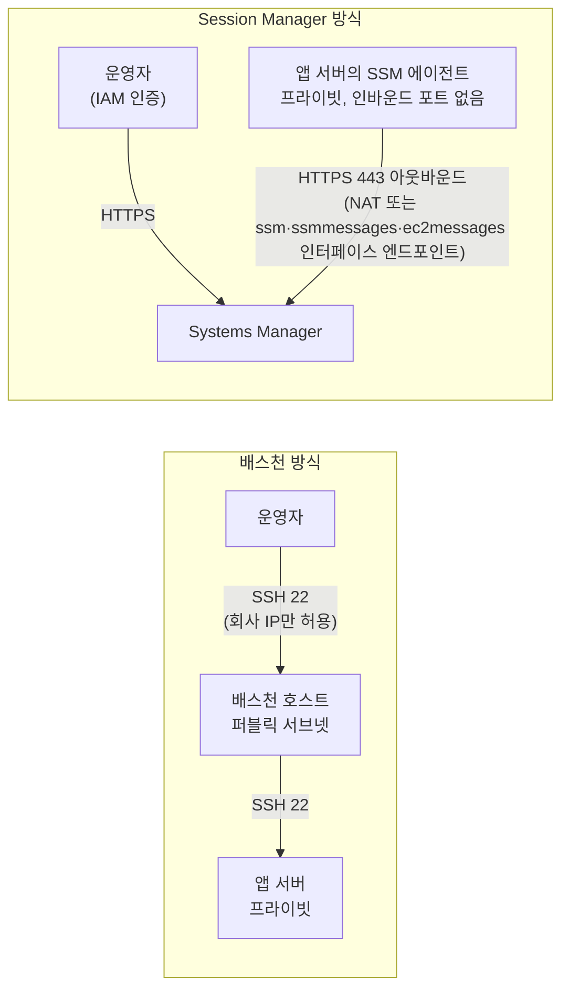

# M02-07. 관측과 방어: VPC Flow Logs, Network Firewall, Bastion vs Session Manager
> 도메인: D1 · 예상 시간: 40분 · 실습 등급: 🟡 (Flow Logs·Network Firewall 구성) / 🔴 (Session Manager — 501)

## 왜 필요한가

새벽에 "결제 API 호출이 간헐적으로 타임아웃 난다"는 알람이 왔다. SG가 막은 걸까, NACL일까, 아예 패킷이 안 나간 걸까? 같은 주에 보안 감사가 두 가지를 요구했다: "DB 서브넷으로 거부된 접속 시도를 기록할 것", "운영자가 서버에 SSH로 접속하는 방식을 없애고 접속 기록을 남길 것". 마지막으로 앱 서버가 알려진 악성 도메인으로 나가는 것을 VPC 경계에서 막고 싶다. 이 레슨은 **보는 도구**(Flow Logs)와 **막는 도구**(Network Firewall), **들어가는 방법**(Bastion vs Session Manager)을 다룬다.

## 핵심 개념

### VPC Flow Logs

- ENI를 지나는 **IP 트래픽의 메타데이터**를 기록한다: 출발·목적지 IP와 포트, 프로토콜, 패킷·바이트 수, 시간, **ACCEPT/REJECT**. 패킷 **내용(페이로드)은 기록하지 않는다**(내용이 필요하면 Traffic Mirroring).
- 대상 범위: **VPC / 서브넷 / ENI**. 트래픽 유형: `ACCEPT` / `REJECT` / `ALL`.
- 보낼 곳: **CloudWatch Logs**(IAM 역할 필요), **S3**, **Amazon Data Firehose**. S3에 쌓고 Athena로 SQL 질의하는 구성이 흔하다(M11).
- 트래픽 경로 밖에서 수집하므로 네트워크 성능에 영향이 없다. Amazon DNS 서버로 가는 질의, 인스턴스 메타데이터(169.254.169.254) 같은 일부 트래픽은 기록되지 않는다.
- GuardDuty는 Flow Logs 등을 분석해 위협을 탐지한다(M09). Flow Logs 자체는 "기록"이지 "탐지"가 아니다.

### Flow Log 레코드 읽기 (시험 단골)

기본 형식(버전 2)의 필드 순서:

```
version account-id interface-id srcaddr dstaddr srcport dstport protocol packets bytes start end action log-status
```

아래는 **AWS 문서의 기본 형식을 따라 만든 예시**다(에뮬레이터에는 트래픽이 없어 실제 레코드가 생기지 않는다 — 아래 lab09 출력 참고). 주문 API(`10.0.10.25`)가 DB(`10.0.20.30:5432`)에 접속한 기록이 **DB 쪽 ENI**에서 이렇게 찍혔다.

```
2 123456789012 eni-0db000000000000a1 10.0.10.25 10.0.20.30 49152 5432 6 5 400 1767225600 1767225660 ACCEPT OK
2 123456789012 eni-0db000000000000a1 10.0.20.30 10.0.10.25 5432 49152 6 4 320 1767225600 1767225660 REJECT OK
```

- 1행: 들어오는 요청(5432)은 **ACCEPT**.
- 2행: 같은 연결의 응답(출발 5432 → 목적지 49152)이 **REJECT**.

어느 검문소가 막았을까? **보안 그룹은 상태 저장**이라, 인바운드를 허용한 연결의 응답을 거부하지 않는다. 따라서 응답을 막은 것은 **NACL의 아웃바운드 규칙**(임시 포트 미허용)이다 — 레슨 4 스스로 확인 3번과 같은 실수다. 반대로 요청 자체가 REJECT라면 SG 또는 NACL 인바운드를 본다.

### AWS Network Firewall

- VPC 경계에 두는 **관리형 상태 저장 방화벽·IPS**. 도메인 목록(허용/거부), Suricata 호환 규칙, 상태 비저장 5-튜플 규칙을 쓴다.
- 전용 **방화벽 서브넷**에 방화벽 엔드포인트(`vpce-…`)가 생기고, 라우팅 테이블이 트래픽을 그 엔드포인트로 **지나가게** 만든다(예: 앱 서브넷 `0.0.0.0/0 → 방화벽 엔드포인트`, 방화벽 서브넷 `0.0.0.0/0 → NAT/IGW`, IGW 쪽 엣지 라우팅으로 들어오는 트래픽도 방화벽으로).
- 구성 요소: **규칙 그룹**(stateless/stateful) → **방화벽 정책**(규칙 그룹 묶음 + 기본 동작) → **방화벽**(VPC·서브넷에 배치).

| 도구 | 계층·위치 | 잘하는 일 |
|---|---|---|
| 보안 그룹 | ENI, L3/L4, 상태 저장 | 리소스별 최소 권한 허용 |
| NACL | 서브넷, L3/L4, 상태 비저장 | IP 대역 차단(Deny) |
| **Network Firewall** | VPC 경계(라우팅으로 통과), L3~L7 | 도메인 필터링(아웃바운드 악성 도메인 차단), IPS, 중앙 정책 |
| WAF | ALB·CloudFront·API Gateway 앞, L7 HTTP | SQLi·XSS·속도 제한·봇 (M08/M09) |
| Shield | 엣지, L3/L4 DDoS | DDoS 방어 (Standard 기본 제공, Advanced 유료) |

### 서버에 들어가는 법: Bastion vs Session Manager



| | 배스천(점프) 호스트 | Session Manager |
|---|---|---|
| 인바운드 포트 | 배스천에 22 필요 | **없음** (에이전트가 밖으로 연결) |
| 인증 | SSH 키 관리 | **IAM** 정책 |
| 기록 | 직접 구성 | 세션 로그를 CloudWatch Logs/S3에, API는 CloudTrail에 |
| 관리 대상 | 배스천 서버(패치·고가용성) | 없음(관리형), 인스턴스에 에이전트와 IAM 역할(인스턴스 프로파일) |
| 비용 | 배스천 인스턴스 | Session Manager 자체 추가 요금 없음(엔드포인트·로그 저장은 별도) |

## 직접 해 보기

### 1) Flow Logs + Network Firewall — [lab09-flow-logs-firewall.sh](./labs/lab09-flow-logs-firewall.sh) 🟡

```bash
aws iam create-role --role-name todayorder-vpc-flow-logs-role \
  --assume-role-policy-document '{... "Principal": {"Service": "vpc-flow-logs.amazonaws.com"} ...}'
aws ec2 create-flow-logs --resource-type VPC --resource-ids $VPC --traffic-type ALL \
  --log-destination-type cloud-watch-logs --log-group-name /todayorder/vpc-flow-logs --deliver-logs-permission-arn $ROLE_ARN
aws network-firewall create-rule-group --rule-group-name todayorder-deny-domains --type STATEFUL --capacity 10 \
  --rule-group '{"RulesSource":{"RulesSourceList":{"Targets":[".malware.example"],"TargetTypes":["HTTP_HOST","TLS_SNI"],"GeneratedRulesType":"DENYLIST"}}}'
aws network-firewall create-firewall-policy ...
aws network-firewall create-firewall --firewall-name todayorder-fw --vpc-id $VPC --subnet-mappings SubnetId=$FW_SUBNET ...
```

```bash
bash curriculum/m02-vpc-networking/labs/lab09-flow-logs-firewall.sh
```

```
(준비) 3-티어 VPC vpc-00000000000000090 를 그대로 씁니다
== 1. Flow Logs가 CloudWatch Logs에 쓸 수 있게: 로그 그룹 + 서비스 역할(신뢰 정책 + 권한)
   arn:aws:iam::000000000000:role/todayorder-vpc-flow-logs-role
== 2. VPC 전체의 흐름 로그 (ACCEPT·REJECT 모두)
{
    "Id": "fl-000000000000000f6",
    "Status": "ACTIVE",
    "Deliver": "SUCCESS",
    "Traffic": "ALL",
    "Dest": "cloud-watch-logs",
    "Format": "${version} ${account-id} ${interface-id} ${srcaddr} ${dstaddr} ${srcport} ${dstport} ${protocol} ${packets} ${bytes} ${start} ${end} ${action} ${log-status}"
}
== 3. 로그 스트림이 생겼나? (에뮬레이터에는 트래픽이 없다)
   로그 스트림 수: 0
== 4. Network Firewall: 전용 서브넷(/28) + 상태 저장 규칙 그룹(도메인 차단 목록) + 정책 + 방화벽
PROVISIONING
{
    "Status": "READY",
    "Sync": "IN_SYNC",
    "Endpoint": "vpce-9d2d58c2814a28c6e",
    "Subnet": "subnet-000000000000000f7"
}
   실제 AWS라면 이제 퍼블릭/앱 라우팅 테이블의 0.0.0.0/0 다음 홉을 이 방화벽 엔드포인트(vpce-9d2d58c2814a28c6e)로 바꿔 트래픽을 통과시킨다.
  ✔ 흐름 로그 상태: ACTIVE
  ✔ 방화벽 상태: READY
  ✔ 방화벽 엔드포인트: vpce-9d2d58c2814a28c6e
== 5. 정리 (Network Firewall 엔드포인트는 실제 AWS에서 시간당 요금이 붙는다 — 실습 후 바로 지운다)
LAB09 OK
```

방금 본 것:
- Flow Logs가 CloudWatch Logs에 쓰려면 **`vpc-flow-logs.amazonaws.com`이 맡을 수 있는 역할**(신뢰 정책)과 `logs:CreateLogStream`·`logs:PutLogEvents` 권한이 필요하다. 흐름 로그는 `ACTIVE`, `DeliverLogsStatus=SUCCESS`, 형식은 위에서 읽은 기본 형식 그대로다.
- **로그 스트림 수 0** — 에뮬레이터에는 트래픽이 없으니 기록할 것도 없다. 이것이 🟡인 이유다.
- 방화벽은 `PROVISIONING → READY`로 전이하고, AZ마다 방화벽 엔드포인트(`vpce-…`)가 생긴다. 실제로는 이 엔드포인트를 라우팅 테이블의 다음 홉으로 넣어야 트래픽이 검사된다. 에뮬레이터는 아무것도 차단하지 않는다.
- Network Firewall은 실제 AWS에서 비싼 편이라 lab은 마지막에 모두 지운다(방화벽 → 정책 → 규칙 그룹 → 서브넷 순).

### 2) Session Manager — [lab10-not-implemented.sh](./labs/lab10-not-implemented.sh) 일부 🔴

```bash
aws ssm start-session --target i-0123456789abcdef0
```

```
== [레슨 7] Session Manager 세션 시작 (ssm start-session)
   aws: [ERROR]: An error occurred (NotImplemented) when calling the StartSession operation: operation StartSession is scaffolded but not implemented in this emulator
```

방금 본 것: 501. 세션 연결은 위의 표와 다이어그램으로 익힌다. 실습 환경에는 부팅되는 인스턴스도 SSM 에이전트도 없다(M03).

## 실제 AWS에서는

- 실제로는 트래픽이 생기면 (집계 간격과 전달 지연만큼 늦게) 로그 스트림(ENI마다 하나)이 생기고 레코드가 쌓인다. 집계 간격은 기본 10분(최대), 1분으로 줄일 수 있다(에뮬레이터 응답의 `MaxAggregationInterval: 600`).
- 에뮬레이터는 Flow Logs의 S3 대상에 **존재하지 않는 버킷**을 줘도 받아 준다. 실제로는 버킷이 있어야 하고 로그 전달 서비스가 쓸 수 있는 버킷 정책이 필요하다.
- **Reachability Analyzer**는 이 모듈의 경로 추적 워크시트를 AWS가 대신 해 주는 도구다: 패킷을 보내지 않고 라우팅 테이블·SG·NACL 구성을 분석해 "출발지 → 목적지 도달 가능한가, 어디서 막히나"를 알려 준다.
- 실제 AWS에서 해 보려면:
  - **Flow Logs**: 기능 자체는 무료지만 CloudWatch Logs **수집·저장 요금**(vended logs)이 붙는다. 작은 VPC에서 짧게 켜고 `aws ec2 delete-flow-logs --flow-log-ids <id>` → `aws logs delete-log-group --log-group-name <그룹>`.
  - **Network Firewall**: 프리 티어가 아니고 **엔드포인트(AZ)당 시간당 요금 + 처리 GB당 요금**이 꽤 크다. 실습한다면 한 시간 안에 `delete-firewall` → `delete-firewall-policy` → `delete-rule-group`.
  - **Session Manager**: 추가 요금 없이 써 볼 수 있다. 프리 티어 t3.micro(Amazon Linux는 SSM 에이전트 기본 설치) + `AmazonSSMManagedInstanceCore` 관리형 정책을 붙인 인스턴스 프로파일 → 콘솔의 "연결 → Session Manager" 또는 `aws ssm start-session --target <instance-id>`(로컬에 Session Manager 플러그인 필요). 끝나면 인스턴스 종료.

## 시험 포인트

- "누가 어디로 접속했는지, 거부된 트래픽 기록" → **VPC Flow Logs**(VPC/서브넷/ENI 단위, CloudWatch Logs·S3·Firehose). "패킷 **내용**까지" → Traffic Mirroring. "**API 호출** 기록" → CloudTrail(헷갈리게 내는 오답).
- Flow Log에서 인바운드 ACCEPT + 응답 아웃바운드 REJECT → **NACL**(SG는 상태 저장이라 그런 패턴이 안 나온다).
- "VPC에서 나가는 트래픽을 **도메인 기준으로** 필터링/IPS, 여러 VPC에 중앙 정책" → **AWS Network Firewall**(대개 TGW와 검사용 VPC 조합). "HTTP 요청의 SQLi/XSS" → **WAF**.
- "SSH 포트 없이, 키 없이, 접속 기록" → **Session Manager**. 프라이빗 서브넷이면 NAT 또는 SSM 인터페이스 엔드포인트가 필요.
- 배스천을 쓴다면 퍼블릭 서브넷 + SG로 22를 **회사 IP만**, 앱 SG는 22를 **배스천 SG에서만**(체이닝).

## 스스로 확인

1. Flow Log에 `10.0.0.50 → 10.0.20.30` dstport 5432 레코드가 `REJECT`로 찍혔다. 이것만으로 SG 때문인지 NACL 때문인지 알 수 있는가? 무엇을 더 보겠는가?
2. 보안 감사가 "운영자 SSH 접속을 없애라"고 했다. 지금 배스천 호스트를 쓰고 있다. Session Manager로 옮길 때 인스턴스 쪽에 무엇이 준비되어 있어야 하나?
3. "앱 서버가 `*.malware.example`로 나가는 HTTPS를 막아라"를 SG나 NACL로 할 수 없는 이유는?

<details><summary>답</summary>

1. 알 수 없다. 요청 방향의 REJECT는 DB의 SG(인바운드에 출처가 없음)일 수도, DB 서브넷 NACL(인바운드 미허용)일 수도 있다. DB SG의 인바운드 규칙과 DB 서브넷 NACL의 규칙을 둘 다 확인한다(lab05 Q6처럼 둘 다 막고 있을 수도 있다). 이 경우 출발지가 퍼블릭 서브넷이므로 둘 다 막는 것이 정상이다.
2. ① SSM 에이전트(Amazon Linux 등 일부 AMI는 기본 설치) ② `AmazonSSMManagedInstanceCore` 같은 권한을 가진 IAM 역할(인스턴스 프로파일) ③ Systems Manager 엔드포인트로 나가는 HTTPS 경로(NAT, 또는 `ssm`·`ssmmessages`·`ec2messages` 인터페이스 엔드포인트). 이후 22번 인바운드 규칙과 배스천을 제거한다.
3. SG·NACL은 IP·포트만 본다. 도메인의 IP는 바뀌고(CDN 등) 여러 개라 IP로 막을 수 없다. TLS SNI·HTTP Host를 보는 Network Firewall의 도메인 목록 규칙이 필요하다.

</details>
