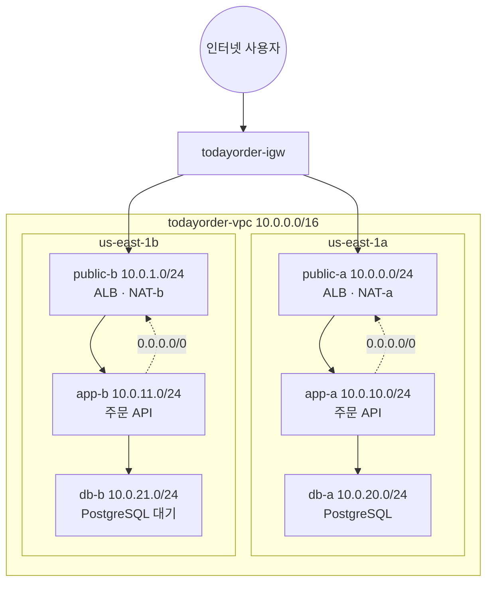

# M02. VPC 네트워킹

> 시나리오: TodayOrder 2단계 — "서버를 둘 네트워크가 필요하다." 인터넷에서 들어오는 길과 DB가 숨어 있을 곳을 나누고, 주문 API가 외부 결제 대행사·S3·정산 시스템과 이야기할 길을 낸다.
> 도메인: D1(보안), D2(복원력) · 예상 시간: 약 7시간 (가장 어려운 모듈이다. 2~3일에 나눠서 하자)

## 목표

- CIDR을 손으로 계산하고, 겹치지 않는 VPC·서브넷 주소 계획을 세울 수 있다.
- 2-AZ 3-티어 VPC(퍼블릭·앱·DB 서브넷, IGW, AZ별 NAT 게이트웨이)를 CLI로 직접 만들 수 있다.
- **라우팅 테이블·보안 그룹·NACL 출력만 보고** 패킷이 인터넷에서 프라이빗 DB까지 어떻게 가는지(또는 왜 못 가는지) 설명할 수 있다 — 이 모듈의 중심 목표이며, [레슨 4의 "한 요청을 끝까지 따라가기" 표](./04-security-group-vs-nacl.md#4-한-요청을-끝까지-따라가기)가 그 종합이다.
- VPC 엔드포인트, 피어링, Transit Gateway, VPN, Direct Connect 중 요구에 맞는 것을 고를 수 있다.

## 레슨

| # | 레슨 | 시간 | 등급 |
|---|---|---|---|
| 1 | [IP와 CIDR 속성 과외](./01-ip-and-cidr.md) | 50분 | 🟢 |
| 2 | [VPC, 서브넷, 라우팅 테이블, IGW — "퍼블릭 서브넷"의 정의](./02-vpc-subnet-route-igw.md) | 60분 | 🟢 |
| 3 | [NAT 게이트웨이 vs NAT 인스턴스, Egress-only IGW, 고가용성 NAT](./03-nat-and-egress.md) | 40분 | 🟢 / 🔴 |
| 4 | [보안 그룹 vs 네트워크 ACL](./04-security-group-vs-nacl.md) | 60분 | 🟢 |
| 5 | [VPC 엔드포인트와 PrivateLink](./05-vpc-endpoints.md) | 40분 | 🟢 |
| 6 | [VPC 간·온프레미스 연결](./06-hybrid-connectivity.md) | 60분 | 🟢 / 🟡 / 🔴 |
| 7 | [관측과 방어: Flow Logs, Network Firewall, Bastion vs Session Manager](./07-observe-and-protect.md) | 40분 | 🟡 / 🔴 |

에뮬레이터에서는 **패킷이 흐르지 않는다.** 그래서 이 모듈의 핵심 실습은 "경로 추적"이다. 실제 AWS의 VPC 라우터가 하는 일(서브넷 → 적용되는 라우팅 테이블 → 최장 접두사 일치 → 다음 홉, 그리고 SG·NACL 규칙 판정)을 `describe-*` 출력을 읽고 똑같이 해 본다. 스크립트가 같은 판정을 자동으로 해서 답을 채점한다.

## 실습

| 실습 | 스크립트 | 레슨 | 등급 |
|---|---|---|---|
| CIDR 손계산 채점(사용 가능 IP, 크기·범위·겹침 오류) | [labs/lab01-cidr-basics.sh](./labs/lab01-cidr-basics.sh) | 1 | 🟢 |
| 3-티어 VPC 구축(서브넷 6, IGW, NAT 2, 라우팅 테이블 4) | [labs/lab02-three-tier-vpc.sh](./labs/lab02-three-tier-vpc.sh) | 2, 3 | 🟢 |
| 경로 추적 워크시트(퍼블릭 판정, 인터넷·NAT·local·DROP) | [labs/lab03-route-trace.sh](./labs/lab03-route-trace.sh) | 2, 3 | 🟢 |
| 보안 그룹 체이닝(ALB → 앱 → DB 참조)과 판정 워크시트 | [labs/lab04-security-group-chaining.sh](./labs/lab04-security-group-chaining.sh) | 4 | 🟢 |
| NACL 규칙(번호 순서, 명시적 Deny, 임시 포트)과 판정 워크시트 | [labs/lab05-nacl-rules.sh](./labs/lab05-nacl-rules.sh) | 4 | 🟢 |
| S3 게이트웨이 엔드포인트(prefix list 경로) + SQS 인터페이스 엔드포인트 | [labs/lab06-vpc-endpoints.sh](./labs/lab06-vpc-endpoints.sh) | 5 | 🟢 |
| Transit Gateway로 VPC 2개 연결(연결·전파·VPC 경로) | [labs/lab07-transit-gateway.sh](./labs/lab07-transit-gateway.sh) | 6 | 🟢 |
| VPC 피어링: 요청(pending-acceptance)·CIDR 겹침(failed) / 수락 501 | [labs/lab08-peering-request.sh](./labs/lab08-peering-request.sh) | 6 | 🟡 |
| Flow Logs(→ CloudWatch Logs) + Network Firewall 구성 | [labs/lab09-flow-logs-firewall.sh](./labs/lab09-flow-logs-firewall.sh) | 7 | 🟡 |
| 볼 수 없는 것 확인: Egress-only IGW·리전 NAT·VPN·Client VPN·TGW 정적 경로·Session Manager(501) / Direct Connect 위치 읽기(🟢) | [labs/lab10-not-implemented.sh](./labs/lab10-not-implemented.sh) | 3, 6, 7 | 🔴 |
| boto3: VPC 토폴로지를 읽어 Mermaid로 출력 | [sdk/vpc_to_mermaid.py](./sdk/vpc_to_mermaid.py) | 2 | 🟢 |

[labs/_lib.sh](./labs/_lib.sh)는 lab들이 함께 쓰는 함수(CIDR 계산, 최장 접두사 일치, 3-티어 VPC 만들기/지우기)다. lab03~lab09는 3-티어 VPC가 없으면 스스로 만들고(`ensure_three_tier`), 있으면 그대로 쓴다. 그래서 어떤 순서로 실행해도 된다.

전부 한 번에 검증 (10~15분):

```bash
export EMULATOR_PORT=9297          # 대화형 터미널이면 생략 가능
curriculum/m02-vpc-networking/labs/verify.sh
```

`verify.sh`는 에뮬레이터를 재시작해 깨끗한 상태로 만든 뒤, sdk 예제의 안전 장치를 확인하고, 모든 lab을 두 번 — 1회차는 번호 순(01→10), 2회차는 **역순**(10→01) — 실행해 멱등성과 순서 독립성을 확인하고, sdk 예제를 실행한다. 마지막 줄이 `MODULE m02 OK`면 통과.

정리 자료: [cheatsheet.md](./cheatsheet.md) · [quiz.md](./quiz.md)

## CIDR 계획

이 모듈이 만드는 VPC의 기준이다. 이름·CIDR·연결 관계는 아래 표가 기준이며 [labs/_lib.sh](./labs/_lib.sh)의 `M02_SUBNETS`·`build_three_tier`와 같다. 모든 리소스에 `Name`과 `Project=todayorder` 태그를 붙인다. 리전 `us-east-1`.

> **M10과의 관계**: M10(레슨 3, lab04)은 이 VPC를 그대로 재현하지 않는다. 같은 요구(10.0.0.0/16, 2 AZ × 3 티어, IGW, NAT, SG 체인)를 만족하는 **자기 2-AZ 3-티어 VPC**를 CloudFormation 템플릿 [vpc-3tier.yaml](../m10-monitoring-iac/labs/templates/vpc-3tier.yaml)로 따로 만든다. 다른 점:
>
> | 항목 | M02 (CLI, `labs/_lib.sh`) | M10 (CloudFormation, `vpc-3tier.yaml`) |
> |---|---|---|
> | 서브넷 CIDR (퍼블릭 / 앱 / DB, a·b) | `10.0.0.0/24`·`10.0.1.0/24` / `10.0.10.0/24`·`10.0.11.0/24` / `10.0.20.0/24`·`10.0.21.0/24` | `10.0.1.0/24`·`10.0.2.0/24` / `10.0.11.0/24`·`10.0.12.0/24` / `10.0.21.0/24`·`10.0.22.0/24` |
> | NAT 게이트웨이 | AZ마다 1개 (`todayorder-nat-a`·`-b`) | AZ a에 1개 (비용 절감용) |
> | 앱 라우팅 테이블 | AZ별 2개 (`app-rt-a → nat-a`, `app-rt-b → nat-b`) | 1개 (두 앱 서브넷 → AZ a의 NAT) |
> | 보안 그룹 | `todayorder-alb-sg` → `todayorder-app-sg` → `todayorder-db-sg` | 논리 ID `WebSg` → `AppSg` → `DbSg` (`GroupName` 미지정 — CloudFormation이 `<스택>-WebSg-<무작위>` 형식으로 이름을 붙인다) |
> | 리소스 `Name` 태그 | 모든 리소스에 `todayorder-…` | VPC(`${EnvName}-vpc`)에만 |

**VPC**

| 이름 | CIDR | 설정 |
|---|---|---|
| `todayorder-vpc` | `10.0.0.0/16` | DNS 확인(`enableDnsSupport`) 기본 켜짐, DNS 호스트 이름(`enableDnsHostnames`) **켬** |

**서브넷 6개** (AZ당 티어 하나씩. 3번째 옥텟: 0~9 퍼블릭, 10~19 앱, 20~29 DB, 30 이후 예비)

| 이름 | CIDR | AZ | 티어 | 퍼블릭 IP 자동 할당 | 라우팅 테이블 |
|---|---|---|---|---|---|
| `todayorder-public-a` | `10.0.0.0/24` | us-east-1a | 퍼블릭 (ALB, NAT) | 켬 | `todayorder-public-rt` |
| `todayorder-public-b` | `10.0.1.0/24` | us-east-1b | 퍼블릭 (ALB, NAT) | 켬 | `todayorder-public-rt` |
| `todayorder-app-a` | `10.0.10.0/24` | us-east-1a | 앱 (프라이빗) | 끔 | `todayorder-app-rt-a` |
| `todayorder-app-b` | `10.0.11.0/24` | us-east-1b | 앱 (프라이빗) | 끔 | `todayorder-app-rt-b` |
| `todayorder-db-a` | `10.0.20.0/24` | us-east-1a | DB (격리) | 끔 | `todayorder-db-rt` |
| `todayorder-db-b` | `10.0.21.0/24` | us-east-1b | DB (격리) | 끔 | `todayorder-db-rt` |

**게이트웨이**

| 이름 | 종류 | 위치 |
|---|---|---|
| `todayorder-igw` | 인터넷 게이트웨이 | `todayorder-vpc`에 연결 |
| `todayorder-nat-a` (+ EIP `todayorder-nat-a-eip`) | 퍼블릭 NAT 게이트웨이(zonal) | `todayorder-public-a` |
| `todayorder-nat-b` (+ EIP `todayorder-nat-b-eip`) | 퍼블릭 NAT 게이트웨이(zonal) | `todayorder-public-b` |

**라우팅 테이블 4개** (VPC의 기본(main) 라우팅 테이블은 손대지 않고 `local`만 둔다 — 실수로 연결 안 된 서브넷이 인터넷에 노출되지 않게)

| 이름 | 경로 (`10.0.0.0/16 → local`은 모두 자동) | 연결된 서브넷 |
|---|---|---|
| `todayorder-public-rt` | `0.0.0.0/0 → todayorder-igw` | public-a, public-b |
| `todayorder-app-rt-a` | `0.0.0.0/0 → todayorder-nat-a` | app-a |
| `todayorder-app-rt-b` | `0.0.0.0/0 → todayorder-nat-b` | app-b |
| `todayorder-db-rt` | (없음 — 인터넷으로 나가는 길이 없다) | db-a, db-b |

**보안 그룹** ([lab04](./labs/lab04-security-group-chaining.sh)) — 아웃바운드는 모두 기본값(전체 허용)

| 이름 | 인바운드 |
|---|---|
| `todayorder-alb-sg` | tcp 443 ← `0.0.0.0/0` |
| `todayorder-app-sg` | tcp 8080 ← `todayorder-alb-sg` |
| `todayorder-db-sg` | tcp 5432 ← `todayorder-app-sg` |

lab05~lab09가 덧붙이는 것(선택 — 3-티어 VPC의 핵심은 위 표까지): NACL `todayorder-public-nacl`·`todayorder-db-nacl`([lab05](./labs/lab05-nacl-rules.sh) 참고), S3 게이트웨이 엔드포인트 `todayorder-s3-gw`(app-rt-a·app-rt-b), SQS 인터페이스 엔드포인트 `todayorder-sqs-if`(app-a·app-b, SG `todayorder-endpoint-sg`: tcp 443 ← `10.0.0.0/16`), 정산 VPC `todayorder-settlement-vpc` `10.20.0.0/16`(서브넷 `10.20.0.0/24`·`10.20.1.0/24`) + Transit Gateway `todayorder-tgw`, 분석 VPC `10.30.0.0/16`·레거시 VPC `10.0.0.0/16`(피어링 실습용), Network Firewall 서브넷 `10.0.30.0/28`(lab09가 만들었다가 지움). 연습용 VPC `10.99.0.0/16`(lab01), `10.98.0.0/16`(lab10)은 lab이 끝날 때 지운다.



## 에뮬레이터 제약

에뮬레이터 1.0.322, 포트 9302에서 직접 확인했다. 재생성된 [FIDELITY.md](../../docs/FIDELITY.md)의 "M02 VPC 네트워킹" 사실 표에도 같은 내용이 있다(`EnableVgwRoutePropagation`처럼 표에 없는 세부 오퍼레이션은 이 모듈의 관찰).

| 오퍼레이션 / 동작 | 증상 | 이 모듈의 대응 |
|---|---|---|
| 데이터 플레인 전체 | 패킷이 흐르지 않는다. SG·NACL·라우팅은 저장·조회만 되고 실제로 무언가를 막거나 보내지 않는다 | 경로·규칙을 읽어 판정하는 워크시트(lab03·04·05·06·07) |
| `AcceptVpcPeeringConnection` | 501 → 피어링이 `pending-acceptance`에 머문다 | lab08 🟡, 수락 후는 다이어그램 |
| `RejectVpcPeeringConnection`, `DeleteVpcPeeringConnection` | 501 → 한 번 만든 피어링 요청을 지울 수 없다. VPC는 지워지고 피어링 기록만 남는다 | lab08은 "있으면 재사용" 방식으로 멱등 |
| `CreateEgressOnlyInternetGateway`, `DescribeEgressOnlyInternetGateways` | 501 | lab10에서 501 확인, 레슨 3 개념 |
| `CreateNatGateway --availability-mode regional` | 501 (zonal NAT는 정상) | lab10, 레슨 3 개념 |
| `CreateVpnConnection`, `EnableVgwRoutePropagation`, `CreateClientVpnEndpoint` | 501. 고객 게이트웨이·가상 프라이빗 게이트웨이 생성·연결은 된다 | lab10, 레슨 6 개념 |
| `ssm StartSession` | 501 | lab10, 레슨 7 개념 |
| `ReplaceRoute` | 501. 경로를 바꾸려면 `delete-route` 후 `create-route` | lab07의 `ensure_route`가 그렇게 한다 |
| `CreateTransitGatewayRoute`, `SearchTransitGatewayRoutes`, `GetTransitGatewayAttachmentPropagations` | 501. 정적 경로·TGW 경로 조회 불가. 연결(association)·전파(propagation)와 그 조회(`get-transit-gateway-route-table-associations/-propagations`)는 동작 | lab07은 전파만 사용 |
| `DeleteTransitGatewayVpcAttachment`, `DisassociateTransitGatewayRouteTable` | 501 → 한 번 VPC를 연결한 TGW는 지울 수 없다(`IncorrectState`). 연결된 서브넷·VPC 삭제는 막지 않는다 | lab07은 "있으면 재사용" 방식으로 멱등. `teardown_vpc`는 501을 건너뛴다. **부작용**: lab02(또는 lab07의 정산 VPC 재생성)가 VPC를 다시 만들 때마다 옛 VPC의 TGW 연결이 `available`로 남아 `todayorder-tgw-rt`에 연결·전파된 채 쌓이고, 지워진 옛 주문 VPC의 연결도 `10.0.0.0/16`을 계속 전파한다(실제 AWS라면 같은 CIDR이 두 연결에서 전파되는 충돌 상태). lab07은 현재 VPC ID의 연결만 확인하므로 결과에는 영향이 없다. 깨끗하게 하려면 `scripts/emulator-reset.sh` |
| TGW 기본 연결·전파 | `DefaultRouteTableAssociation/Propagation=enable`이어도 새 연결이 기본 라우팅 테이블에 자동으로 연결·전파되지 않는다 | 기본값을 끄고 명시적으로 연결·전파(실제 AWS에서도 같은 결과) |
| 블랙홀 경로 | NAT 게이트웨이를 지워도 그 경로의 `State`가 `blackhole`이 아니라 `active`로 남는다 | 레슨 3 "실제 AWS에서는" |
| 기본 VPC | 기본 VPC(`172.31.0.0/16`)와 기본 서브넷 3개는 있지만 **IGW와 `0.0.0.0/0` 경로가 없다**(실제 기본 VPC에는 있다) | 레슨 2 "실제 AWS에서는" |
| 접두사 목록(prefix list) CIDR | S3·DynamoDB 접두사 목록이 `198.18.x.x`(테스트용 대역) 하나씩이다. 실제는 수십 개의 공인 대역 | lab06은 목록에서 CIDR을 읽어 쓴다 |
| Flow Logs | 생성·`ACTIVE`·`DeliverLogsStatus=SUCCESS`까지. 트래픽이 없어 로그 스트림이 생기지 않는다. S3 대상은 없는 버킷도 받아 준다 | lab09 🟡, 레코드 읽기는 레슨 7 워크시트(문서 형식 예시) |
| Network Firewall | 규칙 그룹·정책·방화벽이 `READY`, 엔드포인트 ID 발급. 차단 동작은 없음 | lab09 🟡 |
| Direct Connect | `describe-locations`가 위치 3개만 돌려준다(실제는 훨씬 많다). `create-connection`은 `requested` 상태로 생성됨(실제로는 요금 발생 가능해 실습에 넣지 않음) | lab10에서 위치 읽기만 |
| 리소스 ID | `vpc-00000000000000080`처럼 일련번호. 실행마다 달라진다(문서의 ID는 예시) | – |

## 설계 대비 대체 사유

- CURRICULUM.md M02의 실습을 모두 구현했다: 3-티어 VPC(lab02), SG 체이닝(lab04), NACL(lab05), S3 게이트웨이 엔드포인트(lab06), TGW(lab07), 피어링 요청 🟡(lab08), 수락·Egress-only IGW·VPN·Session Manager 🔴(lab10), boto3 Mermaid(sdk).
- **추가**: lab01(CIDR 채점, 레슨 1의 실습), lab03(경로 추적 워크시트 — 패킷이 흐르지 않는 에뮬레이터에서 "패킷 경로"를 배우는 핵심 실습), lab09(레슨 7 Flow Logs·Network Firewall 구성, 🟡). lab06에는 SQS 인터페이스 엔드포인트도 넣었다.
- **TGW 실습 방식 변경**: CURRICULUM은 TGW를 🟢로 보았고 결과도 🟢이지만, 정적 경로(`CreateTransitGatewayRoute`)와 경로 조회(`SearchTransitGatewayRoutes`)가 501이라 **전파(propagation)만으로** 경로를 채운다. TGW 기본 연결·전파가 에뮬레이터에서 자동 적용되지 않아, 기본값을 끄고 직접 연결하는 방식으로 썼다(실제 AWS에서도 권장되는 명시적 구성).
- **피어링·TGW lab의 멱등성 방식**: 삭제 API가 501이라 "지우고 다시 만들기" 대신 "있으면 재사용"으로 썼다. 이 방식은 실제 AWS에서도 안전하다.
- 🔴 항목(Egress-only IGW, 리전 NAT, VPN, Client VPN, Session Manager)은 lab10이 **501 응답 자체를 단언**한다. 에뮬레이터가 이 기능을 구현하면 lab10이 실패해 문서 갱신 시점을 알려 준다.
