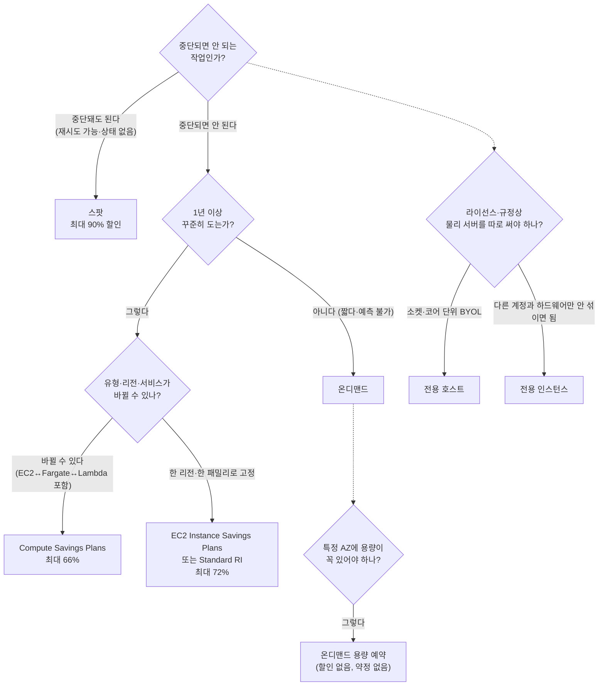

# M03-02. 구매 옵션: 온디맨드, Savings Plans, 예약, 스팟, 전용, 용량 예약
> 도메인: D4, D3 · 예상 시간: 50분 · 실습 등급: 🟡

## 왜 필요한가

TodayOrder 주문 API 서버 4대가 1년 내내 돈다. 매일 새벽에는 주문 정산 배치가 2시간 돌고, 연말 대목에는 서버를 잠깐 3배로 늘린다. 이 세 가지를 모두 같은 가격표(온디맨드)로 사면 청구서가 불필요하게 커진다. AWS는 **같은 인스턴스를 사는 방법**을 여러 가지 준다. "얼마나 오래, 얼마나 확실히, 중단돼도 괜찮은가"에 따라 맞는 구매 옵션이 다르다. SAA-C03에서 "가장 비용 효율적인"이라는 표현이 나오면 거의 이 레슨을 묻는다.

## 핵심 개념



### 결정 표

| 옵션 | 약정 | 할인(온디맨드 대비, AWS 발표 최대치) | 중단 위험 | 용량 보장 | 이럴 때 |
|---|---|---|---|---|---|
| **온디맨드(On-Demand)** | 없음 | – | 없음 | 없음 | 짧은·예측 불가 워크로드, 개발·테스트, 처음 써 보는 서비스 |
| **Savings Plans — Compute** | 1년/3년, **시간당 $ 사용액** 약정 | 최대 66% | 없음 | 없음 | 꾸준한 사용, 패밀리·리전·OS가 바뀔 수 있고 **Fargate·Lambda**에도 할인을 받고 싶다 |
| **Savings Plans — EC2 Instance** | 1년/3년, 한 리전의 한 패밀리 | 최대 72% | 없음 | 없음 | 꾸준한 사용, 패밀리·리전 고정(크기·OS는 바꿔도 됨) |
| **예약 인스턴스(RI) — Standard** | 1년/3년, 유형 고정 | 최대 72% | 없음 | **영역(AZ) RI만** 보장 | 아주 안정적인 워크로드. **RI 마켓플레이스에서 팔 수 있다** |
| **예약 인스턴스(RI) — Convertible** | 1년/3년 | 최대 66% | 없음 | 영역 RI만 | 기간 중 패밀리·OS 등을 **교환**해야 할 수 있다 |
| **스팟(Spot)** | 없음 | **최대 90%** | **있음(2분 전 알림)** | 없음 | 배치, CI, 이미지 변환, 빅데이터, 상태 없는 웹 서버 일부 |
| **전용 인스턴스(Dedicated Instance)** | 없음(온디맨드/RI 가능) | – (추가 요금) | 없음 | 없음 | 규정상 다른 고객과 **하드웨어를 공유하면 안 됨** |
| **전용 호스트(Dedicated Host)** | 온디맨드 또는 예약 | – (가장 비쌈) | 없음 | 호스트 단위 | **소켓·코어 단위 라이선스(BYOL)**, 호스트를 직접 지정·관리해야 함 |
| **온디맨드 용량 예약(ODCR)** | 없음(언제든 취소) | 없음 (Savings Plans·리전 RI 할인과 함께 적용 가능) | 없음 | **특정 AZ에 보장** | 행사·재해 복구 훈련처럼 "그 시간에 그 AZ에서 반드시 띄워야 하는" 경우 |

- 할인율은 AWS 가격 페이지에 적힌 **최대치**다(2026-11 확인). 실제 할인율은 유형·리전·기간·선결제 방식에 따라 다르다.
- 결제 방식: **전체 선결제(All Upfront) > 부분 선결제(Partial) > 선결제 없음(No Upfront)** 순으로 할인 폭이 크다. 3년이 1년보다 더 싸다.
- 과금 단위: EC2는 **초 단위**(최소 60초)로 청구된다(Linux 등. 일부 OS는 시간 단위).
- AWS는 새로 약정할 때 RI보다 **Savings Plans**를 권하는 편이다. 시험에도 "유연성 + 할인"이 나오면 Savings Plans가 정답인 경우가 많다.

### 스팟을 쓸 때 꼭 알아야 할 것

- AWS가 용량을 되찾을 때 **2분 전에 중단 알림**(인스턴스 메타데이터, EventBridge 이벤트)을 준다. 그보다 이른 신호로 **리밸런스 권고(rebalance recommendation)** 도 있다.
- 중단 동작: 종료(terminate, 기본) / 중지(stop) / 최대 절전(hibernate). 중지·최대 절전은 `persistent` 요청이어야 한다.
- 한 유형·한 AZ에 몰지 말고 **여러 유형·여러 AZ**로 분산한다(ASG 혼합 인스턴스 정책 또는 EC2 Fleet, 할당 전략 `price-capacity-optimized`). 레슨 6에서 ASG로 다시 본다.
- 스팟 요청을 **취소해도 이미 뜬 인스턴스는 종료되지 않는다.** 직접 종료해야 한다(아래 실습에서 확인).
- 상태를 가진 단일 서버(주문 DB), 중단되면 처음부터 다시 해야 하는 긴 작업에는 맞지 않는다.

### 리전 RI vs 영역(AZ) RI

| | 리전 RI | 영역 RI |
|---|---|---|
| 할인 적용 | 리전의 모든 AZ, **같은 패밀리 안에서 크기 유연**(Linux) | 지정 AZ·지정 유형 |
| 용량 예약 | **없음** | **있음** |

"할인도 받고 특정 AZ 용량도 보장" → 영역 RI, 또는 **ODCR + Savings Plans** 조합.

## 직접 해 보기

전체 과정: [labs/lab02-purchase-options.sh](./labs/lab02-purchase-options.sh). **가격 숫자는 에뮬레이터가 내놓는 값이며 실제 AWS 가격이 아니다.** 구조와 흐름만 본다.

**1) 스팟 가격 기록** — 같은 유형도 AZ마다 가격이 다르다.

```bash
aws ec2 describe-spot-price-history --instance-types c7i.large --product-descriptions "Linux/UNIX" \
  --no-paginate --query 'SpotPriceHistory[].[AvailabilityZone,InstanceType,SpotPrice]' --output text | sort | uniq
```

```
us-east-1a	c7i.large	0.042200
us-east-1b	c7i.large	0.024800
us-east-1c	c7i.large	0.032900
```

**2) 스팟 요청 → fulfilled → 인스턴스.**

```bash
aws ec2 request-spot-instances --instance-count 1 --type one-time \
  --launch-specification '{"ImageId":"ami-0000000000000004c","InstanceType":"c7i.large","SubnetId":"<서브넷 A>"}' \
  --query 'SpotInstanceRequests[0].SpotInstanceRequestId' --output text
aws ec2 describe-spot-instance-requests --spot-instance-request-ids sir-00000000000000098 \
  --query 'SpotInstanceRequests[0].[State,Status.Code,InstanceId]' --output text
```

```
open	pending-evaluation	terminate
active	fulfilled	i-00000000000000003
{
    "Lifecycle": "spot",
    "Request": "sir-00000000000000098",
    "Type": "c7i.large"
}
```

방금 본 것: 요청은 `open/pending-evaluation`으로 시작해 `active/fulfilled`가 되고, 인스턴스의 `InstanceLifecycle`이 `spot`이다(온디맨드 인스턴스는 이 필드가 비어 있다). 기본 중단 동작은 `terminate`다.

**3) 요청을 취소해도 인스턴스는 계속 돈다.**

```
cancelled
스팟 인스턴스 상태: running
```

**4) 예약 인스턴스 상품 읽기** — 같은 상품이 범위(Scope)별로 있다.

```bash
aws ec2 describe-reserved-instances-offerings --instance-type m7i.large --product-description Linux/UNIX \
  --offering-class standard --no-paginate \
  --query 'ReservedInstancesOfferings[?Duration==`31536000` && OfferingType==`No Upfront`].[Scope,AvailabilityZone]' --output text
aws ec2 describe-reserved-instances-offerings --instance-type m7i.large --product-description Linux/UNIX \
  --offering-class standard --no-paginate \
  --query 'ReservedInstancesOfferings[?Scope==`Region`].[Duration,OfferingType,FixedPrice,UsagePrice]' --output text | sort
```

```
Region	None
Availability Zone	us-east-1a
Availability Zone	us-east-1b
31536000	All Upfront	430.99	0.0
31536000	No Upfront	0.0	0.0492
31536000	Partial Upfront	215.5	0.0246
94608000	All Upfront	861.98	0.0
94608000	No Upfront	0.0	0.0328
94608000	Partial Upfront	430.99	0.0164
(standard + convertible 상품 수: 36, 범위: Availability Zone/Region/)
```

방금 본 것: 기간은 초 단위(31536000초 = 1년, 94608000초 = 3년). `FixedPrice`가 선결제, `UsagePrice`가 시간당 요금이다. 리전 RI(`Region`)와 영역 RI(`Availability Zone`)가 따로 있다. 1년 All Upfront를 시간당으로 나눠 보면 430.99 ÷ 8760 ≈ 0.0492로 No Upfront와 같다. **에뮬레이터의 가격표는 결제 방식별 할인을 반영하지 않는다.** 실제로는 선결제가 많을수록 실효 단가가 낮다.

**5) Savings Plans 상품 읽기.**

```bash
aws savingsplans describe-savings-plans-offerings \
  --query 'searchResults[].[planType,join(`,`,productTypes)]' --output text | sort | uniq -c
```

```
   6 Compute	Fargate,EC2,Lambda
  14 EC2Instance	EC2
```

방금 본 것: **Compute** Savings Plans는 EC2·Fargate·Lambda에 걸쳐 적용되고, **EC2Instance**는 EC2에만 적용된다. 결정 표의 차이 그대로다.

**6) 온디맨드 용량 예약 · 7) 전용 인스턴스 · 8) 전용 호스트.**

```bash
aws ec2 create-capacity-reservation --instance-type m7i.large --instance-platform Linux/UNIX \
  --availability-zone us-east-1a --instance-count 2 --end-date-type unlimited
aws ec2 run-instances ... --placement Tenancy=dedicated
aws ec2 allocate-hosts --instance-type m7i.large --availability-zone us-east-1a --quantity 1
```

```
m7i.large	us-east-1a	2	2	open	active
i-00000000000000004 tenancy=dedicated
h-000000000000000a1	available	m7i.large	us-east-1a
```

방금 본 것: 용량 예약은 `active`, 총 2대·남은 2대, 매칭 기준 `open`(조건이 맞는 인스턴스가 자동으로 예약을 쓴다)이다. 전용 인스턴스는 `Tenancy=dedicated`, 전용 호스트는 `h-…` 호스트 ID를 받는다. lab은 끝에서 예약을 취소하고(`cancel-capacity-reservation`) 호스트를 반납한다(`release-hosts`).

## 실제 AWS에서는

- 에뮬레이터는 **요금을 매기지 않는다.** 할인 적용, 스팟 가격 변동, **스팟 중단(2분 알림)** 은 재현되지 않는다. 가격표 숫자도 실제가 아니다(위 4번처럼 결제 방식별 할인도 없음).
- 에뮬레이터에서 용량 예약을 지정해 인스턴스를 띄워도 `AvailableInstanceCount`가 줄지 않는다(실제는 사용한 만큼 준다).
- RI·Savings Plans는 **구매하는 순간 기간 전체 요금이 확정**되는 약정이다. 연습 삼아 사면 안 된다. 가격 비교는 **AWS Pricing Calculator**와 Cost Explorer의 구매 권장 사항으로 한다(M13).

**실제 AWS에서 해 보려면 (🟡)**
- 스팟 가격 기록·RI/Savings Plans 상품 조회(`describe-*`)는 **무료**이고 아무것도 만들지 않는다. 실제 가격 차이를 보기에 좋다.
- 스팟 인스턴스는 프리 티어 대상이 아니다. 몇 분 띄워 보는 정도는 비용이 아주 작지만, **반드시 종료**한다: `aws ec2 terminate-instances --instance-ids <id>` (요청 취소만으로는 안 꺼진다).
- 용량 예약은 만드는 순간부터 **쓰지 않아도 온디맨드 요금**이 나간다 → 바로 `aws ec2 cancel-capacity-reservation --capacity-reservation-id <id>`.
- **전용 호스트는 실습하지 않는다**(호스트 단위로 비싸게 청구된다). RI·Savings Plans 구매 버튼도 누르지 않는다.

## 시험 포인트

- "중단돼도 되는 배치/CI/이미지 처리, **가장 저렴하게**" → **스팟**. "중단되면 안 된다"가 붙으면 스팟은 오답.
- "1년 이상 꾸준히, 유형·리전이 바뀔 수 있고 Lambda·Fargate도 쓴다" → **Compute Savings Plans**. "한 패밀리 고정, 최대 할인" → **EC2 Instance Savings Plans / Standard RI**.
- "기간 중 인스턴스 패밀리를 바꿔야 할 수도" → **Convertible RI**(또는 Compute SP). "안 쓰게 된 RI를 팔고 싶다" → **Standard RI + RI 마켓플레이스**.
- "특정 AZ에 용량 보장, 장기 약정 없이" → **온디맨드 용량 예약**. 할인까지 원하면 + Savings Plans/리전 RI.
- "소켓·코어 단위 라이선스(BYOL), 물리 서버 가시성" → **전용 호스트**. "하드웨어만 다른 고객과 분리" → **전용 인스턴스**.
- 섞어 쓰는 것이 정답인 경우가 많다: **기준 부하 = SP/RI, 피크 = 온디맨드, 중단 가능 작업 = 스팟**.

## 스스로 확인

1. TodayOrder의 정산 배치는 매일 새벽 2시간, 중간에 끊기면 마지막 체크포인트부터 다시 돈다. 어떤 구매 옵션을 쓰고, 어떻게 구성해야 끊김에 강할까?
2. 1년 뒤 API를 컨테이너(Fargate)로 옮길 계획이 있다. 지금 EC2 4대를 위해 무엇을 약정해야 할인을 계속 받을까?
3. "다음 달 블랙프라이데이 하루 동안 us-east-1a에 m7i.large 20대를 꼭 띄워야 한다." 어떤 옵션인가? RI를 사면 안 되는 이유는?

<details><summary>답</summary>

1. **스팟.** 체크포인트가 있어 중단을 견딘다. 여러 인스턴스 유형·여러 AZ로 분산하고(`price-capacity-optimized`), 2분 중단 알림을 받으면 체크포인트를 저장하게 한다. AWS Batch(레슨 7)의 스팟 컴퓨트 환경이 이 일을 대신해 준다.
2. **Compute Savings Plans.** EC2에서 Fargate로 옮겨도 같은 약정으로 할인이 이어진다. EC2 Instance SP나 RI는 EC2에만 적용된다.
3. **온디맨드 용량 예약(ODCR)** 을 그 기간만 만들었다가 취소한다. RI는 1년 이상 약정이라 하루를 위해 사면 낭비이고, 리전 RI는 용량을 보장하지도 않는다.

</details>
