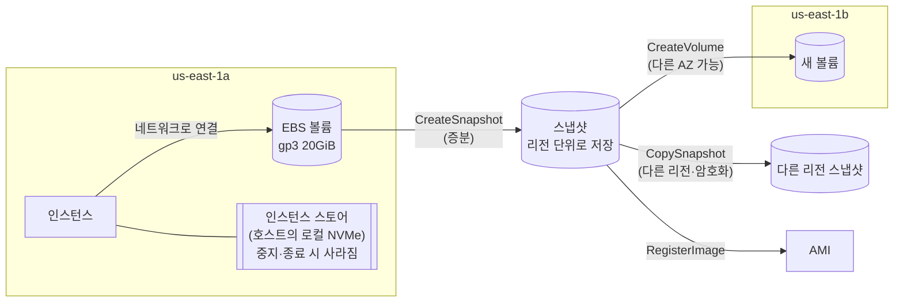

# M03-03. EBS(gp3·io2·st1·sc1, 스냅샷, 암호화, 다중 연결)와 인스턴스 스토어
> 도메인: D3, D2, D1 · 예상 시간: 55분 · 실습 등급: 🟢 볼륨·스냅샷 / 🔴 스냅샷에서 볼륨 복원·AMI 생성

## 왜 필요한가

API 서버의 로그와 업로드 임시 파일이 쌓이는 디스크, 개발팀이 직접 운영하는 PostgreSQL 데이터 디스크, 밤마다 떠야 하는 백업. "서버에 딸린 디스크"를 잘못 고르면 DB가 느리거나(IOPS 부족) 쓸데없이 비싸다(필요 없는 io2). 또 디스크가 어느 AZ에 묶여 있는지, 서버를 지우면 디스크도 지워지는지 모르면 데이터를 잃는다.

## 핵심 개념

**EBS(Elastic Block Store)** 는 네트워크로 붙는 **블록 스토리지(가상 디스크)** 다. 인스턴스와 수명이 분리되어 있어 인스턴스를 중지·종료해도 데이터가 남는다(종료 시 삭제 옵션 제외).



핵심 성질:
- EBS 볼륨은 **하나의 AZ에 속한다.** 같은 AZ의 인스턴스에만 붙는다. 다른 AZ로 옮기려면 **스냅샷 → 다른 AZ에 볼륨 생성**.
- **스냅샷**은 증분 백업이고 **리전 단위**로 저장된다(AWS가 관리하는 S3에, 사용자 버킷에는 보이지 않는다). 다른 리전으로 복사할 수 있어 DR에 쓴다.
- 한 볼륨은 보통 한 인스턴스에만 붙는다. 예외가 **io1/io2 다중 연결(Multi-Attach)**: 같은 AZ의 Nitro 인스턴스 여러 대(최대 16대)에 동시에 붙는다. 여러 서버가 동시에 쓰면 일반 파일 시스템(ext4·xfs)은 깨지므로 **클러스터 인식 파일 시스템/애플리케이션**이 필요하다. "여러 서버가 파일을 공유"가 목적이면 보통 EFS(M04)가 정답이다.

### 볼륨 유형 (AWS 문서, 2026-11 확인)

| 유형 | 분류 | 크기 | 최대 IOPS | 최대 처리량 | 특징 | 이럴 때 |
|---|---|---|---|---|---|---|
| **gp3** | 범용 SSD | 1 GiB – 64 TiB | 80,000 | 2,000 MiB/s | 기본 **3,000 IOPS·125 MiB/s 포함**, IOPS·처리량을 크기와 **따로** 올린다(IOPS는 GiB당 500까지) | 대부분의 부트·앱·중소 DB. **기본 선택** |
| gp2 | 범용 SSD(이전 세대) | 1 GiB – 16 TiB | 16,000 | 250 MiB/s | IOPS = **GiB당 3**(최소 100), 1TiB 미만은 3,000까지 버스트 | 기존 볼륨. gp3로 바꾸면 보통 더 싸다(GiB당 최대 20% 저렴) |
| **io2** Block Express | 프로비저닝 IOPS SSD | 4 GiB – 64 TiB | 256,000 | 4,000 MiB/s | IOPS:GiB = 1000:1, **내구성 99.999%**, 지연 1ms 미만, **다중 연결** | 지연에 민감한 핵심 DB(Oracle, SQL Server, SAP HANA) |
| io1 | 프로비저닝 IOPS SSD(이전) | 4 GiB – 16 TiB | 64,000 | 1,000 MiB/s | IOPS:GiB = 50:1, 다중 연결 | 기존 볼륨 |
| **st1** | 처리량 최적화 HDD | 125 GiB – 16 TiB | 500 | 500 MiB/s | 큰 순차 I/O, **부트 볼륨 불가** | 빅데이터, 로그 처리, 데이터 웨어하우스 |
| **sc1** | 콜드 HDD | 125 GiB – 16 TiB | 250 | 250 MiB/s | 가장 싼 EBS, 부트 불가 | 자주 안 읽는 대용량 데이터 |

gp3·gp2·io1·st1·sc1의 내구성은 99.8–99.9%다(io2만 99.999%). 최대 IOPS는 Nitro 인스턴스에 붙였을 때 기준이다.

### 인스턴스 스토어 (Instance Store)

인스턴스가 올라간 **물리 호스트의 로컬 디스크**다(유형 이름의 `d`, 또는 I 패밀리). 네트워크를 거치지 않아 **매우 빠르지만 휘발성**이다: 인스턴스를 **중지·종료하거나 호스트 하드웨어가 고장 나면 데이터가 사라진다**(재부팅은 유지). 캐시, 버퍼, 스크래치 공간, 여러 노드에 복제하는 분산 DB에 쓴다. 스냅샷 기능이 없다.

### 암호화

- KMS 키(AWS 관리형 `aws/ebs` 또는 고객 관리형)로 **저장 데이터·스냅샷·인스턴스와 볼륨 사이 전송 데이터**가 함께 암호화된다. 성능 영향은 거의 없다.
- 암호화된 볼륨의 스냅샷은 암호화되고, 그 스냅샷으로 만든 볼륨도 암호화된다.
- **이미 있는 암호화 안 된 볼륨을 그 자리에서 암호화할 수는 없다** → 스냅샷 → **암호화하며 복사(CopySnapshot --encrypted)** → 그 스냅샷으로 새 볼륨.
- **EBS 기본 암호화(encryption by default)** 를 리전별로 켜 두면 이후 만드는 모든 새 볼륨이 자동 암호화된다.

### 스냅샷 관리

| 기능 | 용도 |
|---|---|
| **Data Lifecycle Manager(DLM)** / **AWS Backup** | 스냅샷 생성·보존 기간 자동화 (M12) |
| **스냅샷 아카이브 계층** | 오래 보관만 하는 스냅샷을 더 싼 계층으로(복원에 시간이 걸린다) |
| **휴지통(Recycle Bin)** | 실수로 지운 스냅샷·AMI를 보존 기간 안에 되살린다 |
| **빠른 스냅샷 복원(FSR)** | 스냅샷에서 만든 볼륨이 처음부터 최대 성능을 내게(초기화 지연 제거, 추가 요금) |

## 직접 해 보기

전체 과정: [labs/lab03-ebs-volumes-snapshots.sh](./labs/lab03-ebs-volumes-snapshots.sh)

**1) 유형별 볼륨.**

```bash
aws ec2 create-volume --availability-zone us-east-1a --volume-type gp3 --size 20 --iops 3000 --throughput 125
aws ec2 create-volume --availability-zone us-east-1a --volume-type gp2 --size 10
aws ec2 create-volume --availability-zone us-east-1a --volume-type io2 --size 10 --iops 3000 --multi-attach-enabled
aws ec2 create-volume --availability-zone us-east-1a --volume-type st1 --size 125
```

```
------------------------------------------------------
|                   DescribeVolumes                  |
+-----+------+-------+-------+--------+--------------+
|  gp2|  10  |  None |  None |  False |  available   |
|  gp3|  20  |  3000 |  125  |  False |  available   |
|  io2|  10  |  3000 |  None |  True  |  available   |
|  st1|  125 |  None |  None |  False |  available   |
+-----+------+-------+-------+--------+--------------+
```

(열: 유형, GiB, IOPS, 처리량, 다중 연결, 상태)

**2) 규칙 위반.**

```
-- HDD(st1·sc1)는 125 GiB 부터
aws: [ERROR]: An error occurred (InvalidParameterValue) when calling the CreateVolume operation: Invalid value '100' for size. A sc1 volume holds from 125 to 16384 GiB
-- io2 는 IOPS 를 꼭 정해야 한다
aws: [ERROR]: An error occurred (MissingParameter) when calling the CreateVolume operation: iops is required for a io2 volume
-- 다중 연결(Multi-Attach)은 io1/io2 만
aws: [ERROR]: An error occurred (InvalidParameterCombination) when calling the CreateVolume operation: The parameter multi-attach-enabled is not supported for gp3 volumes.
```

**3) 연결과 AZ 제약, 다중 연결.**

```bash
aws ec2 attach-volume --volume-id <gp2> --instance-id <i1> --device /dev/sdf
aws ec2 attach-volume --volume-id <gp2> --instance-id <i2> --device /dev/sdf     # 두 번째 인스턴스
aws ec2 attach-volume --volume-id <io2> --instance-id <i1> --device /dev/sdg
aws ec2 attach-volume --volume-id <io2> --instance-id <i2> --device /dev/sdg
aws ec2 attach-volume --volume-id <us-east-1b 볼륨> --instance-id <i1> --device /dev/sdh
```

```
-- 같은 gp2 볼륨을 두 번째 인스턴스에 → 거부 (다중 연결 불가 유형)
aws: [ERROR]: An error occurred (VolumeInUse) when calling the AttachVolume operation: vol-000000000000000c0 is already attached to an instance
-- io2 (MultiAttachEnabled) 는 두 인스턴스에 동시에
attaching
attaching
i-00000000000000009	/dev/sdg	attached
i-0000000000000000a	/dev/sdg	attached
-- 다른 AZ(us-east-1b)의 볼륨은 연결할 수 없다
aws: [ERROR]: An error occurred (InvalidVolume.ZoneMismatch) when calling the AttachVolume operation: The volume 'vol-000000000000000cb' is not in the same availability zone as instance 'i-00000000000000009'
```

방금 본 것: **볼륨은 AZ에 묶인다**(`ZoneMismatch`). 다중 연결은 io2에서만 된다.

**4) 연결된 채로 gp2 → gp3, 10 → 20 GiB (Elastic Volumes).**

```bash
aws ec2 modify-volume --volume-id <gp2> --volume-type gp3 --size 20
aws ec2 modify-volume --volume-id <gp2> --size 10
```

```
modifying	gp2	gp3	10	20	3000	125
gp3	20	3000	125	in-use
-- 줄이기는 안 된다
aws: [ERROR]: An error occurred (InvalidParameterValue) when calling the ModifyVolume operation: New size cannot be smaller than existing size
```

방금 본 것: 인스턴스를 멈추지 않고 유형·크기를 바꿨다(`in-use` 그대로). gp3로 바뀌면서 기본 3,000 IOPS·125 MiB/s가 붙었다. **크기는 늘릴 수만 있다.** 실제로는 늘린 뒤 OS 안에서 파일 시스템도 늘려야 한다(`growpart`, `xfs_growfs`).

**5) 스냅샷 · 6) 암호화 사본 · 7) 기본 암호화.**

```bash
aws ec2 create-snapshot --volume-id <gp3> --description "todayorder data nightly"
aws ec2 copy-snapshot --source-snapshot-id <snap> --source-region us-east-1 --encrypted \
  --description "todayorder data encrypted copy"
aws ec2 enable-ebs-encryption-by-default
aws ec2 create-volume --availability-zone us-east-1a --volume-type gp3 --size 8 --query '[VolumeId,Encrypted]' --output text
aws ec2 disable-ebs-encryption-by-default
```

```
snap-000000000000000bb	pending
completed	100%	20	False	standard
snap-000000000000000bb	False	todayorder data nightly
snap-000000000000000bd	True	todayorder data encrypted copy
True
vol-000000000000000be	True
False
```

방금 본 것: 스냅샷은 `pending`에서 `completed`가 되고 저장 계층은 `standard`다. **암호화 안 된 스냅샷을 복사하면서 암호화**했다(`True`). 기본 암호화를 켠 뒤 만든 볼륨은 옵션 없이도 `Encrypted=True`다. (lab은 다른 lab에 영향을 주지 않게 바로 다시 끈다.)

**8) 스냅샷에서 볼륨 복원 — 에뮬레이터에서는 실패한다.**

```bash
aws ec2 create-volume --availability-zone us-east-1b --snapshot-id snap-000000000000000bb
```

```
aws: [ERROR]: An error occurred (InvalidSnapshot.NotFound) when calling the CreateVolume operation: The snapshot 'snap-000000000000000bb' does not exist.
```

방금 본 것: 방금 `completed`로 조회한 스냅샷인데 "없다"고 한다. 에뮬레이터 한계다(🔴). 실제 AWS에서는 이것이 **볼륨을 다른 AZ로 옮기는 정석 방법**이다. 스냅샷 아카이브 계층 이동(`ModifySnapshotTier`)도 501이다.

### AMI 읽기 (🔴 생성 대체 실습)

AMI 생성(`CreateImage`), 스냅샷으로 등록(`RegisterImage`), 복사(`CopyImage`)가 모두 501이라 기존 AMI를 **읽는** 실습으로 대신한다: [labs/lab04-ami-read.sh](./labs/lab04-ami-read.sh)

```bash
aws ec2 describe-images --owners amazon \
  --filters "Name=name,Values=al2023-ami-2023.*-kernel-*-x86_64" "Name=state,Values=available" \
  --query 'sort_by(Images,&CreationDate)[-3:].[ImageId,Name,CreationDate]' --output text
```

```
ami-0000000000000003c	al2023-ami-2023.6.20241121.0-kernel-6.1-x86_64	2024-11-21T04:40:03.000Z
ami-00000000000000044	al2023-ami-2023.7.20250603.0-kernel-6.12-x86_64	2025-06-03T05:18:27.000Z
ami-0000000000000004c	al2023-ami-2023.8.20251104.0-kernel-6.18-x86_64	2025-11-04T05:52:41.000Z
describe-images 최신: ami-0000000000000004c / SSM 파라미터: ami-0000000000000004c
```

```json
{
    "Name": "al2023-ami-2023.8.20251104.0-kernel-6.18-x86_64",
    "Owner": "137112412989",
    "Public": true,
    "Arch": "x86_64",
    "Virtualization": "hvm",
    "RootDeviceType": "ebs",
    "RootDevice": "/dev/xvda",
    "BootMode": "uefi-preferred",
    "ImdsSupport": "v2.0",
    "Platform": "Linux/UNIX",
    "RootSnapshot": "snap-0000000000000004d",
    "RootSizeGiB": 8,
    "RootType": "gp3",
    "RootEncrypted": false
}
[
    {
        "Group": "all"
    }
]
```

```
== 4. 루트 디바이스 유형별 AMI 수: EBS 기반 vs 인스턴스 스토어 기반
  52 ebs
   4 instance-store
== 5. 아키텍처별 (x86_64 vs arm64 = Graviton)
  20 arm64
  36 x86_64
== 6. 내 계정이 만든 AMI (owners=self)
내 AMI 수: 0
== 7. 인스턴스에서 AMI 만들기(CreateImage) — 에뮬레이터 미구현
aws: [ERROR]: An error occurred (NotImplemented) when calling the CreateImage operation: operation CreateImage is scaffolded but not implemented in this emulator
== 8. 스냅샷으로 AMI 등록(RegisterImage) — 에뮬레이터 미구현
aws: [ERROR]: An error occurred (NotImplemented) when calling the RegisterImage operation: operation RegisterImage is scaffolded but not implemented in this emulator
== 9. 다른 리전으로 AMI 복사(CopyImage) — 에뮬레이터 미구현
aws: [ERROR]: An error occurred (NotImplemented) when calling the CopyImage operation: operation CopyImage is scaffolded but not implemented in this emulator
```

방금 본 것: AMI = **루트 스냅샷 + 디바이스 매핑 + 속성**. `ImdsSupport: v2.0`이면 이 AMI로 띄운 인스턴스는 IMDSv2가 기본이다. `LaunchPermissions: Group=all`은 **공개 AMI**라는 뜻이다. 내 AMI는 기본이 비공개이고, 특정 계정에만 공유할 수 있다. `ImdsSupport`·`BootMode` 같은 필드를 읽는 습관은 실제 운영에서도 쓸모가 있다.

## 실제 AWS에서는

- 스냅샷에서 볼륨 복원(다른 AZ로 이동), AMI 생성·등록·리전 간 복사가 모두 동작한다. 골든 AMI 파이프라인은 **EC2 Image Builder**로 자동화한다.
- 에뮬레이터는 **IOPS:GiB 비율을 검사하지 않는다**(예: gp3 10 GiB에 20,000 IOPS, io2 10 GiB에 100,000 IOPS도 받아 준다). 실제로는 gp3 500:1, io2 1000:1을 넘으면 거부된다.
- 에뮬레이터는 성능(IOPS·처리량)을 흉내 내지 않는다. gp2 버스트 크레딧, 스냅샷 복원 직후의 초기화 지연도 없다.
- 에뮬레이터에서 종료된 인스턴스의 루트 볼륨은 `in-use`로 남는다(실제는 삭제).

**실제 AWS에서 해 보려면 (🔴 항목: 복원·AMI)**
- 프리 티어(2025-07-15 이후 만든 계정은 크레딧 방식, 최대 6개월)로 해 볼 수 있다. EBS 스토리지와 스냅샷은 **GiB·월 단위로 계속 과금**되므로 끝나면 지운다.
- 순서: 작은 gp3 볼륨(1 GiB) → `create-snapshot` → 다른 AZ에 `create-volume --snapshot-id` → 인스턴스(t3.micro 등)에서 `create-image --no-reboot`.
- 정리: `aws ec2 deregister-image --image-id <ami>` → `aws ec2 delete-snapshot --snapshot-id <AMI의 스냅샷>` → `aws ec2 delete-volume --volume-id <vol>` → `aws ec2 terminate-instances ...`. **AMI를 등록 해제해도 스냅샷은 남아 과금된다**는 점에 주의.

## 시험 포인트

- "볼륨을 다른 AZ(또는 리전)로 옮겨라" → **스냅샷 → (리전이면 CopySnapshot) → 새 AZ에 CreateVolume**. 볼륨을 직접 옮기는 API는 없다.
- "기존 암호화 안 된 볼륨을 암호화" → 스냅샷 → **암호화 복사** → 새 볼륨 → 교체. "앞으로 만들 모든 볼륨" → **EBS 기본 암호화**.
- "IOPS가 크기와 무관하게 필요하고 비용도 아끼고 싶다" → **gp3**(gp2→gp3 변경은 무중단). "sub-ms 지연, 99.999% 내구성, 최고 IOPS" → **io2 Block Express**.
- "대용량 순차 읽기(로그·빅데이터), 싸게" → **st1**. "거의 안 읽는 데이터, 가장 싸게" → **sc1**. 둘 다 **부트 볼륨 불가**.
- "가장 빠른 임시 디스크, 잃어도 됨" → **인스턴스 스토어**. "중지해도 데이터 유지" → EBS.
- "여러 EC2가 같은 블록 볼륨을 동시에" → **io1/io2 다중 연결**(같은 AZ). 파일 공유라면 **EFS**.

## 스스로 확인

1. us-east-1a의 DB 서버를 us-east-1b로 옮겨야 한다. 데이터 볼륨은 어떻게 옮기나?
2. gp2 1,000 GiB 볼륨의 기준 IOPS는? 같은 성능을 gp3로 얻으려면 무엇을 설정하나?
3. 인스턴스 스토어에 세션 캐시를 두던 서버를 비용 절감을 위해 밤에 **중지**했다가 아침에 켰다. 무슨 일이 생기나?

<details><summary>답</summary>

1. 볼륨 스냅샷을 만들고, 그 스냅샷으로 us-east-1b에 새 볼륨을 만들어 새 인스턴스에 붙인다. EBS 볼륨은 AZ 리소스라 직접 옮길 수 없다.
2. 3 IOPS/GiB × 1,000 = **3,000 IOPS**. gp3는 크기와 상관없이 기본 3,000 IOPS·125 MiB/s를 주므로 1,000 GiB gp3면 추가 설정 없이 같은 IOPS를 더 싸게 얻는다(처리량이 더 필요하면 throughput만 올린다).
3. 인스턴스 스토어 데이터는 중지하면 **사라진다**. 캐시가 비어 아침 첫 요청들이 느려진다. 남겨야 하는 데이터라면 EBS나 ElastiCache 같은 외부 저장소에 둔다.

</details>
