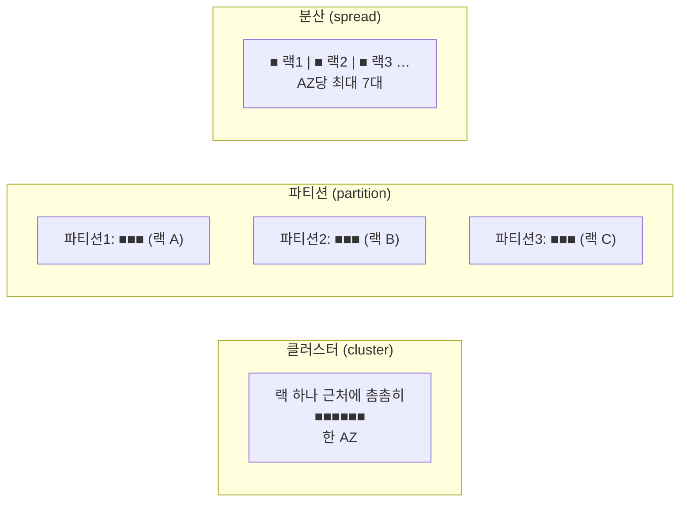

# M03-04. 배치 그룹, ENI·탄력적 IP, 최대 절전
> 도메인: D2, D3 · 예상 시간: 40분 · 실습 등급: 🟡

## 왜 필요한가

TodayOrder에 세 가지 요구가 한꺼번에 왔다. 추천 모델 학습 서버들은 **서로 아주 빠르게** 데이터를 주고받아야 하고, 결제 대행사는 **고정 IP**만 방화벽에 열어 준다고 하고, 관리자 대시보드 서버는 **켜는 데 10분**이나 걸려 밤에 끄기가 망설여진다. 인스턴스 유형을 바꾸는 것으로는 해결되지 않는다. **어디에 놓을지(배치 그룹), 어떤 주소를 붙일지(ENI·EIP), 어떻게 끌지(최대 절전)** 를 정해야 한다.

## 핵심 개념

### 배치 그룹 (Placement Group)

인스턴스를 물리적으로 **어떻게 놓을지**에 대한 힌트다. 무료다.



| 전략 | 배치 | 장점 | 제약 | 이럴 때 |
|---|---|---|---|---|
| **클러스터(cluster)** | 한 AZ 안, 고대역 네트워크 구간에 촘촘히 | **지연 최저, 처리량 최고**(같은 그룹 내 단일 흐름 최대 10 Gbps) | **한 AZ** → AZ 장애에 함께 죽는다. 버스트(T) 유형 불가. 같은 유형을 한 번에 띄우길 권장 | HPC, 분산 학습, 노드 간 통신이 많은 작업 |
| **파티션(partition)** | 파티션마다 서로 다른 랙 묶음 | 랙 장애가 한 파티션에만 영향. **어느 파티션에 있는지 보인다** | AZ당 **최대 7개 파티션**(인스턴스 수는 계정 한도까지) | HDFS, HBase, Cassandra, Kafka 같은 대규모 분산·복제 시스템 |
| **분산(spread)** | 인스턴스마다 다른 랙 | 동시 장애 위험 최소 | 랙 수준 분산은 **AZ당 실행 중인 인스턴스 최대 7대** | 서로 떨어져 있어야 하는 소수의 핵심 서버(예: 주 DB와 대기 DB 노드) |

### ENI (Elastic Network Interface)

인스턴스의 **가상 네트워크 카드**다. 프라이빗 IP, MAC 주소, 보안 그룹, (선택) 공인 IP·EIP를 가진다. 모든 인스턴스에는 기본 ENI(eth0, 디바이스 인덱스 0)가 있고 **보조 ENI**를 더 붙일 수 있다. 보조 ENI는 **떼어서 같은 AZ의 다른 인스턴스에 붙일 수 있고, IP·MAC이 그대로 따라간다.** 그래서 "IP로 라이선스가 묶인 소프트웨어", "관리망/서비스망 분리", "간단한 장애 조치"에 쓴다. ENI는 **서브넷(=AZ)에 속한다.**

### 탄력적 IP (Elastic IP, EIP)

계정에 할당해 두는 **고정 공인 IPv4**다. 인스턴스(또는 ENI)에 붙였다 떼었다 할 수 있어서, 서버가 고장 나면 EIP를 예비 서버로 옮겨 같은 IP로 서비스를 이어 갈 수 있다. 다만:
- 2024년 2월부터 AWS는 **모든 공인 IPv4 주소에 시간당 요금**을 받는다(사용 중인 EIP 포함).
- 리전당 기본 할당량이 작다(기본 5개, 늘릴 수 있다).
- 현대적인 설계는 서버마다 고정 IP를 주기보다 **로드 밸런서 + DNS**를 쓴다. 고정 IP가 꼭 필요하면 **NLB(AZ마다 EIP 지정 가능)** 나 **Global Accelerator(고정 애니캐스트 IP 2개)**(M08)를 쓴다.

### 최대 절전 (Hibernation)

인스턴스를 멈출 때 **메모리(RAM) 내용을 루트 EBS 볼륨에 저장**하고, 다시 켤 때 그대로 불러온다. 프로세스와 캐시가 살아 있는 상태로 돌아오므로 "켜는 데 오래 걸리는(메모리를 데우는 데 오래 걸리는) 서버"를 밤에 꺼도 아침에 바로 쓸 수 있다.

| 조건 (AWS 문서) | 내용 |
|---|---|
| 켜는 시점 | **시작할 때만** 켤 수 있다. 실행 중이거나 중지된 인스턴스에는 나중에 켤 수 없다 |
| 루트 볼륨 | **EBS**(인스턴스 스토어 불가), **암호화 필수**, RAM을 담을 만큼 커야 한다 |
| RAM | Linux는 **150 GiB 미만**(Windows는 16 GiB 이하) |
| 요금 | 최대 절전 중(stopped)에는 인스턴스 요금이 없고 **EBS 저장 요금**(RAM 내용 포함)만 나간다 |

| 동작 | 메모리 | 인스턴스 스토어 | 공인 IP(자동) | 요금 |
|---|---|---|---|---|
| 재부팅 | 초기화 | 유지 | 유지 | 계속 |
| 중지 | 사라짐 | 사라짐 | 바뀜 | EBS만 |
| **최대 절전** | **EBS에 저장 후 복원** | 사라짐 | 바뀜 | EBS만 |
| 종료 | 사라짐 | 사라짐 | 반납 | 없음 |

## 직접 해 보기

전체 과정: [labs/lab05-placement-eni-eip.sh](./labs/lab05-placement-eni-eip.sh)

**1) 배치 그룹 3종.**

```bash
aws ec2 create-placement-group --group-name todayorder-pg-cluster --strategy cluster
aws ec2 create-placement-group --group-name todayorder-pg-spread --strategy spread --spread-level rack
aws ec2 create-placement-group --group-name todayorder-pg-partition --strategy partition --partition-count 3
aws ec2 create-placement-group --group-name todayorder-pg-too-many --strategy partition --partition-count 8
```

```
-----------------------------------------------------------------------
|                       DescribePlacementGroups                       |
+--------------------------+------------+------------+-------+--------+
|  todayorder-pg-cluster   |  cluster   |  available |  None |  None  |
|  todayorder-pg-spread    |  spread    |  available |  None |  rack  |
|  todayorder-pg-partition |  partition |  available |  3    |  None  |
+--------------------------+------------+------------+-------+--------+
-- 파티션은 AZ당 최대 7개
aws: [ERROR]: An error occurred (InvalidParameterValue) when calling the CreatePlacementGroup operation: Value (8) for parameter partitionCount is invalid. A partition placement group accepts between 1 and 7 partitions
```

**2) 클러스터 배치 그룹에 같은 유형 2대를 한 번에.**

```bash
aws ec2 run-instances --image-id "$AMI" --instance-type c7i.large --count 2 \
  --subnet-id "$M03_SUBNET_A" --placement GroupName=todayorder-pg-cluster
```

```
i-00000000000000010	c7i.large	todayorder-pg-cluster	us-east-1a
i-00000000000000011	c7i.large	todayorder-pg-cluster	us-east-1a
```

**3) ENI를 고장 난 서버에서 예비 서버로 옮기기.**

```bash
aws ec2 create-network-interface --subnet-id "$M03_SUBNET_A" --groups <sg> --private-ip-address 10.30.1.50
aws ec2 attach-network-interface --network-interface-id <eni> --instance-id <api-a> --device-index 1
# api-a 고장 → 떼어서 api-b 로
aws ec2 detach-network-interface --attachment-id <attachment>
aws ec2 attach-network-interface --network-interface-id <eni> --instance-id <api-b> --device-index 1
```

```
eni-00000000000000101	available	10.30.1.50	02:00:00:00:01:01
0	eni-00000000000000104	10.30.1.6
1	eni-00000000000000101	10.30.1.50
-- api-a 가 고장났다고 치고, ENI 를 떼어 api-b 에 붙인다 (IP·MAC 이 그대로 따라간다)
in-use	i-00000000000000013	10.30.1.50	02:00:00:00:01:01
```

방금 본 것: api-a에는 기본 ENI(인덱스 0, `10.30.1.6`)와 보조 ENI(인덱스 1, `10.30.1.50`)가 있었다. 보조 ENI를 api-b로 옮기자 **IP `10.30.1.50`과 MAC `02:00:00:00:01:01`이 그대로** 따라갔다.

**4) EIP 옮기기.**

```bash
aws ec2 allocate-address --domain vpc
aws ec2 associate-address --allocation-id <alloc> --instance-id <api-a>
aws ec2 associate-address --allocation-id <alloc> --instance-id <api-b> --allow-reassociation
```

```
할당: eipalloc-0000000000000010c 54.0.0.2
54.0.0.2	ec2-54-0-0-2.compute-1.amazonaws.com
54.0.0.2	i-00000000000000013
api-a 의 공인 IP: None
```

방금 본 것: EIP를 붙이자 인스턴스에 공인 IP와 공인 DNS 이름이 생겼고, `--allow-reassociation`으로 api-b에 다시 붙이자 api-a의 공인 IP는 사라졌다. 같은 공인 IP로 서비스가 이어진다.

**5) 최대 절전.**

```bash
aws ec2 run-instances --image-id "$AMI" --instance-type m7i.large --subnet-id "$M03_SUBNET_A" \
  --hibernation-options Configured=true \
  --block-device-mappings 'DeviceName=/dev/xvda,Ebs={Encrypted=true,VolumeSize=20,VolumeType=gp3}'
aws ec2 stop-instances --instance-ids <hib> --hibernate
aws ec2 stop-instances --instance-ids <api-a> --hibernate      # 최대 절전을 안 켠 인스턴스
```

```
{
    "Configured": true
}
running	stopping
stopped	Client.UserInitiatedShutdown
-- 최대 절전을 켜지 않은 인스턴스에 --hibernate → 거부
aws: [ERROR]: An error occurred (UnsupportedHibernationConfiguration) when calling the StopInstances operation: The instance 'i-00000000000000012' was not launched with hibernation enabled
-- (에뮬레이터 차이) 루트 볼륨 설정(암호화·20GiB)이 반영되지 않았다
8	False
```

방금 본 것: 시작할 때 켜 둔 인스턴스만 최대 절전으로 멈출 수 있다(`UnsupportedHibernationConfiguration`). 다만 에뮬레이터는 `--block-device-mappings`로 지정한 루트 볼륨 설정(20 GiB, 암호화)을 무시하고 AMI 기본값(8 GiB, 암호화 안 됨)으로 만들었다. 실제 AWS라면 **암호화되지 않은 루트로는 최대 절전을 켠 인스턴스가 시작되지 않는다.**

## 실제 AWS에서는

- 배치 그룹의 실제 효과(지연·대역폭·랙 분리)는 에뮬레이터에서 볼 수 없다. 또 에뮬레이터는 **분산 배치 그룹의 AZ당 7대 제한**과 **클러스터 배치 그룹의 T 유형 금지**를 검사하지 않는다(탐색 중 8대·t3.micro가 모두 받아들여졌다).
- 에뮬레이터는 IGW가 없는 VPC의 인스턴스에도 EIP 연결을 받아 주고, 이미 연결된 EIP를 `--allow-reassociation` 없이 다시 연결해도 받아 준다. 실제 AWS는 둘 다 거부한다.
- 최대 절전의 메모리 저장·복원, 최대 절전 시의 상태 사유(`Client.UserInitiatedHibernate`)는 재현되지 않는다(에뮬레이터는 일반 중지 사유를 보인다). 루트 볼륨 암호화·크기 조건도 검사하지 않는다.

**실제 AWS에서 해 보려면 (🟡)**
- 배치 그룹·ENI는 무료다. EIP와 자동 할당 공인 IP는 **시간당 과금**된다(2024-02부터). 인스턴스는 프리 티어 대상 유형(`aws ec2 describe-instance-types --filters Name=free-tier-eligible,Values=true`)을 쓴다.
- 최대 절전 실습: 프리 티어 대상 유형 중 최대 절전을 지원하는 것(예: t3.micro)으로, 루트 볼륨을 **암호화**해서 시작 → 앱을 띄우고 → `stop-instances --hibernate` → `start-instances`로 프로세스가 살아 있는지 확인한다.
- 정리: `aws ec2 disassociate-address --association-id <id>` → `aws ec2 release-address --allocation-id <id>` (**떼기만 하면 계속 과금**), `aws ec2 delete-network-interface`, `aws ec2 terminate-instances`, `aws ec2 delete-placement-group`.

## 시험 포인트

- "노드 간 지연 최소·처리량 최대(HPC)" → **클러스터** 배치 그룹(단, 한 AZ라 가용성은 낮다).
- "Cassandra/HDFS/Kafka, 랙 장애를 격리하고 토폴로지를 알아야" → **파티션**.
- "소수의 핵심 인스턴스가 동시에 죽으면 안 된다" → **분산**(AZ당 7대).
- "IP·MAC에 묶인 라이선스를 예비 서버로 옮겨라" → **보조 ENI 이동**. "고정 공인 IP로 장애 조치" → **EIP 재연결**. 고정 IP가 필요한 L4 부하 분산 → **NLB + EIP**.
- "부팅·워밍업이 오래 걸리는 서버를 끄되 메모리 상태를 유지" → **최대 절전**(시작 시 활성화, 암호화된 EBS 루트, RAM 150 GiB 미만).

## 스스로 확인

1. 추천 모델 학습용 c7i 16대를 클러스터 배치 그룹에 넣으려는데, 팀장이 "AZ 장애가 걱정된다"고 한다. 무엇을 포기하고 무엇을 얻는 선택인가?
2. 결제 대행사가 "우리 쪽 방화벽에는 IP 하나만 등록해 줄 수 있다"고 한다. API 서버는 ASG로 2~6대가 오간다. 어떻게 하나?
3. 이미 운영 중인 관리자 서버에 최대 절전을 켜고 싶다. 가능한가?

<details><summary>답</summary>

1. 클러스터 배치 그룹은 한 AZ에 몰아 **가용성을 포기하고 네트워크 성능을 얻는다**. 학습 작업은 체크포인트에서 다시 시작할 수 있으니 보통 받아들일 만하다. 걱정되면 체크포인트를 S3에 두고 다른 AZ에서 재시작하는 절차를 준비한다.
2. 들어오는 쪽이면 **NLB에 EIP**를 붙여 고정 IP로 받는다. **나가는** 요청의 출발지 IP가 하나여야 한다면 프라이빗 서브넷의 서버들이 **EIP를 가진 NAT 게이트웨이**(M02)로 나가게 한다. 인스턴스마다 EIP를 붙이는 방법은 대수가 바뀌는 ASG와 맞지 않는다.
3. 불가능하다. 최대 절전은 **시작할 때만** 켤 수 있다. 같은 설정(암호화된 루트 포함)으로 최대 절전을 켠 새 인스턴스를 만들어 옮겨야 한다.

</details>
