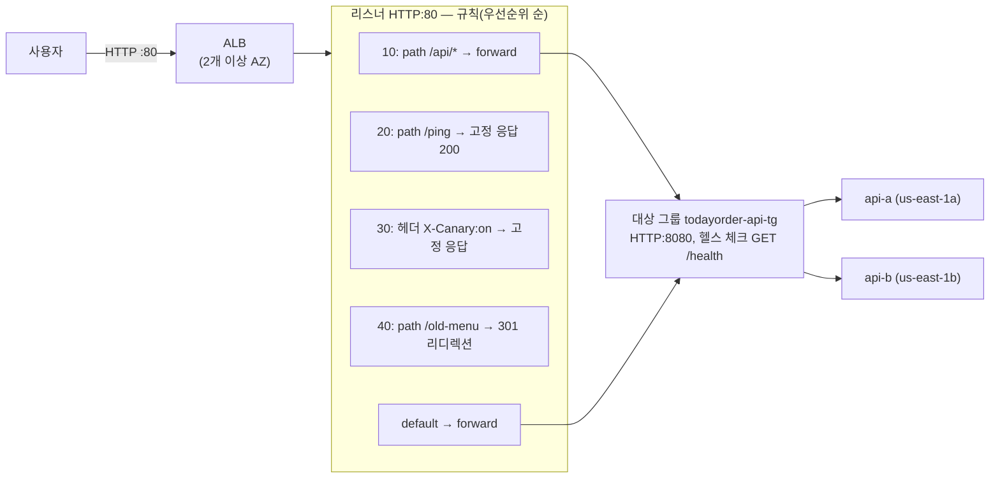

# M03-05. 로드 밸런서: ALB·NLB·GWLB, 대상 그룹, 헬스 체크, 스티키 세션, 교차 영역
> 도메인: D2, D3 · 예상 시간: 55분 · 실습 등급: 🟡 (구성 전부 / 규칙 동작은 컨테이너 안에서만, 선택 과제)

## 왜 필요한가

API 서버가 한 대면 그 서버가 죽거나 배포로 재시작할 때 주문이 멈춘다. 두 대로 늘리면 이번에는 "사용자는 어느 서버로 가야 하나?", "죽은 서버로는 어떻게 안 보내나?" 가 문제가 된다. DNS에 IP 두 개를 적는 방법으로는 죽은 서버를 빨리 빼지 못한다. **로드 밸런서**는 하나의 입구(DNS 이름)로 요청을 받아 **건강한** 서버들에 나눠 준다. 다음 레슨의 오토 스케일링도 로드 밸런서가 있어야 의미가 있다.

## 핵심 개념



용어:
- **리스너(Listener)**: 로드 밸런서가 받는 프로토콜·포트(예: HTTP:80, HTTPS:443).
- **규칙(Rule)**: 리스너에 도착한 요청을 조건(경로·호스트·헤더·쿼리 문자열·메서드·출발지 IP)에 따라 어떤 **동작(action)** 으로 처리할지. 우선순위 숫자가 **작을수록 먼저** 평가하고, 아무것도 맞지 않으면 **default** 규칙. 동작은 전달(forward), 리디렉션, 고정 응답, 인증(Cognito/OIDC).
- **대상 그룹(Target Group)**: 요청을 받을 대상의 묶음 + 헬스 체크 설정. 대상 유형은 `instance`, `ip`, `lambda`(ALB), `alb`(NLB 뒤에 ALB).
- **헬스 체크**: 대상마다 주기적으로 요청(예: `GET /health`)을 보내 연속 N번 성공하면 healthy, M번 실패하면 unhealthy. unhealthy 대상에는 보내지 않는다.

### ALB vs NLB vs GWLB

| | **ALB** (Application) | **NLB** (Network) | **GWLB** (Gateway) |
|---|---|---|---|
| 계층 | **L7** HTTP/HTTPS/gRPC, WebSocket | **L4** TCP/UDP/TLS | **L3** 패킷 (GENEVE 6081) |
| 라우팅 | 경로·호스트·헤더·쿼리·메서드 | 포트 단위 | 모든 트래픽을 어플라이언스로 |
| 고정 IP | 없음(DNS 이름만) | **AZ마다 고정 IP, EIP 지정 가능** | – |
| 성능 | 일반 웹 | **초당 수백만 요청, 매우 낮은 지연** | – |
| 클라이언트 IP | `X-Forwarded-For` 헤더로 전달 | 대상 유형·프로토콜에 따라 다름(아래) | 보존 |
| 대상 | instance, ip, **lambda** | instance, ip, **alb** | instance, ip (방화벽·IDS 어플라이언스) |
| 교차 영역 기본값 | **켜짐** | **꺼짐** | 꺼짐 |
| 보안 그룹 | 붙인다 | 붙일 수 있다(생성 시) | – |
| 이럴 때 | 웹·API, 마이크로서비스 경로 라우팅, 컨테이너 | 게임·IoT·금융 등 TCP/UDP, 고정 IP, 극저지연, PrivateLink 서비스 제공 | 서드파티 방화벽·IDS/IPS를 투명하게 끼워 넣기 |

**NLB의 클라이언트 IP 보존**(대상 그룹 속성 `preserve_client_ip.enabled`, AWS 문서 2026-11 확인):

| 대상 그룹 | 기본값 |
|---|---|
| 인스턴스 대상 | **켜짐** — 대상은 클라이언트 IP를 그대로 본다 |
| IP 대상 + UDP / TCP_UDP | **켜짐**(끌 수 없음) |
| IP 대상 + **TCP / TLS** | **꺼짐** — 대상에는 NLB 노드의 프라이빗 IP가 보인다 |

TCP/TLS + IP 대상에서 클라이언트 IP가 필요하면 `preserve_client_ip.enabled=true`로 켜거나(대상이 같은 VPC 또는 같은 리전의 피어링 VPC에 있어야 한다), **프록시 프로토콜 v2**(`proxy_protocol_v2.enabled`)를 켜고 앱이 헤더에서 읽게 한다. PrivateLink(엔드포인트 서비스)로 들어온 트래픽은 항상 NLB IP로 보이므로 프록시 프로토콜 v2를 쓴다.

**CLB(Classic)** 는 이전 세대다. 새로 만들지 않는다.

### 그 밖에 시험에 나오는 설정

- **교차 영역 로드 밸런싱(Cross-zone)**: 켜면 각 노드가 **모든 AZ의 대상**에 고르게 나눈다. 끄면 자기 AZ의 대상에만 나눈다. AZ마다 대상 수가 다르면(1a에 2대, 1b에 8대) 꺼진 상태에서는 1a의 두 대가 트래픽 절반을 받는다. ALB는 기본 켜짐(대상 그룹 단위로 끌 수 있다), NLB·GWLB는 기본 꺼짐이고 켜면 AZ 간 데이터 전송 요금이 붙는다.
- **스티키 세션(Stickiness)**: 같은 클라이언트를 같은 대상으로 보낸다. ALB가 만드는 쿠키(`lb_cookie`, 기간 지정) 또는 앱이 만든 쿠키(`app_cookie`). 세션을 서버 메모리에 두는 레거시 앱용이다. **더 좋은 해법은 세션을 ElastiCache·DynamoDB로 빼서 서버를 무상태로** 만드는 것이다.
- **등록 취소 지연(Deregistration delay, 연결 드레이닝)**: 대상을 빼거나 축소할 때, 진행 중인 요청이 끝나도록 기다리는 시간. 기본 300초.
- **HTTPS**: 리스너에 **ACM 인증서**를 붙여 로드 밸런서에서 TLS를 종료한다. 하나의 리스너에 여러 도메인 인증서를 둘 수 있다(**SNI**).
- **AWS WAF 연결**: ALB에 **AWS WAF**를 붙여 SQL 인젝션·속도 제한을 막는다(M08).

## 직접 해 보기

전체 과정: [labs/lab06-alb-target-group.sh](./labs/lab06-alb-target-group.sh)

**1) ALB는 최소 2개 AZ.**

```bash
aws elbv2 create-load-balancer --name todayorder-alb --type application --subnets "$M03_SUBNET_A"
aws elbv2 create-load-balancer --name todayorder-alb --type application --scheme internet-facing \
  --subnets "$M03_SUBNET_A" "$M03_SUBNET_B" --security-groups <alb-sg>
```

```
aws: [ERROR]: An error occurred (ValidationError) when calling the CreateLoadBalancer operation: At least two subnets in two different Availability Zones must be specified
{
    "Type": "application",
    "Scheme": "internet-facing",
    "State": "provisioning",
    "DNSName": "127.0.0.1:36123",
    "AZs": [
        "us-east-1a",
        "us-east-1b"
    ]
}
waiter: active
```

방금 본 것: `provisioning` → `active`. 실제 AWS의 DNS 이름은 `todayorder-alb-123456789.us-east-1.elb.amazonaws.com` 형태인데, 에뮬레이터는 **컨테이너 안의 주소**(`127.0.0.1:<포트>`)를 준다.

**2) 대상 그룹과 헬스 체크, 대상 등록.**

```bash
aws elbv2 create-target-group --name todayorder-api-tg --protocol HTTP --port 8080 --vpc-id "$M03_VPC" \
  --target-type instance --health-check-path /health --health-check-interval-seconds 15 \
  --healthy-threshold-count 2 --unhealthy-threshold-count 3 --matcher HttpCode=200
aws elbv2 register-targets --target-group-arn <tg> --targets Id=<api-a> Id=<api-b>
aws elbv2 describe-target-health --target-group-arn <tg>
```

```
HTTP	8080	instance	/health	15	2	3
-- 리스너가 없으면 대상 그룹은 아직 쓰이지 않는다
i-00000000000000015	unused	Target.NotInUse
i-00000000000000016	unused	Target.NotInUse
```

**3) 리스너를 만들면 대상이 healthy가 된다.**

```bash
aws elbv2 create-listener --load-balancer-arn <alb> --protocol HTTP --port 80 \
  --default-actions Type=forward,TargetGroupArn=<tg>
```

```
i-00000000000000015	8080	healthy
i-00000000000000016	8080	healthy
```

방금 본 것: 대상 그룹은 리스너(규칙)에 연결되어야 `unused`에서 벗어난다. 에뮬레이터는 **실제로 `/health`를 호출하지 않고** 인스턴스가 running이면 healthy로 표시한다(인스턴스는 부팅하지 않으니 호출할 대상도 없다).

**4) 규칙.**

```bash
aws elbv2 create-rule --listener-arn <listener> --priority 10 \
  --conditions Field=path-pattern,Values='/api/*' --actions Type=forward,TargetGroupArn=<tg>
aws elbv2 create-rule --listener-arn <listener> --priority 20 --conditions Field=path-pattern,Values=/ping \
  --actions 'Type=fixed-response,FixedResponseConfig={StatusCode=200,ContentType=text/plain,MessageBody=todayorder-ok}'
aws elbv2 create-rule --listener-arn <listener> --priority 30 \
  --conditions '[{"Field":"http-header","HttpHeaderConfig":{"HttpHeaderName":"X-Canary","Values":["on"]}}]' \
  --actions 'Type=fixed-response,FixedResponseConfig={StatusCode=200,ContentType=text/plain,MessageBody=canary}'
aws elbv2 create-rule --listener-arn <listener> --priority 40 --conditions Field=path-pattern,Values=/old-menu \
  --actions 'Type=redirect,RedirectConfig={Path=/api/menu,StatusCode=HTTP_301}'
aws elbv2 describe-rules --listener-arn <listener> --query 'Rules[].[Priority,Conditions[0].Field,Actions[0].Type]' --output text
```

```
10	path-pattern	forward
20	path-pattern	fixed-response
30	http-header	fixed-response
40	path-pattern	redirect
default	None	forward
-- 같은 우선순위는 둘 수 없다
aws: [ERROR]: An error occurred (PriorityInUse) when calling the CreateRule operation: Priority '10' is currently in use
```

**5) 대상 그룹 속성: 스티키 세션, 등록 취소 지연, 교차 영역.**

```
-- 기본값
deregistration_delay.timeout_seconds	300
stickiness.enabled	false
load_balancing.cross_zone.enabled	use_load_balancer_configuration
load_balancing.algorithm.type	round_robin
-- 변경 후
deregistration_delay.timeout_seconds	30
stickiness.enabled	true
stickiness.lb_cookie.duration_seconds	3600
-- ALB 의 교차 영역 로드 밸런싱 (ALB 는 기본 켜짐, 대상 그룹 단위로 끌 수 있다)
idle_timeout.timeout_seconds	60
load_balancing.cross_zone.enabled	true
```

방금 본 것: 등록 취소 지연 기본 300초, 스티키 세션 기본 꺼짐, 알고리즘 기본 라운드 로빈, 유휴 타임아웃 60초. 대상 그룹의 교차 영역 값은 "로드 밸런서 설정을 따름"이고, ALB 쪽은 `true`다.

**6) api-a를 중지하면?**

```
i-00000000000000015	unhealthy	Target.Timeout
i-00000000000000016	healthy	None
```

방금 본 것: 에뮬레이터의 헬스 상태는 **인스턴스 상태를 따른다**. 실제 AWS에서는 `/health` 응답이 실패해도(앱이 죽어도) unhealthy가 된다.

**7) NLB: 교차 영역 기본 꺼짐, IP 대상(TCP)은 클라이언트 IP 보존 기본 꺼짐.**

```bash
aws elbv2 create-target-group --name todayorder-api-tcp-tg --protocol TCP --port 8080 --vpc-id "$M03_VPC" --target-type ip
aws elbv2 describe-target-group-attributes --target-group-arn <tcp-tg> \
  --query 'Attributes[?Key==`preserve_client_ip.enabled`||Key==`proxy_protocol_v2.enabled`].[Key,Value]' --output text
```

```
TCP	8080	ip	TCP
network	internal	todayorder-nlb-ee65fe25de1ae77b.elb.us-east-1.amazonaws.com
load_balancing.cross_zone.enabled = false
-- TCP + IP 대상 그룹: 클라이언트 IP 보존과 프록시 프로토콜 v2 기본값
preserve_client_ip.enabled	false
proxy_protocol_v2.enabled	false
```

방금 본 것: 이 대상 그룹(IP 대상 + TCP)은 클라이언트 IP 보존이 **기본 꺼짐**이다. 이대로면 대상 서버는 NLB 노드의 프라이빗 IP를 보게 된다. 클라이언트 IP가 필요하면 `preserve_client_ip.enabled=true` 또는 `proxy_protocol_v2.enabled=true`로 바꾼다(위 표). 같은 설정을 UDP 대상 그룹이나 인스턴스 대상 그룹으로 만들면 기본값이 `true`다.

### 선택 과제: 규칙이 정말 응답하는지 (컨테이너 안에서)

에뮬레이터는 ALB 리스너를 **에뮬레이터 컨테이너 안에** 실제로 띄운다. 내 Mac에서는 닿지 않으므로 `docker exec`로 컨테이너 안에서 요청한다: [labs/lab07-alb-rules-in-container.sh](./labs/lab07-alb-rules-in-container.sh)

```bash
DNS=$(aws elbv2 describe-load-balancers --names todayorder-alb-rules --query 'LoadBalancers[0].DNSName' --output text)
curl -s -m 3 "http://$DNS/ping"                                                   # 내 Mac → 실패
docker exec aws-emulator-$EMULATOR_PORT curl -s -w ' [HTTP %{http_code}]' "http://$DNS/ping"
docker exec aws-emulator-$EMULATOR_PORT curl -s -w ' [HTTP %{http_code}]' -H 'X-Canary: on' "http://$DNS/"
docker exec aws-emulator-$EMULATOR_PORT curl -s -o /dev/null -w ' [HTTP %{http_code}]' "http://$DNS/old-menu"
docker exec aws-emulator-$EMULATOR_PORT curl -s -o /dev/null -w ' [HTTP %{http_code}]' "http://$DNS/api/orders"
docker exec aws-emulator-$EMULATOR_PORT curl -s -o /dev/null -w ' [HTTP %{http_code}]' -H 'Host: admin.todayorder.example' "http://$DNS/"
```

```
ALB DNSName = 127.0.0.1:37567  (에뮬레이터: 컨테이너 안의 주소)
== 2. 내 Mac 에서 직접 → 연결 안 됨
호스트에서 연결 성공? no
== 3. 컨테이너 안에서 요청
GET /ping              → todayorder-ok [HTTP 200]
GET / (X-Canary: on)   → canary [HTTP 200]
GET /old-menu          →  [HTTP 301]
GET /api/orders        →  [HTTP 502]
GET / (Host: admin…)   →  [HTTP 502]
```

방금 본 것: 경로 규칙의 고정 응답, 헤더 규칙, 리디렉션이 **실제로 동작한다**. `/api/orders`는 대상(부팅하지 않는 인스턴스)으로 전달됐지만 받을 프로세스가 없어 **502 Bad Gateway**다. 실제 ALB도 대상이 응답하지 않으면 502/504를 낸다. 마지막 줄은 `Host: admin.todayorder.example`에 403을 주는 **host-header 규칙(우선순위 50)이 무시되고 default로 전달**된 결과다. 에뮬레이터는 host-header 조건을 평가하지 않는다(실제 ALB는 403 `admin-blocked`를 돌려준다).

## 실제 AWS에서는

- 헬스 체크가 실제로 `GET /health`를 보내고, 앱이 200을 주지 않으면 unhealthy가 되어 트래픽에서 빠진다. 에뮬레이터는 인스턴스 상태만 본다.
- ALB의 DNS 이름은 인터넷(또는 VPC 안)에서 바로 호출된다. 에뮬레이터의 리스너는 컨테이너 안에만 있다.
- 에뮬레이터에서 **host-header 조건 규칙은 매칭되지 않는다**. 리디렉션의 `Location`은 원래 호스트가 아니라 `elasticloadbalancingv2.amazonaws.com`으로 나온다. NLB에 `--subnet-mappings`로 EIP를 지정해도 주소가 표시되지 않는다.

**실제 AWS에서 해 보려면 (🟡)**
- ALB·NLB는 **프리 티어 크레딧을 쓰는 유료 리소스**다(시간당 요금 + 처리량 단위 LCU/NLCU). 실습은 1시간 안에 끝내고 지운다.
- 인스턴스 2대(프리 티어 대상 유형)에 사용자 데이터로 `/health`에 200을 주는 웹 서버를 띄우고, 하나의 앱을 멈춰 unhealthy로 바뀌는 것을 본다.
- 정리 순서: `aws elbv2 delete-load-balancer --load-balancer-arn <arn>` → (삭제 완료 후) `aws elbv2 delete-target-group --target-group-arn <arn>` → `aws ec2 terminate-instances --instance-ids <ids>` → `aws ec2 delete-security-group --group-id <sg>`.

## 시험 포인트

- "경로/호스트별로 다른 서비스로(마이크로서비스)", "Lambda를 대상으로" → **ALB**.
- "고정 IP, TCP/UDP, 초저지연·초고성능, 클라이언트 IP 보존" → **NLB**. 단 IP 대상 + TCP/TLS는 클라이언트 IP 보존이 기본 꺼짐 → `preserve_client_ip.enabled` 또는 **프록시 프로토콜 v2**. "고정 IP + HTTP 경로 라우팅" → **NLB 뒤에 ALB 대상**(또는 Global Accelerator + ALB).
- "서드파티 방화벽 어플라이언스를 투명하게 끼워 넣기" → **GWLB**(GENEVE).
- "AZ마다 대상 수가 달라 부하가 쏠린다" → **교차 영역 로드 밸런싱** 켜기.
- "배포·축소 때 진행 중 요청이 끊긴다" → **등록 취소 지연(연결 드레이닝)**. "로그인 세션이 풀린다" → 스티키 세션(임시) 또는 **세션 외부화**(정답에 가까움).
- "ALB 뒤 서버 로그에 클라이언트 IP가 아니라 ALB IP가 찍힌다" → **`X-Forwarded-For`** 헤더를 쓴다.

## 스스로 확인

1. `/api/*`는 주문 서버로, `/static/*`는 고정 응답으로, 그 밖은 웹 서버로 보내려 한다. 규칙 우선순위를 어떻게 매기나?
2. 대상이 us-east-1a에 2대, us-east-1b에 6대인 NLB(기본 설정)에서 1a의 각 대상이 받는 트래픽 비율은? 어떻게 고르게 하나?
3. 결제사가 "고정 IP 2개로만 들어오게 해 달라"는데 TodayOrder의 API는 ALB 경로 라우팅을 쓴다. 어떻게 설계하나?

<details><summary>답</summary>

1. 구체적인 규칙에 작은 번호를 준다: 예) 10 `/api/*` → 주문 TG, 20 `/static/*` → 고정 응답, 그 밖은 **default** → 웹 TG. 우선순위는 작은 수부터 평가하므로 넓은 조건(예: `/*`)을 앞 번호에 두면 뒤 규칙이 무시된다.
2. 교차 영역이 꺼져 있으면 DNS가 두 AZ의 노드에 트래픽을 반씩 주고, 각 노드는 자기 AZ의 대상에만 나눈다. 1a의 두 대가 50%를 나눠 받아 **각 25%**, 1b의 여섯 대는 각 약 8.3%다. **교차 영역 로드 밸런싱을 켜면** 8대가 각 12.5%로 고르게 받는다(NLB는 AZ 간 전송 요금이 생긴다).
3. **NLB(AZ마다 EIP) → 대상 유형 `alb`로 ALB를 붙인다.** 고정 IP는 NLB가, 경로 라우팅은 ALB가 맡는다. 또는 **Global Accelerator**(고정 애니캐스트 IP 2개)를 ALB 앞에 둔다(M08).

</details>
