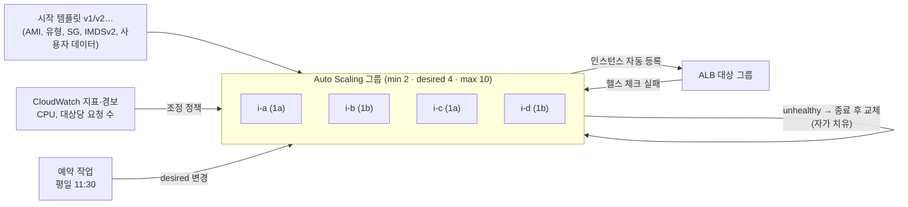
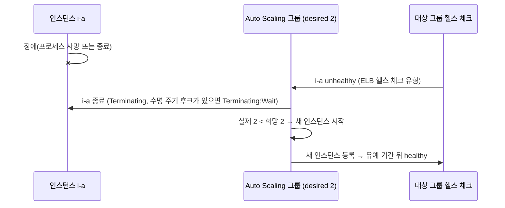

# M03-06. Auto Scaling: 시작 템플릿, 조정 정책, 쿨다운, 수명 주기 후크
> 도메인: D2, D3, D4 · 예상 시간: 60분 · 실습 등급: 🟢 시작 템플릿·ASG·희망 용량·인스턴스 새로 고침 / 🔴 조정 정책·예약 작업·수명 주기 후크·자가 치유

## 왜 필요한가

점심 11시 30분이 되면 주문이 평소의 3배가 된다. 새벽 3시에는 거의 없다. 서버를 피크에 맞춰 6대 두면 하루 대부분은 돈을 버리고, 평균에 맞춰 2대 두면 점심에 주문이 실패한다. 게다가 새벽에 서버 한 대가 죽으면 누군가 일어나서 새로 띄워야 한다. **Auto Scaling 그룹(ASG)** 은 "항상 몇 대 이상, 몇 대 이하, 지금은 몇 대"를 유지하고, 지표나 일정에 맞춰 그 수를 바꾸고, 죽은 서버를 갈아 끼운다.

## 핵심 개념



### 시작 템플릿 (Launch Template)

인스턴스를 만드는 **설정 묶음**(AMI, 인스턴스 유형, 보안 그룹, 키, IAM 인스턴스 프로파일, 사용자 데이터, IMDS 옵션, 태그). **버전**이 있어서 v1을 원본으로 유형만 바꾼 v2를 만들 수 있고, ASG는 특정 버전·`$Default`·`$Latest`를 가리킨다. 예전의 **시작 구성(Launch Configuration)** 은 버전이 없고 새 기능을 지원하지 않는다. 지금은 시작 템플릿을 쓴다.

### ASG의 세 숫자와 헬스 체크

- **최소(min) ≤ 희망(desired) ≤ 최대(max)**. ASG는 실제 대수를 희망 용량에 맞춘다. 조정 정책은 희망 용량을 바꾸지만 min/max를 넘지 않는다.
- 여러 AZ의 서브넷을 주면 **AZ 간 균형**을 맞춰 띄운다.
- 헬스 체크 유형: **EC2**(기본: 인스턴스 상태 확인) / **ELB**(대상 그룹 헬스 체크까지 본다. 앱이 죽은 것도 잡는다). 새 인스턴스가 부팅하는 동안 헬스 체크를 미루는 **유예 기간(grace period)** 을 둔다.
- unhealthy 인스턴스는 종료되고 새 인스턴스로 **교체**된다(자가 치유).

### 조정 정책

| 정책 | 동작 | 이럴 때 |
|---|---|---|
| **대상 추적(Target tracking)** | "평균 CPU 50% 유지"처럼 **목표값**을 주면 AWS가 경보를 만들고 대수를 비례해서 맞춘다 | **대부분의 경우 첫 선택**(AWS 권장). 지표가 대수에 반비례할 때(CPU, 대상당 요청 수) |
| **단계 조정(Step)** | 경보 임계값을 넘은 **폭에 따라** 다른 만큼 조정(+1, +3 …) | 급증에 더 공격적으로 반응하고 싶을 때 |
| **단순 조정(Simple)** | 경보 → 정해진 만큼 조정 → **쿨다운** 동안 다음 경보 무시 | 레거시. 새로 쓸 이유가 거의 없다 |
| **예약 작업(Scheduled)** | 정해진 시각(cron, 시간대 지정)에 min/max/desired 변경 | **예측 가능한** 패턴: 평일 점심, 월말 정산 |
| **예측 조정(Predictive)** | 과거 지표의 일·주 단위 패턴으로 **미리** 용량을 늘린다 | 매일 반복되는 패턴인데 부팅이 느려 반응형으로는 늦을 때 |

- **쿨다운(cooldown)**: 단순 조정에서 한 번 조정한 뒤 다음 조정까지 기다리는 시간(기본 300초).
- **인스턴스 워밍업(instance warmup)**: 새 인스턴스가 지표에 반영되기까지의 시간. 대상 추적·단계 조정에서 "방금 늘린 서버가 아직 일을 안 하는데 또 늘리는" 과잉 반응을 막는다. 그룹의 **기본 인스턴스 워밍업**으로 한 번에 정하는 것을 권장한다.
- 여러 정책이 동시에 작동하면 ASG는 **가장 큰 용량을 주는 정책**을 따른다(확장이 우선).

### 수명 주기 후크 (Lifecycle Hook)

인스턴스가 **시작될 때(Pending:Wait)** 또는 **종료될 때(Terminating:Wait)** 잠시 멈춰 세우고, 그 사이에 할 일을 끼워 넣는다. 예) 종료 전에 로그를 S3로 올리고 진행 중인 작업을 마무리, 시작 후 설정 관리 도구로 준비가 끝나야 서비스 투입. 하트비트 시간 안에 `CompleteLifecycleAction`을 보내거나, 시간이 지나면 `DefaultResult`(CONTINUE/ABANDON)대로 진행한다. 보통 EventBridge → Lambda/SSM으로 처리한다.

### 종료 정책 (Termination policy)

축소할 때 **어느 인스턴스를 끌지**. 기본(Default) 정책은 (1) 인스턴스가 가장 많은 **AZ**를 먼저 고르고, (2) 그 안에서 **오래된 설정**(시작 구성 → 다른 시작 템플릿 → 현재 템플릿의 오래된 버전)을 쓰는 인스턴스를, (3) 그다음 다음 과금 시간에 가장 가까운 것을 고른다. `OldestInstance`, `NewestInstance`, `OldestLaunchTemplate` 등을 지정할 수도 있고, 특정 인스턴스에 **축소 보호(scale-in protection)** 를 걸 수 있다.

### 그 밖의 ASG 기능

- **인스턴스 새로 고침(Instance Refresh)**: 새 AMI·새 템플릿 버전으로 인스턴스를 **롤링 교체**(최소 정상 비율 유지).
- **웜 풀(Warm pool)**: 미리 초기화해 중지(또는 최대 절전)해 둔 인스턴스 풀. 확장이 빨라진다.
- **혼합 인스턴스 정책**: 여러 유형 + 온디맨드 기준 용량 + 그 위 비율 + 스팟 할당 전략(`price-capacity-optimized`). 레슨 2의 "기준은 온디맨드, 나머지는 스팟"을 ASG 하나로 구현한다.

### 세 가지 "Auto Scaling"

| 이름 | 무엇을 조정하나 |
|---|---|
| **Amazon EC2 Auto Scaling** | EC2 인스턴스(ASG). 이 레슨의 주제 |
| **Application Auto Scaling** | EC2가 아닌 리소스: **ECS 서비스 태스크 수, DynamoDB 읽기/쓰기 용량, Aurora 복제본 수**, Lambda 프로비저닝된 동시성, SageMaker 엔드포인트 등 |
| **AWS Auto Scaling** | 여러 서비스(ASG·ECS·DynamoDB·Aurora)를 한 화면에서 묶어 **조정 계획(scaling plan)** 으로 관리 |

## 직접 해 보기 1 — 시작 템플릿과 ASG (🟢)

전체 과정: [labs/lab08-launch-template-asg.sh](./labs/lab08-launch-template-asg.sh)

**1) 시작 템플릿 v1, v2.**

```bash
aws ec2 create-launch-template --launch-template-name todayorder-api-lt --version-description "v1 t3.micro" \
  --launch-template-data '{"ImageId":"<AMI>","InstanceType":"t3.micro","MetadataOptions":{"HttpTokens":"required"},"TagSpecifications":[{"ResourceType":"instance","Tags":[{"Key":"Project","Value":"todayorder"}]}]}'
aws ec2 create-launch-template-version --launch-template-id <lt> --source-version 1 \
  --version-description "v2 t3.small" --launch-template-data '{"InstanceType":"t3.small"}'
aws ec2 describe-launch-template-versions --launch-template-id <lt> \
  --query 'LaunchTemplateVersions[].[VersionNumber,VersionDescription,DefaultVersion,LaunchTemplateData.InstanceType,LaunchTemplateData.ImageId,LaunchTemplateData.MetadataOptions.HttpTokens]' --output text
```

```
1	v1 t3.micro	True	t3.micro	ami-0000000000000004c	required
2	v2 t3.small	False	t3.small	ami-0000000000000004c	required
1	2
```

방금 본 것: v2는 **유형만** 바꿨는데 AMI·IMDSv2 설정을 v1에서 상속했다. 기본 버전은 1, 최신 버전은 2다. 레슨 1에서 501이던 "인스턴스 유형 변경"을 이렇게 표현한다.

**2) ASG 만들기.**

```bash
aws autoscaling create-auto-scaling-group --auto-scaling-group-name todayorder-api-asg \
  --launch-template 'LaunchTemplateId=<lt>,Version=$Default' \
  --min-size 2 --max-size 6 --desired-capacity 2 \
  --vpc-zone-identifier "$M03_SUBNET_A,$M03_SUBNET_B" \
  --target-group-arns <tg> --health-check-type ELB --health-check-grace-period 120 \
  --tags Key=Project,Value=todayorder,PropagateAtLaunch=true
```

```
{
    "Min": 2,
    "Max": 6,
    "Desired": 2,
    "HealthCheck": "ELB",
    "Grace": 120,
    "AZs": [
        "us-east-1a",
        "us-east-1b"
    ],
    "TerminationPolicies": [
        "Default"
    ]
}
i-00000000000000018	us-east-1a	InService	Healthy	t3.micro	$Default
i-00000000000000019	us-east-1b	InService	Healthy	t3.micro	$Default
```

방금 본 것: 희망 용량만큼 인스턴스가 **AZ마다 한 대씩** 떴다. 이 인스턴스들은 EC2에서도 `aws:autoscaling:groupName` 태그로 보인다.

**3) 기본 버전을 v2로 바꾸고 희망 용량 4 → 범위 밖 값 → 희망 용량 2.**

```bash
aws ec2 modify-launch-template --launch-template-id <lt> --default-version 2
aws autoscaling set-desired-capacity --auto-scaling-group-name todayorder-api-asg --desired-capacity 4
aws autoscaling set-desired-capacity --auto-scaling-group-name todayorder-api-asg --desired-capacity 10
aws autoscaling set-desired-capacity --auto-scaling-group-name todayorder-api-asg --desired-capacity 1
aws autoscaling set-desired-capacity --auto-scaling-group-name todayorder-api-asg --desired-capacity 2
```

```
i-00000000000000018	us-east-1a	InService	Healthy	t3.micro	$Default
i-0000000000000001a	us-east-1a	InService	Healthy	t3.small	$Default
i-00000000000000019	us-east-1b	InService	Healthy	t3.micro	$Default
i-0000000000000001b	us-east-1b	InService	Healthy	t3.small	$Default
aws: [ERROR]: An error occurred (ValidationError) when calling the SetDesiredCapacity operation: New SetDesiredCapacity value 10 is above max value 6 for the AutoScalingGroup: todayorder-api-asg
aws: [ERROR]: An error occurred (ValidationError) when calling the SetDesiredCapacity operation: New SetDesiredCapacity value 1 is below min value 2 for the AutoScalingGroup: todayorder-api-asg
i-00000000000000018	us-east-1a	InService	Healthy	t3.micro	$Default
i-00000000000000019	us-east-1b	InService	Healthy	t3.micro	$Default
```

방금 본 것: 확장 때 새 인스턴스는 v2(`t3.small`)로 떴고, AZ마다 하나씩 늘었다. min/max 밖의 값은 거부된다. 그런데 **축소 때 에뮬레이터는 새 v2 인스턴스를 껐다.** 실제 AWS의 기본 종료 정책이라면 AZ 균형을 맞춘 뒤 **현재 템플릿의 오래된 버전(v1)** 을 쓰는 인스턴스를 먼저 끄므로 `t3.small` 두 대가 남는다(워크시트 12번).

**4) 인스턴스 새로 고침으로 전부 v2로.**

```bash
aws autoscaling start-instance-refresh --auto-scaling-group-name todayorder-api-asg \
  --preferences MinHealthyPercentage=50
aws autoscaling describe-instance-refreshes --auto-scaling-group-name todayorder-api-asg \
  --query 'InstanceRefreshes[0].[Status,PercentageComplete,Preferences.MinHealthyPercentage]' --output text
```

```
Successful	100	50
i-0000000000000001c	us-east-1a	InService	Healthy	t3.small	$Default
i-0000000000000001d	us-east-1b	InService	Healthy	t3.small	$Default
```

방금 본 것: 인스턴스 ID가 모두 바뀌고 전부 `t3.small`이 됐다. 새 AMI를 배포할 때 쓰는 방법이다.

**5) (에뮬레이터 차이) 대상 그룹 자동 등록.**

```
대상 그룹의 대상 수: 0  (실제 AWS: ASG 인스턴스가 자동 등록된다)
```

## 직접 해 보기 2 — 조정 정책과 자가 치유 (🔴)

에뮬레이터는 `PutScalingPolicy`, `PutScheduledUpdateGroupAction`, `PutLifecycleHook`, `DescribePolicies`, `DescribeScalingActivities`, `SetInstanceHealth`, `TerminateInstanceInAutoScalingGroup`, `PutWarmPool`이 모두 501이고 자가 치유도 하지 않는다. 그래서 **정책 JSON을 직접 쓰고**, 계산은 **워크시트**로 한다. 전체 과정: [labs/lab09-scaling-policies-and-healing.sh](./labs/lab09-scaling-policies-and-healing.sh)

### 정책 JSON (labs/policies/)

대상 추적 — CPU 50% ([target-tracking-cpu50.json](./labs/policies/target-tracking-cpu50.json)):

```json
{
  "AutoScalingGroupName": "todayorder-api-asg",
  "PolicyName": "cpu-target-50",
  "PolicyType": "TargetTrackingScaling",
  "EstimatedInstanceWarmup": 120,
  "TargetTrackingConfiguration": {
    "PredefinedMetricSpecification": {
      "PredefinedMetricType": "ASGAverageCPUUtilization"
    },
    "TargetValue": 50.0,
    "DisableScaleIn": false
  }
}
```

단계 조정 — 경보 임계값(예: CPU 60%) **기준 상대값**으로 단계를 적는다 ([step-scaling-cpu.json](./labs/policies/step-scaling-cpu.json)):

```json
{
  "AutoScalingGroupName": "todayorder-api-asg",
  "PolicyName": "cpu-step-out",
  "PolicyType": "StepScaling",
  "AdjustmentType": "ChangeInCapacity",
  "MetricAggregationType": "Average",
  "EstimatedInstanceWarmup": 120,
  "StepAdjustments": [
    { "MetricIntervalLowerBound": 0.0, "MetricIntervalUpperBound": 20.0, "ScalingAdjustment": 1 },
    { "MetricIntervalLowerBound": 20.0, "ScalingAdjustment": 3 }
  ]
}
```

→ CPU 60 이상 80 미만이면 +1, 80 이상이면 +3. 이 정책을 실행할 CloudWatch 경보(임계값 60)는 따로 만든다(M10).

예약 작업 — 평일 11:30(서울)에 min 4 / desired 6 ([scheduled-lunch-peak.json](./labs/policies/scheduled-lunch-peak.json)):

```json
{
  "AutoScalingGroupName": "todayorder-api-asg",
  "ScheduledActionName": "weekday-lunch-peak",
  "Recurrence": "30 11 * * 1-5",
  "TimeZone": "Asia/Seoul",
  "MinSize": 4,
  "DesiredCapacity": 6
}
```

나머지: ALB 대상당 요청 수 추적([target-tracking-alb-requests.json](./labs/policies/target-tracking-alb-requests.json)), 단순 조정([simple-scaling.json](./labs/policies/simple-scaling.json)), 예측 조정([predictive-cpu.json](./labs/policies/predictive-cpu.json)), 종료 수명 주기 후크([lifecycle-hook-drain.json](./labs/policies/lifecycle-hook-drain.json)).

### CLI를 "문법 채점기"로

AWS CLI는 요청을 보내기 **전에** 입력 JSON을 API 모델과 대조한다. 모양이 틀리면 `ParamValidation`으로 거부하고, 맞으면 에뮬레이터까지 가서 501을 받는다. 그래서 **NotImplemented가 나오면 모양은 통과**다.

```bash
aws autoscaling put-scaling-policy --cli-input-json file://labs/policies/target-tracking-cpu50.json
```

```
-- target-tracking-cpu50.json         → NotImplemented (모양 통과)
-- target-tracking-alb-requests.json  → NotImplemented (모양 통과)
-- step-scaling-cpu.json              → NotImplemented (모양 통과)
-- simple-scaling.json                → NotImplemented (모양 통과)
-- predictive-cpu.json                → NotImplemented (모양 통과)
-- scheduled-lunch-peak.json          → NotImplemented (모양 통과)
-- lifecycle-hook-drain.json          → NotImplemented (모양 통과)
== 2. 일부러 틀린 JSON → CLI 가 보내기도 전에 거부 (ParamValidation)
aws: [ERROR]: An error occurred (ParamValidation): Parameter validation failed:
Unknown parameter in input: "PolicyTyp", must be one of: AutoScalingGroupName, PolicyName, PolicyType, AdjustmentType, MinAdjustmentStep, MinAdjustmentMagnitude, ScalingAdjustment, Cooldown, MetricAggregationType, StepAdjustments, EstimatedInstanceWarmup, TargetTrackingConfiguration, Enabled, PredictiveScalingConfiguration
Invalid type for parameter StepAdjustments[0].ScalingAdjustment, value: one, type: <class 'str'>, valid types: <class 'int'>
```

CLI는 **이름·타입·필수 여부**만 본다. 단계 구간이 겹치거나 비었는지, 목표값이 말이 되는지 같은 **의미**는 실제 AWS가 판단한다. 그 부분은 아래 워크시트로 손으로 확인한다.

### 자가 치유가 일어나지 않는다

```bash
aws ec2 terminate-instances --instance-ids <ASG 인스턴스 하나>
```

```
shutting-down
EC2 상태: terminated
-- 30초 동안 대체 인스턴스가 뜨는지 지켜본다 (실제 AWS라면 헬스 체크 실패 → 교체)
자가 치유 일어남? no
i-0000000000000001e	InService	Healthy
i-0000000000000001f	InService	Healthy
== 5. 수동으로 치유하려는 API 도 501
aws: [ERROR]: An error occurred (NotImplemented) when calling the SetInstanceHealth operation: operation SetInstanceHealth is scaffolded but not implemented in this emulator
aws: [ERROR]: An error occurred (NotImplemented) when calling the TerminateInstanceInAutoScalingGroup operation: operation TerminateInstanceInAutoScalingGroup is scaffolded but not implemented in this emulator
```

방금 본 것: EC2에서는 `terminated`인데 ASG는 여전히 그 인스턴스를 `InService/Healthy`로 들고 있고, 대체 인스턴스도 없다. 실제 AWS라면 다음 헬스 체크에서 unhealthy로 표시하고 **종료 → 새 인스턴스 시작**으로 희망 용량을 되돌린다.



## 워크시트: "이 지표 값이면 몇 대?"

ASG `todayorder-api-asg`: **min 2 / max 10**. 정책 값은 위 JSON 파일들. 대상 추적은 시험 풀이용 근사식 **필요 대수 = ⌈현재 대수 × 현재 지표 ÷ 목표값⌉** (min/max로 자른다)을 쓴다. AWS는 정확한 계산식을 공개하지 않고, 실제 축소는 이보다 천천히 일어난다.

| # | 상황 | 답 |
|---|---|---|
| 1 | 대상 추적 CPU 50%, 현재 4대, 평균 CPU 75% | ? |
| 2 | 대상 추적 CPU 50%, 현재 6대, 평균 CPU 90% | ? |
| 3 | 대상 추적 CPU 50%, 현재 6대, 평균 CPU 30% | ? |
| 4 | 대상당 요청 1,000 추적, 현재 4대, ALB 전체 요청 7,500 | ? |
| 5 | 단계 조정(경보 임계값 CPU 60%), 현재 4대, CPU 65% | ? |
| 6 | 같은 정책, CPU 85% | ? |
| 7 | 같은 정책, CPU 55% | ? |
| 8 | 단순 조정 +2(쿨다운 300초): 4대에서 경보 → 120초 뒤 또 경보 | ? |
| 9 | 단계 조정 `PercentChangeInCapacity` +25%, `MinAdjustmentMagnitude` 2, 현재 4대 | ? |
| 10 | 예약 작업 `weekday-lunch-peak` 시각, 현재 3대 | ? |
| 11 | 정책 두 개: CPU 추적은 6대, 요청 추적은 8대를 원한다 | ? |
| 12 | 기본 종료 정책, 축소 1대: 1a에 v1·v1·v2, 1b에 v2·v2 (현재 템플릿 버전 v2) | 어느 인스턴스? |

<details><summary>정답과 풀이</summary>

| # | 답 | 풀이 |
|---|---|---|
| 1 | **6대** | ⌈4 × 75 ÷ 50⌉ = ⌈6⌉ = 6 |
| 2 | **10대** | ⌈6 × 90 ÷ 50⌉ = ⌈10.8⌉ = 11 → max 10 |
| 3 | **4대** | ⌈6 × 30 ÷ 50⌉ = ⌈3.6⌉ = 4. 실제는 더 천천히 줄인다 |
| 4 | **8대** | 대상당 7,500 ÷ 4 = 1,875 → ⌈4 × 1,875 ÷ 1,000⌉ = ⌈7.5⌉ = 8 (= ⌈전체 요청 ÷ 목표⌉) |
| 5 | **5대** | 초과 폭 5 → [0, 20) 구간 → +1 |
| 6 | **7대** | 초과 폭 25 → [20, ∞) 구간 → +3 |
| 7 | **4대** | 임계값 미만 → 경보가 울리지 않는다 |
| 8 | **6대** | 첫 경보 +2 = 6. 120초 < 쿨다운 300초 → 두 번째 경보 무시 |
| 9 | **6대** | 4 × 25% = 1 → `MinAdjustmentMagnitude` 2가 우선 → +2 |
| 10 | **6대** | 그 시각에 min 4, desired 6으로 바뀐다 |
| 11 | **8대** | 여러 정책이면 **더 큰 용량**을 주는 정책을 따른다 |
| 12 | **1a의 v1 중 하나** | ① 인스턴스가 더 많은 AZ(1a)를 먼저 고른다 ② 그 안에서 현재 템플릿의 오래된 버전(v1)을 쓰는 것 ③ v1이 둘이면 다음 과금 시간에 가까운 것(같으면 무작위) |

1~11번은 [sdk/scaling_worksheet.py](./sdk/scaling_worksheet.py)가 같은 JSON 파일을 읽어 계산하고 채점한다.

```
ASG todayorder-api-asg: min 2 / max 10
 1. 대상 추적 CPU 50%, 현재 4대, 평균 CPU 75% → 6대  [OK]
 2. 대상 추적 CPU 50%, 현재 6대, 평균 CPU 90% (max 10) → 10대  [OK]
 3. 대상 추적 CPU 50%, 현재 6대, 평균 CPU 30% → 4대  [OK]
 4. 대상 추적 대상당 요청 1000, 현재 4대, ALB 전체 7,500 요청(대상당 1875) → 8대  [OK]
 5. 단계 조정(경보 임계값 CPU 60%), 현재 4대, CPU 65% → 5대  [OK]
 6. 단계 조정(경보 임계값 CPU 60%), 현재 4대, CPU 85% → 7대  [OK]
 7. 단계 조정(경보 임계값 CPU 60%), 현재 4대, CPU 55% → 4대  [OK]
 8. 단순 조정 +2, 쿨다운 300초: 4대에서 경보 → 120초 뒤 또 경보 → 6대  [OK]
 9. 단계 조정 PercentChangeInCapacity +25%, MinAdjustmentMagnitude 2, 현재 4대 → 6대  [OK]
10. 예약 작업 weekday-lunch-peak(30 11 * * 1-5 Asia/Seoul) 시각, 현재 3대 → 6대  [OK]
11. 정책 두 개: CPU 추적은 6대, 요청 추적은 8대를 원한다 → 8대  [OK]
SDK scaling_worksheet OK
```

</details>

## 실제 AWS에서는

- 조정 정책·예약 작업·예측 조정·수명 주기 후크·웜 풀이 모두 동작하고, `describe-scaling-activities`로 "왜 늘었/줄었는지" 기록을 본다. 대상 추적 정책은 CloudWatch 경보 두 개(확장·축소용)를 **자동으로 만들고 관리**한다. 직접 고치지 않는다.
- 자가 치유: EC2 상태 확인 실패, 또는(ELB 헬스 체크 유형이면) 대상 그룹 헬스 체크 실패 → 종료 → 교체.
- 에뮬레이터는 ASG에 연결한 **대상 그룹에 인스턴스를 등록하지 않는다**. 또 **축소 때 기본 종료 정책을 따르지 않고**(위 3번), 혼합 인스턴스 정책을 저장은 하지만 첫 번째 유형의 **온디맨드**로만 띄운다. 시작 템플릿의 `TagSpecifications`·`MetadataOptions`가 ASG 인스턴스에 반영되지 않는다(ASG 태그의 `PropagateAtLaunch`는 반영된다). `CreateOrUpdateTags`(ASG 태그 추가)도 501이다.

**실제 AWS에서 해 보려면 (🔴 항목)**
- ASG 자체는 무료이고 인스턴스 요금만 나간다. 프리 티어 대상 유형으로 min 1 / max 2 정도로 만든다.
- 대상 추적 CPU 정책을 붙이고 인스턴스 안에서 `stress`로 CPU를 올리면 몇 분 뒤 확장되는 것을 `describe-scaling-activities`로 볼 수 있다. 인스턴스를 직접 종료해 자가 치유도 확인한다.
- 정리: `aws autoscaling delete-auto-scaling-group --auto-scaling-group-name <이름> --force-delete`(인스턴스도 종료된다) → `aws ec2 delete-launch-template --launch-template-id <lt>`. ASG를 먼저 지우지 않고 인스턴스만 종료하면 **ASG가 계속 새로 띄운다.**

## 시험 포인트

- "CPU(또는 대상당 요청)를 일정 수준으로 유지, 가장 운영이 쉬운" → **대상 추적**.
- "매주 월요일 9시에 트래픽이 몰린다(예측 가능)" → **예약 작업**. "매일 반복 패턴 + 부팅이 느림" → **예측 조정**.
- "늘린 서버가 일하기 전에 또 늘어난다(과잉 확장)" → **인스턴스 워밍업/쿨다운** 조정.
- "종료 전에 로그를 옮기고 작업을 마무리" / "시작 후 소프트웨어 설치가 끝나야 투입" → **수명 주기 후크**.
- "앱이 죽었는데 ASG가 교체하지 않는다" → 헬스 체크 유형을 **ELB**로(EC2 유형은 인스턴스 상태만 본다).
- "확장이 너무 느리다" → 골든 AMI, **웜 풀**, 예측 조정.
- "DynamoDB 용량·ECS 태스크·Aurora 복제본 조정" → **Application Auto Scaling**. "여러 서비스를 한 계획으로" → **AWS Auto Scaling**.

## 스스로 확인

1. 점심 피크가 매일 11:30에 오는데 대상 추적 정책만 두었더니 11:30~11:40에 오류가 난다. 무엇을 더하나?
2. CPU 대상 추적 정책을 두었는데 ASG가 4대 ↔ 5대를 계속 오간다. 무엇을 의심하나?
3. ASG의 헬스 체크 유형이 EC2다. 앱 프로세스가 죽어 ALB가 대상을 unhealthy로 표시했는데 인스턴스는 그대로 남아 있다. 왜인가?

<details><summary>답</summary>

1. 반응형 정책은 지표가 오른 **뒤에** 늘리고, 새 인스턴스가 준비되는 데도 시간이 걸린다. **예약 작업**(11:20에 desired 6)이나 **예측 조정**으로 미리 늘리고, 골든 AMI·웜 풀로 준비 시간을 줄인다.
2. 인스턴스 워밍업이 너무 짧아 새 인스턴스의 낮은 초기 지표가 바로 반영되거나, 목표값이 애매한 구간에 걸려 있다. 워밍업을 실제 준비 시간에 맞추고, 단계 조정을 쓴다면 확장·축소 임계값 사이에 충분한 간격을 둔다(flapping 방지).
3. EC2 헬스 체크는 **인스턴스 상태(하드웨어·OS)** 만 본다. 앱이 죽은 것은 모른다. 헬스 체크 유형을 **ELB**로 바꾸면 대상 그룹 헬스 체크 실패도 교체 사유가 된다.

</details>
