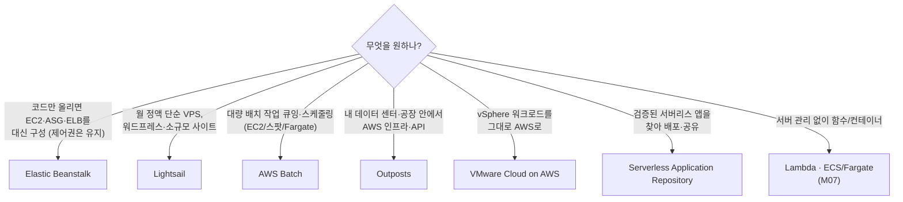

# M03-07. 그 밖의 컴퓨트 한눈에: Elastic Beanstalk, Lightsail, Batch, Outposts, VMware Cloud on AWS, Serverless Application Repository
> 도메인: D2, D3 · 예상 시간: 25분 · 실습 등급: 🟡

## 왜 필요한가

레슨 1~6에서 EC2·ALB·ASG를 하나씩 조립했다. 그런데 TodayOrder의 다른 요구는 꼭 그렇게까지 할 필요가 없다. 관리자 화면은 "코드만 올리면 알아서 떴으면" 좋겠고, 마케팅팀 랜딩 페이지는 "월 정액으로 단순하게", 정산 배치는 "작업만 던지면 스팟으로 알아서" 돌았으면 한다. 공장 한쪽에는 "데이터는 공장 밖으로 못 나간다"는 장비도 있다. 시험은 이런 요구를 듣고 **알맞은 컴퓨트 서비스를 고르는지** 묻는다.

## 핵심 개념



| 서비스 | 한 줄 정의 | 이럴 때 | 헷갈리는 상대 |
|---|---|---|---|
| **Elastic Beanstalk** | 코드를 올리면 EC2·ASG·ELB·CloudWatch 경보를 대신 만들고 배포·상태 모니터링을 해 주는 PaaS. 서비스 자체는 무료(만들어진 리소스 비용만) | "개발자가 인프라를 몰라도 웹 앱을 빨리 배포", 기존 Java/.NET/Python/Node/Docker 앱 | CloudFormation(인프라 전체를 직접 코드로), App Runner·ECS(컨테이너 — App Runner는 2026-04-30부터 신규 고객 불가, M07 레슨 5) |
| **Lightsail** | 서버·스토리지·데이터 전송을 묶은 **월 정액 번들**의 단순 VPS | 개인·소규모 사이트, 워드프레스, 예측 가능한 고정 비용 | EC2(세밀한 제어·대규모) |
| **AWS Batch** | 컨테이너 배치 작업을 **큐에 넣으면** 필요한 만큼 EC2/스팟/Fargate를 띄워 실행하고 줄인다 | 대량·장시간 배치, 과학 계산, 정산. **Lambda 15분 제한을 넘는 작업** | Lambda(짧은 이벤트 처리), Step Functions(흐름 제어) |
| **Outposts** | AWS가 설치·관리하는 랙/서버를 **내 데이터 센터**에 두고 같은 API로 EC2·EBS 등을 쓴다 | 온프레미스 시스템과 초저지연, 데이터 거주 요건, 로컬 처리 | Local Zones(AWS가 대도시에 둔 인프라), Wavelength(통신사 5G 망 안) |
| **VMware Cloud on AWS** | AWS 베어메탈 위에서 VMware vSphere 환경을 그대로 운영 | vSphere 워크로드를 **바꾸지 않고** 클라우드로 옮기기, DC 탈출 | Application Migration Service(서버를 EC2로 재호스팅, M12) |
| **Serverless Application Repository** | SAM으로 만든 서버리스 앱을 공개·비공개로 공유하고 한 번에 배포 | 검증된 서버리스 구성 요소 재사용, 조직 내 공유 | – |

### Elastic Beanstalk 조금 더

- **환경 유형**: 웹 서버 환경(ALB + ASG) / **작업자(worker) 환경**(SQS 큐에서 메시지를 받아 처리).
- **배포 정책**: 한꺼번에(All at once, 중단 있음) · 롤링 · 추가 배치와 함께 롤링(용량 유지) · **변경 불가능(Immutable, 새 ASG로 띄운 뒤 교체, 롤백이 가장 안전)** · 트래픽 분할(카나리). **블루/그린**은 환경 두 개를 두고 **CNAME 교체(swap)** 로 한다.
- 내부적으로 CloudFormation 스택을 만든다. 만들어진 EC2에 접속하거나 설정을 바꾸는 등 제어권은 그대로 있다.

## 직접 해 보기

전체 과정: [labs/lab10-other-compute.sh](./labs/lab10-other-compute.sh)

**1) Beanstalk 플랫폼 카탈로그와 기본 Auto Scaling 설정.**

```bash
aws elasticbeanstalk list-available-solution-stacks \
  --query 'SolutionStacks[?contains(@, `Python`) || contains(@, `Corretto 21`)] | [:4]' --output text
aws elasticbeanstalk describe-configuration-options --solution-stack-name "64bit Amazon Linux 2023 v4.7.0 running Python 3.13" \
  --options Namespace=aws:autoscaling:asg --query 'Options[].[Name,DefaultValue]' --output text
```

```
64bit Amazon Linux 2023 v4.5.0 running Corretto 21
64bit Amazon Linux 2023 v4.7.0 running Python 3.14
64bit Amazon Linux 2023 v4.7.0 running Python 3.13
64bit Amazon Linux 2023 v4.7.0 running Python 3.12
Availability Zones	Any
Cooldown	360
MaxSize	4
MinSize	1
```

방금 본 것: Beanstalk이 대신 만드는 ASG의 기본값(min 1, max 4, 쿨다운 360초)이다. 레슨 6의 개념이 그대로 설정 이름으로 나온다.

**2) 애플리케이션 + 환경.**

```bash
aws elasticbeanstalk create-application --application-name todayorder-admin --description "TodayOrder 관리자 화면"
aws elasticbeanstalk create-environment --application-name todayorder-admin --environment-name todayorder-admin-dev \
  --solution-stack-name "64bit Amazon Linux 2023 v4.7.0 running Python 3.13"
aws elasticbeanstalk describe-environment-resources --environment-name todayorder-admin-dev
```

```
todayorder-admin
todayorder-admin-dev	Launching
Ready	Green	todayorder-admin-dev-c8f174dddd.us-east-1.elasticbeanstalk.com
-- 환경이 거느린 리소스 (이름만 기록된다: 에뮬레이터는 실제 ASG·ELB 를 만들지 않는다)
{
    "ASG": 1,
    "Instances": 1,
    "LaunchTemplates": 1,
    "LoadBalancers": 1,
    "Alarms": 2
}
```

방금 본 것: 환경 하나가 ASG·인스턴스·시작 템플릿·로드 밸런서·경보 2개(확장/축소 트리거)를 거느린다. Beanstalk이 결국 **이 모듈에서 손으로 만든 것들의 묶음**이라는 뜻이다. 다만 에뮬레이터는 이름만 기록할 뿐 실제 ASG를 만들지 않는다(`aws autoscaling describe-auto-scaling-groups`에 나타나지 않는다).

**3) Lightsail 번들 · 4) Batch 컴퓨트 환경.**

```bash
aws lightsail get-bundles --query 'bundles[:4].[bundleId,price,cpuCount,ramSizeInGb,diskSizeInGb,transferPerMonthInGb]' --output text
aws lightsail create-instances --instance-names todayorder-landing --availability-zone us-east-1a \
  --blueprint-id amazon_linux_2023 --bundle-id nano_3_0
aws batch create-compute-environment --compute-environment-name todayorder-batch-ce --type MANAGED \
  --compute-resources "type=FARGATE_SPOT,maxvCpus=16,subnets=<A>,<B>,securityGroupIds=<sg>"
```

```
nano_3_0	5.0	2	0.5	20	1024
micro_3_0	7.0	2	1.0	40	2048
small_3_0	12.0	2	2.0	60	3072
medium_3_0	24.0	2	4.0	80	4096
CreateInstance	Started
todayorder-landing	running	amazon_linux_2023	nano_3_0
todayorder-batch-ce	MANAGED	ENABLED	FARGATE_SPOT	16
```

방금 본 것: Lightsail은 "월 가격 + vCPU + RAM + 디스크 + **월 전송량**"이 한 줄로 묶인 상품이다(가격은 에뮬레이터 값이니 실제 가격은 Lightsail 요금 페이지에서 확인한다). Batch 컴퓨트 환경은 **FARGATE_SPOT** 유형으로 만들었다. 서버를 직접 관리하지 않으면서 스팟 할인을 받는 배치 실행 환경이다.

## 실제 AWS에서는

- Beanstalk 환경을 만들면 실제 CloudFormation 스택이 생기고 EC2·ASG·ALB가 실재한다. 에뮬레이터는 **이름만 기록**한다. 또 에뮬레이터는 카탈로그에 없는 솔루션 스택 이름도 받아 준다(탐색 중 확인).
- Lightsail 인스턴스는 실제로 부팅하고 고정 IP·방화벽을 갖는다. Batch는 작업 정의·작업 큐·작업 제출까지 이어져야 의미가 있다.

**실제 AWS에서 해 보려면 (🟡)**
- Beanstalk: 샘플 애플리케이션으로 환경을 만들면 EC2·ALB(또는 단일 인스턴스) 비용이 나간다. "단일 인스턴스" 환경 유형으로 만들고 확인 후 `aws elasticbeanstalk terminate-environment --environment-name <이름>` → `aws elasticbeanstalk delete-application --application-name <이름>`.
- Lightsail: 번들 요금이 월 단위로 표시되지만 시간 단위로 청구된다. 확인 후 `aws lightsail delete-instance --instance-name <이름>`(스냅샷·고정 IP를 만들었다면 그것도 지운다).
- Batch: 컴퓨트 환경 자체는 무료이고 작업이 돌 때만 과금된다. 정리는 `update-compute-environment --state DISABLED` → `delete-compute-environment`.

## 시험 포인트

- "개발자가 인프라 관리 없이 웹 앱을 빠르게, 하지만 EC2 제어권은 유지" → **Elastic Beanstalk**. "가장 안전한 배포·빠른 롤백" → **Immutable** 또는 **블루/그린(CNAME 교체)**.
- "SQS 메시지를 처리하는 백그라운드 작업 서버를 Beanstalk으로" → **작업자 환경**.
- "단순한 웹사이트, 고정 월 비용, AWS 경험이 적다" → **Lightsail**.
- "수천 개의 배치 작업, 스팟으로 싸게, 15분 넘게 걸림" → **AWS Batch**(Lambda 아님).
- "온프레미스에서 AWS API로, 데이터는 현장에" → **Outposts**. "대도시 사용자 저지연" → Local Zones. "5G 모바일 초저지연" → Wavelength.
- "vSphere VM을 재구성 없이 AWS로" → **VMware Cloud on AWS**.

## 스스로 확인

1. 정산 작업 하나가 40분 걸리고, 매일 밤 2,000개가 한꺼번에 들어온다. Lambda와 AWS Batch 중 무엇이 맞나?
2. Beanstalk 배포 중 새 버전에 버그가 있어 즉시 되돌려야 한다. 어떤 배포 정책이 가장 빠르고 안전하게 되돌릴 수 있나?
3. 공장 설비 데이터가 법적으로 공장 밖에 저장되면 안 되지만, AWS와 같은 API·도구로 처리하고 싶다. 무엇을 고르나?

<details><summary>답</summary>

1. **AWS Batch.** Lambda 함수는 최대 15분이라 40분 작업을 못 돌린다. Batch는 작업 큐에 2,000개를 넣으면 컴퓨트 환경(EC2/스팟/Fargate)을 필요한 만큼 늘려 처리하고 줄인다.
2. **Immutable**(새 ASG에 새 버전을 띄우고 건강하면 교체, 문제가 있으면 새 ASG만 버린다) 또는 **블루/그린**(이전 환경이 그대로 있으니 CNAME만 되돌린다). All at once와 롤링은 기존 인스턴스를 직접 바꾸므로 되돌리는 데 다시 배포해야 한다.
3. **Outposts.** AWS가 관리하는 하드웨어를 공장(온프레미스)에 두고 EC2·EBS 등을 같은 API로 쓴다. Local Zones는 AWS 시설이라 데이터가 공장 밖으로 나간다.

</details>
