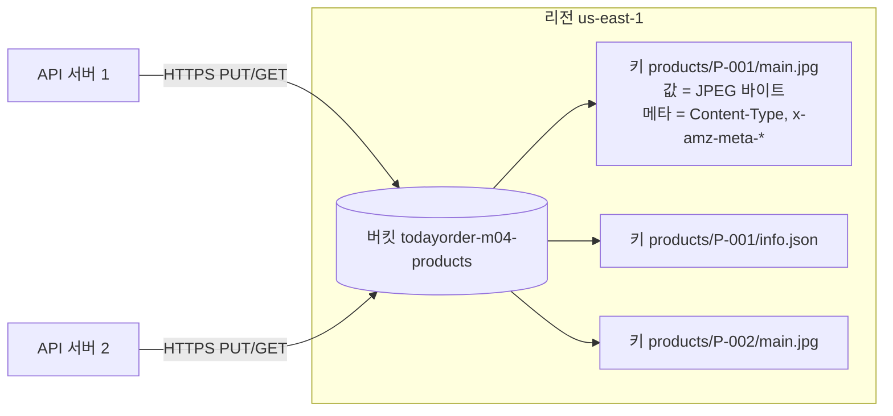

# M04-01. S3 기본: 버킷, 객체, 키, 일관성, 내구성 vs 가용성
> 도메인: D3 · 예상 시간: 40분 · 실습 등급: 🟢

## 왜 필요한가

TodayOrder의 API 서버(M03)는 상품 이미지를 서버 디스크의 `/var/www/images`에 저장하고 있다. 서버를 두 대로 늘리자 문제가 생겼다. 1번 서버에 올린 이미지를 2번 서버는 모른다. 서버가 죽으면 디스크와 함께 이미지가 사라진다. 디스크가 차면 누군가 새벽에 볼륨을 늘려야 한다. "파일을 서버 밖, **어느 서버에서나 HTTP로 접근할 수 있고, 용량 걱정 없고, 잃어버리지 않는 곳**"에 두고 싶다. 그게 Amazon S3(Simple Storage Service)다.

## 핵심 개념

### 객체 스토리지란

S3는 파일 시스템이 아니라 **키-값 저장소**다. 값은 파일 내용(바이트)이고 키는 문자열이다. HTTP API로 `PUT`/`GET`/`DELETE` 하는 거대한 해시 맵이라고 생각하면 된다.

| 용어 | 정의 | TodayOrder 예 |
|---|---|---|
| 버킷(Bucket) | 객체를 담는 최상위 컨테이너. 이름은 **전 세계에서 유일**, 리전 하나에 속한다 | `todayorder-m04-products` |
| 객체(Object) | 데이터 + 메타데이터. 한 객체는 최대 **50 TB**(2025-12 발표, 이전에는 5 TB. 사용 설명서 표기는 48.8 TiB) | 상품 사진 한 장 |
| 키(Key) | 버킷 안에서 객체를 가리키는 문자열 (최대 1,024바이트) | `products/P-001/main.jpg` |
| 접두사(Prefix) | 키의 앞부분. `/`는 특별한 문자가 아니다 — 폴더는 **없다** | `products/P-001/` |
| 메타데이터 | 시스템(`Content-Type`, `Content-Length`, ETag)과 사용자 정의(`x-amz-meta-*`) | `uploaded-by=admin` |
| 태그(Tag) | 객체에 붙이는 키-값 쌍(최대 10개). 수명 주기·권한·비용 분류에 쓴다 | `team=catalog` |



**크기 한계**: 단일 `PUT`은 최대 5 GB, 그보다 크면 멀티파트 업로드(레슨 5)로만 올린다. AWS는 100 MB 정도부터 멀티파트를 고려하라고 권한다.

### 일관성 모델

2020년 12월부터 S3는 모든 리전에서 **강한 read-after-write 일관성**을 제공한다. `PUT`(새 객체든 덮어쓰기든)이나 `DELETE`가 성공 응답을 돌려준 직후의 `GET`·`HEAD`·`LIST`는 바뀐 결과를 본다. 예전 시험 자료의 "덮어쓰기는 최종 일관성"은 **이제 틀린 설명**이다. 단, 버킷 **설정**(버전 관리, 정책 등) 변경은 반영에 시간이 걸릴 수 있다.

같은 키에 동시에 두 번 쓰면? 잠금이 없으므로 **마지막에 도착한 쓰기가 이긴다**. 동시성 제어가 필요하면 조건부 쓰기(`If-None-Match`, `If-Match`)나 DB를 함께 쓴다.

### 내구성 vs 가용성

| | 의미 | S3 Standard |
|---|---|---|
| 내구성(Durability) | 저장한 데이터를 **잃어버리지 않을** 확률 | 99.999999999% (9가 11개, "11 nines") |
| 가용성(Availability) | 요청했을 때 **응답받을 수 있는** 비율 | 99.99% (설계 기준) |

11 nines는 "객체 1,000만 개를 저장하면 평균 1만 년에 1개를 잃는" 수준이다. S3 Standard는 데이터를 **최소 3개 AZ**에 나눠 저장해서 이 내구성을 얻는다. 가용성은 클래스마다 다르다(레슨 2): One Zone-IA는 내구성은 같은 11 nines지만 AZ 하나에만 저장하므로 **그 AZ가 사라지면 데이터도 사라질 수 있고**, 가용성은 99.5%다.

> 시험의 함정: "내구성이 가장 높은 클래스"를 묻는 보기는 대부분 함정이다. 거의 모든 S3 클래스의 설계 내구성은 똑같이 11 nines다. 차이는 **가용성·AZ 수·검색 시간·요금**에서 난다.

### 성능 감각

S3는 **접두사(prefix)마다** 초당 최소 3,500건의 쓰기(PUT/COPY/POST/DELETE)와 5,500건의 읽기(GET/HEAD)를 처리한다. 접두사를 여러 개로 나누면(예: `receipts/2026/11/12/...`) 처리량이 그만큼 늘어난다. 키를 무작위 해시로 시작하라는 옛 조언은 더 이상 필요 없다.

## 직접 해 보기

[lab01-s3-object-basics.sh](./labs/lab01-s3-object-basics.sh)

```bash
export EMULATOR_PORT=9297   # 터미널에서 직접 실행하면 생략 가능
bash curriculum/m04-storage/labs/lab01-s3-object-basics.sh
```

**1) 버킷 이름 규칙** — 소문자·숫자·`.`·`-`, 3~63자. 대문자는 안 된다.

```
== 1. 버킷 이름 규칙: 대문자는 안 된다

aws: [ERROR]: An error occurred (InvalidBucketName) when calling the CreateBucket operation: The specified bucket is not valid.
== 2. 버킷 만들기
/todayorder-m04-products
```

**2) 객체 올리기** — `--content-type`, 사용자 메타데이터(`--metadata`), 태그(`--tagging`)를 함께 줬다. 응답은 ETag(내용의 MD5 해시. 멀티파트 객체는 예외 — 레슨 5)다.

```
== 3. 객체 올리기 (키에 '/'가 들어가도 폴더가 생기는 게 아니다)
"a124bd999df7f949616ca0d625c74a07"
"690be561f85dc46311ceebda69615265"
"bc153805865f34efdc7ba7581aa3fbe7"
```

**3) 폴더처럼 보기** — `--delimiter /`를 주면 S3가 다음 `/`까지를 묶어 `CommonPrefixes`로 돌려준다. 콘솔의 "폴더"는 이 기능이 만든 착시다.

```
== 4. 접두사(Prefix)와 구분자(Delimiter)로 '폴더처럼' 보기
{
    "Folders": [
        "products/P-001/",
        "products/P-002/"
    ],
    "Files": null
}
[
    {
        "Key": "products/P-001/info.json",
        "Size": 40
    },
    {
        "Key": "products/P-001/main.jpg",
        "Size": 17
    }
]
```

**4) 메타데이터와 태그**

```
== 5. 메타데이터는 HEAD로, 태그는 별도 API로
{
    "ContentType": "image/jpeg",
    "Length": 17,
    "Metadata": {
        "uploaded-by": "admin",
        "origin": "seller-portal"
    },
    "SSE": "AES256"
}
[
    {
        "Key": "team",
        "Value": "catalog"
    }
]
```

방금 본 것: 암호화를 요청하지 않았는데 `SSE: AES256`이다. 2023년 1월부터 모든 새 객체는 기본으로 SSE-S3로 암호화된다(레슨 4). 메타데이터는 객체를 만들 때 정해지고 바꾸려면 객체를 다시 써야(복사해야) 하지만, 태그는 따로 바꿀 수 있다.

**5) 강한 일관성** — 덮어쓴 직후 읽으면 항상 새 값이다.

```
== 6. 덮어쓰기 직후 바로 읽기 — 새 내용이 나온다 (강한 read-after-write 일관성)
쓰기 price-v1 → 읽기 price-v1
쓰기 price-v2 → 읽기 price-v2
쓰기 price-v3 → 읽기 price-v3
쓰기 price-v4 → 읽기 price-v4
쓰기 price-v5 → 읽기 price-v5
```

**6) 서버 쪽 복사, 없는 키, 비어 있지 않은 버킷**

```
== 7. 서버 쪽 복사 (CopyObject) 와 삭제
"bc153805865f34efdc7ba7581aa3fbe7"
delete: s3://todayorder-m04-products/products/P-002/main.jpg
== 8. 없는 키 읽기 → NoSuchKey

aws: [ERROR]: An error occurred (NoSuchKey) when calling the GetObject operation: The specified key does not exist.
== 9. 비어 있지 않은 버킷 삭제 → BucketNotEmpty

aws: [ERROR]: An error occurred (BucketNotEmpty) when calling the DeleteBucket operation: The bucket you tried to delete is not empty
== 10. 정리
LAB01 OK
```

방금 본 것: `CopyObject`는 데이터를 내 PC로 내려받지 않고 S3 안에서 복사한다(복사본 ETag가 원본과 같다). S3에는 "이름 바꾸기(rename)"가 없어서, 키를 바꾸려면 복사 후 삭제한다. 버킷은 비워야 지울 수 있다.

## 실제 AWS에서는

- 버킷 이름은 **모든 AWS 계정을 통틀어** 유일해야 한다. `todayorder-m04-products`는 누군가 이미 쓰고 있을 수 있다(`BucketAlreadyExists`). 에뮬레이터는 내 버킷만 있어 충돌하지 않는다.
- us-east-1 이외의 리전에 버킷을 만들 때는 `--create-bucket-configuration LocationConstraint=<리전>`이 필요하다. us-east-1은 넣지 않는다(넣으면 오류).
- 일관성·오류 코드·메타데이터 동작은 에뮬레이터와 같다. 실습 규모(KB 단위 객체 몇 개)는 요금이 거의 없고(프리 티어 적용 여부와 한도는 계정 생성 시기에 따라 다르니 AWS 프리 티어 페이지에서 확인), 끝나면 `aws s3 rb s3://<버킷> --force`로 지운다.

## 시험 포인트

- "여러 서버가 공유하는 정적 파일·이미지·백업, 용량 예측 불가" → **S3**.
- S3는 **강한 read-after-write 일관성**(덮어쓰기·삭제 포함). "최종 일관성 때문에 옛 데이터가 보인다"는 보기는 틀렸다.
- 내구성(11 nines)은 클래스 대부분이 같다. 클래스 선택은 **가용성·AZ 수·검색 시간·최소 보관 기간**으로 판단한다.
- 단일 PUT 5 GB, 객체 최대 50 TB → 큰 파일은 **멀티파트 업로드**.
- 처리량이 부족하다 → **접두사를 나눠** 병렬화한다(접두사당 3,500 쓰기 / 5,500 읽기 per 초).
- 버킷 이름은 전역 유일, 버킷 자체는 **리전** 리소스다.

## 스스로 확인

1. `aws s3 ls s3://todayorder-m04-products/products/`가 "폴더" 두 개를 보여 줬다. 그런데 `products/P-002/main.jpg`를 지우자 `products/P-002/` 폴더도 사라졌다. 왜인가?
2. 이미지 서버 두 대가 같은 키 `products/P-001/main.jpg`에 거의 동시에 다른 이미지를 올렸다. 결과는?
3. "One Zone-IA는 내구성이 낮다"는 말은 맞는가?

<details><summary>답</summary>

1. 폴더는 실재하지 않는다. `CommonPrefixes`는 그 접두사로 시작하는 키가 있을 때만 계산되어 나온다. 마지막 키가 사라지면 "폴더"도 사라진다.
2. 마지막에 처리된 쓰기가 남는다(last writer wins). 객체 단위 잠금은 없다. 덮어쓰기를 막으려면 조건부 쓰기(`If-None-Match: *`)를 쓰거나 버전 관리(레슨 3)로 이전 버전을 보존한다.
3. 설계 내구성 수치는 똑같이 11 nines다. 다만 데이터를 AZ 하나에만 두므로 **AZ가 물리적으로 파괴되면** 데이터를 잃을 수 있다는 점이 다르다. 그래서 "다시 만들 수 있는 데이터(썸네일 등)"에만 쓴다.

</details>
