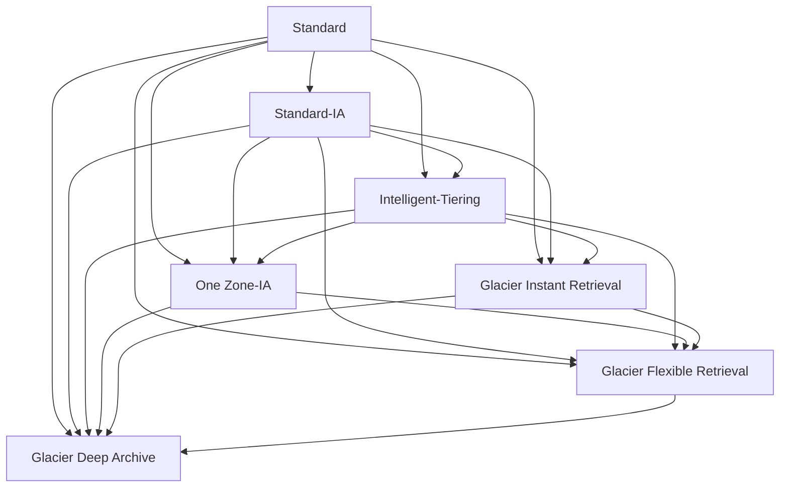

# M04-02. 스토리지 클래스와 수명 주기
> 도메인: D3, D4 · 예상 시간: 55분 · 실습 등급: 🟢 (구성) · 전환 동작은 에뮬레이터에서 일어나지 않음 → 비용은 워크시트

## 왜 필요한가

TodayOrder는 주문마다 영수증 PDF를 S3에 남긴다. 고객이 영수증을 다시 여는 건 거의 주문 후 일주일 안이다. 그런데 전자상거래 관련 법 때문에 몇 년은 보관해야 한다. 한 달에 수백 GB씩 쌓이는 영수증을 전부 가장 비싼 S3 Standard에 두면 청구서가 매달 커진다. "**자주 안 읽는 데이터는 싼 곳으로, 필요 없어진 데이터는 자동으로 지우는**" 방법이 필요하다.

## 핵심 개념

### 스토리지 클래스 한눈에

클래스는 **객체마다** 정한다(같은 버킷에 섞여 있어도 된다). 아래 수치는 AWS 문서(2026-11 확인)의 설계 기준이다.

| 클래스 (API 이름) | 이럴 때 | 검색(첫 바이트) | 최소 보관 기간 | 최소 과금 크기 | AZ | 가용성(설계) |
|---|---|---|---|---|---|---|
| Standard (`STANDARD`) | 자주 읽음 | 밀리초 | 없음 | 없음 | ≥3 | 99.99% |
| Intelligent-Tiering (`INTELLIGENT_TIERING`) | 접근 패턴을 모름·바뀜 | 밀리초(선택형 아카이브 계층 제외) | 없음 | 없음(128 KB 미만은 자동 계층 이동 안 함) | ≥3 | 99.9% |
| Standard-IA (`STANDARD_IA`) | 가끔 읽지만 읽을 땐 즉시 | 밀리초 | 30일 | 128 KB | ≥3 | 99.9% |
| One Zone-IA (`ONEZONE_IA`) | 가끔 읽음 + **다시 만들 수 있는** 데이터 | 밀리초 | 30일 | 128 KB | **1** | 99.5% |
| Glacier Instant Retrieval (`GLACIER_IR`) | 분기에 한 번 읽을까 말까, 읽을 땐 즉시 | 밀리초 | 90일 | 128 KB | ≥3 | 99.9% |
| Glacier Flexible Retrieval (`GLACIER`) | 아카이브, 몇 분~몇 시간 기다려도 됨 | 신속 1–5분 · 표준 3–5시간 · 대량 5–12시간 | 90일 | 객체당 40 KB 추가 과금 | ≥3 | 99.99%(복원 후) |
| Glacier Deep Archive (`DEEP_ARCHIVE`) | 규정 보관, 1년에 한 번도 안 읽음 | 표준 12시간 이내 · 대량 48시간 이내 (신속 없음) | 180일 | 객체당 40 KB 추가 과금 | ≥3 | 99.99%(복원 후) |
| Express One Zone (`EXPRESS_ONEZONE`) | 초저지연(한 자릿수 ms), ML·분석 중간 데이터 | 한 자릿수 밀리초 | (시험 범위 밖) | (시험 범위 밖) | **1** | 99.95% |

- **내구성은 모두 11 nines**로 같다(레슨 1). One Zone 계열만 "AZ 손실 시 유실"이라는 단서가 붙는다.
- **최소 보관 기간**: 그 전에 지우거나 다른 클래스로 옮겨도 **남은 기간만큼 요금**이 나온다(조기 삭제 요금).
- **최소 과금 크기**: IA·Glacier IR에 4 KB짜리 객체를 넣어도 128 KB로 계산한다. Glacier Flexible/Deep Archive는 객체마다 40 KB(32 KB는 Glacier 요율, 8 KB는 Standard 요율)의 메타데이터가 붙는다.
- **검색 요금**: IA·Glacier IR은 읽은 GB만큼 검색 요금이 붙는다. Standard·Intelligent-Tiering은 검색 요금이 없다(Intelligent-Tiering은 대신 객체당 모니터링 요금).
- Express One Zone은 **디렉터리 버킷** 전용이라 일반(범용) 버킷에는 넣을 수 없다. 실습에서 확인한다.
- Reduced Redundancy(`REDUCED_REDUNDANCY`)는 권장하지 않는 옛 클래스다. 시험 보기로 나오면 오답이다.

### Intelligent-Tiering: 패턴을 모를 때의 정답

객체마다 접근을 감시해 자동으로 계층을 옮긴다. 30일 동안 안 읽으면 Infrequent Access 계층, 90일이면 Archive Instant Access 계층으로 간다. 다시 읽으면 Frequent로 돌아온다. **검색 요금이 없고** 최소 보관 기간도 없다. 대신 128 KB 이상 객체마다 소액의 모니터링 요금이 붙는다. 선택하면 Archive Access(90일~)·Deep Archive Access(180일~) 계층도 켤 수 있다. 이 두 계층은 복원이 필요하다.

### 수명 주기(Lifecycle) 규칙

버킷에 거는 "시간이 지나면 이렇게 하라"는 규칙이다. 규칙마다 **필터**(접두사, 태그, 객체 크기)와 **동작**을 정한다.

| 동작 | 의미 |
|---|---|
| `Transitions` | N일 뒤 다른 클래스로 전환 |
| `Expiration` | N일 뒤 삭제(버전 관리 버킷이면 삭제 마커를 만든다) |
| `NoncurrentVersionTransitions` / `NoncurrentVersionExpiration` | 이전 버전(레슨 3)을 옮기거나 지움 |
| `AbortIncompleteMultipartUpload` | 완료 안 된 멀티파트 업로드의 파트를 N일 뒤 정리(레슨 5) |
| `ExpiredObjectDeleteMarker` | 남은 버전이 없는 삭제 마커 정리 |

전환은 **폭포(waterfall)** 방향, 즉 아래로만 흐른다.



AWS가 **거부하는** 규칙(`InvalidArgument`):
- 한 규칙 안에서 다음 전환이 이전 클래스의 최소 보관 기간보다 빠름. 예: Glacier IR 4일 → Deep Archive 20일은 안 되고 94일 이후여야 한다.
- 폭포를 거스르는 전환(예: Glacier → Standard-IA).
- 만료(`Expiration`)가 전환보다 빠르거나 같음: 만료 일수는 그 규칙의 모든 전환 일수보다 커야 한다(예: Glacier Flexible Retrieval 90일 전환에 60일·90일 만료는 안 되고 91일부터). 이 저장소의 에뮬레이터는 이 규칙을 검사하지 않고 저장한다(2026-11 확인).

> 📌 **2026년 7월 변경**: 예전에는 "Standard-IA·One Zone-IA로의 전환은 생성 후 30일 이상"이어야 했고, 그보다 짧으면 `InvalidArgument`였다. [2026-07-16 발표](https://aws.amazon.com/about-aws/whats-new/2026/07/s3-removes-30-day-transitions-standard-ia-one-zone-ia/)로 이 제한이 없어져 **0일 전환도 가능**하다. 하지만 IA의 **최소 보관 기간 30일(요금)** 은 그대로다. 그 전에 지우거나 다른 클래스로 옮기면 남은 기간만큼 요금이 나온다. 시험 문제나 옛 자료는 여전히 "30일 이후부터"를 정답으로 기대할 수 있으니 두 가지를 모두 알아 둔다.

그리고 2024년 9월부터 **128 KB 미만 객체는 기본적으로 어떤 클래스로도 전환되지 않는다**. 작은 객체는 전환 요청 요금이 절감액보다 크기 때문이다. 필요하면 필터에 `ObjectSizeGreaterThan`/`ObjectSizeLessThan`을 직접 쓴다. 에뮬레이터 응답의 `"TransitionDefaultMinimumObjectSize": "all_storage_classes_128K"`가 이 기본값이다.

<!-- widget: s3-lifecycle-planner -->

### Glacier 복원(Restore)

Glacier Flexible Retrieval·Deep Archive 객체는 바로 `GET`할 수 없다. `RestoreObject`로 **임시 사본**을 N일 동안 만들어 달라고 요청하고, 사본이 준비되면 읽는다. 객체의 클래스는 여전히 Glacier다. 원래 클래스를 바꾸려면 복원 후 `CopyObject`로 덮어쓴다. Glacier Instant Retrieval은 이름 그대로 복원 없이 바로 읽힌다.

## 직접 해 보기

[lab02-lifecycle-and-classes.sh](./labs/lab02-lifecycle-and-classes.sh)

```bash
bash curriculum/m04-storage/labs/lab02-lifecycle-and-classes.sh
```

**1) 클래스 지정 업로드, 그리고 범용 버킷의 Express One Zone**

```
== 1. 스토리지 클래스를 지정해 올리기
receipts/DEEP_ARCHIVE.json	DEEP_ARCHIVE
receipts/GLACIER.json	GLACIER
receipts/GLACIER_IR.json	GLACIER_IR
receipts/INTELLIGENT_TIERING.json	INTELLIGENT_TIERING
receipts/ONEZONE_IA.json	ONEZONE_IA
receipts/STANDARD.json	STANDARD
receipts/STANDARD_IA.json	STANDARD_IA
== 2. 범용 버킷에 EXPRESS_ONEZONE? (디렉터리 버킷 전용 클래스)

aws: [ERROR]: An error occurred (InvalidStorageClass) when calling the PutObject operation: The storage class you specified is not valid
```

**2) 즉시 검색 vs 복원 필요**

```
== 3. Glacier Instant Retrieval 은 바로 읽힌다
GLACIER_IR
== 4. Glacier Flexible Retrieval 은 복원 전에는 못 읽는다

aws: [ERROR]: An error occurred (InvalidObjectState) when calling the GetObject operation: The operation is not valid for the object's storage class
== 5. Deep Archive 에 Expedited(신속) 복원 요청 → 지원하지 않는 검색 옵션

aws: [ERROR]: An error occurred (InvalidTier) when calling the RestoreObject operation: Retrieval option is not supported by this storage class.
```

**3) 복원 요청과 완료**

```
== 6. Glacier 객체 복원 요청 (Standard 등급, 임시 사본 1일)
{
    "Class": "GLACIER",
    "Restore": "ongoing-request=\"true\""
}
== 7. 복원 완료(ongoing-request="false")까지 폴링 (최대 120초)
Restore: ongoing-request="false", expiry-date="Sat, 14 Nov 2026 00:00:00 GMT"
GLACIER
복원된 사본을 읽었습니다 (클래스는 여전히 GLACIER)
```

방금 본 것: `HeadObject`의 `Restore` 헤더로 진행 상황을 본다. **에뮬레이터는 몇 초 만에 복원을 끝내지만, 실제로 Standard 등급은 3~5시간이 걸린다.** 실제 서비스에서는 폴링 대신 S3 이벤트 알림(`s3:ObjectRestore:Completed`)을 받는다.

**4) 영수증 수명 주기 규칙**

```
== 8. 영수증 버킷 수명 주기 규칙 (30일 IA → 90일 Glacier IR → 365일 Deep Archive → 7년 후 삭제)
{
    "TransitionDefaultMinimumObjectSize": "all_storage_classes_128K"
}
[
    {
        "ID": "receipts-tiering",
        "Prefix": "receipts/",
        "Transitions": [
            [
                30,
                "STANDARD_IA"
            ],
            [
                90,
                "GLACIER_IR"
            ],
            [
                365,
                "DEEP_ARCHIVE"
            ]
        ],
        "ExpireDays": 2555
    },
    {
        "ID": "tmp-cleanup",
        "Prefix": "tmp/",
        "Transitions": null,
        "ExpireDays": 1
    }
]
== 9. 규칙이 있어도 객체의 클래스는 그대로 (전환은 시간이 지나야 일어나는데, 에뮬레이터는 전환을 하지 않는다)
receipts/STANDARD.json StorageClass=None
```

방금 본 것: `HeadObject`는 Standard 객체에 대해 `StorageClass`를 아예 돌려주지 않는다(그래서 `None`). 이건 실제 S3도 같다. 규칙의 날짜 계산 예: 30일 IA → 90일 Glacier IR 사이는 60일로 IA 최소 보관 30일을 넘고, 90일 → 365일은 Glacier IR 최소 90일을 넘으므로 유효하다.

**5) 규칙 검증 — 무엇이 저장되고 무엇이 거부되나**

```
== 10. STANDARD_IA 로 10일 만에 전환 → 받아 준다 (AWS도 2026-07부터 허용. 예전에는 최소 30일)
rc=0 {
    "TransitionDefaultMinimumObjectSize": "all_storage_classes_128K"
}
== 11. 한 규칙 안에서 최소 보관 기간보다 빠른 연쇄 전환 (Glacier IR 4일 → Deep Archive 20일) → 거부
aws: [ERROR]: An error occurred (InvalidArgument) when calling the PutBucketLifecycleConfiguration operation: 'Days' in the 'Transition' action for StorageClass 'DEEP_ARCHIVE' for filter '(prefix=receipts/)' must be 90 days more than 'filter '(prefix=receipts/)'' 'Days' in the 'Transition' action for StorageClass 'GLACIER_IR' for filter '(prefix=receipts/)'
== 12. 전환 순서가 거꾸로 (GLACIER 30일 → STANDARD_IA 60일) → 거부
aws: [ERROR]: An error occurred (InvalidArgument) when calling the PutBucketLifecycleConfiguration operation: 'Days' in the 'Transition' action for StorageClass 'GLACIER' for filter '(prefix=receipts/)' must be greater than 'Days' in the 'Transition' action for StorageClass 'STANDARD_IA' for filter '(prefix=receipts/)'
== 13. 정리
LAB02 OK
```

방금 본 것: 에뮬레이터 1.0.322의 수명 주기 검증은 위 "AWS가 거부하는 규칙" 중 앞의 두 가지(이른 연쇄 전환, 역방향 전환)는 같게 동작했고, 셋째(전환보다 빠르거나 같은 만료)는 거부하지 않고 저장했다. IA 10일 전환은 저장하고(2026-07 이후 AWS와 같음), 최소 보관 기간보다 빠른 연쇄 전환(이전 버전 전환에도 적용)과 역방향 전환은 거부한다. 존재하지 않는 클래스, 중복 규칙 ID, 0일 만료도 거부한다.

하지만 **"저장됐다"가 "좋은 규칙"이라는 뜻은 아니다.** IA로 10일 만에 옮기고 20일에 지우는 규칙은 저장되지만 IA 최소 보관 30일 요금을 낸다. [sdk/lifecycle_lint.py](./sdk/lifecycle_lint.py)는 저장되는 규칙의 비용 함정과, 저장 전에 걸러야 할 규칙(현재·이전 버전 전환 모두, 첫 전환이 0일인 경우 포함)을 찾는다.

```bash
uv run python curriculum/m04-storage/sdk/lifecycle_lint.py
```

```
데모 버킷 todayorder-m04-lifecycle-lint 에 규칙 3개 저장 — 모두 저장됐다
[todayorder-m04-lifecycle-lint] 점검 결과 5건
  WARN  logs-deep-then-delete: [현재 버전] DEEP_ARCHIVE 에 30일만 두고 삭제 → 최소 보관 180일 중 남은 150일치 조기 삭제 요금
  INFO  logs-deep-then-delete: 128 KB 미만 객체는 기본적으로 전환되지 않음(작은 객체는 전환 요청 비용이 절감액보다 큼)
  INFO  menu-old-versions: [이전 버전] STANDARD_IA 전환 10일 — 2026-07 발표는 현재 버전만 언급 — 이전 버전의 최소 일수는 실제 계정에서 확인
  WARN  menu-old-versions: [이전 버전] STANDARD_IA 에 10일만 두고 삭제 → 최소 보관 30일 중 남은 20일치 조기 삭제 요금
  INFO  menu-old-versions: 128 KB 미만 객체는 기본적으로 전환되지 않음(작은 객체는 전환 요청 비용이 절감액보다 큼)
[저장 전 점검(규칙 사전)] 점검 결과 4건
  ERROR gir-4-da-20: [현재 버전] GLACIER_IR(4일) → DEEP_ARCHIVE(20일): GLACIER_IR 최소 보관 90일보다 빠름 — 한 규칙에서는 거부됨
  ERROR gir-0-da-30: [현재 버전] GLACIER_IR(0일) → DEEP_ARCHIVE(30일): GLACIER_IR 최소 보관 90일보다 빠름 — 한 규칙에서는 거부됨
  ERROR nc-gir-5-da-20: [이전 버전] GLACIER_IR(5일) → DEEP_ARCHIVE(20일): GLACIER_IR 최소 보관 90일보다 빠름 — 한 규칙에서는 거부됨
  ERROR backwards: [현재 버전] GLACIER → STANDARD_IA 전환은 폭포 모델에 없음
에뮬레이터도 4개 모두 InvalidArgument 로 거부
정리 완료
SDK lifecycle_lint OK
```

## 비용 워크시트 (손으로 풀기)

에뮬레이터에서는 전환이 일어나지 않고 요금도 없으므로 비용은 손으로 계산한다. **아래 단가는 계산 연습을 위한 가정값**이다(us-east-1 공시 단가와 비슷한 수준으로 잡았지만, 실제 단가는 리전·시기마다 다르므로 [S3 요금 페이지](https://aws.amazon.com/s3/pricing/)에서 확인한다). 요청 요금·전환 요청 요금·데이터 전송 요금은 문제에서 따로 말하지 않으면 무시한다. 계산 편의상 1 GB = 1,000 MB = 1,000,000 KB, 한 달 = 30일로 둔다.

| 가정 단가 | 저장 (USD/GB-월) | 검색 (USD/GB) |
|---|---|---|
| Standard | 0.023 | 0 |
| Standard-IA | 0.0125 | 0.01 |
| One Zone-IA | 0.01 | 0.01 |
| Glacier Instant Retrieval | 0.004 | 0.03 |
| Glacier Flexible Retrieval | 0.0036 | (복원 등급별, 이 워크시트에서는 사용 안 함) |
| Glacier Deep Archive | 0.00099 | (사용 안 함) |

**문제 W1.** 상품 이미지 10 TB(= 10,000 GB). 앱 화면마다 읽힌다. Standard에 두면 한 달 저장 요금은?

**문제 W2.** 영수증이 매달 500 GB씩 새로 생긴다. 한 달 동안은 자주 읽고, 이후에는 매달 그 묶음의 1%(5 GB)만 읽는다. **한 달치 묶음(500 GB)이 첫 1년 동안 내는 저장+검색 요금**을 비교하라.
- (a) 12개월 내내 Standard
- (b) 수명 주기: 1개월 Standard → 2개월 Standard-IA(30\~90일) → 9개월 Glacier IR(90\~365일)

**문제 W3.** 4 KB짜리 주문 이벤트 JSON 1,000,000개(합계 4 GB)를 "어차피 잘 안 읽으니" Standard-IA로 바로 저장했다. Standard 대비 한 달 저장 요금은?

**문제 W4.** 10 KB짜리 로그 1,000,000개(합계 10 GB)를 Glacier Flexible Retrieval로 보관한다. 객체당 40 KB 메타데이터 과금(32 KB는 Glacier 요율, 8 KB는 Standard 요율)을 포함한 한 달 요금은? Standard에 그냥 두는 것과 비교하면?

**문제 W5.** 감사 로그 1 TB(1,000 GB)를 Deep Archive에 넣었는데 30일 뒤 "필요 없다"며 지웠다. 실제로 청구되는 저장 요금은?

**문제 W6.** 썸네일(원본에서 언제든 다시 만들 수 있음) 2 TB, 한 달에 한두 번 읽힌다. Standard-IA와 One Zone-IA 중 무엇이 맞고, 한 달에 얼마를 아끼는가(저장 요금만)?

<details><summary>정답과 풀이</summary>

**W1.** 10,000 × 0.023 = **230 USD/월**. 자주 읽으므로 IA로 옮기면 검색 요금(GB당)이 저장 절감액을 넘는다. Standard가 맞다.

**W2.**
- (a) 500 × 0.023 × 12 = **138.00 USD**. 검색 요금은 0.
- (b) 저장: Standard 1개월 500 × 0.023 = 11.50 / IA 2개월 500 × 0.0125 × 2 = 12.50 / GIR 9개월 500 × 0.004 × 9 = 18.00 → 42.00. 검색: IA 2개월 × 5 GB × 0.01 = 0.10 / GIR 9개월 × 5 GB × 0.03 = 1.35 → 1.45. 합계 **43.45 USD**.
- 약 69% 절감. 최소 보관 기간(IA 30일 → 60일 머묾, GIR 90일 → 275일 머묾)도 모두 채워서 조기 삭제 요금이 없다. 객체가 128 KB 미만이면 기본 설정으로는 전환이 일어나지 않으니, 영수증 PDF 크기도 확인해야 한다.

**W3.** Standard: 4 × 0.023 = 0.092 USD. Standard-IA: 객체마다 128 KB로 과금 → 1,000,000 × 128 KB = 128 GB × 0.0125 = **1.60 USD**. **약 17배 비싸다.** 작은 객체는 IA/Glacier IR에 넣지 않는다(그래서 수명 주기 기본값이 128 KB 미만을 전환하지 않는다).

**W4.** 데이터 10 GB × 0.0036 = 0.036 / Glacier 요율 메타데이터 32 KB × 1,000,000 = 32 GB × 0.0036 = 0.1152 / Standard 요율 메타데이터 8 GB × 0.023 = 0.184 → 합계 **약 0.335 USD**. Standard에 두면 10 × 0.023 = **0.23 USD**. **아카이브가 더 비싸다.** 작은 객체를 아카이브할 때는 묶어서(tar/zip) 큰 객체 몇 개로 만든다.

**W5.** Deep Archive 최소 보관 180일(= 6개월)치가 청구된다. 1,000 × 0.00099 × 6 = **5.94 USD**(실제로 둔 1개월치 0.99 + 조기 삭제 요금 4.95). 아카이브는 "확실히 오래 둘 데이터"에만 쓴다.

**W6.** 다시 만들 수 있고 가끔 읽으므로 **One Zone-IA**. Standard-IA 2,000 × 0.0125 = 25.00, One Zone-IA 2,000 × 0.01 = 20.00 → **월 5 USD 절감**. AZ가 사라지면 썸네일을 다시 만들면 된다. 원본 이미지에는 One Zone-IA를 쓰지 않는다.

</details>

## 실제 AWS에서는

- 수명 주기 전환은 **비동기**다. 규칙 날짜가 지나도 실제 이동은 늦을 수 있다. 다만 Glacier 계열로의 전환은 규칙이 충족된 날부터 대상 클래스 요율로 과금된다.
- 수명 주기 규칙은 하루 단위로 평가된다. "1일 후 만료"를 걸어도 정확히 24시간 뒤에 사라지지 않는다.
- 어떤 클래스가 맞을지 모르겠다면 **S3 Storage Class Analysis**(버킷/접두사의 접근 패턴 분석)와 **S3 Storage Lens**(조직 전체 사용량 대시보드)를 본다.
- 실제로 해 보려면: 영수증 수명 주기 규칙(lab02 8단계)을 프리 티어 계정의 빈 버킷에 걸어 보는 것은 무료다. 객체를 Glacier/Deep Archive로 올리거나 복원하면 소액이지만 요금과 **최소 보관 기간 요금**이 생기니 KB 단위 테스트 파일만 쓴다. 정리: `aws s3api delete-bucket-lifecycle --bucket <버킷>` → `aws s3 rb s3://<버킷> --force`.

## 시험 포인트

- "접근 패턴을 **모르거나 바뀐다**, 운영 부담 없이 비용 최적화" → **S3 Intelligent-Tiering**.
- "가끔 읽지만 읽을 땐 **즉시**(밀리초)" → Standard-IA. "분기 1회 정도, 즉시" → **Glacier Instant Retrieval**.
- "**다시 만들 수 있는** 데이터 + 가끔 읽음 + 최저가" → **One Zone-IA**. "AZ 장애에도 살아남아야" → One Zone 계열은 오답.
- "몇 분 안에 가끔 꺼내야 하는 아카이브" → Glacier Flexible(신속 1–5분). "**12시간/48시간** 기다려도 되는 장기 규정 보관, 최저가" → **Deep Archive**(신속 검색 없음).
- 수명 주기의 IA·One Zone-IA 전환은 2026-07부터 **0일부터** 가능(예전 자료·시험은 "30일 이후부터"). 최소 보관 기간(요금): IA 30일, Glacier IR·Flexible 90일, Deep Archive 180일. 작은 객체(128 KB 미만)는 IA·Glacier IR 비용 함정.
- "완료되지 않은 멀티파트 업로드 비용" → 수명 주기 `AbortIncompleteMultipartUpload`. "이전 버전이 쌓여 비용 증가" → `NoncurrentVersionExpiration`.

## 스스로 확인

1. 영수증을 "생성 7일 후 Standard-IA로, 20일 후 삭제"하는 규칙을 에뮬레이터에 넣었더니 잘 저장됐다. 실제 계정에서는 저장되는가? 이 규칙의 문제는?
2. 데이터 분석팀이 1년에 한 번, 감사 때만 2018년 주문 로그를 본다. 감사관은 "요청 후 이틀 안에 주면 된다"고 했다. 가장 싼 클래스는? 감사 일정이 "요청 후 5분 안에"로 바뀌면?
3. Intelligent-Tiering이 항상 Standard보다 싸지 않은 경우는?

<details><summary>답</summary>

1. 2026-07 이후의 실제 AWS에서도 저장된다(그 전에는 7일 IA 전환이 `InvalidArgument`였다). 문제는 비용이다. IA의 최소 보관 기간은 30일인데 13일만 두고 지우므로, 객체마다 남은 17일치를 IA 요율로 더 낸다. 20일 안에 지울 데이터라면 Standard에 두는 편이 낫다. `lifecycle_lint.py`가 이런 규칙을 WARN으로 알려 준다.
2. 이틀 안이면 Deep Archive(대량 검색 48시간 이내, 표준 12시간 이내)가 가장 싸다. 5분 안이면 Glacier Flexible Retrieval의 신속 검색(1–5분)이나 Glacier Instant Retrieval(밀리초)을 쓴다. 1년에 한 번이라면 검색 요금보다 저장 요금이 중요하니 비교 계산이 필요하다.
3. 객체가 아주 많고 작을 때(128 KB 미만은 계층 이동이 안 되어 Standard와 같은 Frequent 계층 요금), 또는 거의 모든 객체가 매일 읽혀 계속 Frequent에 머무를 때. 이때는 모니터링 요금만큼 손해다(128 KB 미만은 모니터링 요금도 없지만 절감도 없다).

</details>
