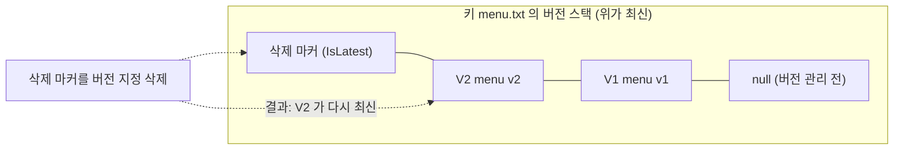
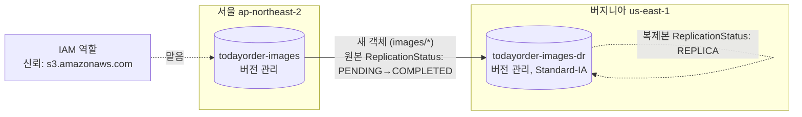

# M04-03. 버전 관리, MFA Delete, 객체 잠금(WORM), 복제(CRR/SRR)
> 도메인: D1, D2 · 예상 시간: 60분 · 실습 등급: 🟢 (버전 관리·삭제 마커·객체 잠금·복제) / 🟡 (MFA Delete: 저장만, 집행 안 됨)

## 왜 필요한가

메뉴 관리자가 가격표 파일을 잘못 덮어썼다. 신입이 `aws s3 rm --recursive`를 잘못된 접두사로 실행했다. 랜섬웨어에 감염된 서버가 정산 파일을 암호화된 쓰레기로 덮어쓰기 시작했다. 그리고 이사회는 "서울 리전 전체가 멈추면 상품 이미지는?"이라고 묻는다. 지금까지의 S3 버킷은 **덮어쓰면 끝, 지우면 끝, 리전이 멈추면 끝**이다. 되돌릴 수 있어야 하고, 아무도 지울 수 없어야 할 데이터가 있고, 다른 리전에 사본이 있어야 한다.

## 핵심 개념

### 버전 관리(Versioning)

버킷 단위로 켠다. 켜면 같은 키에 쓸 때마다 **새 버전**(새 `VersionId`)이 생기고 이전 버전은 남는다.

| 동작 | 버전 관리 꺼짐 | 버전 관리 켜짐 |
|---|---|---|
| 같은 키에 PUT | 덮어씀(이전 내용 사라짐) | 새 버전 추가, 이전 버전 보존 |
| 버전 ID 없이 DELETE | 객체 삭제 | **삭제 마커**(delete marker)를 최신 버전으로 추가. 데이터는 그대로 |
| 버전 ID 지정 DELETE | – | 그 버전을 **영구 삭제** |
| GET (최신이 삭제 마커) | – | `404 NoSuchKey` |



- 버전 관리는 **끌 수 없다.** 한 번 켜면 `Enabled` ↔ `Suspended`만 오간다. 일시 중지 상태에서 새로 쓰는 객체는 버전 ID `null`이 된다.
- 모든 버전이 각각 **요금 대상**이다. 수명 주기 `NoncurrentVersionExpiration`(예: 이전 버전 30일 뒤 삭제)과 같이 쓴다.
- 버전 관리 이전부터 있던 객체의 버전 ID는 `null`이다.

### MFA Delete

버전 관리 버킷에서 **버전을 영구 삭제**하거나 **버전 관리 상태를 바꿀 때** MFA 코드를 요구하는 기능이다. 루트 사용자만 켤 수 있고, 콘솔이 아니라 CLI/API로만(`--mfa "<장치 ARN> <코드>"`) 켠다. MFA Delete를 켠 버킷에는 수명 주기 설정을 쓸 수 없다. 그래서 실무에서는 객체 잠금이 더 자주 쓰인다.

### 객체 잠금(Object Lock) — WORM

WORM(Write Once Read Many): 한 번 쓰면 정해진 기간 동안 **수정·삭제할 수 없다.** 객체 **버전** 단위로 걸리고 버전 관리가 필수다. 이제 기존 버킷에도 켤 수 있지만, 한 번 켜면 끌 수 없다.

| | 거버넌스(Governance) 모드 | 규정 준수(Compliance) 모드 | 법적 보존(Legal Hold) |
|---|---|---|---|
| 기간 | 보존 기한(Retain Until) | 보존 기한 | **기한 없음**(해제할 때까지) |
| 누가 해제·단축 | `s3:BypassGovernanceRetention` 권한 + 우회 헤더를 가진 사용자 | **아무도 못 함(루트 포함)**. 기한을 늘리는 것만 가능 | `s3:PutObjectLegalHold` 권한이 있는 사용자 |
| 언제 | 실수 방지, 테스트, 내부 정책 | 금융·의료 규정(SEC 17a-4 등) | 소송·조사 중 보존 |

버킷에 **기본 보존(Default Retention)**을 걸면 새 객체 버전에 자동으로 적용된다.

### 복제(Replication) — CRR과 SRR

원본 버킷의 **새** 객체를 다른 버킷으로 비동기 복사한다.

| | CRR (Cross-Region) | SRR (Same-Region) |
|---|---|---|
| 대상 | 다른 리전 | 같은 리전 |
| 용도 | 리전 장애 대비(DR), 먼 지역 사용자의 지연 감소, 규정상 다른 리전 사본 | 여러 버킷의 로그를 한 곳으로 모으기, 운영 ↔ 테스트 계정 간 실데이터 동기화, 같은 리전 안 규정 사본 |

공통 요구·규칙:
- **원본·대상 모두 버전 관리**가 켜져 있어야 한다. S3가 맡을 **IAM 역할**(신뢰 정책 `s3.amazonaws.com`)이 필요하다.
- 규칙 이후의 **새 객체만** 복제된다. 기존 객체는 **S3 Batch Replication**으로 옮긴다.
- **체인 복제는 안 된다.** A→B, B→C로 걸어도 A의 객체가 C까지 가지 않는다(B에서 "복제본"인 객체는 다시 복제되지 않는다).
- 삭제 마커는 **기본적으로 복제되지 않는다**(`DeleteMarkerReplication`으로 켤 수 있다). **버전 지정 삭제는 복제되지 않는다.** 원본에서 악의적으로 영구 삭제해도 대상은 안전하다.
- 대상에서 다른 스토리지 클래스(예: DR 사본은 Standard-IA)를 지정할 수 있고, 다른 계정이면 소유권을 대상 계정으로 바꿀 수 있다.
- 복제 시간에 SLA가 필요하면 **S3 Replication Time Control(RTC)**: 새 객체의 99.99%를 15분 안에 복제한다.



## 직접 해 보기 (1) — 버전 관리와 객체 잠금

[lab03-versioning-object-lock.sh](./labs/lab03-versioning-object-lock.sh)

**1) 버전이 쌓이고, 삭제는 마커가 된다**

```
== 1. 버전 관리 전: 응답에 VersionId 가 없다 (목록에서는 "null" 버전으로 보인다)
None
== 2. 버전 관리 켜기
{
    "Status": "Enabled"
}
== 3. 같은 키에 두 번 쓰기 → 쓸 때마다 새 VersionId
V1=f7f357981faedf57d358c7f6a11deaef
V2=06835580d031570235b8b707a68fea5f
== 4. 실수로 삭제 → 실제로는 '삭제 마커'가 최신 버전이 된다
{
    "DeleteMarker": true,
    "VersionId": "a8c73ac456bf2de9d60b35a786fcd72b"
}
aws: [ERROR]: An error occurred (NoSuchKey) when calling the GetObject operation: The specified key does not exist.
== 5. 버전 목록: 버전 3개(null 포함) + 삭제 마커 1개
{"type":"version","VersionId":"06835580d031570235b8b707a68fea5f","IsLatest":false}
{"type":"version","VersionId":"f7f357981faedf57d358c7f6a11deaef","IsLatest":false}
{"type":"version","VersionId":"null","IsLatest":false}
{"type":"delete-marker","VersionId":"a8c73ac456bf2de9d60b35a786fcd72b","IsLatest":true}
```

**2) 되살리기와 영구 삭제**

```
== 6. 이전 버전은 VersionId 로 읽을 수 있다
V1 내용: menu v1 (김치볶음밥 8000원)
== 7. 삭제 마커를 '버전 지정 삭제'하면 객체가 되살아난다
{
    "DeleteMarker": true,
    "VersionId": "a8c73ac456bf2de9d60b35a786fcd72b"
}
현재 내용: menu v2 (김치볶음밥 9000원)
== 8. 버전 지정 삭제는 '영구 삭제'다 (V1 을 지우면 되돌릴 수 없다)
{
    "VersionId": "f7f357981faedf57d358c7f6a11deaef"
}
aws: [ERROR]: An error occurred (NoSuchVersion) when calling the GetObject operation: The specified version does not exist.
== 9. 버전 관리는 끌 수 없고 '일시 중지(Suspended)'만 된다
aws: [ERROR]: An error occurred (MalformedXML) when calling the PutBucketVersioning operation: The XML you provided was not well-formed or did not validate against our published schema
{
    "Status": "Suspended"
}
```

방금 본 것: "삭제"했는데 데이터는 하나도 사라지지 않았다. 7단계 응답의 `"DeleteMarker": true`는 "지운 버전이 삭제 마커였다"는 뜻이다. `Disabled`라는 상태는 API에 아예 없다.

**3) MFA Delete 🟡**

```
== 10. MFA Delete: x-amz-mfa 헤더 없이 켜려 하면 거부
aws: [ERROR]: An error occurred (IllegalVersioningConfigurationException) when calling the PutBucketVersioning operation: VersioningConfiguration.MfaDelete requires the x-amz-mfa request header, which this request does not carry
-- MFA 장치 ARN + 코드를 주면 저장된다 (에뮬레이터는 코드를 검증하지 않는다)
MFADelete=Enabled
-- 에뮬레이터 한계: MFA 없이 버전 지정 삭제가 통과한다 (실제 AWS는 거부)
{
    "VersionId": "06835580d031570235b8b707a68fea5f"
}
```

> ⚠️ **에뮬레이터 한계**: MFA Delete 설정은 저장되지만 집행되지 않는다. 아무 코드(`123456`)나 받아 주고, 루트가 아닌 사용자도 켤 수 있으며, 켠 뒤에도 MFA 없이 버전을 영구 삭제할 수 있다.

**4) 객체 잠금**

```
== 11. 객체 잠금 버킷 만들기 (만들 때 켜면 버전 관리도 자동으로 켜진다)
{
    "Status": "Enabled"
}
{
    "ObjectLockConfiguration": {
        "ObjectLockEnabled": "Enabled",
        "Rule": {
            "DefaultRetention": {
                "Mode": "GOVERNANCE",
                "Days": 1
            }
        }
    }
}
== 12. 기본 보존(거버넌스 1일)이 새 객체에 자동 적용
{
    "Mode": "GOVERNANCE",
    "Until": "2026-11-13T12:26:04+00:00"
}
aws: [ERROR]: An error occurred (AccessDenied) when calling the DeleteObject operation: Access Denied because object protected by object lock.
-- 거버넌스 모드는 s3:BypassGovernanceRetention 권한 + 우회 헤더로 지울 수 있다
{
    "VersionId": "7f8ce3a0edb163120bd0e16aad9a2db6"
}
== 13. 규정 준수(COMPLIANCE) 모드: 우회 헤더도, 보존 기간 단축도 안 된다
aws: [ERROR]: An error occurred (AccessDenied) when calling the DeleteObject operation: Access Denied because object protected by object lock.
aws: [ERROR]: An error occurred (AccessDenied) when calling the PutObjectRetention operation: Access Denied because object protected by object lock.
-- (실습용으로 보존 기한을 15초 뒤로 잡았다. 기한이 지나면 지울 수 있다 — 최대 120초 폴링)
보존 기한 뒤 삭제: yes
== 14. 법적 보존(Legal Hold): 기한 없음, 해제할 때까지 삭제 불가
{
    "LegalHold": {
        "Status": "ON"
    }
}
aws: [ERROR]: An error occurred (AccessDenied) when calling the DeleteObject operation: Access Denied because object protected by object lock.
해제 후 삭제됨
== 15. 정리
LAB03 OK
```

방금 본 것: 에뮬레이터의 기본 사용자는 모든 권한을 가진 관리자다. 그런데도 거버넌스 모드는 우회 헤더(`--bypass-governance-retention`) 없이 지울 수 없었다. 규정 준수 모드는 우회 헤더를 줘도, 보존 기간을 줄이려 해도 거부됐다. 실습이 끝나야 하므로 규정 준수 기한을 15초로 잡았다. **실제 계정에서 규정 준수 모드로 긴 기한을 걸면 기한까지 그 객체와 버킷을 지울 방법이 없다.**

## 직접 해 보기 (2) — 복제가 실제로 일어난다

[lab04-replication.sh](./labs/lab04-replication.sh)

```
== 1. 원본·대상 버킷 (둘 다 버전 관리 필수)
-- 복제 규칙을 걸기 전에 올린 기존 객체
== 2. S3가 맡을 복제 역할 (신뢰 정책: s3.amazonaws.com)
arn:aws:iam::000000000000:role/todayorder-m04-s3-replication
== 3. 복제 규칙: images/ 만, 대상에서는 STANDARD_IA 로 (DR 사본은 덜 읽으니까)
[
    {
        "ID": "images-to-dr",
        "Prefix": "images/",
        "Dest": "arn:aws:s3:::todayorder-m04-images-dr",
        "Class": "STANDARD_IA"
    }
]
== 4. 새 객체 두 개: images/ (규칙 안) 와 docs/ (규칙 밖)
== 5. 복제 상태: 원본 COMPLETED(처음엔 PENDING일 수 있음) / 대상 REPLICA, 버전 ID 동일
{
    "Status": "COMPLETED",
    "VersionId": "817f310a79f443f7a08acfea3da927a3"
}
{
    "Status": "REPLICA",
    "VersionId": "817f310a79f443f7a08acfea3da927a3",
    "Class": "STANDARD_IA"
}
== 6. 대상 버킷 목록: 기존 객체(old.jpg)와 규칙 밖(docs/)은 없다
["images/P-001.jpg"]
== 7. 원본에서 삭제 → 삭제 마커는 기본적으로 복제되지 않는다 (대상에서는 여전히 읽힌다)
대상의 삭제 마커 수: 0
9
== 8. DeleteMarkerReplication=Enabled 로 바꾸면 삭제 마커도 복제된다
대상의 삭제 마커 수: 1
== 9. 정리
LAB04 OK
```

방금 본 것:
- 복제본은 **같은 버전 ID**를 가진다. 원본은 `COMPLETED`, 대상은 `REPLICA`.
- 대상 클래스를 `STANDARD_IA`로 지정한 대로 저장됐다.
- 규칙 전에 있던 `images/old.jpg`와 필터 밖의 `docs/readme.txt`는 넘어가지 않았다.
- 원본에서 지워도(삭제 마커) 기본 설정에서는 대상에서 계속 읽힌다(`9` = 바이트 수). 이게 "실수로 지워도 DR 사본은 안전"의 근거다. 반대로 "원본에서 지우면 대상에서도 안 보여야 한다"면 `DeleteMarkerReplication`을 켠다.

## 실제 AWS에서는

- 복제는 비동기라 대부분 수 초~수 분이지만 보장 시간은 없다(필요하면 RTC). 에뮬레이터는 거의 즉시 복제했다. 실습 스크립트는 시간을 가정하지 않고 폴링한다.
- 에뮬레이터는 복제 설정 시 **역할의 존재와 권한, 대상 버킷의 버전 관리·존재 여부를 검사하지 않는다**(존재하지 않는 역할 ARN, 버전 관리 없는 대상, 없는 대상 버킷 모두 `PutBucketReplication` 성공). 실제 AWS는 대상 버전 관리가 꺼져 있으면 설정을 거부하고, 역할 권한이 없으면 복제가 `FAILED`가 된다. lab04는 실제처럼 역할과 권한을 만든다.
- 에뮬레이터는 객체 잠금이 켜진 버킷의 버전 관리를 `Suspended`로 바꾸는 요청도 받아 줬다. 실제 AWS에서는 객체 잠금 버킷의 버전 관리를 일시 중지할 수 없다.
- MFA Delete는 실제 AWS에서만 의미가 있다(위 ⚠️).
- **실제 AWS에서 해 보려면 (MFA Delete 🟡)**: 루트 사용자의 액세스 키가 필요한데, 루트 액세스 키를 만드는 것 자체가 보안 모범 사례에 어긋난다. 그래서 **실제 계정에서는 시도하지 않기를 권한다**. 대신 객체 잠금 거버넌스 모드(짧은 기한)로 같은 목적을 실습한다. 객체 잠금 규정 준수 모드는 실제 계정에서 **긴 기한으로 걸지 않는다**(기한까지 삭제 불가 → 그동안 저장 요금도 계속 나온다).
- 복제 실습(lab04)은 실제 계정에서 두 리전 버킷으로 해 볼 수 있다. **리전 간 데이터 전송 요금**이 GB당 붙으니 KB 단위 파일만 쓴다. 정리: 복제 규칙 삭제(`delete-bucket-replication`) → 두 버킷의 **모든 버전** 삭제 → 버킷 삭제 → 역할 삭제.

## 시험 포인트

- "실수로 덮어쓰기·삭제해도 복구" → **버전 관리**. 삭제는 삭제 마커일 뿐이고, 삭제 마커를 지우면 복구된다.
- "버전 영구 삭제에 추가 인증" → **MFA Delete**(루트만, CLI/API로만).
- "규정상 일정 기간 누구도(루트 포함) 지울 수 없게" → 객체 잠금 **규정 준수 모드**. "대부분은 못 지우지만 특정 관리자는 예외" → **거버넌스 모드**. "기한 미정, 소송 대비" → **법적 보존**. 객체 잠금은 버전 관리가 필수다.
- "다른 리전에 사본(DR·지연·규정)" → **CRR**. "같은 리전, 로그 집계·계정 간 동기화" → **SRR**. 둘 다 양쪽 **버전 관리 필수**.
- "기존 객체도 복제" → **S3 Batch Replication**. "15분 SLA" → **RTC**. "A→B→C 연쇄" → 안 된다(A→C 규칙을 따로 건다).
- 원본에서 버전 지정 삭제(악의적 영구 삭제)는 **복제되지 않는다**.

## 스스로 확인

1. 버전 관리를 켠 버킷에 10 MB 파일을 매일 덮어쓴다. 한 달 뒤 저장 요금은 10 MB 기준인가? 어떻게 관리하는가?
2. 랜섬웨어가 서버의 자격 증명을 탈취해 정산 버킷의 객체를 덮어쓰고, 이전 버전까지 영구 삭제하려 한다. 무엇이 막아 주는가?
3. 서울 버킷 → 버지니아 버킷 CRR을 걸었다. 운영자가 서울 버킷에서 `aws s3api delete-object --version-id ...`로 특정 버전을 지웠다. 버지니아에서는?

<details><summary>답</summary>

1. 아니다. 버전마다 과금되므로 약 30개 × 10 MB = 300 MB가 쌓인다. 수명 주기 `NoncurrentVersionExpiration`(예: 이전 버전 7일 뒤 삭제, 또는 최근 N개만 유지)으로 관리한다.
2. 버전 관리만으로는 부족하다(권한이 있으면 버전 지정 삭제가 가능하다). 객체 잠금(특히 규정 준수 모드)이 기한 동안 덮어쓰기 이전 버전과 원본을 지킨다. 다른 계정으로의 복제(삭제 마커 미복제)도 추가 방어선이다.
3. 그대로 남아 있다. 버전 지정 삭제는 복제되지 않는다.

</details>
