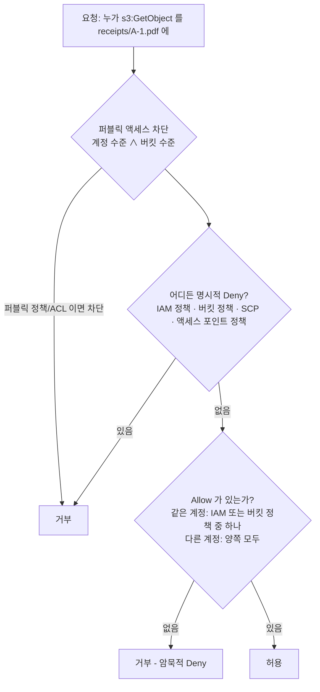
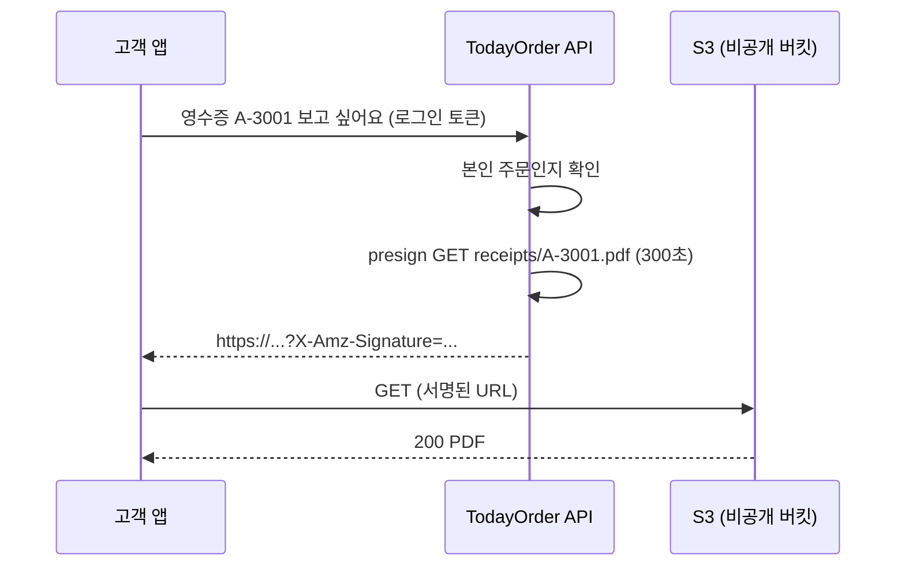
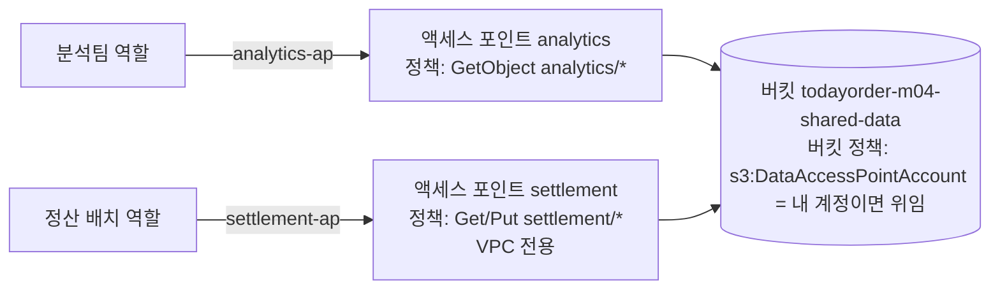

# M04-04. S3 보안: 버킷 정책, ACL, 퍼블릭 액세스 차단, 암호화, 미리 서명된 URL, 액세스 포인트
> 도메인: D1 · 예상 시간: 60분 · 실습 등급: 🟢 (버킷 정책·BPA·SSE·presigned URL) / 🔴 (액세스 포인트·계정 수준 BPA)

## 왜 필요한가

"스타트업 S3 버킷 공개 설정으로 고객 개인정보 수십만 건 노출" 같은 뉴스는 거의 매년 나온다. TodayOrder의 영수증 버킷에는 주문자 이름·주소·결제 금액이 들어 있다. 이 버킷은 **절대 공개되면 안 되고**, 저장된 데이터는 **암호화**되어야 하고, 실수로라도 영수증이 **삭제되면 안 된다**. 그런데 고객 앱은 자기 영수증을 내려받아야 한다. 비공개 버킷의 파일을 "그 사람에게만, 잠깐" 여는 방법이 필요하다.

## 핵심 개념

### S3 접근 제어의 층



| 수단 | 붙는 곳 | 언제 |
|---|---|---|
| IAM 정책 (자격 증명 기반) | 사용자·역할 | "이 역할은 어떤 버킷에 무엇을" — 같은 계정 내부 접근의 기본 |
| **버킷 정책** (리소스 기반, JSON) | 버킷 | 다른 계정·서비스에 권한 부여, **버킷 전체 규칙 강제**(암호화·HTTPS·삭제 금지 같은 명시적 Deny) |
| ACL | 버킷·객체 | 옛 방식. 2023년 4월부터 새 버킷은 **ACL 비활성화**(객체 소유권 `BucketOwnerEnforced`)가 기본, AWS는 ACL을 끄고 정책을 쓰라고 권장 |
| **퍼블릭 액세스 차단**(Block Public Access, BPA) | 계정·버킷 | "퍼블릭이 될 수 있는 설정"을 아예 막는 안전장치. 새 버킷은 4개 옵션 모두 켜짐 |
| 액세스 포인트(Access Point) | 버킷에 붙는 별도 엔드포인트 | 팀·앱마다 **자기 정책과 이름**을 가진 입구. 거대한 버킷 정책 하나를 쪼갠다. VPC 전용으로 만들 수도 있다 |
| 미리 서명된 URL | 요청 하나 | 비공개 객체를 **서명자의 권한으로, 정해진 시간 동안** 누구에게나 연다 |

**BPA 4개 옵션**: `BlockPublicAcls`(퍼블릭 ACL 설정 거부) · `IgnorePublicAcls`(기존 퍼블릭 ACL 무시) · `BlockPublicPolicy`(퍼블릭 버킷 정책 설정 거부) · `RestrictPublicBuckets`(퍼블릭 정책이 있어도 익명·타 계정 접근 제한). 계정 수준 BPA는 계정의 **모든** 버킷에 적용되고, 버킷 설정보다 우선한다(둘 중 더 엄격한 쪽).

### 서버 측 암호화(SSE) 3종 + 클라이언트 측

| | 키 관리 | 감사·통제 | 시험 키워드 |
|---|---|---|---|
| **SSE-S3** (`AES256`) | S3가 전부 | 없음 | 기본값(2023년 1월부터 모든 새 객체), 추가 비용 없음 |
| **SSE-KMS** (`aws:kms`) | KMS 키(AWS 관리형 `aws/s3` 또는 고객 관리형) | **CloudTrail에 키 사용 기록**, 키 정책으로 누가 복호화할지 통제, 키 교체 | "키 사용 감사", "키 권한 분리", "직접 키 교체 통제". 요청마다 KMS 호출 → 할당량·비용 → **S3 버킷 키**로 줄임 |
| DSSE-KMS | KMS, 두 겹 암호화 | SSE-KMS와 같음 | 규정상 "이중 암호화" 요구 |
| **SSE-C** | **고객**이 요청마다 키를 보냄, AWS는 키를 저장 안 함 | 고객 책임 | "키를 AWS에 맡기면 안 된다 + 서버 측 암호화". 키를 잃으면 데이터도 잃음. 2026년 4월부터 **새 범용 버킷은 SSE-C가 기본 차단**(중동 바레인·UAE 리전 제외. 기존 버킷은 계정에 SSE-C 객체가 하나도 없을 때만 함께 차단됨) |
| 클라이언트 측 암호화 | 고객 앱이 올리기 전에 암호화 | 고객 책임 | "S3에 평문이 한 번도 닿으면 안 된다" |

전송 중 암호화는 HTTPS다. 버킷 정책에서 `aws:SecureTransport: false`를 Deny하면 HTTP 요청을 막을 수 있다.

### 미리 서명된 URL(Presigned URL)

서명(SigV4)에 필요한 값을 HTTP 헤더 대신 **쿼리 문자열**에 넣은 URL이다. URL을 가진 사람은 AWS 자격 증명 없이 그 요청(특정 키의 GET 또는 PUT) 하나를 할 수 있다. 권한은 **URL을 만든 주체의 권한**이다. 만든 주체에게 권한이 없으면 URL도 동작하지 않는다.

- 유효 기간: IAM 사용자 자격 증명으로 SigV4 서명 시 **최대 7일**. 역할(임시 자격 증명)로 만들면 그 **세션이 끝날 때 함께 만료**된다.
- 서명에 포함된 것(경로·메서드·서명한 헤더)을 바꾸면 `SignatureDoesNotMatch`.



## 직접 해 보기 (1) — 기본값, BPA, 버킷 정책, SSE

[lab05-bucket-security.sh](./labs/lab05-bucket-security.sh)

**1) 새 버킷의 기본 보안 설정**

```
== 1. 새 버킷의 기본 보안 설정 3종
-- (a) 퍼블릭 액세스 차단: 4개 모두 true
{
    "PublicAccessBlockConfiguration": {
        "BlockPublicAcls": true,
        "IgnorePublicAcls": true,
        "BlockPublicPolicy": true,
        "RestrictPublicBuckets": true
    }
}
-- (b) 객체 소유권: BucketOwnerEnforced = ACL 비활성화
BucketOwnerEnforced
-- (c) 기본 암호화: SSE-S3(AES256), SSE-C 는 차단 목록에
{
    "ServerSideEncryptionConfiguration": {
        "Rules": [
            {
                "ApplyServerSideEncryptionByDefault": {
                    "SSEAlgorithm": "AES256"
                },
                "BucketKeyEnabled": false,
                "BlockedEncryptionTypes": {
                    "EncryptionType": [
                        "SSE-C"
                    ]
                }
            }
        ]
    }
}
```

방금 본 것: 아무 설정 없이 만든 버킷이 이미 "비공개 + ACL 꺼짐 + SSE-S3 + SSE-C 차단"이다. 사고는 대부분 누군가 이 기본값을 **일부러 끌 때** 난다.

**2) 퍼블릭으로 만들려는 시도는 BPA에 막힌다**

```
== 2. 퍼블릭 정책은 퍼블릭 액세스 차단(BlockPublicPolicy)에 막힌다
aws: [ERROR]: An error occurred (AccessDenied) when calling the PutBucketPolicy operation: User: arn:aws:iam::000000000000:user/emulator is not authorized to perform: s3:PutBucketPolicy on resource: "arn:aws:s3:::todayorder-m04-receipts-sec" because public policies are prevented by the BlockPublicPolicy setting in S3 Block Public Access.
== 3. 퍼블릭 ACL 도 막힌다 (BlockPublicAcls)
aws: [ERROR]: An error occurred (AccessDenied) when calling the PutObjectAcl operation: User: arn:aws:iam::000000000000:user/emulator is not authorized to perform: s3:PutObjectAcl on resource: "arn:aws:s3:::todayorder-m04-receipts-sec/receipts/A-2001.json" because public ACLs are prevented by the BlockPublicAcls setting in S3 Block Public Access.
```

**3) 버킷 정책으로 규칙 강제** — 정책 전문은 lab05 5단계. 세 문장 모두 `Effect: Deny`다.

```
...
== 5. 버킷 정책: (1) SSE-KMS 가 아닌 업로드 거부 (2) receipts/ 삭제 거부 (3) HTTPS 아닌 요청 거부
["DenyNonKmsUploads","DenyReceiptDelete","DenyInsecureTransport"]
-- 암호화 헤더 없이 업로드 → 명시적 Deny
aws: [ERROR]: An error occurred (AccessDenied) when calling the PutObject operation: User: arn:aws:iam::000000000000:user/emulator is not authorized to perform: s3:PutObject on resource: "arn:aws:s3:::todayorder-m04-receipts-sec/receipts/A-2002.json" with an explicit deny in a resource-based policy
-- SSE-KMS(내 키)로 업로드 → 통과
{
    "SSE": "aws:kms",
    "KeyId": "alias/todayorder-m04-receipts"
}
-- receipts/ 삭제 → 명시적 Deny (관리자라도)
aws: [ERROR]: An error occurred (AccessDenied) when calling the DeleteObject operation: User: arn:aws:iam::000000000000:user/emulator is not authorized to perform: s3:DeleteObject on resource: "arn:aws:s3:::todayorder-m04-receipts-sec/receipts/A-2002.json" with an explicit deny in a resource-based policy
-- 읽기는 Deny 대상이 아니므로 통과 (에뮬레이터 연결은 항상 HTTPS)
aws:kms
```

방금 본 것: 에뮬레이터의 기본 사용자(`user/emulator`)는 모든 권한을 가진 관리자다. 그래도 **명시적 Deny가 Allow를 이긴다.** 조건 키 `s3:x-amz-server-side-encryption`도 실제로 평가됐다. (실제 AWS에서는 응답의 `SSEKMSKeyId`가 키 **ARN**이다. 에뮬레이터는 요청에 쓴 별칭을 그대로 돌려준다.)

**4) 버킷 기본 암호화를 SSE-KMS + 버킷 키로**

```
== 6. 정책을 걷어내고, 버킷 기본 암호화를 SSE-KMS + S3 버킷 키로
{
    "SSE": "aws:kms",
    "KeyId": "alias/todayorder-m04-receipts",
    "BucketKey": true
}
```

헤더 없이 올려도 기본 암호화가 SSE-KMS를 적용했다. **S3 버킷 키**는 버킷 단위로 짧게 쓰는 데이터 키를 만들어 KMS 호출을 크게 줄인다(KMS 요청 비용·할당량 절감).

**5) SSE-C** — 실습을 위해 차단 목록을 비우고(`BlockedEncryptionTypes: NONE`) 32바이트 키를 직접 만든다.

```
== 7. SSE-C: 키를 내가 들고 다닌다 (실습을 위해 차단 목록을 비운다)
AES256
-- 키 없이 읽기 → 거부
aws: [ERROR]: An error occurred (InvalidRequest) when calling the GetObject operation: The object was stored using a form of Server Side Encryption. The correct parameters must be provided to retrieve the object.
-- 같은 키로 읽기 → 통과
34
SSE-C 왕복 성공
== 8. 정리
PendingDeletion
LAB05 OK
```

> ⚠️ **에뮬레이터 한계 두 가지**
> - 버킷의 `BlockedEncryptionTypes`에 `SSE-C`가 있어도 에뮬레이터는 SSE-C 업로드를 **막지 않는다**. 실제 AWS는 `403 AccessDenied`를 돌려준다. 그래서 lab05는 차단 목록을 먼저 비운다(실제 AWS에서도 이렇게 해야 SSE-C를 쓸 수 있다).
> - **KMS 키를 비활성화해도 SSE-KMS 객체가 읽힌다**(직접 확인: 키 상태 `Disabled`에서 `GetObject` 성공). 실제 AWS에서는 키가 비활성화되면 S3가 데이터 키를 복호화하지 못해 읽기가 실패한다. 이 "키 의존성"은 M09에서 KMS `Decrypt` 실패로 보여 준다.

## 직접 해 보기 (2) — 미리 서명된 URL을 curl로

[lab06-presigned-url.sh](./labs/lab06-presigned-url.sh)

```
== 1. 서명 없이 객체 URL 로 GET → 403 (버킷은 비공개)
HTTP 403
== 2. 5분짜리 presigned GET URL
X-Amz-Algorithm
X-Amz-Credential
X-Amz-Date
X-Amz-Expires
X-Amz-SignedHeaders
X-Amz-Signature
HTTP 200, 내용: %PDF-1.4 fake receipt A-3001
== 3. URL 의 키를 다른 객체로 바꾸면 → 서명 불일치 403
<Code>SignatureDoesNotMatch</Code>
HTTP 403
== 4. 1초짜리 URL → 만료되면 403 (최대 60초 폴링)
<Code>AccessDenied</Code>
<Message>Request has expired</Message>
HTTP 403
== 5. presigned PUT URL (CLI 에는 PUT 서명 기능이 없어 boto3 로 만든다) → curl 로 업로드
HTTP 200
-- 서명에 포함된 Content-Type 과 다르게 보내면 → 403
HTTP 403
{
    "Type": "application/pdf",
    "Size": 28
}
== 6. 정리
LAB06 OK
```

방금 본 것: curl은 AWS 자격 증명이 전혀 없는데도 비공개 객체를 받았다. 쿼리 문자열의 `X-Amz-Credential`(누가), `X-Amz-Date`+`X-Amz-Expires`(언제까지), `X-Amz-Signature`(위조 방지)가 권한을 대신한다. 키를 바꾸거나 서명한 `Content-Type`을 바꾸면 서명이 맞지 않는다. 이 패턴을 서비스로 만든 것이 [sdk/receipt_upload_service.py](./sdk/receipt_upload_service.py)다.

```bash
uv run python curriculum/m04-storage/sdk/receipt_upload_service.py
```

```
버킷 준비: todayorder-m04-receipts-sdk (비공개·버전 관리·SSE-S3·수명 주기)
업로드 키: receipts/2026/11/12/A-5001.pdf (URL 유효 300초)
앱 → presigned PUT: HTTP 200
앱 → Content-Type 을 바꿔 PUT: HTTP 403 (SignatureDoesNotMatch)
확인: 37 bytes, SSE=AES256, 버전 있음=True
재발급 후 버전 수: 2
앱 → presigned GET: HTTP 200, Content-Disposition=attachment; filename="A-5001.pdf"
서명 없이 GET: HTTP 403
오늘의 영수증: ['receipts/2026/11/12/A-5001.pdf']
정리 완료
SDK receipt_upload_service OK
```

## 직접 해 보기 (3) — 액세스 포인트와 계정 수준 BPA 🔴

[lab07-s3-control-unreachable.sh](./labs/lab07-s3-control-unreachable.sh). 액세스 포인트와 계정 수준 BPA는 **S3 Control API**(`aws s3control ...`)로 관리한다. SDK는 이 API의 호스트명 앞에 계정 ID를 붙인다(`<계정ID>.s3-control.<리전>.amazonaws.com`). 에뮬레이터 엔드포인트에도 똑같이 붙여서 `000000000000.127.0.0.1`이라는 존재하지 않는 호스트로 가 버린다.

```
== 1. S3 Control: 액세스 포인트 만들기 → 호스트명에 계정 ID 가 붙어 에뮬레이터에 닿지 않는다
aws: [ERROR]: Could not connect to the endpoint URL: "https://000000000000.127.0.0.1:<포트>/v20180820/accesspoint/todayorder-analytics"
== 2. S3 Control: 계정 수준 퍼블릭 액세스 차단 조회 → 같은 이유로 실패
aws: [ERROR]: Could not connect to the endpoint URL: "https://000000000000.127.0.0.1:<포트>/v20180820/configuration/publicAccessBlock"
```

`<포트>` 자리에는 내 `EMULATOR_PORT`(학습자 기본값 9297)가 찍힌다.

대체 실습으로 버킷 수준 BPA를 쓰고, 액세스 포인트 설계를 JSON으로 적는다. 액세스 포인트를 쓰는 표준 패턴은 이렇다. **버킷 정책은 "이 계정의 액세스 포인트를 거쳐 온 요청이면 허용"으로 권한을 위임하고, 실제 세부 권한은 각 액세스 포인트 정책에 둔다.**

```
...
== 4. 대체 실습 (b): 액세스 포인트 설계를 JSON 으로 — 분석팀 전용 액세스 포인트(읽기, analytics/ 만)
-- 버킷 정책: '이 계정의 액세스 포인트를 거쳐 온 요청'에 권한을 위임 (s3:DataAccessPointAccount)
{"Sid":"AnalyticsReadOnly","Resource":"arn:aws:s3:us-east-1:000000000000:accesspoint/todayorder-analytics/object/analytics/*"}
{"Sid":"DelegateToAccessPoints","Condition":{"StringEquals":{"s3:DataAccessPointAccount":"000000000000"}}}
-- 위임 정책은 Principal "*" 지만 조건이 있어 '퍼블릭'이 아니다 → BlockPublicPolicy 를 통과하는지 확인
{
    "IsPublic": false
}
== 5. 정리
LAB07 OK
```



## 실제 AWS에서는

- 에뮬레이터는 버킷 정책의 명시적 Deny와 조건 키를 집행했지만, 공식 문서는 에뮬레이터를 "보안 테스트에 쓰지 말라"고 한다. 버전에 따라 바뀔 수 있다.
- **에뮬레이터는 S3에 대한 IAM 사용자 정책을 일부만 평가한다**(M01 README "에뮬레이터 제약"과 같은 결과를 이 포트에서 다시 확인). 정책이 없는 사용자의 객체·버킷 단위 데이터 요청(`GetObject`·`PutObject`·`ListObjectsV2`)은 `AccessDenied ... because no identity-based policy allows ...`로 거부하고, `s3:*` 허용에 `s3:GetObject` 명시적 Deny를 더하면 `GetObject`만 `... with an explicit deny in an identity-based policy`로 거부한다. 반면 계정·관리 수준 요청(`ListBuckets`·`CreateBucket`·`DeleteBucket`·`PutBucketVersioning`)은 정책이 없어도 통과시킨다. **실제 AWS는 모든 S3 요청에서** IAM 정책과 버킷 정책을 함께 평가한다(같은 계정이면 둘 중 하나의 Allow로 충분하고, 어디든 명시적 Deny가 있으면 거부).
- 퍼블릭 정책을 걸어도(BPA를 끈 경우) 에뮬레이터는 익명 GET을 허용하지 않았다(403). 실제 AWS에서는 퍼블릭 읽기 정책 + BPA 해제면 **누구나** 읽는다. 그래서 실제 계정에서는 이 실험을 하지 않는다.
- SSE-C 차단(`BlockedEncryptionTypes`)과 KMS 키 상태는 실제 AWS에서만 효과가 있다(위 ⚠️).
- **실제 AWS에서 해 보려면 (lab07)**: 액세스 포인트(`aws s3control create-access-point --account-id <내 계정> --name <이름> --bucket <버킷>`)와 계정 수준 BPA 조회(`aws s3control get-public-access-block --account-id <내 계정>`)는 무료다. 계정 수준 BPA는 **켜 두는 것이 권장값**이다. 끄지 말고 조회만 한다. 정리: `aws s3control delete-access-point --account-id <내 계정> --name <이름>`.
- presigned URL·버킷 정책·SSE-S3는 소량이면 요금이 거의 없다(프리 티어 적용 여부와 한도는 계정 생성 시기에 따라 다르니 AWS 프리 티어 페이지에서 확인). 고객 관리형 KMS 키는 **키당 월 요금**이 있으니 실습 뒤 `schedule-key-deletion`(7~30일 대기)을 잊지 않는다.

## 시험 포인트

- "버킷이 실수로라도 퍼블릭이 되면 안 된다, 계정 전체" → **계정 수준 S3 Block Public Access**(+ 필요하면 SCP로 해제 금지).
- "키 사용을 감사하고 키 접근을 분리 통제" → **SSE-KMS**(고객 관리형 키). "KMS 요청이 너무 많아 비용·스로틀링" → **S3 버킷 키**.
- "키를 AWS에 저장하면 안 되지만 서버 측 암호화" → **SSE-C**. "S3에 평문이 닿으면 안 됨" → **클라이언트 측 암호화**.
- "업로드 시 암호화 강제" → 버킷 정책 Deny(`s3:x-amz-server-side-encryption` 조건) 또는 기본 암호화. "HTTPS 강제" → `aws:SecureTransport` Deny.
- "로그인한 사용자에게만 비공개 파일을 잠깐" / "클라이언트가 서버를 거치지 않고 직접 업로드" → **미리 서명된 URL**(GET/PUT). 권한은 서명한 주체의 것, 만료 최대 7일.
- "다른 계정에 버킷 접근 허용" → 버킷 정책(리소스 기반) + 상대 계정의 IAM 허용. ACL은 비활성화가 권장.
- "팀·앱이 많아 버킷 정책이 거대해짐", "특정 VPC에서만 접근" → **S3 액세스 포인트**(VPC 전용 액세스 포인트).

## 스스로 확인

1. 버킷 정책 `"Effect": "Allow", "Principal": "*", "Action": "s3:GetObject"`를 **저장하려는** `put-bucket-policy` 호출이 `AccessDenied`로 실패했다(GET은 아직 해 보지도 않았다). 정책 문법은 맞다. 무엇 때문인가?
2. 운영자가 "영수증은 절대 삭제 불가"를 원한다. 버킷 정책 Deny(lab05)와 객체 잠금(레슨 3) 중 무엇이 더 강한가?
3. EC2의 역할(임시 자격 증명)로 7일짜리 presigned URL을 만들었는데 몇 시간 만에 403이 났다. 왜인가?

<details><summary>답</summary>

1. 버킷 수준 BPA의 `BlockPublicPolicy`가 퍼블릭 정책을 **저장하는 것 자체**를 막았다(lab05 2단계, 오류 메시지 끝의 `because public policies are prevented by the BlockPublicPolicy setting`). 계정 수준 BPA가 켜져 있어도 마찬가지다. 반대로 정책은 저장됐는데 익명 GET이 거부된다면, 원인은 `RestrictPublicBuckets`(또는 계정 수준 BPA)다.
2. 객체 잠금(규정 준수 모드)이 더 강하다. 버킷 정책은 정책을 바꿀 권한이 있는 사람이 Deny를 지우면 끝이다. 규정 준수 모드 객체 잠금은 루트 사용자도 보존 기간 동안 지울 수 없다.
3. 임시 자격 증명으로 만든 presigned URL은 그 자격 증명(역할 세션)이 만료되면 함께 무효가 된다. 길게 써야 한다면 URL을 그때그때 새로 발급하는 설계(API가 요청마다 발급)가 맞다.

</details>
