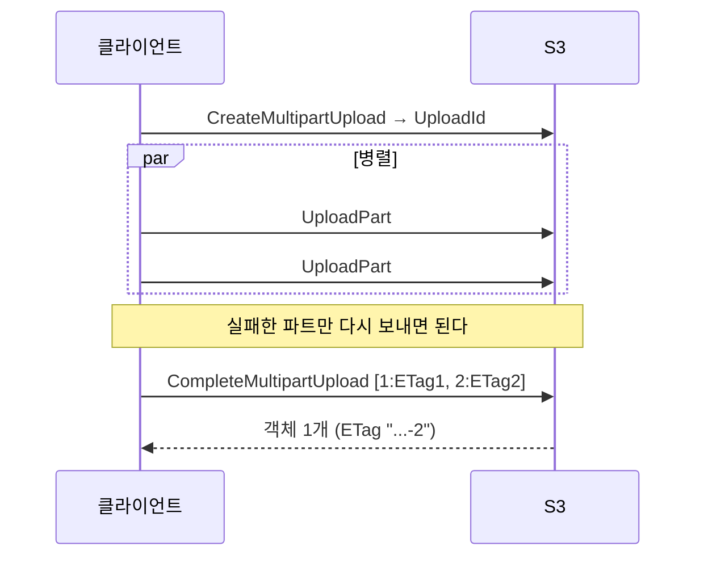
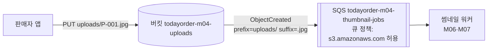

# M04-05. S3 성능·기능: 멀티파트, Transfer Acceleration, 이벤트 알림, 정적 웹 호스팅, 요청자 지불
> 도메인: D3 · 예상 시간: 50분 · 실습 등급: 🟢 (멀티파트·이벤트 알림) / 설정 저장만 확인 (웹 호스팅·가속·요청자 지불)

## 왜 필요한가

TodayOrder가 가게 소개 영상(수백 MB~수 GB)을 받기 시작했다. 업로드가 90%에서 끊기면 처음부터 다시 올려야 하고, 해외 지사에서 올리면 너무 느리다. 또 상품 이미지가 올라올 때마다 썸네일을 만들어야 하는데, 지금은 API 서버가 업로드 직후 동기적으로 썸네일을 만들어 응답이 느리다. "**큰 파일을 조각내 병렬로**, **멀리서도 빠르게**, **업로드되면 알아서 다음 작업이 시작되게**" 하고 싶다.

## 핵심 개념

### 멀티파트 업로드

큰 객체를 여러 **파트**로 나눠 따로(병렬로) 올리고 마지막에 합친다.



| 한계 | 값 |
|---|---|
| 파트 크기 | 5 MiB ~ 5 GiB (**마지막 파트는 5 MiB 미만 가능**) |
| 파트 수 | 최대 10,000 |
| 단일 PUT | 최대 5 GB (그보다 크면 멀티파트 필수) |
| 객체 최대 | 50 TB |
| 권장 | 100 MB 이상이면 멀티파트를 고려 |

완료하지도 중단하지도 않은 업로드의 파트는 **보이지 않게 남아 저장 요금이 나간다.** 그래서 수명 주기 규칙 `AbortIncompleteMultipartUpload`(레슨 2)를 거의 모든 버킷에 건다. 다운로드 쪽은 `Range` 헤더로 **바이트 범위 GET**을 병렬로 보내 빠르게 받는다.

### S3 Transfer Acceleration

클라이언트가 가까운 **CloudFront 엣지 로케이션**으로 올리면, 그다음부터는 AWS 백본망을 타고 버킷 리전까지 간다. 멀리 떨어진 사용자가 큰 파일을 올릴 때 유리하다. 버킷에 켜고 `<버킷>.s3-accelerate.amazonaws.com` 엔드포인트를 쓴다. 버킷 이름에 **점(.)이 있으면 안 되고**, 가속이 효과가 없으면 가속 요금을 받지 않는다.

### 이벤트 알림

객체 생성·삭제·복원 완료 같은 일이 생기면 S3가 메시지를 보낸다. 대상은 **SQS 큐 · SNS 토픽 · Lambda 함수 · EventBridge**다. SQS **FIFO 큐는 직접 대상이 될 수 없다**(EventBridge를 거친다). 접두사·접미사 필터로 범위를 좁힐 수 있다. EventBridge로 보내면 더 많은 필터링·여러 대상·보관/재생을 쓸 수 있다.

**대상 쪽 정책이 필수**다. S3(`s3.amazonaws.com`)가 그 큐에 `sqs:SendMessage` 할 수 있어야 하고, 보통 `aws:SourceArn`(내 버킷)·`aws:SourceAccount` 조건으로 좁힌다. 정책이 없으면 알림 설정 자체가 실패한다.



### 정적 웹 사이트 호스팅 · 요청자 지불 · (S3 Select)

- **정적 웹 사이트 호스팅**: 버킷을 `index.html`/`error.html`이 있는 웹 서버처럼 쓴다. 웹 사이트 엔드포인트는 **HTTP만** 지원한다. HTTPS·커스텀 도메인 인증서·캐시가 필요하면 앞에 **CloudFront + OAC**(M08)를 둔다. 공개 웹 사이트로 쓰려면 BPA를 풀고 퍼블릭 읽기 정책이 필요하지만, 요즘 권장 구조는 **버킷은 비공개로 두고 CloudFront OAC로만 읽게** 하는 것이다.
- **요청자 지불(Requester Pays)**: 요청·데이터 전송 요금을 버킷 소유자가 아니라 **요청한 쪽 계정**이 낸다. 대용량 공개 데이터셋을 다른 회사와 나눌 때 쓴다. 요청자는 `x-amz-request-payer: requester` 헤더로 동의해야 하고, 익명 요청은 안 된다.
- **S3 Select**는 2024년 7월부터 신규 고객에게 제공되지 않는다. S3 안의 데이터를 SQL로 조회하려면 **Athena**를 쓴다(M11).

## 직접 해 보기 (1) — 멀티파트

[lab08-multipart-upload.sh](./labs/lab08-multipart-upload.sh)

```
== 0. 6 MiB 짜리 '홍보 영상' 파일을 5 MiB + 1 MiB 로 자른다
5242880 part-aa
1048576 part-ab
== 1. CreateMultipartUpload → UploadId
UploadId 길이: 43
== 2. UploadPart (파트 번호 1, 2 — 병렬로 올려도 된다)
part1 ETag="3e874b708a9bff0bd9f41a24f7bcb868"
part2 ETag="ae972098058a06ce68f908668c942916"
== 3. 완료 전: 진행 중인 업로드와 파트 목록 (객체는 아직 없다)
[
    "videos/promo.mp4"
]
[
    {
        "N": 1,
        "Size": 5242880
    },
    {
        "N": 2,
        "Size": 1048576
    }
]
aws: [ERROR]: An error occurred (404) when calling the HeadObject operation: Not Found
== 4. CompleteMultipartUpload → 하나의 객체
{
    "Key": "videos/promo.mp4",
    "ETag": "\"33c985d13245937104138e8c75ae9b6c-2\""
}
{
    "Size": 6291456,
    "ETag": "\"33c985d13245937104138e8c75ae9b6c-2\"",
    "Type": "video/mp4"
}
내려받은 파일이 원본과 같다
```

방금 본 것: 완료 전에는 `ListMultipartUploads`·`ListParts`에만 보이고 객체로는 존재하지 않는다(`HeadObject` 404). 완료된 객체의 ETag는 전체 MD5가 아니라 `<파트 ETag들의 해시>-<파트 수>` 형식이다. **멀티파트 객체의 ETag를 파일 MD5와 비교하면 안 된다.**

```
== 5. 첫 파트가 5 MiB 미만이면? (1 MiB + 1 MiB) → 완료 단계에서 EntityTooSmall
aws: [ERROR]: An error occurred (EntityTooSmall) when calling the CompleteMultipartUpload operation: Your proposed upload is smaller than the minimum allowed size
== 6. 완료 못 한 업로드는 남아 있다 → AbortMultipartUpload 로 파트까지 삭제
[
    "videos/small.mp4"
]
남은 미완료 업로드: 0
== 7. 고수준 명령: aws s3 cp 는 8 MiB(기본 multipart_threshold) 이상이면 자동으로 멀티파트
upload: ./menu-video.mp4 to s3://todayorder-m04-videos/videos/menu-video.mp4
ETag="0ebaf1ee29988eab8aed15ff0d9635cd-3"   (끝의 -N 이 파트 수: 20 MiB / 8 MiB 청크 = 3)
== 8. 정리
LAB08 OK
```

방금 본 것: 파트 크기 제한은 `UploadPart`가 아니라 **`CompleteMultipartUpload`** 때 검사된다. 실패한 업로드는 남아서 공간을 차지한다. `aws s3 cp`와 boto3 `upload_file`은 알아서 멀티파트로 올린다(boto3는 `TransferConfig`로 임계값·동시성 조정).

## 직접 해 보기 (2) — 이벤트 알림이 SQS에 실제로 도착

[lab09-event-notifications.sh](./labs/lab09-event-notifications.sh)

```
== 1. 큐 정책 없이 알림 설정 → S3가 목적지를 검증하다 실패
aws: [ERROR]: An error occurred (InvalidArgument) when calling the PutBucketNotificationConfiguration operation: Unable to validate the following destination configurations
== 2. 큐 정책: s3.amazonaws.com 이 '내 버킷에서 온 경우에만' SendMessage 가능
== 3. 이제 알림 설정 성공 → S3가 확인용 s3:TestEvent 를 보낸다
[
    {
        "Id": "thumbnail-on-upload",
        "Events": [
            "s3:ObjectCreated:*"
        ],
        "Filter": [
            {
                "Name": "Prefix",
                "Value": "uploads/"
            },
            {
                "Name": "Suffix",
                "Value": ".jpg"
            }
        ]
    }
]
s3:TestEvent
== 4. 객체 5개 업로드 (규칙에 맞는 것은 uploads/*.jpg 세 개뿐, 마지막 P-004 가 도착하면 수집 종료)
PUT uploads/P-001.jpg
PUT uploads/readme.txt
PUT products/P-003.jpg
PUT uploads/P-002.jpg
PUT uploads/P-004.jpg
== 5. 큐에서 받은 이벤트 (P-004 가 올 때까지, 최대 60초)
ObjectCreated:Put uploads/P-001.jpg
ObjectCreated:Put uploads/P-002.jpg
ObjectCreated:Put uploads/P-004.jpg
== 6. 메시지 본문 구조 (P-004 이벤트)
{
  "eventSource": "aws:s3",
  "eventName": "ObjectCreated:Put",
  "awsRegion": "us-east-1",
  "bucket": "todayorder-m04-uploads",
  "key": "uploads/P-004.jpg",
  "size": 3
}
```

방금 본 것: 큐 정책이 없을 때 S3는 알림 설정을 **거부**했다(`InvalidArgument`). 정책을 넣자 S3가 먼저 `s3:TestEvent`를 보냈고, 필터(`uploads/` + `.jpg`)에 맞는 세 건만 큐에 왔다. `readme.txt`와 `products/P-003.jpg`는 오지 않았다. 워커는 메시지의 `Records[].s3.object.key`를 읽어 썸네일을 만든다(M06·M07에서 이어진다).

**설정만 확인하는 기능들**

```
== 7. 그 밖의 버킷 기능 — 설정만 (동작은 레슨 5 '실제 AWS에서는')
-- 정적 웹 사이트 호스팅
{
    "IndexDocument": {
        "Suffix": "index.html"
    },
    "ErrorDocument": {
        "Key": "error.html"
    }
}
-- 요청자 지불(Requester Pays)
Payer=Requester
-- Transfer Acceleration
Accelerate=Enabled
-- 이름에 점(.)이 있는 버킷은 Transfer Acceleration 불가
aws: [ERROR]: An error occurred (InvalidRequest) when calling the PutBucketAccelerateConfiguration operation: A parameter or header in your request isn't valid. For details, see the description of this API operation.
== 8. 정리
LAB09 OK
```

## 실제 AWS에서는

- 이벤트 알림은 보통 수 초 안에 오지만 **가끔 1분 이상 걸릴 수 있고, 드물게 중복 전달**될 수 있다. 순서도 보장되지 않는다(같은 키의 이벤트 순서는 `sequencer` 값으로 판단). 워커는 **멱등**하게 만든다. lab09는 마지막에 올린 P-004의 도착을 "수집 끝" 신호로 썼는데, 이건 에뮬레이터가 순서대로 보내기 때문에 통하는 실습용 단순화다.
- 정적 웹 사이트 엔드포인트(`http://<버킷>.s3-website-<리전>.amazonaws.com`), Transfer Acceleration 엔드포인트(`<버킷>.s3-accelerate.amazonaws.com`)는 에뮬레이터에 없다. 설정이 저장되는 것만 확인했다.
- 요청자 지불 버킷에 다른 계정이 요청할 때 `--request-payer requester`를 빼면 403이 난다. 에뮬레이터는 계정을 분리하지 않아 재현할 수 없다.
- 실제로 해 보려면: 멀티파트·이벤트 알림(SQS)은 프리 티어 범위 안의 소량으로 가능하다(SQS 월 100만 요청 무료). Transfer Acceleration은 **GB당 추가 요금**이 있으니 테스트 파일만 쓴다. 정리: `aws s3api put-bucket-notification-configuration --bucket <버킷> --notification-configuration '{}'` → `aws sqs delete-queue` → `aws s3 rb --force`. 미완료 멀티파트 업로드가 남지 않았는지 `aws s3api list-multipart-uploads`로 확인한다.

## 시험 포인트

- "수 GB 파일 업로드가 자주 실패·느림" → **멀티파트 업로드**(병렬, 실패 파트만 재전송). 100 MB 이상 권장, 5 GB 초과는 필수.
- "전 세계에서 한 버킷으로 큰 파일 업로드가 느림" → **S3 Transfer Acceleration**. "다운로드(읽기) 지연" → CloudFront.
- "미완료 멀티파트 업로드 요금" → 수명 주기 `AbortIncompleteMultipartUpload`.
- "업로드되면 처리 시작(썸네일·바이러스 검사)" → **S3 이벤트 알림 → SQS/SNS/Lambda/EventBridge**. "여러 대상·고급 필터링·재생" → EventBridge. 대상의 리소스 정책을 잊지 말 것.
- "정적 웹 사이트 + HTTPS" → S3 + **CloudFront**(OAC). S3 웹 사이트 엔드포인트만으로는 HTTPS 불가.
- "데이터 공유 비용을 받는 쪽이 부담" → **요청자 지불**.
- "S3 데이터에 SQL" → **Athena**(S3 Select는 신규 고객 불가).

## 스스로 확인

1. 3 GiB 동영상을 5 MiB 파트로 나누면 파트가 몇 개인가? 10,000개 제한에 걸리지 않으려면 50 TB 객체의 파트는 최소 얼마여야 하는가?
2. 이벤트 알림 대상을 SQS FIFO 큐로 설정하려 했다. 순서가 중요하다면 어떻게 하는가?
3. lab09 1단계의 `InvalidArgument`는 왜 "알림이 오지 않는 것"이 아니라 "설정이 실패하는 것"인가? 이게 운영에 유리한 이유는?

<details><summary>답</summary>

1. 3 GiB = 3,072 MiB → 3,072 / 5 = 614.4 → 615개. 50 TB를 10,000개로 나누면 파트당 약 5 GB, 즉 최대 파트 크기(5 GiB) 근처까지 키워야 한다(그래서 이론상 최대는 10,000 × 5 GiB).
2. S3는 FIFO 큐로 직접 보낼 수 없다. EventBridge로 보내 규칙 대상으로 FIFO 큐를 지정하거나, 소비자가 `sequencer`로 순서를 정리한다.
3. S3가 설정 시점에 대상에 보낼 수 있는지 검증하기 때문이다(그 결과로 `s3:TestEvent`를 보낸다). 권한이 없으면 배포 때 바로 실패하므로, "설정은 됐는데 이벤트가 조용히 안 온다"는 찾기 어려운 장애를 막는다. (SNS→SQS는 반대로 조용히 실패한다 — M06)

</details>
