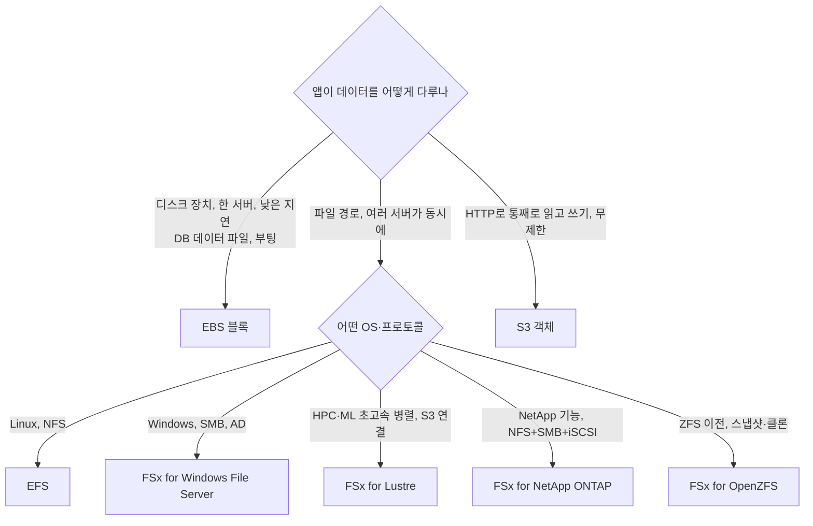
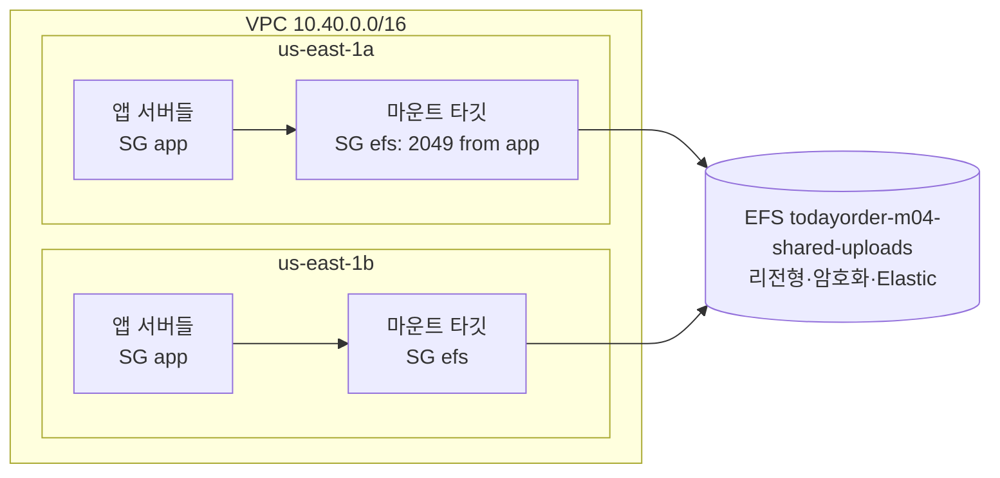

# M04-06. 파일 스토리지(EFS, FSx 4종)와 블록·파일·객체의 선택
> 도메인: D3 · 예상 시간: 45분 · 실습 등급: 🟡 (EFS 구성까지. NFS 마운트는 불가)

## 왜 필요한가

TodayOrder의 레거시 "가게 관리자 페이지"는 PHP 앱이라 업로드된 메뉴판 PDF를 `/var/app/uploads`라는 **디렉터리 경로**로 읽고 쓴다. S3 API로 바꾸려면 코드를 많이 고쳐야 한다. 그런데 서버를 2개 AZ에 3대씩 띄우자, 한 서버에 올린 파일이 다른 서버에는 없다. EBS 볼륨은 한 서버(한 AZ)에만 붙는다. "**여러 서버가 동시에 마운트하는 공유 디렉터리**"가 필요하다. 그리고 회계팀의 윈도 PC들은 사내 파일 서버(SMB, Active Directory)를 AWS로 옮기고 싶어 한다.

## 핵심 개념

### 블록 vs 파일 vs 객체

| | 블록 | 파일 | 객체 |
|---|---|---|---|
| AWS 서비스 | EBS, 인스턴스 스토어 (M03) | **EFS, FSx** | S3 |
| 보이는 모습 | 포맷 안 된 디스크(`/dev/xvdf`). OS가 파일 시스템을 올린다 | 마운트하는 디렉터리 트리(NFS/SMB) | 버킷 + 키, HTTP API |
| 동시 접근 | 보통 인스턴스 1대 (io1/io2 Multi-Attach는 같은 AZ 최대 16대, 클러스터 인식 파일 시스템 필요) | 수백~수천 클라이언트 동시 | 무제한 |
| 범위 | 1 AZ | EFS 리전형은 여러 AZ, One Zone은 1 AZ | 리전 |
| 부분 수정 | 블록 단위로 제자리 수정 | 파일 일부 수정·잠금 가능 | 객체 통째로 다시 씀 |
| 대표 용도 | 부팅 디스크, DB 데이터 파일 | 공유 홈·웹 콘텐츠·CMS·컨테이너 공유 볼륨 | 이미지·백업·로그·데이터 레이크 |



### Amazon EFS

**완전 관리형 NFS**(NFSv4.0/4.1)다. 리눅스 인스턴스·컨테이너·Lambda가 마운트한다. 용량을 미리 정하지 않는다. 쓰는 만큼 자동으로 늘고 줄며 쓴 만큼 낸다.

- **파일 시스템 유형**: 리전형(Regional, 여러 AZ에 저장) / One Zone(1 AZ, 더 쌈).
- **마운트 타깃**: VPC의 **AZ마다 하나**씩 만드는 NFS 엔드포인트(ENI)다. 같은 AZ의 인스턴스는 그 AZ의 마운트 타깃으로 붙는다. 마운트 타깃의 보안 그룹은 **TCP 2049(NFS)** 인바운드를 앱 서버 보안 그룹에서만 허용한다.
- **스토리지 클래스**: Standard / Infrequent Access(IA) / Archive. 수명 주기 정책으로 N일 동안 접근하지 않은 파일을 옮긴다. IA·Archive는 파일당 최소 과금 크기(128 KiB)가 있고 Archive는 최소 보관 90일이다.
- **처리량 모드**: **Elastic**(권장, 사용량에 맞춰 자동), Provisioned(고정 처리량 구매), Bursting(저장량에 비례한 크레딧).
- **성능 모드**: General Purpose(권장, 낮은 지연). Max I/O는 이전 세대 모드다.
- **액세스 포인트**: 앱마다 루트 디렉터리와 POSIX 사용자(UID/GID)를 강제하는 입구. 컨테이너·Lambda에서 자주 쓴다.
- **보안**: 저장 암호화(KMS), 전송 암호화(TLS 마운트), 파일 시스템 정책(IAM 리소스 정책)으로 "TLS 아닌 마운트 거부" 같은 규칙을 둔다.
- **백업**: AWS Backup 자동 백업. **복제**: 다른 리전/AZ로 EFS 복제.

### Amazon FSx 4종

| | 프로토콜·OS | 이럴 때 | 시험 키워드 |
|---|---|---|---|
| **FSx for Windows File Server** | SMB, Windows, **Active Directory** 연동, NTFS ACL, DFS | 사내 윈도 파일 서버 이전, .NET·SharePoint 같은 윈도 앱 | "SMB", "Windows", "AD" |
| **FSx for Lustre** | Lustre(리눅스) 병렬 파일 시스템 | HPC, ML 학습, 금융 시뮬레이션, 영상 렌더링. **S3 버킷을 연결**해 객체를 파일로 읽고 결과를 S3에 씀 | "HPC", "초고속 처리량", "S3 데이터를 파일 시스템으로" |
| **FSx for NetApp ONTAP** | NFS, SMB, **iSCSI** 동시 | 사내 NetApp 이전, 스냅샷·클론·중복 제거·압축, 리눅스·윈도 혼합 | "멀티 프로토콜", "NetApp" |
| **FSx for OpenZFS** | NFS (ZFS) | 사내 ZFS 파일 서버 이전, 순간 스냅샷·클론 | "ZFS" |

Lustre의 배포 유형: **Scratch**(임시 처리, 복제 없음, 싸다) vs **Persistent**(장기, AZ 안에서 복제).

## 직접 해 보기

[lab10-efs-file-system.sh](./labs/lab10-efs-file-system.sh) — 레거시 앱용 공유 업로드 디렉터리를 만든다.



**1) 네트워크와 파일 시스템**

```
== 1. 네트워크: VPC 10.40.0.0/16, 프라이빗 서브넷 2개(us-east-1a, 1b), NFS 보안 그룹
VPC=vpc-000000000000000ba  subnets=subnet-000000000000000c2,subnet-000000000000000c4  efs-sg=sg-000000000000000c8
== 2. 파일 시스템 생성 (리전형=여러 AZ, 암호화, General Purpose, Elastic 처리량)
{
    "Id": "fs-ee521d7a0f4d38726",
    "State": "creating",
    "Perf": "generalPurpose",
    "Throughput": "elastic",
    "Encrypted": true
}
→ available
== 3. 같은 CreationToken 으로 또 만들기 → FileSystemAlreadyExists (생성 요청의 멱등성 키)
aws: [ERROR]: An error occurred (FileSystemAlreadyExists) when calling the CreateFileSystem operation: File system 'fs-ee521d7a0f4d38726' already exists with creation token 'todayorder-m04-shared-uploads'
Additional error details:
ErrorCode: FileSystemAlreadyExists
FileSystemId: fs-ee521d7a0f4d38726
```

방금 본 것: `CreationToken`은 "같은 요청을 재시도해도 파일 시스템이 두 개 생기지 않게" 하는 멱등성 키다. 네트워크 오류로 재시도할 때 중복 생성을 막는다.

**2) 마운트 타깃 — AZ당 하나**

```
== 4. AZ마다 마운트 타깃 하나씩
{
    "Id": "fsmt-f16952ee72f3454f2",
    "Subnet": "subnet-000000000000000c2",
    "State": "creating"
}
{
    "Id": "fsmt-0c7de8064963bab0c",
    "Subnet": "subnet-000000000000000c4",
    "State": "creating"
}
→ 마운트 타깃 2개 available
-- 같은 서브넷(us-east-1a)에 두 번째 마운트 타깃 → MountTargetConflict (AZ당 하나)
aws: [ERROR]: An error occurred (MountTargetConflict) when calling the CreateMountTarget operation: File system fs-ee521d7a0f4d38726 already has mount target fsmt-f16952ee72f3454f2 in Availability Zone us-east-1c
Additional error details:
ErrorCode: MountTargetConflict
마운트 타깃 수: 2
```

> ⚠️ **에뮬레이터 한계** (1.0.322에서 관찰한 사실만):
> - 같은 AZ의 **다른 서브넷**에 두 번째 마운트 타깃을 만들면 충돌하지 않고 **만들어진다**(실제 AWS는 `MountTargetConflict`). 충돌은 **같은 서브넷**으로 다시 만들 때만 난다. 그래서 lab10은 같은 서브넷으로 충돌을 재현한다.
> - 마운트 타깃의 AZ 표시가 서브넷의 AZ와 다를 수 있다(위 오류 메시지의 AZ가 `us-east-1a`가 아니다). 그래서 lab10은 AZ를 출력하지 않는다. 실제 AWS에서는 마운트 타깃이 지정한 서브넷의 AZ와 IP 대역을 따른다.

**3) 액세스 포인트·수명 주기·백업·정책**

```
== 5. 액세스 포인트: 앱은 /uploads 를 루트로, UID/GID 1000 으로만 본다
{
    "Id": "fsap-d254741f599dc6f79",
    "Path": "/uploads",
    "Uid": 1000
}
== 6. 수명 주기: 30일 미접근 → IA, 90일 → Archive, 한 번 읽으면 Standard 로 복귀
{
    "LifecyclePolicies": [
        {
            "TransitionToIA": "AFTER_30_DAYS"
        },
        {
            "TransitionToArchive": "AFTER_90_DAYS"
        },
        {
            "TransitionToPrimaryStorageClass": "AFTER_1_ACCESS"
        }
    ]
}
== 7. 자동 백업(AWS Backup) 켜기, TLS 아닌 마운트 거부 정책
ENABLING
fs-ee521d7a0f4d38726
== 8. 마운트 타깃이 남은 파일 시스템 삭제 → FileSystemInUse
aws: [ERROR]: An error occurred (FileSystemInUse) when calling the DeleteFileSystem operation: File system 'fs-ee521d7a0f4d38726' still has 2 mount target(s); delete them first
Additional error details:
ErrorCode: FileSystemInUse
== 9. 정리 (액세스 포인트 → 마운트 타깃 → 파일 시스템 → 네트워크)
남은 파일 시스템: 0
LAB10 OK
```

방금 본 것: 마운트 타깃은 `creating`으로 시작하므로 lab10은 `available`이 될 때까지 기다린 뒤 다음 단계로 간다. 파일 시스템 정책은 처음에 `Action: "*"`를 Deny하도록 썼더니 에뮬레이터가 `InvalidPolicyException: This policy would prevent future FileSystemPolicy updates`로 거부했다(정책 잠금 방지 검사 — 실제 AWS와 같은 안전장치). 그래서 lab10은 클라이언트 동작(`ClientMount`·`ClientWrite`·`ClientRootAccess`)만 Deny한다. 삭제는 생성의 역순으로 한다.

## 실제 AWS에서는

- 실제로는 EC2에서 `sudo mount -t efs -o tls fs-xxxx:/ /var/app/uploads`(amazon-efs-utils)로 마운트하고, 한 서버에서 쓴 파일을 다른 AZ의 서버에서 바로 읽는다. 에뮬레이터의 EC2는 부팅하지 않고 마운트 타깃도 실제 NFS 서버가 아니라서 이 부분은 볼 수 없다.
- 마운트 타깃은 실제로 지정 서브넷의 IP를 받는다(위 ⚠️).
- **실제 AWS에서 해 보려면**: EFS는 쓴 만큼(GB-월) 과금되므로 MB 단위 실습이면 비용이 아주 적다(프리 티어 적용 여부는 계정 생성 시기에 따라 다르니 AWS 프리 티어 페이지에서 확인). 마운트해 볼 EC2 인스턴스 요금이 더 크다. t3.micro 두 대를 다른 AZ에 띄우고 위 마운트 명령으로 같은 파일을 읽어 보자. **정리 순서**: 인스턴스 종료 → `aws efs delete-access-point` → `aws efs delete-mount-target`(두 개) → 마운트 타깃이 사라질 때까지 대기 → `aws efs delete-file-system`. FSx는 프리 티어가 없고 시간당 요금이 크므로 실습하지 않는다.

## 시험 포인트

- "여러 EC2(여러 AZ)가 같은 파일을 동시에, 리눅스, 용량 자동" → **EFS**. "한 인스턴스의 고성능 디스크" → **EBS**. "HTTP로 접근하는 무제한 저장" → **S3**.
- "EFS 비용 절감, 오래 안 읽는 파일" → EFS 수명 주기(IA/Archive). "한 AZ면 충분, 더 싸게" → EFS One Zone.
- "윈도·SMB·AD" → **FSx for Windows File Server**. "HPC·ML, S3 데이터를 고속 파일 시스템으로" → **FSx for Lustre**. "NFS+SMB+iSCSI, NetApp" → **FSx for NetApp ONTAP**. "ZFS" → **FSx for OpenZFS**.
- EFS는 **리눅스(NFS)** 전용이다. 윈도 인스턴스 공유 파일이면 FSx for Windows다.
- "컨테이너·Lambda가 각자 다른 디렉터리·UID로 같은 EFS 사용" → **EFS 액세스 포인트**.

## 스스로 확인

1. 마운트 타깃을 us-east-1a에만 만들었다. us-east-1b의 인스턴스가 EFS를 쓸 수 있는가? 왜 AZ마다 만들라고 하는가?
2. 레거시 PHP 앱(리눅스)과 회계팀 윈도 PC가 **같은 파일**을 각각 NFS와 SMB로 열어야 한다. 무엇을 고르는가?
3. 동영상 렌더링 팀이 S3에 있는 원본 영상 200 TB를 수백 대의 인스턴스에서 병렬로 읽어 처리하려 한다. EFS와 FSx for Lustre 중 무엇이 맞고 이유는?

<details><summary>답</summary>

1. 리전형 EFS라면 다른 AZ의 마운트 타깃 IP로 붙을 수는 있다. 하지만 AZ 간 데이터 전송 요금이 나오고, 1a가 장애 나면 1b 인스턴스도 파일 시스템을 못 쓴다. 가용성과 비용 때문에 인스턴스가 있는 AZ마다 마운트 타깃을 둔다.
2. FSx for NetApp ONTAP(같은 볼륨을 NFS·SMB로 동시에 제공). EFS는 SMB를 지원하지 않고, FSx for Windows는 NFS 리눅스 앱에 맞지 않는다.
3. FSx for Lustre. 대규모 병렬 처리량에 맞춘 파일 시스템이고 S3 버킷을 데이터 저장소로 연결해 객체를 파일로 읽고 결과를 S3로 내보낸다. EFS는 범용 공유 파일 시스템이다.

</details>
