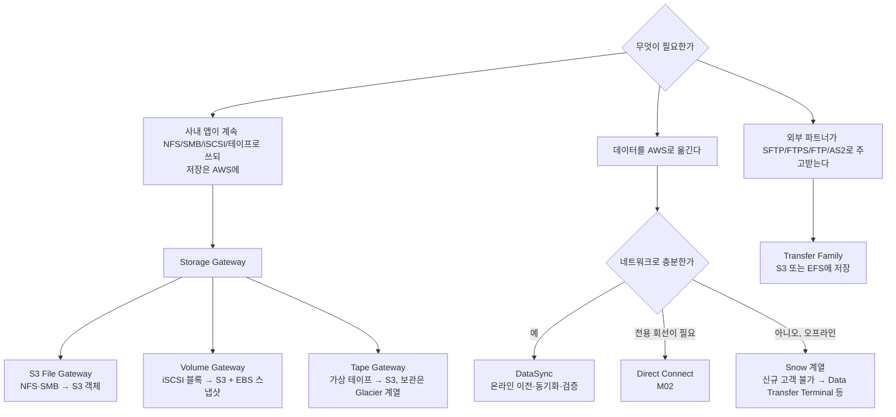

# M04-07. 하이브리드·이전: Storage Gateway, DataSync, Snow 패밀리, Transfer Family
> 도메인: D2, D3 · 예상 시간: 40분 · 실습 등급: 🟡 (구성까지, 데이터 이동 없음) · 일부 🔴 (501)

## 왜 필요한가

TodayOrder가 오프라인 매장 체인을 인수했다. 본사 사무실에는 10년 치 주문 기록 40 TB가 NAS에 있고, 매장 POS 서버는 매일 밤 테이프로 백업한다. 회계 협력사는 정산 파일을 SFTP로만 주고받겠다고 한다. 모든 것을 한 번에 AWS로 옮길 수는 없다. "**사내 시스템은 그대로 쓰면서 저장은 AWS로**", "**대량 데이터를 안전하게 한 번에 옮기기**", "**옛 프로토콜로 S3에 파일 넣기**"가 각각 필요하다.

## 핵심 개념

### 상황별 서비스 지도



### AWS Storage Gateway

사내(온프레미스)에 **게이트웨이 VM이나 하드웨어 어플라이언스**를 설치한다. 사내 서버는 익숙한 프로토콜로 게이트웨이와 통신하고, 게이트웨이는 데이터를 AWS에 저장하면서 자주 쓰는 데이터를 **로컬 캐시**에 둔다.

| 유형 | 사내 쪽 프로토콜 | AWS 쪽 저장 | 이럴 때 |
|---|---|---|---|
| **S3 File Gateway** | NFS, SMB | S3 객체(파일 1개 = 객체 1개). S3 기능(수명 주기, 버전, 이벤트) 그대로 사용 | 사내 앱이 파일로 쓰는 데이터를 S3에 쌓아 분석·보관 |
| **Volume Gateway — 캐시 모드(cached)** | iSCSI 블록 | 기본 데이터는 S3, **자주 쓰는 데이터만** 로컬 | 사내 스토리지 용량을 늘리지 않고 블록 볼륨 확장 |
| **Volume Gateway — 저장 모드(stored)** | iSCSI 블록 | **전체 데이터가 로컬**, AWS에는 비동기 스냅샷(EBS 스냅샷) | 로컬 저지연이 필요하고 AWS는 백업·DR용 |
| **Tape Gateway** | iSCSI 가상 테이프 라이브러리(VTL) | 가상 테이프는 S3, 보관(archive)하면 **Glacier Flexible Retrieval/Deep Archive** | 기존 백업 소프트웨어의 테이프 작업을 그대로 유지하며 물리 테이프 제거 |

FSx File Gateway(사내에서 FSx for Windows를 캐시하는 유형)는 **신규 고객에게 더 이상 제공되지 않는다**. 시험에서는 위 세 유형 위주로 나온다.

### AWS DataSync

NFS·SMB·HDFS·다른 오브젝트 스토리지와 AWS 스토리지(S3, EFS, FSx) 사이를 **온라인으로** 복사·동기화한다. 사내에서 읽으려면 **DataSync 에이전트**(VM)가 필요하다. AWS 스토리지끼리는 에이전트 없이도 된다. 증분 전송, 전송 중 무결성 검증, 대역폭 제한, 스케줄을 지원한다. "**Storage Gateway는 계속 쓰는 하이브리드 통로**, **DataSync는 옮기는 도구**"로 구분한다.

### Snow 패밀리 — 현재 상태에 주의

물리 장비를 받아 데이터를 담아 보내는 오프라인 이전 서비스다. 시험 자료에 자주 나오지만 **현황이 크게 바뀌었다**.
- Snowcone: 2024-11-12 단종(기존 고객 지원도 2025-11-12 종료).
- Snowball Edge: **2025-11-07부터 신규 고객에게 제공되지 않는다**(기존 고객만 사용). AWS는 2026-12-31에 상용 리전의 Snowball 지원 종료를 예고했다.
- AWS가 권하는 대안: 온라인은 **DataSync**, 물리 이전은 **AWS Data Transfer Terminal**(AWS 시설에 장비를 직접 가져가 고속 업로드), 엣지 컴퓨팅은 **Outposts**.

시험(SAA-C03)은 여전히 "네트워크로 몇 주\~몇 달 걸리는 수십 TB\~PB 데이터 → Snowball"을 정답으로 기대할 수 있다. **개념(대역폭 계산 → 오프라인 이전)은 알아 두고, 실무에서는 현재 제공 여부를 확인**한다.

**대역폭 계산 감각**: 40 TB를 100 Mbps 회선으로 보내면? 40 × 8 × 10^12 비트 ÷ 10^8 비트/초 = 3.2 × 10^6 초 ≈ **37일**(회선을 100% 쓴다는 가정). 1 Gbps면 약 3.7일이다.

### AWS Transfer Family

SFTP·FTPS·FTP·AS2(그리고 웹 앱) 엔드포인트를 관리형으로 제공하고, 파일을 **S3 또는 EFS**에 저장한다. 사용자 인증은 서비스 관리형(SSH 키), Directory Service, 사용자 지정 ID 공급자(Lambda/API Gateway) 중에서 고른다. "파트너가 SFTP만 쓴다, 우리는 서버를 운영하기 싫다"면 Transfer Family다.

## 직접 해 보기

[lab11-hybrid-transfer.sh](./labs/lab11-hybrid-transfer.sh) — 실제 게이트웨이 장비도 사내망도 없으므로 **AWS 쪽 구성**만 만들어 본다. 각 서비스가 S3에 접근하려면 역할이 필요하니, 스크립트는 실제처럼 역할(신뢰 정책 + S3 권한)을 먼저 만든다.

**1) Storage Gateway**

```
== 1. Storage Gateway — S3 File Gateway 활성화
   (실제로는 사내에 게이트웨이 VM/하드웨어를 설치하고 그 장비에서 활성화 키를 받는다. 여기서는 임의의 키)
{
    "Name": "todayorder-m04-file-gw",
    "Type": "FILE_S3",
    "State": "RUNNING"
}
-- NFS 파일 공유: 사내 서버(10.0.0.0/16)가 NFS 로 마운트하면, 파일이 S3 객체로 저장된다
[
    {
        "Type": "NFS",
        "Status": "AVAILABLE"
    }
]
-- SMB 파일 공유(윈도 클라이언트용) → 에뮬레이터 501
aws: [ERROR]: An error occurred (NotImplemented) when calling the CreateSMBFileShare operation: operation CreateSMBFileShare is scaffolded but not implemented in this emulator
== 2. Volume Gateway(캐시 모드) / Tape Gateway — 게이트웨이는 활성화되지만 볼륨·테이프 생성은 501
aws: [ERROR]: An error occurred (NotImplemented) when calling the CreateCachediSCSIVolume operation: operation CreateCachediSCSIVolume is scaffolded but not implemented in this emulator
aws: [ERROR]: An error occurred (NotImplemented) when calling the CreateTapes operation: operation CreateTapes is scaffolded but not implemented in this emulator
{"GatewayName":"todayorder-m04-file-gw","GatewayType":"FILE_S3"}
{"GatewayName":"todayorder-m04-volume-gw","GatewayType":"CACHED"}
{"GatewayName":"todayorder-m04-tape-gw","GatewayType":"VTL"}
```

방금 본 것: 게이트웨이 유형(`FILE_S3`, `CACHED`, `VTL`)이 곧 위 표의 세 가지다. 에뮬레이터는 아무 활성화 키나 받아 주고 S3 NFS 공유까지 만들지만, 그 공유에 실제로 마운트할 장비는 없다. SMB 공유·iSCSI 볼륨·가상 테이프 생성은 501이다.

**2) DataSync**

```
== 3. DataSync — S3 → S3 이전 작업
작업 상태: AVAILABLE
{
    "Status": "SUCCESS",
    "FilesTransferred": 0,
    "BytesTransferred": 0
}
대상 버킷 객체 수: 0   ← 에뮬레이터는 작업 상태만 SUCCESS 로 바꾸고 실제로 복사하지 않는다
-- 온프레미스 NFS 위치(에이전트 필요) → 501
aws: [ERROR]: An error occurred (NotImplemented) when calling the CreateLocationNfs operation: operation CreateLocationNfs is scaffolded but not implemented in this emulator
```

방금 본 것: 위치(location) 2개 → 작업(task) → 실행(execution)이라는 DataSync의 구조는 그대로다. 하지만 원본에 파일이 있는데도 **0개 전송·SUCCESS**다. 에뮬레이터의 "성공"을 그대로 믿으면 안 되는 대표 사례다.

**3) Transfer Family**

```
== 4. Transfer Family — S3 에 저장하는 관리형 SFTP 서버 (협력사가 정산 파일을 SFTP 로 올린다)
{
    "Protocols": [
        "SFTP"
    ],
    "Domain": "S3",
    "State": "ONLINE",
    "Endpoint": "PUBLIC"
}
== 5. 정리
LAB11 OK
```

## 실제 AWS에서는

- Storage Gateway는 **사내에 게이트웨이를 설치**(VMware/Hyper-V/KVM VM, 또는 EC2)하고 그 장비의 80번 포트에서 활성화 키를 받는다. 에뮬레이터처럼 임의 키로는 활성화되지 않는다.
- DataSync는 실제로 파일을 복사하고, 작업 보고서와 CloudWatch 지표로 전송 건수·바이트·검증 결과를 보여 준다.
- **실제 AWS에서 해 보려면**:
  - DataSync S3→S3 작업은 에이전트 없이 해 볼 수 있다. **GB당 요금**이 붙으니 KB 단위 파일만 쓴다. 정리: `aws datasync delete-task`, `aws datasync delete-location`.
  - Storage Gateway는 EC2에 게이트웨이 AMI를 띄워 체험할 수 있다. 다만 게이트웨이용 인스턴스(권장 사양이 큼)와 캐시용 EBS 요금이 나오므로 짧게 쓰고 `aws storagegateway delete-gateway` 후 **EC2·EBS도 삭제**한다.
  - Transfer Family 서버는 **켜져 있는 시간만큼 시간당 요금**이 나온다(프리 티어 없음). 만들었다면 바로 `aws transfer delete-server --server-id <id>`.
  - Snow 장비 주문은 신규 고객에게 열려 있지 않으므로 해 보지 않는다.

## 시험 포인트

- "사내 앱이 NFS/SMB로 쓰는 파일을 S3에 저장, 로컬 캐시로 저지연" → **S3 File Gateway**.
- "사내 iSCSI 볼륨, 기본 데이터는 AWS, 자주 쓰는 것만 로컬" → **Volume Gateway 캐시 모드**. "전체를 로컬에 두고 AWS는 백업" → **저장 모드**.
- "테이프 백업 소프트웨어를 바꾸지 않고 물리 테이프를 없애고 싶다" → **Tape Gateway**(보관은 Glacier 계열).
- "온프레미스 NAS → S3/EFS/FSx로 온라인 대량 이전·주기적 동기화, 무결성 검증" → **DataSync**.
- "수십 TB 이상인데 회선으로는 몇 주~몇 달" → 오프라인 이전(**Snowball** — 시험 맥락. 실제로는 신규 고객 불가, 대안 확인). "꾸준히 쓰는 전용 회선" → **Direct Connect**.
- "파트너가 SFTP/FTPS/AS2로 S3에 파일 전송, 서버 운영 없이" → **Transfer Family**.

## 스스로 확인

1. 매장 POS 백업 소프트웨어가 "테이프 라이브러리"에만 백업할 수 있다. 백업을 AWS로 보내면서 소프트웨어는 그대로 두고 싶다. 무엇을 쓰는가? 10년 보관용 테이프는 어디에 보관되는가?
2. 본사 NAS 40 TB를 한 번 옮기고, 이후 한 달 동안은 바뀐 파일만 매일 밤 동기화하려 한다. 회선은 1 Gbps다. 무엇을 쓰는가?
3. lab11에서 DataSync 실행 상태가 `SUCCESS`였다. 이 결과로 "이전이 끝났다"고 보고해도 되는가?

<details><summary>답</summary>

1. Tape Gateway(가상 테이프 라이브러리). 백업 소프트웨어는 iSCSI VTL을 진짜 테이프 라이브러리처럼 쓴다. 가상 테이프는 S3에 있다가, 보관(archive)하면 Glacier Flexible Retrieval이나 Deep Archive 풀로 옮겨진다.
2. DataSync. 1 Gbps면 40 TB가 이론상 약 3.7일이라 온라인 이전이 현실적이고, 증분 동기화·스케줄·검증이 DataSync의 기능이다. 사내에 DataSync 에이전트를 설치한다.
3. 안 된다. 에뮬레이터는 0개를 전송하고도 SUCCESS를 돌려줬다. 실제 AWS에서도 상태만 보지 말고 `FilesTransferred`·검증 결과·대상 객체 수를 확인하는 습관이 필요하다.

</details>
