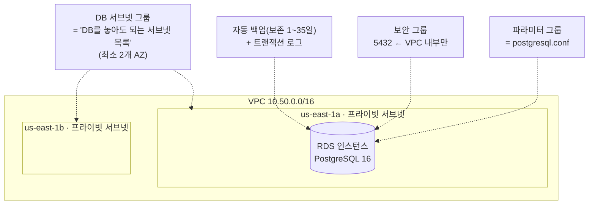

# M05-01. RDS 기본 — 엔진, 서브넷·파라미터 그룹, 백업·스냅샷·PITR
> 도메인: D2, D3 · 예상 시간: 50분 · 실습 등급: 🟡

## 왜 필요한가

TodayOrder의 주문 데이터는 지금 API 서버와 같은 EC2 한 대 안의 PostgreSQL에 있다. 디스크가 차면 직접 늘리고, 백업은 새벽 cron의 `pg_dump`, 마이너 패치는 "언젠가"다. 그 서버가 죽으면 주문도 같이 죽는다. 팀장은 말한다. "DB 운영은 AWS에 맡기고, 우리는 스키마와 쿼리에 집중하자." 그 선택지가 **Amazon RDS(Relational Database Service)** 다.

## 핵심 개념

### RDS가 대신해 주는 것, 내가 계속 하는 것

| AWS가 한다 (관리형) | 내가 한다 |
|---|---|
| 하드웨어·OS·DB 엔진 설치와 패치(유지 관리 기간에) | 스키마, 인덱스, 쿼리 튜닝 |
| 자동 백업과 시점 복원(PITR) | 백업 보존 기간·백업 기간 선택 |
| Multi-AZ 장애 조치, 읽기 전용 복제본 생성 | 무엇을 켤지 결정, 앱의 재연결 처리 |
| 스토리지 확장(자동 확장 옵션) | 인스턴스 클래스·스토리지 유형 선택 |
| 저장 데이터 암호화(KMS) | 보안 그룹·서브넷 배치, 비밀번호 관리 |

반대로 **OS에 SSH로 들어갈 수 없다.** OS 수준 접근이 꼭 필요하면(특정 에이전트 설치 등) RDS Custom(Oracle·SQL Server)이나 EC2에 직접 설치하는 선택지가 남는다. 시험에서 "OS 접근 필요"가 나오면 RDS(일반)는 오답이다.

### 엔진

RDS가 지원하는 엔진: **PostgreSQL, MySQL, MariaDB, Oracle, SQL Server, Db2**, 그리고 AWS가 만든 **Aurora**(MySQL·PostgreSQL 호환, 레슨 3). 에뮬레이터에서 PostgreSQL 엔진 버전을 조회하면 이렇게 나온다.

```bash
aws rds describe-db-engine-versions --engine postgres --query 'DBEngineVersions[].[EngineVersion,DBParameterGroupFamily]' --output text
```

```
11.22-rds.20241121	postgres11
13.16	postgres13
14.13	postgres14
15.8	postgres15
16.3	postgres16
16.4	postgres16
17.2	postgres17
18.3	postgres18
```

### RDS 인스턴스를 이루는 부품



| 부품 | 한 줄 정의 | 왜 |
|---|---|---|
| **DB 서브넷 그룹** | RDS가 인스턴스를 놓을 수 있는 서브넷 묶음. 2개 이상의 AZ를 포함해야 한다 | Multi-AZ 대기 인스턴스·복제본을 다른 AZ에 둘 수 있게 |
| **파라미터 그룹** | 엔진 설정(`postgresql.conf`, `my.cnf`)을 대신하는 설정 묶음. 기본 그룹은 수정 불가 → 사용자 그룹을 만들어 붙인다 | `ApplyType`이 `dynamic`이면 즉시, `static`이면 재부팅 후 적용 |
| **옵션 그룹** | 엔진 부가 기능(Oracle TDE, SQL Server 네이티브 백업 등) | 주로 Oracle·SQL Server |
| **보안 그룹** | 인스턴스 앞 상태 저장 방화벽(M02) | DB 포트를 앱 서버 SG(또는 VPC 내부)에서만 연다 |
| **퍼블릭 접근(PubliclyAccessible)** | 퍼블릭 IP를 줄지 | 운영 DB는 `false` + 프라이빗 서브넷이 정석 |

### 백업 세 가지: 자동 백업, 수동 스냅샷, 시점 복원(PITR)

| | 자동 백업 | 수동 스냅샷 | 시점 복원(PITR) |
|---|---|---|---|
| 누가 만드나 | RDS가 매일 백업 기간에 + 트랜잭션 로그 | 사람이(`create-db-snapshot`) | 자동 백업 + 로그로 재구성 |
| 보존 | 보존 기간(1~35일, 0이면 끔) 지나면 삭제 | **직접 지울 때까지** | 보존 기간 안의 아무 시각(초 단위) |
| 인스턴스 삭제 시 | 기본은 함께 삭제(유지 옵션 있음) | 남는다 | — |
| 복원 결과 | — | **새 인스턴스**(새 엔드포인트) | **새 인스턴스**(새 엔드포인트) |

- 자동 백업이 켜져 있으면 `LatestRestorableTime`(보통 현재보다 수 분 전)까지 PITR이 된다. 트랜잭션 로그는 약 5분마다 S3에 올라간다.
- 복원은 언제나 **새 인스턴스**를 만든다. 기존 인스턴스를 그 자리에서 되돌리지 않는다. 그래서 복원 후에는 앱의 접속 주소를 바꾸거나 이름을 바꿔치기해야 한다.
- **자동 백업 보존 기간이 0이면 읽기 전용 복제본도 만들 수 없다**(레슨 2에서 직접 본다).
- 스냅샷은 다른 리전으로 복사(DR, M12)하거나 다른 계정과 공유할 수 있다. 암호화된 스냅샷을 공유하려면 고객 관리형 KMS 키여야 한다.

### 암호화는 생성할 때 정한다

`--storage-encrypted`(KMS)는 **생성 시에만** 켤 수 있다. 이미 암호화되지 않은 DB를 암호화하려면: 스냅샷 → 스냅샷을 암호화하며 복사 → 그 스냅샷에서 복원. 시험 단골이다.

## 직접 해 보기

[labs/lab01-rds-instance-backup.sh](./labs/lab01-rds-instance-backup.sh)를 실행한다. 아래는 실제 실행 출력이다(ID·포트·시각은 실행마다 다르다).

```bash
export EMULATOR_PORT=9297   # 터미널에서 직접 실행하면 생략 가능
bash curriculum/m05-databases/labs/lab01-rds-instance-backup.sh
```

**1) 네트워크와 DB 서브넷 그룹**

```bash
aws rds create-db-subnet-group --db-subnet-group-name todayorder-m05-db-subnets \
  --db-subnet-group-description "TodayOrder private DB subnets" \
  --subnet-ids "$SUBNET_A" "$SUBNET_B" \
  --query 'DBSubnetGroup.{Name: DBSubnetGroupName, Status: SubnetGroupStatus, AZs: Subnets[].SubnetAvailabilityZone.Name}'
```

```
{
    "Name": "todayorder-m05-db-subnets",
    "Status": "Complete",
    "AZs": [
        "us-east-1a",
        "us-east-1b"
    ]
}
```

방금 본 것: 스크립트는 먼저 `10.50.0.0/16` VPC에 프라이빗 서브넷 두 개(1a, 1b)와 "VPC 안에서만 5432 허용" 보안 그룹을 만든다(M02 복습). 서브넷 그룹은 그 서브넷들을 RDS에 알려 주는 목록이다.

**2) 파라미터 그룹 — 느린 쿼리 로그를 500ms로**

```bash
aws rds modify-db-parameter-group --db-parameter-group-name todayorder-m05-pg16 \
  --parameters "ParameterName=log_min_duration_statement,ParameterValue=500,ApplyMethod=immediate"
aws rds describe-db-parameters --db-parameter-group-name todayorder-m05-pg16 --source user \
  --query 'Parameters[].{Name: ParameterName, Value: ParameterValue, ApplyType: ApplyType}'
```

```
[
    {
        "Name": "log_min_duration_statement",
        "Value": "500",
        "ApplyType": "dynamic"
    }
]
```

방금 본 것: `dynamic` 파라미터라 `immediate`로 적용할 수 있다. `shared_buffers` 같은 `static` 파라미터는 `pending-reboot`로만 적용된다.

**3) 인스턴스 생성 → waiter → 확인**

```bash
aws rds create-db-instance --db-instance-identifier todayorder-m05-db \
  --engine postgres --engine-version 16.3 --db-instance-class db.t3.micro \
  --allocated-storage 20 --storage-type gp3 --storage-encrypted \
  --master-username todayorder --master-user-password 'Lab-only-Passw0rd' \
  --db-subnet-group-name todayorder-m05-db-subnets --vpc-security-group-ids "$DB_SG" \
  --db-parameter-group-name todayorder-m05-pg16 --backup-retention-period 7 \
  --no-publicly-accessible --deletion-protection
aws rds wait db-instance-available --db-instance-identifier todayorder-m05-db
```

```
{
    "Status": "available",
    "AZ": "us-east-1a",
    "Endpoint": "127.0.0.1",
    "Port": 39821,
    "Encrypted": true,
    "Public": false,
    "BackupRetention": 7,
    "BackupWindow": "07:00-07:30",
    "DeletionProtection": true,
    "ParamGroup": "todayorder-m05-pg16",
    "SG": "sg-0000000000000008c"
}
LatestRestorableTime=2026-11-12T12:05:57.016835+00:00  (자동 백업이 켜져 있으면 '여기까지는 되돌릴 수 있다'는 시각이 생긴다)
```

방금 본 것: 생성 응답은 `creating`, waiter가 `available`까지 기다렸다. **`Endpoint`가 `127.0.0.1:<임의 포트>`** 인 것은 에뮬레이터의 특징이다. 이 포트는 에뮬레이터 컨테이너 안에서만 열려 있어(실제 PostgreSQL 엔진이 컨테이너 안에서 뜬다) 내 PC의 `psql`로는 접속할 수 없다. 실제 AWS의 엔드포인트는 `todayorder-m05-db.xxxx.us-east-1.rds.amazonaws.com:5432` 같은 DNS 이름이다. 이 모듈은 SQL 접속 실습을 하지 않는다.

**4) 수동 스냅샷 → 스냅샷에서 "새" 인스턴스로 복원**

```
{
    "Id": "todayorder-m05-db-snap-manual",
    "Type": "manual",
    "Status": "available",
    "Encrypted": true,
    "Engine": "16.3"
}
...
------------------------------------------------------
|                 DescribeDBInstances                |
+-----------------------------+-------------+--------+
|  todayorder-m05-db          |  available  |  39821 |
|  todayorder-m05-db-restored |  available  |  40901 |
+-----------------------------+-------------+--------+
```

방금 본 것: 암호화된 인스턴스의 스냅샷은 자동으로 암호화된다. 복원하면 **원본과 별개인 두 번째 인스턴스**가 자기 엔드포인트(포트)를 갖고 생긴다.

**5) 시점 복원(PITR) — 에뮬레이터 미구현**

```bash
aws rds restore-db-instance-to-point-in-time --source-db-instance-identifier todayorder-m05-db \
  --target-db-instance-identifier todayorder-m05-db-pitr --use-latest-restorable-time \
  --db-subnet-group-name todayorder-m05-db-subnets
```

```
aws: [ERROR]: An error occurred (NotImplemented) when calling the RestoreDBInstanceToPointInTime operation: operation RestoreDBInstanceToPointInTime is scaffolded but not implemented in this emulator
```

방금 본 것: `LatestRestorableTime`은 보여 주지만 PITR 복원 자체는 501이다. 자동 백업 목록(`describe-db-instance-automated-backups`)도 501이고, `describe-db-snapshots --snapshot-type automated`는 빈 목록이다. 개념은 아래 "실제 AWS에서는"으로 보충한다.

**6) 삭제 방지와 최종 스냅샷**

```
aws: [ERROR]: An error occurred (InvalidParameterCombination) when calling the DeleteDBInstance operation: Cannot delete protected DB Instance, please disable deletion protection and try again.
-- 삭제 방지를 끄고, 최종 스냅샷을 남기며 삭제
false
-- 최종 스냅샷 이름도, --skip-final-snapshot 도 주지 않으면?
aws: [ERROR]: An error occurred (InvalidParameterCombination) when calling the DeleteDBInstance operation: FinalDBSnapshotIdentifier is required unless SkipFinalSnapshot is specified.
"deleting"
-------------------------------------------------------------------------------
|                             DescribeDBSnapshots                             |
+--------------------------------+---------+------------+---------------------+
|  todayorder-m05-db-final       |  manual |  available |  todayorder-m05-db  |
|  todayorder-m05-db-snap-manual |  manual |  available |  todayorder-m05-db  |
+--------------------------------+---------+------------+---------------------+
```

방금 본 것: 삭제 방지(`DeletionProtection`)가 켜진 DB는 지울 수 없고, 지울 때는 "최종 스냅샷을 남길지"를 반드시 명시해야 한다. 최종 스냅샷은 수동 스냅샷과 같아서 인스턴스가 사라져도 남는다(=계속 과금된다). 스크립트는 마지막에 모두 정리한다.

## 실제 AWS에서는

- **PITR**: 보존 기간 안의 아무 초로나 새 인스턴스를 만들 수 있다(`--restore-time 2026-11-12T03:15:00Z` 또는 `--use-latest-restorable-time`). "어제 오후 3시 14분에 실수로 `DELETE` 했다" → 3시 13분으로 PITR → 새 인스턴스에서 데이터 확인 → 앱을 새 엔드포인트로 전환(또는 필요한 행만 옮기기).
- **엔드포인트는 DNS 이름**이고, Multi-AZ 장애 조치 때도 이름은 그대로라 앱은 재연결만 하면 된다(레슨 2).
- **스토리지 자동 확장**(`--max-allocated-storage`)을 켜면 여유 공간이 부족할 때 자동으로 늘어난다. 줄이지는 못한다.
- 에뮬레이터에서는 생성·삭제가 1초 안에 끝나지만 실제 RDS 인스턴스 생성은 보통 수 분~십수 분 걸린다.

> **실제 AWS에서 해 보려면** (🟡 실습)
> - 프리 티어: 2025-07-15 **이전**에 만든 계정(레거시 프리 티어)은 가입 후 12개월 동안 단일 AZ 마이크로 인스턴스(`db.t3.micro`/`db.t4g.micro`) 월 750시간 + 스토리지 20 GB. 2025-07-15 **이후** 만든 계정은 크레딧을 쓰는 무료 플랜(최대 6개월)이라 사용량이 크레딧에서 차감된다. 어느 쪽이든 **Multi-AZ·읽기 복제본은 인스턴스 시간이 늘어나** 무료 범위를 금방 넘는다. 조건은 [AWS 프리 티어 페이지](https://aws.amazon.com/free/)에서 확인하자.
> - 과금 주의: 인스턴스를 **중지해도 7일 뒤 자동으로 다시 시작**되고, 스토리지·스냅샷은 중지 중에도 과금된다. 수동/최종 스냅샷은 지울 때까지 과금된다.
> - 정리: `aws rds delete-db-instance --db-instance-identifier <id> --skip-final-snapshot --delete-automated-backups` → `aws rds delete-db-snapshot --db-snapshot-identifier <snap>` → 파라미터 그룹·서브넷 그룹 삭제.

## 시험 포인트

- "관리 부담을 줄이며 관계형 DB" → **RDS**. "OS/DB 엔진에 직접 접근·커스터마이즈 필요" → **RDS Custom**(Oracle·SQL Server) 또는 **EC2에 직접 설치**.
- "특정 시각으로 되돌리기" → **자동 백업 + PITR**(보존 기간 최대 35일). "35일보다 오래 보관" → **수동 스냅샷**(또는 AWS Backup, M12).
- 복원(스냅샷·PITR)은 **항상 새 인스턴스**를 만든다 → 앱의 엔드포인트를 바꿔야 한다.
- "암호화 안 된 RDS를 암호화하라" → 스냅샷 → **암호화하며 복사** → 복원. 기존 인스턴스에서 바로 켤 수 없다.
- DB는 **프라이빗 서브넷 + 보안 그룹은 앱 서버 SG만 허용**. 서브넷 그룹은 2개 이상의 AZ.
- 파라미터 변경: `dynamic`은 즉시, `static`은 재부팅 필요. 기본 파라미터 그룹은 수정 불가.

## 스스로 확인

1. 운영 DB에서 실수로 테이블을 지웠다. 자동 백업 보존 기간은 7일이다. 복구 절차를 순서대로 말해 보라. 원래 DB는 어떻게 되는가?
2. 왜 DB 서브넷 그룹에 서로 다른 AZ의 서브넷이 두 개 이상 필요할까?
3. 최종 스냅샷을 남기고 인스턴스를 지웠다. 비용은 더 이상 안 나올까?

<details><summary>답</summary>

1. PITR로 삭제 직전 시각을 지정해 **새 인스턴스**를 만든다 → 새 인스턴스에서 데이터 확인 → 앱 접속 주소를 새 인스턴스로 바꾸거나 필요한 테이블만 덤프해 원래 DB로 옮긴다. 원래 DB는 그대로 남아 있다(복원은 덮어쓰지 않는다).
2. Multi-AZ의 대기 인스턴스나 다른 AZ의 복제본을 둘 자리가 있어야 하기 때문이다. RDS는 서브넷 그룹 안에서 AZ를 골라 인스턴스를 배치한다.
3. 아니다. 최종 스냅샷은 수동 스냅샷이라 직접 지울 때까지 스냅샷 스토리지 요금이 나온다.
</details>
