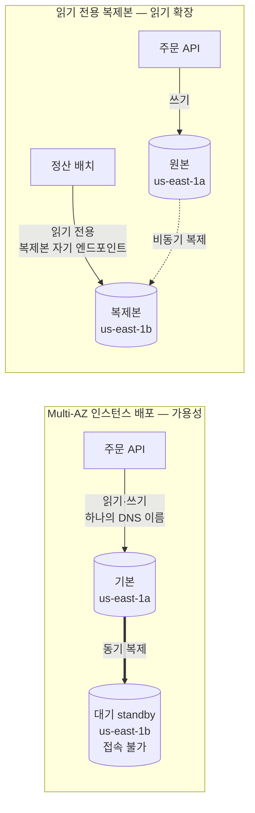
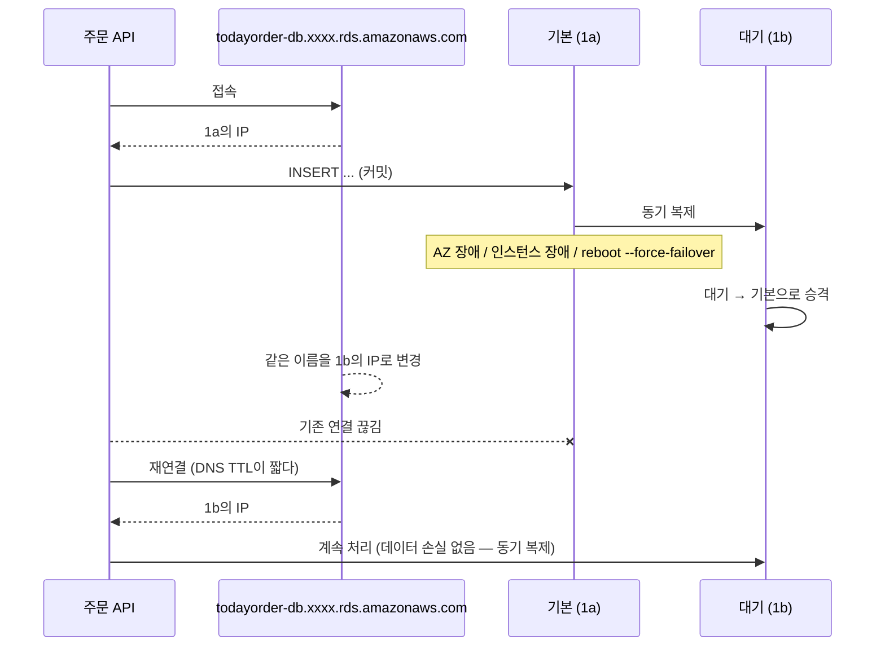

# M05-02. Multi-AZ vs 읽기 전용 복제본 — 가용성과 확장은 다르다
> 도메인: D2, D3 · 예상 시간: 45분 · 실습 등급: 🟡

## 왜 필요한가

RDS로 옮기고 두 가지 일이 생겼다. 첫째, us-east-1a에 장애가 났다는 뉴스에 팀장이 묻는다. "우리 DB도 그 AZ에 있지? 그럼 주문이 멈추나?" 둘째, 매일 오전 10시 정산팀의 집계 쿼리가 돌면 주문 API의 응답이 느려진다. 둘 다 "DB를 하나 더 두면 된다"처럼 들리지만, **첫째는 가용성(살아남기), 둘째는 확장(읽기 부하 나누기)** 이고 해법이 다르다.

## 핵심 개념

### 두 가지 "복제"



| | Multi-AZ (인스턴스 배포) | 읽기 전용 복제본(Read Replica) |
|---|---|---|
| 목적 | **가용성**: AZ·인스턴스 장애에서 자동 복구 | **확장**: 읽기 부하 분산, 보고·분석 쿼리 격리 |
| 복제 방식 | **동기**(커밋 시 대기 쪽에도 기록) | **비동기**(약간의 지연, 읽기는 조금 오래된 값일 수 있음) |
| 두 번째 DB로 읽기 | **불가**(대기 인스턴스는 트래픽을 받지 않음) | 가능(복제본마다 자기 엔드포인트) |
| 장애 시 | **자동 장애 조치**: 같은 DNS 이름이 대기 쪽을 가리킴(보통 1~2분) | 자동 아님. 필요하면 **수동 승격(promote)** → 독립 DB(새 엔드포인트) |
| 위치 | 같은 리전의 다른 AZ | 같은 AZ·다른 AZ·**다른 리전**(교차 리전 복제본 → DR) |
| 개수 | 대기 1 | 원본당 최대 **15**(MySQL·MariaDB·PostgreSQL·SQL Server), **Oracle은 최대 5** |
| 전제 조건 | — | 원본의 **자동 백업이 켜져 있어야** 함(보존 기간 ≥ 1) |

둘은 함께 쓸 수 있다. "Multi-AZ 원본 + 다른 AZ의 읽기 복제본 2개"가 흔한 운영 구성이다. 복제본 자체도 Multi-AZ로 만들 수 있다.

> 용어 주의: **Multi-AZ DB 클러스터**(MySQL·PostgreSQL)는 또 다른 배포 방식이다. 기본 1 + **읽을 수 있는** 대기 2를 서로 다른 AZ에 두고, 장애 조치가 더 빠르다. 시험에서 "대기 인스턴스로도 읽기를 받고 싶다 + 빠른 장애 조치"가 나오면 이것(또는 Aurora)을 떠올린다. 에뮬레이터에서 `create-db-cluster --engine postgres`는 응답은 하지만 멤버 인스턴스를 만들지 않아 실습하지 않는다.

### 장애 조치 순서 (Multi-AZ)



앱이 할 일은 **연결이 끊기면 다시 붙는 것**(재시도·커넥션 풀 검증)뿐이다. 이름이 그대로이기 때문이다. 반면 복제본 승격은 새 엔드포인트가 생기므로 앱 설정을 바꿔야 한다.

### 수직 확장 vs 수평 확장

- **수직(scale up)**: 인스턴스 클래스를 키운다(`db.t3.micro → db.r6g.large`). 쓰기 성능에도 효과가 있지만 수정 중 재시작이 필요하다(Multi-AZ면 대기 쪽 먼저 바꾸고 장애 조치해 중단을 줄인다).
- **수평(scale out)**: 읽기 복제본을 늘린다. **읽기만** 늘어난다. 쓰기는 여전히 원본 하나.
- 쓰기가 한계라면? → 더 큰 인스턴스, Aurora, 샤딩, 또는 DynamoDB 같은 다른 모델(레슨 4).

## 직접 해 보기

[labs/lab02-rds-multiaz-replica.sh](./labs/lab02-rds-multiaz-replica.sh)

**1) Multi-AZ 인스턴스**

```bash
aws rds create-db-instance --db-instance-identifier todayorder-m05-maz ... --multi-az --backup-retention-period 7
aws rds wait db-instance-available --db-instance-identifier todayorder-m05-maz
aws rds describe-db-instances --db-instance-identifier todayorder-m05-maz --query 'DBInstances[0].{
  Status: DBInstanceStatus, MultiAZ: MultiAZ, AZ: AvailabilityZone, SecondaryAZ: SecondaryAvailabilityZone}'
```

```
{
    "Status": "available",
    "MultiAZ": true,
    "AZ": "us-east-1a",
    "SecondaryAZ": null
}
```

방금 본 것: `MultiAZ: true`는 저장됐지만 **`SecondaryAvailabilityZone`이 비어 있다.** 실제 AWS는 여기에 대기 인스턴스의 AZ(예: `us-east-1b`)를 보여 준다. 에뮬레이터는 대기 인스턴스를 만들지 않는다.

**2) 강제 장애 조치**

```bash
aws rds reboot-db-instance --db-instance-identifier todayorder-m05-maz --force-failover
```

```
{
    "Status": "rebooting",
    "AZ": "us-east-1a"
}
장애 조치 전 AZ=us-east-1a → 후 AZ=us-east-1a   (실제 AWS라면 대기 인스턴스의 AZ로 바뀐다)
[
    "DB instance created",
    "DB instance restarted"
]
```

방금 본 것: API는 받아들이고 `rebooting`을 거치지만 AZ는 그대로이고 이벤트도 "restarted"뿐이다. (이벤트는 이번 실행이 시작된 뒤의 것만 `--start-time`으로 본다. 이 필터가 없으면 같은 에뮬레이터에서 다시 실행할 때 이전 실행의 "created/restarted"가 반복해 보인다.) **장애 조치는 이 에뮬레이터에서 재현되지 않는다** → 위 시퀀스 다이어그램이 실제 동작이다. (실제 AWS의 이벤트 메시지에는 "Multi-AZ instance failover started/completed"가 찍힌다.)

**3) 읽기 전용 복제본을 다른 AZ에**

```bash
aws rds create-db-instance-read-replica --db-instance-identifier todayorder-m05-maz-rr \
  --source-db-instance-identifier todayorder-m05-maz --db-instance-class db.t3.micro \
  --availability-zone us-east-1b
```

```
[
    {
        "Id": "todayorder-m05-maz",
        "AZ": "us-east-1a",
        "MultiAZ": true,
        "Port": 36103,
        "SourceOf": [
            "todayorder-m05-maz-rr"
        ],
        "ReplicaOf": null
    },
    {
        "Id": "todayorder-m05-maz-rr",
        "AZ": "us-east-1b",
        "MultiAZ": false,
        "Port": 42301,
        "SourceOf": [],
        "ReplicaOf": "todayorder-m05-maz"
    }
]
```

방금 본 것: 복제본은 **자기 엔드포인트(다른 포트)** 를 가진 별도 인스턴스이고, 원본과 서로를 가리킨다(`ReadReplicaDBInstanceIdentifiers` ↔ `ReadReplicaSourceDBInstanceIdentifier`). 정산 배치는 이 복제본 엔드포인트에 붙이면 된다.

**4) 수직 확장**

```
{
    "Status": "modifying",
    "Class": "db.t3.small"
}
현재 클래스: db.t3.small
```

**5) 자동 백업이 꺼진 원본에서는 복제본 불가**

```bash
aws rds create-db-instance-read-replica --db-instance-identifier todayorder-m05-nobackup-rr \
  --source-db-instance-identifier todayorder-m05-nobackup     # 원본은 --backup-retention-period 0
```

```
aws: [ERROR]: An error occurred (InvalidDBInstanceState) when calling the CreateDBInstanceReadReplica operation: Automated backups are not enabled for this database instance. To enable automated backups, use ModifyDBInstance to set the backup retention period to a non-zero value.
```

방금 본 것: 실제 AWS와 같은 규칙이 재현된다. 복제본은 원본의 백업(스냅샷 + 로그)에서 시작하기 때문이다.

**6) 복제본 승격과 원본 삭제**

```
aws: [ERROR]: An error occurred (NotImplemented) when calling the PromoteReadReplica operation: operation PromoteReadReplica is scaffolded but not implemented in this emulator
...
== 7. 원본을 지우면? 같은 리전의 복제본은 독립 인스턴스로 승격된다
"deleting"
{
    "Id": "todayorder-m05-maz-rr",
    "Status": "available",
    "ReplicaOf": null
}
```

방금 본 것: 명시적 승격(`promote-read-replica`)은 501이지만, **원본을 지우면 같은 리전의 복제본이 독립 인스턴스가 되는** 동작은 AWS 문서대로 재현된다.

## 실제 AWS에서는

- Multi-AZ 장애 조치는 보통 1~2분이고, 그동안 쓰기·읽기 모두 끊긴다(재연결 필요). 대기 인스턴스는 읽기를 받지 않는다.
- 읽기 복제본은 비동기라 **복제 지연(ReplicaLag)** 이 있다. "방금 쓴 주문을 바로 다시 읽는" 화면은 원본에서 읽어야 한다.
- 같은 리전 안의 원본→복제본 복제 트래픽은 요금이 없고, **교차 리전 복제본은 데이터 전송 요금**이 붙는다.
- RDS는 읽기 복제본을 **자동으로 늘리거나 줄이지 않는다**(Aurora는 Aurora Auto Scaling으로 리더 수를 조정할 수 있다).

> **실제 AWS에서 해 보려면** (🟡 실습)
> - 프리 티어: Multi-AZ와 읽기 복제본은 인스턴스 시간이 2배·3배로 늘어 무료 범위를 금방 넘는다. 가장 작은 클래스로 1시간 안에 끝내자.
> - 과금 주의: 복제본은 **별도 인스턴스 요금**, 교차 리전 복제본은 전송 요금 추가.
> - 해 볼 것: `aws rds reboot-db-instance --db-instance-identifier <id> --force-failover` 후 `describe-db-instances`의 `AvailabilityZone`·`SecondaryAvailabilityZone`이 서로 바뀌는지, `describe-events`에 failover 이벤트가 찍히는지 확인.
> - 정리: 복제본 먼저 `aws rds delete-db-instance --db-instance-identifier <rr> --skip-final-snapshot`, 그다음 원본.

## 시험 포인트

- "AZ 장애에도 DB 자동 복구, 데이터 손실 최소" → **Multi-AZ**. "읽기 부하·보고 쿼리 분리" → **읽기 전용 복제본**. 둘을 바꿔 고르게 하는 문제가 단골이다.
- Multi-AZ 대기 인스턴스는 **읽기에 못 쓴다**(인스턴스 배포 기준). "대기도 읽게" → Multi-AZ **DB 클러스터** 또는 Aurora.
- Multi-AZ = **동기**, 복제본 = **비동기**. "RPO 0에 가깝게" → 동기 쪽.
- "다른 리전에 읽기 + DR" → **교차 리전 읽기 복제본**(승격하면 독립 DB). 더 빠른 RTO/RPO가 필요하면 Aurora Global Database(레슨 3).
- 복제본 만들기 전제: 원본 **자동 백업 켜기**. 원본 삭제 시 같은 리전 복제본은 독립 DB로 승격된다.
- 쓰기 병목에는 복제본이 답이 아니다 → 수직 확장, Aurora, 또는 데이터 모델 변경.

## 스스로 확인

1. 정산 쿼리 때문에 주문 API가 느리다. Multi-AZ를 켜면 해결될까? 왜?
2. Multi-AZ 장애 조치 뒤 앱 설정(엔드포인트)을 바꿔야 하나? 읽기 복제본을 승격한 뒤에는?
3. 원본에 방금 쓴 주문을 복제본에서 바로 읽었더니 없었다. 버그인가?

<details><summary>답</summary>

1. 안 된다. Multi-AZ 대기 인스턴스는 트래픽을 받지 않는다. 읽기 복제본을 만들고 정산 배치를 복제본 엔드포인트로 보내야 한다.
2. Multi-AZ는 같은 DNS 이름을 유지하므로 재연결만 하면 된다. 복제본 승격은 그 복제본의 엔드포인트가 새 쓰기 주소가 되므로 앱 설정을 바꿔야 한다.
3. 버그가 아니라 비동기 복제의 지연이다. 쓴 직후 읽어야 하는 화면은 원본에서 읽는다.
</details>
