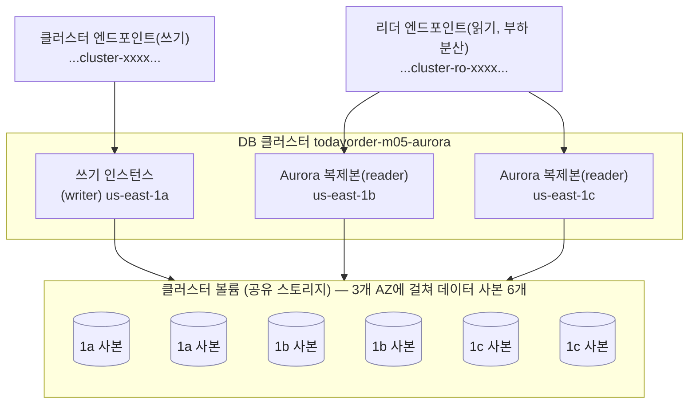
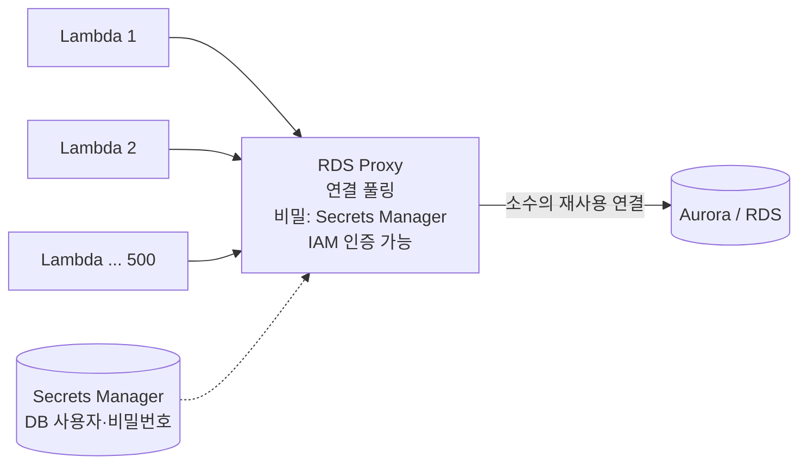

# M05-03. Aurora — 스토리지 구조, 엔드포인트, Global Database, Serverless v2, 그리고 RDS Proxy
> 도메인: D2, D3 · 예상 시간: 55분 · 실습 등급: 🟡

## 왜 필요한가

TodayOrder가 커졌다. 읽기 복제본을 3개로 늘렸더니 복제 지연 때문에 "결제했는데 주문 내역에 없다"는 문의가 온다. Multi-AZ 장애 조치 1~2분도 길다는 말이 나온다. 이벤트 날 밤에는 Lambda가 수백 개씩 떠서 DB 연결 수가 한계를 넘는다. 그리고 해외 진출 이야기가 나온다. 이 문제들에 AWS가 내놓은 답이 **Aurora**(+ **RDS Proxy**)다.

## 핵심 개념

### Aurora는 "컴퓨트와 스토리지를 분리한 RDS"



- 인스턴스마다 디스크를 따로 갖는 RDS와 달리, Aurora 인스턴스들은 **하나의 클러스터 볼륨을 공유**한다. 볼륨은 데이터를 **3개 AZ에 6개 사본**으로 저장한다.
- 그래서 복제본은 데이터를 "복사받는" 게 아니라 같은 스토리지를 읽는다 → 복제 지연이 보통 수십 ms 수준으로 작고, 복제본을 **최대 15개**까지 둔다.
- 쓰기 인스턴스가 죽으면 복제본 하나가 쓰기로 **승격**된다(대기 전용 인스턴스가 따로 없다. 복제본이 곧 장애 조치 대상). 어떤 복제본을 먼저 승격할지는 **승격 티어(promotion tier, 0~15, 낮을수록 우선)** 로 정한다. 복제본이 하나도 없으면 같은 AZ나 다른 AZ에 새 인스턴스를 만들어야 해 더 오래 걸린다.
- 볼륨은 쓰는 만큼 **자동으로 커진다**. 최대 크기는 엔진 버전에 따라 128 TiB 또는 256 TiB(최신 버전).
- 엔진은 **MySQL 호환 / PostgreSQL 호환** 두 가지. 기존 앱을 거의 그대로 옮길 수 있다.

### 엔드포인트 4종

| 엔드포인트 | 가리키는 것 | 쓰임 |
|---|---|---|
| **클러스터(쓰기) 엔드포인트** | 현재 쓰기 인스턴스. 장애 조치 후에도 이름 그대로 | 앱의 기본 접속 주소 |
| **리더 엔드포인트** | 복제본들에 연결 단위 부하 분산 | 읽기 전용 화면, 조회 API |
| **사용자 지정(custom) 엔드포인트** | 내가 고른 인스턴스 묶음 | 분석 쿼리는 큰 인스턴스 2대로만 등 |
| 인스턴스 엔드포인트 | 특정 인스턴스 하나 | 진단용. 앱에서 쓰지 않는다 |

### 그 밖에 시험에 나오는 Aurora 기능

| 기능 | 한 줄 요약 |
|---|---|
| **Aurora Global Database** | 주 리전 1 + **보조 리전 최대 10개**. 스토리지 계층에서 복제해 지연이 보통 **1초 미만**. 보조 리전은 읽기 전용(쓰기 전달 옵션 있음). 계획된 이전은 *switchover*(데이터 손실 없음), 리전 장애는 *failover* |
| **Aurora Serverless v2** | 인스턴스 클래스 대신 `db.serverless` + 용량 범위(ACU, 1 ACU ≈ 2 GiB 메모리). 부하에 따라 초 단위로 늘고 준다. 최대 256 ACU, 최소 0 ACU로 두면 유휴 시 자동 일시 중지 |
| Serverless v1 | 2025-03-31 지원 종료(남은 클러스터는 v2로 자동 업그레이드). 새 설계에 쓰지 않는다 |
| **Aurora 복제본 자동 조정** | Application Auto Scaling으로 리더 수를 CPU·연결 수에 맞춰 늘리고 줄인다 |

<details><summary>시험 키워드만 알아 두면 되는 기능 3개 (Backtrack · 클론 · I/O-Optimized)</summary>

| 기능 | 한 줄 요약 | 이 말이 나오면 |
|---|---|---|
| Backtrack (Aurora MySQL) | 새 클러스터를 만들지 않고 같은 클러스터를 과거 시점으로 "되감기" | "복원 없이 몇 분 전으로 빨리 되돌리기" |
| 클론(Clone) | 쓰기 시 복사(copy-on-write)로 빠르고 싸게 테스트용 클러스터 복제 | "운영 데이터로 테스트 환경을 빠르고 싸게" |
| 스토리지 구성 Standard / I/O-Optimized | I/O 요청 요금을 따로 낼지, 인스턴스·스토리지 단가에 포함할지 | "I/O 요금이 Aurora 비용의 큰 몫" → I/O-Optimized |

</details>

### RDS Proxy — 연결을 모아 주는 문지기



- Lambda처럼 **짧게 많이 뜨는 클라이언트**가 각자 DB 연결을 열면 `max_connections`를 넘는다. 프록시가 연결을 **풀링·재사용**해 DB 쪽 연결 수를 줄인다.
- 장애 조치 때 앱 연결을 프록시가 붙잡고 있다가 새 쓰기 인스턴스로 넘겨 **장애 조치 시간을 줄인다**.
- DB 비밀번호는 **Secrets Manager**에 두고 프록시가 꺼내 쓴다(그래서 프록시에 그 비밀을 읽을 **IAM 역할**이 필요). 앱은 **IAM 인증**으로 프록시에 붙을 수 있다.
- 프록시는 VPC 안에만 있다(퍼블릭 접근 불가).

## 직접 해 보기

[labs/lab03-aurora-cluster-proxy.sh](./labs/lab03-aurora-cluster-proxy.sh)

**1) 클러스터를 먼저 만들고 → 인스턴스를 붙인다**

```bash
aws rds create-db-cluster --db-cluster-identifier todayorder-m05-aurora --engine aurora-postgresql \
  --master-username todayorder --master-user-password 'Lab-only-Passw0rd' \
  --db-subnet-group-name todayorder-m05-aurora-subnets --vpc-security-group-ids "$DB_SG" \
  --backup-retention-period 7 --storage-encrypted \
  --serverless-v2-scaling-configuration MinCapacity=0.5,MaxCapacity=4
```

```
{
    "Status": "creating",
    "Engine": "aurora-postgresql",
    "Version": "17.9",
    "AZs": [
        "us-east-1a",
        "us-east-1b",
        "us-east-1c"
    ],
    "ServerlessV2": {
        "MinCapacity": 0.5,
        "MaxCapacity": 4.0
    }
}
```

```bash
aws rds create-db-instance --db-instance-identifier todayorder-m05-aurora-1 --db-cluster-identifier todayorder-m05-aurora \
  --engine aurora-postgresql --db-instance-class db.serverless --availability-zone us-east-1a
aws rds create-db-instance --db-instance-identifier todayorder-m05-aurora-2 --db-cluster-identifier todayorder-m05-aurora \
  --engine aurora-postgresql --db-instance-class db.r6g.large --availability-zone us-east-1b --promotion-tier 1
```

방금 본 것: Aurora에서 스토리지·백업·암호화·Serverless v2 용량 범위는 **클러스터** 속성이고, 인스턴스는 컴퓨트만 정한다. 같은 클러스터에 서버리스(`db.serverless`)와 프로비저닝(`db.r6g.large`) 인스턴스를 섞을 수 있다.

**2) 엔드포인트와 멤버**

```
{
    "Status": "available",
    "WriterEndpoint": "127.0.0.1",
    "ReaderEndpoint": "todayorder-m05-aurora.cluster-ro-00000000001i.us-east-1.rds.amazonaws.com",
    "Port": 43565,
    "Members": [
        {
            "Id": "todayorder-m05-aurora-1",
            "Writer": true
        },
        {
            "Id": "todayorder-m05-aurora-2",
            "Writer": false
        }
    ]
}
```

방금 본 것: 리더 엔드포인트는 실제 AWS와 같은 `cluster-ro-` 형식이다. 쓰기 엔드포인트가 `127.0.0.1`인 것은 에뮬레이터가 컨테이너 안에서 실제 엔진을 띄웠기 때문이다(실제 AWS: `todayorder-m05-aurora.cluster-xxxx.us-east-1.rds.amazonaws.com`). 호스트에서는 접속할 수 없다.

**3) 장애 조치: 리더를 쓰기로**

```bash
aws rds failover-db-cluster --db-cluster-identifier todayorder-m05-aurora \
  --target-db-instance-identifier todayorder-m05-aurora-2
```

```
"failing-over"
{
    "Status": "available",
    "Members": [
        {
            "Id": "todayorder-m05-aurora-2",
            "Writer": true
        },
        {
            "Id": "todayorder-m05-aurora-1",
            "Writer": false
        }
    ]
}
```

방금 본 것: 쓰기 역할(`IsClusterWriter`)이 aurora-2로 넘어갔다. 클러스터 엔드포인트 이름은 그대로이므로 앱은 재연결만 하면 된다. (에뮬레이터는 역할 전환까지 보여 주지만, 실제 연결이 끊기고 붙는 과정·소요 시간은 볼 수 없다.)

**4) 사용자 지정 엔드포인트 — 미구현**

```
aws: [ERROR]: An error occurred (NotImplemented) when calling the CreateDBClusterEndpoint operation: operation CreateDBClusterEndpoint is scaffolded but not implemented in this emulator
```

**5) Global Database**

```bash
aws rds create-global-cluster --global-cluster-identifier todayorder-m05-global \
  --source-db-cluster-identifier arn:aws:rds:us-east-1:000000000000:cluster:todayorder-m05-aurora
```

<!-- external-host-ok: 에뮬레이터가 돌려준 AWS 형식 이름을 실행 출력 그대로 실었다. 실습은 이 이름에 접속하지 않는다 -->
```
{
    "Id": "todayorder-m05-global",
    "Status": "available",
    "Engine": "aurora-postgresql",
    "Members": [
        {
            "Cluster": "arn:aws:rds:us-east-1:000000000000:cluster:todayorder-m05-aurora",
            "IsWriter": true
        }
    ],
    "Endpoint": "todayorder-m05-global.global-00000000002b.global.rds.amazonaws.com"
}
```

방금 본 것: 기존 클러스터가 글로벌 클러스터의 **주(쓰기) 클러스터**가 됐다. 실제로는 여기서 다른 리전(예: `ap-northeast-2`)에 보조 클러스터를 `create-db-cluster --global-cluster-identifier ...`로 붙인다. 이 에뮬레이터는 리전을 분리하지 않아 보조 리전 복제는 실습하지 않는다(M12에서 포트 두 개로 "리전 2개"를 흉내 낸다).

**6) RDS Proxy: 비밀 + 역할 + 대상**

```bash
aws secretsmanager create-secret --name todayorder-m05-aurora-secret \
  --secret-string '{"username":"todayorder","password":"Lab-only-Passw0rd"}'
aws iam create-role --role-name todayorder-m05-proxy-role --assume-role-policy-document '{... "Service":"rds.amazonaws.com" ...}'
aws iam put-role-policy --role-name todayorder-m05-proxy-role --policy-name read-db-secret --policy-document '{... "secretsmanager:GetSecretValue" ...}'
aws rds create-db-proxy --db-proxy-name todayorder-m05-proxy --engine-family POSTGRESQL \
  --auth "AuthScheme=SECRETS,SecretArn=$secret_arn,IAMAuth=DISABLED" \
  --role-arn arn:aws:iam::000000000000:role/todayorder-m05-proxy-role \
  --vpc-subnet-ids "$SUBNET_A" "$SUBNET_B" --vpc-security-group-ids "$DB_SG" --require-tls
aws rds register-db-proxy-targets --db-proxy-name todayorder-m05-proxy --db-cluster-identifiers todayorder-m05-aurora
```

<!-- external-host-ok: 에뮬레이터가 돌려준 AWS 형식 이름을 실행 출력 그대로 실었다. 실습은 이 이름에 접속하지 않는다 -->
```
{
    "Name": "todayorder-m05-proxy",
    "Status": "creating",
    "EngineFamily": "POSTGRESQL",
    "Endpoint": "todayorder-m05-proxy.proxy-00000000002c.us-east-1.rds.amazonaws.com",
    "RequireTLS": true
}
[
    {
        "Type": "TRACKED_CLUSTER",
        "Cluster": "todayorder-m05-aurora",
        "Role": "READ_WRITE",
        "Health": "AVAILABLE"
    }
]
```

방금 본 것: 프록시는 클러스터를 **추적(TRACKED_CLUSTER)** 하므로 장애 조치로 쓰기 인스턴스가 바뀌어도 따라간다. Lambda는 DB 대신 이 프록시 엔드포인트에 붙는다.

**7) 정리 순서**

```
-- 인스턴스가 남아 있는 클러스터는 지울 수 없다
aws: [ERROR]: An error occurred (InvalidDBClusterStateFault) when calling the DeleteDBCluster operation: DB cluster todayorder-m05-aurora can't be deleted because it still has 2 DB instance(s): todayorder-m05-aurora-1, todayorder-m05-aurora-2. Delete them first
```

프록시 삭제 → 글로벌 클러스터에서 분리·삭제 → 인스턴스 삭제 → 클러스터 삭제 순서로 지운다.

## 실제 AWS에서는

- Aurora 장애 조치는 복제본이 있으면 보통 수십 초 안에 끝나고(인스턴스 배포 RDS Multi-AZ보다 빠르다), RDS Proxy를 쓰면 앱이 체감하는 끊김이 더 줄어든다.
- 리더 엔드포인트는 **연결 단위**로 분산한다(쿼리 단위 아님). 커넥션 풀을 오래 유지하면 특정 리더에 쏠릴 수 있다.
- Serverless v2도 **최소 용량만큼은 계속 과금**된다(0 ACU 자동 일시 중지를 켜지 않은 경우). 프로비저닝보다 항상 싼 것이 아니다 — 부하가 들쭉날쭉할 때 유리하다.
- 에뮬레이터에서 Aurora는 `MultiAZ: false`로 보이지만, 실제로는 다른 AZ에 복제본이 있으면 `MultiAZ: true`로 표시된다.

> **실제 AWS에서 해 보려면** (🟡 실습)
> - 프리 티어 해당 없음. Aurora·RDS Proxy·Global Database 모두 유료다. Serverless v2 최소 0.5 ACU 인스턴스 1대 + 프록시로 1시간 안에 끝내자.
> - 과금 주의: Aurora 클러스터 볼륨은 데이터·백업 스토리지 요금, Standard 구성은 I/O 요청 요금이 따로 나온다. RDS Proxy는 대상 DB의 vCPU(서버리스는 ACU) 기준 시간 요금. Global Database는 보조 리전 인스턴스 + 리전 간 복제 I/O 요금.
> - 정리: `aws rds delete-db-proxy --db-proxy-name <p>` → (글로벌이면) `remove-from-global-cluster`·`delete-global-cluster` → `aws rds delete-db-instance --db-instance-identifier <i> --skip-final-snapshot`(전부) → `aws rds delete-db-cluster --db-cluster-identifier <c> --skip-final-snapshot` → `aws secretsmanager delete-secret --secret-id <s> --force-delete-without-recovery`.

## 시험 포인트

- "MySQL/PostgreSQL 호환 + 높은 성능·가용성 + 복제 지연 최소 + 복제본 15개" → **Aurora**. 데이터는 **3 AZ에 6 사본**.
- "여러 리전에서 1초 미만 지연으로 읽기, 리전 장애 시 빠른 복구(낮은 RPO/RTO)" → **Aurora Global Database**. RDS 교차 리전 복제본보다 빠르다.
- "예측 불가한 간헐적 부하, 용량 관리 싫음(관계형)" → **Aurora Serverless v2**.
- "Lambda가 DB 연결을 너무 많이 연다 / 장애 조치 시간 단축 / DB 자격 증명을 코드에서 빼기" → **RDS Proxy**(+ Secrets Manager, IAM 인증).
- 분석 쿼리를 특정 인스턴스에만 → **사용자 지정 엔드포인트**. 일반 읽기 → **리더 엔드포인트**.
- 장애 조치 우선순위 → **승격 티어**(0이 가장 높다).

## 스스로 확인

1. RDS 읽기 복제본과 Aurora 복제본의 복제 지연이 왜 다른지 스토리지 구조로 설명하라.
2. 앱이 Aurora의 쓰기 인스턴스 엔드포인트(`...-aurora-1.xxxx...`)를 직접 쓰고 있다. 장애 조치 후 무슨 일이 생기나?
3. 야간에만 몰리는 Lambda 기반 이벤트 API가 Aurora에 연결 오류(too many connections)를 낸다. 무엇을 추가하나?

<details><summary>답</summary>

1. RDS 복제본은 원본의 변경 로그를 받아 **자기 디스크에 다시 적용**해야 한다(비동기). Aurora 복제본은 쓰기 인스턴스와 **같은 클러스터 볼륨**을 읽으므로 데이터를 복사할 필요가 없고 캐시만 갱신하면 된다 → 지연이 매우 작다.
2. 그 인스턴스는 이제 리더가 됐으므로 쓰기가 실패한다. 앱은 **클러스터(쓰기) 엔드포인트**를 써야 장애 조치 후에도 쓰기 인스턴스를 따라간다.
3. **RDS Proxy**. 연결을 풀링해 DB 연결 수를 줄인다. (Serverless v2로 용량을 늘리는 것만으로는 연결 폭증 문제가 해결되지 않는다.)
</details>
