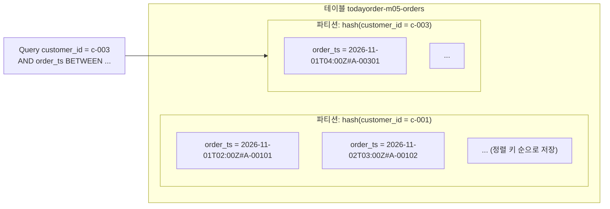

# M05-04. DynamoDB 기본 — 키 설계, 용량 모드, 일관성, Query vs Scan
> 도메인: D2, D3 · 예상 시간: 60분 · 실습 등급: 🟢

## 왜 필요한가

블랙프라이데이 예고가 떴다. 평소의 50배 주문이 몇 시간 동안 몰릴 수 있다. RDB는 인스턴스 크기라는 천장이 있고, 쓰기를 늘리려면 샤딩을 직접 해야 한다. 팀은 "주문 조회·생성"처럼 **접근 패턴이 뻔한** 부분을 서버 관리 없이 사실상 무한히 늘어나는 **Amazon DynamoDB**로 옮기기로 했다. 그런데 DynamoDB는 SQL처럼 "일단 넣고 나중에 아무 조건으로나 조회"가 안 된다. **어떻게 읽을지를 먼저 정하고 테이블을 설계**해야 한다.

## 핵심 개념

### 한 줄 정의

DynamoDB = 완전 관리형·서버리스 **키-값/문서** DB. 테이블 단위로 만들고, 서버·스토리지·패치·복제(리전 안 3개 AZ)를 AWS가 맡는다. 응답은 규모와 상관없이 한 자릿수 밀리초.

| RDB(SQL) | DynamoDB |
|---|---|
| 테이블·행·열, 스키마 고정 | 테이블·**항목(item)**·**속성(attribute)**, 키 외에는 스키마 없음 |
| 아무 열로나 `WHERE`, `JOIN` | **키로만** 효율적으로 찾는다. JOIN 없음 |
| 정규화 → 쿼리 시점에 조합 | 접근 패턴에 맞춰 **미리 모아 둔다**(비정규화) |
| 행 크기 제한 느슨 | 항목 최대 **400 KB** |

### 기본 키 = 파티션 키 (+ 정렬 키)



- **파티션 키(HASH)**: 해시해서 항목이 저장될 파티션을 정한다. 값의 종류가 많고 고르게 접근될수록 좋다(고객 ID, 주문 ID). 값이 몇 개 안 되거나(상태, 날짜) 특정 값에 몰리면 **핫 파티션**이 생긴다.
- **정렬 키(RANGE)**: 같은 파티션 키 안에서의 정렬 순서. `=`, `<`, `BETWEEN`, `begins_with`로 범위 조회가 된다. 그래서 `"시각#주문번호"`처럼 **정렬하고 싶은 값을 앞에** 두는 합성 키를 자주 쓴다.
- 기본 키(파티션 키 [+ 정렬 키])는 **테이블 안에서 유일**하다. 같은 키로 `PutItem`하면 덮어쓴다(→ 레슨 5의 조건부 쓰기).

### 접근 패턴 → 키 설계 (TodayOrder)

| # | 접근 패턴 | 빈도 | 설계 |
|---|---|---|---|
| 1 | 고객의 주문 목록, 최신순 | 매우 높음 | PK `customer_id`, SK `order_ts`(= `2026-11-05T08:00:00Z#A-00305`) → `Query` + 역순 |
| 2 | 주문 1건 상세 | 높음 | 같은 키로 `GetItem` |
| 3 | 고객의 기간별 주문 | 중간 | `Query` + `order_ts BETWEEN` |
| 4 | 상태별 주문(배송 대기 목록) | 중간 | 키에 없음 → **GSI** 필요(레슨 5) |
| 5 | 고객의 고액 주문 | 낮음 | 같은 PK, 다른 정렬 → **LSI**(레슨 5) |

### 읽기 API 3종과 비용

| API | 무엇을 읽나 | 비용(읽은 양 기준) |
|---|---|---|
| `GetItem` | 기본 키 하나 → 항목 1개 | 항목 크기 |
| `Query` | **파티션 키 하나**의 항목들(+ 정렬 키 조건) | 그 파티션에서 읽은 양 |
| `Scan` | **테이블 전체** | 테이블 전체 크기 |

- `FilterExpression`은 **읽은 뒤에** 거른다. 결과가 줄어도 비용(읽은 양)은 그대로다. → "Scan + Filter로 고객 주문 찾기"는 오답.
- 한 번의 `Query`/`Scan` 응답은 최대 **1 MB**. 더 있으면 `LastEvaluatedKey`가 오고, 그 값을 `ExclusiveStartKey`로 넘겨 다음 페이지를 읽는다(CLI·boto3 페이지네이터가 대신 해 준다).

### 용량 단위와 일관성

- **RCU(읽기 용량 단위)**: 4 KB까지 항목을 **강력 일관 읽기 1회/초** 또는 **최종 일관 읽기 2회/초**.
- **WCU(쓰기 용량 단위)**: 1 KB까지 항목 쓰기 1회/초. 트랜잭션 읽기·쓰기는 2배(레슨 5).
- `Query`/`Scan`은 읽은 항목 크기를 **모두 더한 뒤** 4 KB 단위로 올림한다.

| 읽기 일관성 | 의미 | 비용 | 제약 |
|---|---|---|---|
| **최종 일관(기본)** | 방금 쓴 값이 아주 잠깐 안 보일 수 있다 | 0.5배 | — |
| **강력 일관**(`ConsistentRead=true`) | 성공한 모든 쓰기가 반영된 값 | 1배 | **GSI에는 불가**, 글로벌 테이블 다른 리전 복제본 기준으로는 보장 범위가 다름 |

### 조건부 쓰기 — DB 쪽에서 "~일 때만 써라"

DynamoDB에는 `SELECT ... FOR UPDATE` 같은 잠금이 없다. 대신 쓰기 요청에 **조건식(`ConditionExpression`)** 을 붙이면, DynamoDB가 그 항목에 대해 조건 검사와 쓰기를 **원자적으로** 한다. 조건이 거짓이면 아무것도 바꾸지 않고 `ConditionalCheckFailedException`을 돌려준다.

| 하고 싶은 것 | 조건식 |
|---|---|
| 같은 주문번호로 두 번 생성 금지 | `attribute_not_exists(order_id)` |
| 재고가 있을 때만 차감 | `UpdateExpression: SET stock = stock - :q` + `ConditionExpression: stock >= :q` |
| PAID일 때만 SHIPPED로 | `#s = :paid` |
| 낙관적 잠금(버전 번호) | `version = :expected` 이고 쓰면서 `version = version + 1` |

"읽고 → 앱에서 계산하고 → 덮어쓰기"는 동시 요청에서 업데이트가 사라진다(lost update). 재고 차감 동시성 실험과 여러 항목을 묶는 트랜잭션은 [레슨 5](./05-dynamodb-advanced.md)의 lab06에서 직접 해 본다.

### 용량 모드

| | 온디맨드(PAY_PER_REQUEST) | 프로비저닝(PROVISIONED) |
|---|---|---|
| 과금 | 요청한 만큼(읽기/쓰기 요청 단위) | 시간당 설정한 RCU/WCU(쓰든 안 쓰든) |
| 맞는 워크로드 | **예측 불가·급증**, 새 서비스, 트래픽 적은 테이블 | **예측 가능·꾸준함**, 비용 최적화 |
| 확장 | 자동 | Auto Scaling(대상 사용률) 설정, 예약 용량 구매 가능 |
| 초과 시 | 테이블 한도까지 자동 흡수 | 스로틀링(`ProvisionedThroughputExceededException`) |

모드 전환: 프로비저닝 → 온디맨드는 24시간에 최대 4번, 온디맨드 → 프로비저닝은 언제든(레슨 5 lab08에서 실제로 바꿔 본다).

## 직접 해 보기

[labs/lab04-ddb-orders-query-scan.sh](./labs/lab04-ddb-orders-query-scan.sh) — 고객 10명 × 주문 20건(항목당 약 1 KB)을 넣고 같은 질문을 여러 방법으로 물어 소비 용량을 비교한다.

**1) 테이블 생성 — 응답은 CREATING, 반드시 waiter**

```bash
aws dynamodb create-table --table-name todayorder-m05-orders \
  --attribute-definitions AttributeName=customer_id,AttributeType=S AttributeName=order_ts,AttributeType=S AttributeName=total,AttributeType=N \
  --key-schema AttributeName=customer_id,KeyType=HASH AttributeName=order_ts,KeyType=RANGE \
  --local-secondary-indexes '[{"IndexName":"customer-total-index", ...}]' \
  --billing-mode PAY_PER_REQUEST
aws dynamodb wait table-exists --table-name todayorder-m05-orders
```

```
{
    "TableStatus": "CREATING",
    "KeySchema": [
        {
            "AttributeName": "customer_id",
            "KeyType": "HASH"
        },
        {
            "AttributeName": "order_ts",
            "KeyType": "RANGE"
        }
    ],
    "BillingMode": "PAY_PER_REQUEST"
}
{
    "Status": "ACTIVE",
    "Items": 0
}
```

방금 본 것: 생성 응답은 항상 `CREATING`이다. 이 에뮬레이터는 1초도 안 돼 `ACTIVE`가 되는 경우가 많아 **바로 `describe-table`을 하면 실행마다 결과가 다르다**(경쟁 상태). 그래서 `wait table-exists`(boto3는 `get_waiter("table_exists")`)로 기다린 뒤에 쓴다. 실제 AWS에서도 이것이 올바른 순서다. `--attribute-definitions`에는 **키로 쓰는 속성만** 적는다(`total`은 LSI 정렬 키라서 있다. 나머지 속성은 스키마가 없다).

**2) 적재: BatchWriteItem은 한 번에 최대 25건**

```
주문 200건을 BatchWriteItem 8회로 적재
```

**3) GetItem — 키를 전부 알 때**

```bash
aws dynamodb get-item --table-name todayorder-m05-orders \
  --key '{"customer_id":{"S":"c-003"},"order_ts":{"S":"2026-11-05T08:00:00Z#A-00305"}}' \
  --projection-expression "order_id, #s, #t" --expression-attribute-names '{"#s":"status","#t":"total"}' \
  --return-consumed-capacity TOTAL
```

```
{
    "Item": {
        "order_id": {
            "S": "A-00305"
        },
        "total": {
            "N": "37000"
        },
        "status": {
            "S": "PAID"
        }
    },
    "Consumed": 0.5
}
GetItem 최종 일관=0.5 RCU, 강력 일관=1.0 RCU
```

방금 본 것: 1 KB 항목 하나 = 4 KB 이하 → 최종 일관 0.5, 강력 일관 1.0 RCU. `status`·`total`은 DynamoDB **예약어**라 `#s`·`#t` 별칭(`ExpressionAttributeNames`)으로 써야 한다. `ProjectionExpression`은 돌려받는 속성을 줄일 뿐 **읽기 비용은 항목 전체 크기 기준**이다.

**4) Query vs Scan vs Scan+Filter**

```bash
aws dynamodb query --table-name todayorder-m05-orders --key-condition-expression "customer_id = :c" \
  --expression-attribute-values '{":c":{"S":"c-003"}}' --return-consumed-capacity TOTAL
aws dynamodb scan --table-name todayorder-m05-orders --return-consumed-capacity TOTAL
aws dynamodb scan --table-name todayorder-m05-orders --filter-expression "customer_id = :c" \
  --expression-attribute-values '{":c":{"S":"c-003"}}' --return-consumed-capacity TOTAL
```

```
== 4. Query: 고객 c-003 의 주문 전부 (한 파티션만 읽는다)
{
    "Count": 20,
    "ScannedCount": 20,
    "Consumed": 2.5
}
같은 Query 를 강력 일관 읽기로: 5.0 RCU
...
== 6. Scan: 테이블 전체를 읽는다
{
    "Count": 200,
    "ScannedCount": 200,
    "Consumed": 24.5
}
== 7. Scan + FilterExpression: 결과는 20건이지만 읽은 양(=비용)은 그대로
{
    "Count": 20,
    "ScannedCount": 200,
    "Consumed": 24.5
}
```

방금 본 것 — 이 모듈에서 가장 중요한 숫자:

| 방법 | 돌려받은 | 읽은(ScannedCount) | RCU |
|---|---|---|---|
| Query (최종 일관) | 20 | 20 | **2.5** |
| Query (강력 일관) | 20 | 20 | 5.0 |
| Scan | 200 | 200 | 24.5 |
| Scan + Filter | **20** | **200** | **24.5** |

같은 20건을 얻는데 Scan+Filter는 Query의 **약 10배**를 쓴다. 테이블이 200만 건이면 10만 배다. Query 계산: 20건 × 약 1 KB ≈ 20 KB → 4 KB 단위 5개 → 최종 일관이라 × 0.5 = 2.5. (에뮬레이터의 소비 용량 계산이 이 공식대로 나온다.)

**5) 정렬 키 조건 + 역순 + Limit = "최근 주문 3건"**

```bash
aws dynamodb query --table-name todayorder-m05-orders \
  --key-condition-expression "customer_id = :c AND order_ts BETWEEN :from AND :to" \
  --expression-attribute-values '{":c":{"S":"c-003"},":from":{"S":"2026-11-01"},":to":{"S":"2026-11-10"}}' \
  --no-scan-index-forward --limit 3 --no-paginate \
  --query 'Items[].[order_ts.S, status.S, total.N]' --output table
```

```
--------------------------------------------------------
|                         Query                        |
+-------------------------------+------------+---------+
|  2026-11-09T12:00:00Z#A-00309 |  DELIVERED |  39000  |
|  2026-11-08T11:00:00Z#A-00308 |  SHIPPED   |  26000  |
|  2026-11-07T10:00:00Z#A-00307 |  PAID      |  13000  |
+-------------------------------+------------+---------+
```

> 함정: 처음엔 `--max-items 3 --output text`로 받았더니 마지막 줄에 `None`이 찍혔다. CLI 페이지네이션이 남긴 `NextToken` 자리다(M00 레슨 5, FIDELITY "공통 사항"). 한 페이지만 필요하면 `--limit 3 --no-paginate`를 쓴다.

방금 본 것: `ScanIndexForward=false`(`--no-scan-index-forward`)는 정렬 키 **역순**. 정렬 키를 ISO 시각으로 시작하게 만들었기 때문에 문자열 정렬 = 시간 정렬이다.

**6) 페이지네이션**

```
{
    "Count": 8,
    "LastEvaluatedKey": {
        "customer_id": {
            "S": "c-003"
        },
        "order_ts": {
            "S": "2026-11-08T11:00:00Z#A-00308"
        }
    }
}
--page-size 8 로 CLI 가 페이지를 따라가 합친 결과: 20 건
```

방금 본 것: `Limit` 8이면 8건에서 멈추고 "여기서부터 이어 읽어라"는 `LastEvaluatedKey`를 준다. 실제로는 1 MB에서도 같은 일이 일어난다. CLI는 기본으로 페이지를 끝까지 따라가 합쳐 준다(M00 레슨 5). 앱 코드에서는 boto3 **페이지네이터**를 쓰자([sdk/order_repository.py](./sdk/order_repository.py)의 `orders_by_status`).

**7) 키가 아닌 속성으로는 Query 불가**

```
aws: [ERROR]: An error occurred (ValidationException) when calling the Query operation: Query condition missed key schema element: customer_id
```

→ "상태별 주문"은 이 테이블로는 Scan밖에 없다. 레슨 5에서 GSI로 해결한다.

## 실제 AWS에서는

- 에뮬레이터의 소비 용량 숫자는 AWS 공식과 같게 나오지만, **스로틀링·파티션 분할·적응형 용량**은 재현되지 않는다. 실제로는 파티션 하나가 초당 약 3,000 RCU·1,000 WCU를 넘으면 그 키가 스로틀링된다 → 파티션 키 분산이 성능 그 자체다.
- 테이블 생성은 실제로도 보통 수 초~수십 초지만, 시간을 가정하지 말고 waiter를 쓴다.
- 온디맨드 테이블도 테이블당 기본 한도(초당 40,000 읽기/쓰기 요청 단위, 조정 가능)가 있다.
- 저장 데이터는 항상 암호화된다(AWS 소유 키 기본, KMS 관리형/고객 관리형 키 선택 가능).

## 시험 포인트

- "서버리스, 밀리초 응답, 사실상 무제한 확장, 키-값 접근" → **DynamoDB**. "복잡한 JOIN·임의 조회·트랜잭션 많은 OLTP 리포트" → RDS/Aurora.
- 파티션 키는 **카디널리티 높고 고르게** 접근되는 값. "특정 키에 몰려 스로틀링" → 키 설계(쓰기 샤딩: 키에 접미사), 캐시(DAX).
- **Scan은 비싸고 느리다. FilterExpression은 비용을 줄이지 않는다.** "효율적으로 조회"가 나오면 Query(+ 인덱스).
- 예측 불가·급증 → **온디맨드**. 예측 가능·꾸준 → **프로비저닝 + Auto Scaling**(+ 예약 용량으로 추가 절감).
- 강력 일관 읽기는 비용 2배, **GSI에선 불가**.
- 항목 최대 400 KB. 큰 데이터(이미지·영수증 PDF)는 **S3에 두고 키만 DynamoDB에**.

## 스스로 확인

1. 주문 테이블의 파티션 키로 `status`(PAID/SHIPPED/...)를 쓰면 무슨 문제가 생기나?
2. 테이블 100 GB에서 `Scan` + `FilterExpression`으로 한 고객의 주문 10건을 찾았다. 비용은 10건 크기 기준일까?
3. 결제 직후 "내 주문" 화면에 방금 주문이 안 보인다는 버그 보고가 왔다. 의심할 설정은?

<details><summary>답</summary>

1. 값이 몇 개뿐이라 항목이 소수 파티션에 몰린다(핫 파티션) → 스로틀링. 또 "고객의 주문 목록"(가장 잦은 패턴)을 Query로 할 수 없다.
2. 아니다. Scan은 테이블 전체(100 GB)를 읽고 그만큼 RCU를 쓴 뒤에 걸러 낸다. 고객 ID를 파티션 키로 두고 Query 해야 한다.
3. 최종 일관 읽기(기본값). 쓰기 직후 읽어야 하는 화면은 `ConsistentRead=true`로 읽거나, 쓰기 응답의 값을 그대로 화면에 쓴다.
</details>
