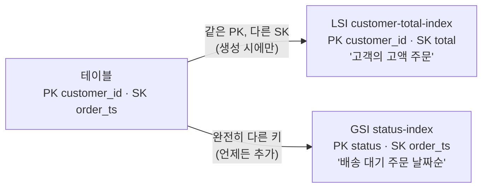
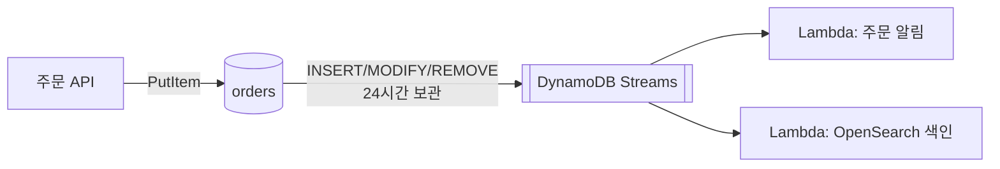

# M05-05. DynamoDB 심화 — GSI/LSI, 조건부 쓰기·트랜잭션, Streams, TTL, DAX, 글로벌 테이블
> 도메인: D2, D3 · 예상 시간: 60분 · 실습 등급: 🟢 (PITR 시점·글로벌 테이블 복제 🟡)

## 왜 필요한가

DynamoDB로 옮긴 주문 서비스에 새 요구가 줄을 선다. 물류팀은 "배송 대기 주문을 날짜순으로" 보고 싶은데 테이블 키는 고객 ID다. 한정판 텀블러 10개에 40명이 동시에 결제 버튼을 눌렀더니 40명 모두 "구매 완료"를 받았다. 장바구니는 하루 지나면 지워져야 하고, 주문이 생길 때마다 알림 서비스가 그 사실을 알아야 한다. 이번 레슨은 이 네 가지를 DynamoDB 기능 하나씩으로 푼다.

## 핵심 개념

### 보조 인덱스: GSI vs LSI



| | GSI (Global Secondary Index) | LSI (Local Secondary Index) |
|---|---|---|
| 키 | 파티션 키·정렬 키 **아무 속성이나** | 파티션 키는 **테이블과 같음**, 정렬 키만 다름 |
| 만들 때 | **언제든** 추가·삭제(기존 데이터는 백필) | **테이블 생성 시에만** |
| 개수 | 테이블당 20(기본, 늘릴 수 있음) | **5** |
| 읽기 일관성 | **최종 일관만** | 강력 일관 가능 |
| 용량 | 테이블과 **별도**(프로비저닝이면 따로 설정) | 테이블 용량을 함께 씀 |
| 크기 제약 | 없음 | 같은 파티션 키의 항목 모음(item collection) 10 GB |
| 투영(Projection) | `KEYS_ONLY` / `INCLUDE` / `ALL` — 인덱스에 복사할 속성. 투영하지 않은 속성은 인덱스 Query로 못 가져온다 | 같음 |

인덱스는 공짜가 아니다. 테이블에 쓸 때 인덱스에도 쓰므로 **쓰기 비용이 늘어난다**(인덱스 키나 투영 속성이 바뀌는 쓰기만). 인덱스 키 속성이 없는 항목은 인덱스에 들어가지 않는다 — 이것을 이용한 **희소 인덱스(sparse index)** 는 "배송 대기 중인 주문만" 같은 목록을 작게 유지한다.

> GSI 파티션 키로 `status`처럼 값이 몇 개 안 되는 속성을 쓰면 인덱스 쪽에 핫 파티션이 생긴다. 이 실습은 개념을 보이려고 `status`를 쓰지만, 큰 서비스라면 `status#날짜` 같은 합성 키나 희소 인덱스로 분산한다.

### 조건부 쓰기와 동시성, 트랜잭션

레슨 4의 조건식을 기억하자. 재고 차감을 **읽고 → 계산하고 → 덮어쓰기**로 하면 동시에 들어온 요청이 같은 값을 읽고 서로의 쓰기를 덮어쓴다(lost update). **`SET stock = stock - :q` + `ConditionExpression: stock >= :q`** 한 번으로 하면 DynamoDB가 항목 단위로 검사와 쓰기를 원자적으로 처리한다.

여러 항목을 "모두 성공 또는 모두 실패"로 묶을 땐 **트랜잭션**:

| | `TransactWriteItems` | `TransactGetItems` |
|---|---|---|
| 동작 | Put/Update/Delete/ConditionCheck 최대 **100개**(4 MB)를 원자적으로 | 최대 100개를 같은 시점의 값으로 |
| 비용 | 일반 쓰기의 **2배** WCU | 일반 읽기의 **2배** RCU |
| 실패 | 하나라도 조건이 틀리면 전부 취소 → `TransactionCanceledException` + 항목별 `CancellationReasons` | 충돌 시 취소 |
| 멱등성 | `ClientRequestToken` — **10분** 동안 같은 토큰의 같은 요청은 한 번만 반영 | — |
| 범위 | 같은 계정·같은 리전의 여러 테이블. 같은 항목을 두 번 건드릴 수 없음 | 같음 |

### Streams — 변경 이벤트

**DynamoDB Streams**를 켜면 항목의 생성·수정·삭제가 순서대로 **24시간** 보관되는 변경 로그에 남는다. 보기 유형: `KEYS_ONLY`, `NEW_IMAGE`, `OLD_IMAGE`, **`NEW_AND_OLD_IMAGES`**. 보통 **Lambda 트리거**(이벤트 소스 매핑, M07)가 읽어 알림·검색 색인·집계를 처리한다. 더 오래 보관하거나 여러 소비자가 필요하면 **Kinesis Data Streams로 내보내기**를 쓴다(M06).



### TTL — 자동 만료

항목에 **Unix epoch 초(Number 타입)** 로 만료 시각을 넣고 테이블에 TTL 속성 이름을 지정하면, 만료된 항목을 DynamoDB가 **WCU를 쓰지 않고** 지운다. 단, 실제 AWS는 **만료 후 보통 며칠 이내**에 지우며 즉시가 아니다 → 그동안 읽힐 수 있으므로 읽기 쪽에서 걸러야 한다. 문자열 등 Number가 아닌 TTL 값은 무시된다. TTL 삭제도 Streams에 `REMOVE`로 남는다(실제 AWS에서는 `userIdentity`가 `dynamodb.amazonaws.com` 서비스로 표시되어 사용자 삭제와 구분된다).

### 백업, PITR, 글로벌 테이블, DAX

| 기능 | 요약 |
|---|---|
| **온디맨드 백업** | 원할 때 전체 백업, 지울 때까지 보관. 복원은 **새 테이블** |
| **PITR** | 켜 두면 복구 기간(1~35일) 안의 아무 초로 **새 테이블**에 복원 |
| **글로벌 테이블** | 여러 리전에 **다중 활성(모든 리전에서 읽기·쓰기)** 복제본. 기본 모드는 최종 일관(보통 1초 안팎 복제, 같은 항목 동시 쓰기는 마지막 쓰기 승리). 다중 리전 강력 일관(MRSC) 모드도 있다 |
| **DAX** | DynamoDB 앞의 인메모리 캐시, 마이크로초 응답, API 호환(레슨 6) |
| **S3로 내보내기/가져오기** | 내보내기는 PITR을 켠 테이블에서 S3로(테이블 용량을 쓰지 않음) → Athena로 분석(M11). 가져오기는 PITR과 무관하게 S3 파일로 **새 테이블**을 만든다 |

## 직접 해 보기

### A. GSI 추가와 LSI — [labs/lab05-ddb-gsi-lsi.sh](./labs/lab05-ddb-gsi-lsi.sh)

**1) 운영 중인 테이블에 GSI 추가 → ACTIVE까지 폴링**

```bash
aws dynamodb update-table --table-name todayorder-m05-orders \
  --attribute-definitions AttributeName=status,AttributeType=S AttributeName=order_ts,AttributeType=S \
  --global-secondary-index-updates '[{"Create":{"IndexName":"status-index",
     "KeySchema":[{"AttributeName":"status","KeyType":"HASH"},{"AttributeName":"order_ts","KeyType":"RANGE"}],
     "Projection":{"ProjectionType":"INCLUDE","NonKeyAttributes":["customer_id","total"]}}}]'
```

```
{
    "TableStatus": "UPDATING",
    "GSI": [
        {
            "Name": "status-index",
            "Status": "CREATING"
        }
    ]
}
-- 인덱스가 ACTIVE 가 될 때까지 폴링 (table-exists waiter 는 인덱스 상태를 보지 않는다)
{
    "TableStatus": "ACTIVE",
    "GSI": [
        {
            "Name": "status-index",
            "Status": "ACTIVE"
        }
    ]
}
```

방금 본 것: GSI 생성은 비동기다. `IndexStatus`가 `ACTIVE`가 되기 전에는 Query할 수 없다. `table-exists` waiter는 테이블 상태만 보므로 인덱스는 따로 폴링한다.

**2) GSI Query — 모든 고객의 SHIPPED 주문, 날짜순**

```bash
aws dynamodb query --table-name todayorder-m05-orders --index-name status-index \
  --key-condition-expression "#s = :s AND order_ts BETWEEN :from AND :to" \
  --expression-attribute-names '{"#s":"status"}' \
  --expression-attribute-values '{":s":{"S":"SHIPPED"},":from":{"S":"2026-11-01"},":to":{"S":"2026-11-10"}}' \
  --return-consumed-capacity INDEXES
```

```
{
    "Count": 18,
    "First3": [
        [
            "c-005",
            "2026-11-01T06:00:00Z#A-00501",
            "49000"
        ],
        [
            "c-010",
            "2026-11-01T11:00:00Z#A-01001",
            "34000"
        ],
        [
            "c-004",
            "2026-11-02T06:00:00Z#A-00402",
            "5000"
        ]
    ],
    "Consumed": {
        "TableName": "todayorder-m05-orders",
        "CapacityUnits": 0.5,
        "ReadCapacityUnits": 0.5,
        "Table": {
            "ReadCapacityUnits": 0.0,
            "CapacityUnits": 0.0
        },
        "GlobalSecondaryIndexes": {
            "status-index": {
                "ReadCapacityUnits": 0.5,
                "CapacityUnits": 0.5
            }
        }
    }
}
SHIPPED 주문 전체: 40 건 (백필 덕분에 GSI 를 만들기 전에 넣은 항목도 나온다)
```

방금 본 것: 18건을 읽었는데 0.5 RCU다. 인덱스에는 키와 `customer_id`·`total`만 투영돼 항목이 작기 때문이다(테이블 항목은 1 KB였다). 소비 용량도 테이블이 아니라 **인덱스에서** 나갔다. 인덱스를 만들기 전에 넣은 주문도 나온다(백필).

**3) GSI의 제약 두 가지**

```
== 4. GSI 에는 강력 일관 읽기가 없다
aws: [ERROR]: An error occurred (ValidationException) when calling the Query operation: Consistent reads are not supported on global secondary indexes
== 5. 투영하지 않은 속성(memo 등)까지 달라고 하면?
aws: [ERROR]: An error occurred (ValidationException) when calling the Query operation: One or more parameter values were invalid: Select type ALL_ATTRIBUTES is not supported for global secondary index status-index because its projection type is not ALL
```

**4) LSI — 같은 고객 안에서 금액순(강력 일관도 됨)**

```
{
    "Count": 4,
    "Items": [
        [
            "41000",
            "2026-11-13T16:00:00Z#A-00313"
        ],
        [
            "43000",
            "2026-11-17T20:00:00Z#A-00317"
        ],
        [
            "48000",
            "2026-11-02T05:00:00Z#A-00302"
        ],
        [
            "50000",
            "2026-11-06T09:00:00Z#A-00306"
        ]
    ]
}
-- LSI 는 강력 일관 읽기가 된다
4
```

**5) 인덱스의 대가 — 쓰기 비용**

```
{
    "TableName": "todayorder-m05-orders",
    "CapacityUnits": 3.0,
    "WriteCapacityUnits": 3.0,
    "Table": {
        "WriteCapacityUnits": 1.0,
        "CapacityUnits": 1.0
    },
    "LocalSecondaryIndexes": {
        "customer-total-index": {
            "WriteCapacityUnits": 1.0,
            "CapacityUnits": 1.0
        }
    },
    "GlobalSecondaryIndexes": {
        "status-index": {
            "WriteCapacityUnits": 1.0,
            "CapacityUnits": 1.0
        }
    }
}
-- 같은 내용으로 한 번 더 덮어쓰면? (인덱스 키·투영 속성이 그대로라 인덱스 쓰기가 없다)
{
    "Total": 1.0,
    "Table": 1.0,
    "LSI": null,
    "GSI": null
}
```

방금 본 것: 새 주문 1건이 테이블 1 + LSI 1 + GSI 1 = **3 WCU**. 인덱스에 영향이 없는 쓰기는 인덱스 비용이 없다(AWS 문서의 규칙과 같다). 인덱스는 "읽기 패턴을 위해 쓰기 비용을 내는 것"이다.

### B. 조건부 쓰기·트랜잭션 — [labs/lab06-ddb-conditional-transactions.sh](./labs/lab06-ddb-conditional-transactions.sh)

**1) 조건부 차감: 재고 3 → 2개 주문 성공 → 다시 2개는 실패**

```bash
aws dynamodb update-item --table-name todayorder-m05-products --key '{"product_id":{"S":"P-100"}}' \
  --update-expression "SET stock = stock - :q" --condition-expression "stock >= :q" \
  --expression-attribute-values '{":q":{"N":"2"}}' --return-values UPDATED_NEW
```

```
{
    "stock": {
        "N": "1"
    }
}
== 3. 한 번 더 2개 주문 (남은 재고 1 → 조건 실패, 아무것도 바뀌지 않는다)
{
    "Message": "The conditional request failed",
    "Code": "ConditionalCheckFailedException",
    "message": "The conditional request failed",
    "Item": {
        "stock": {
            "N": "1"
        },
        "name": {
            "S": "limited tumbler"
        },
        "product_id": {
            "S": "P-100"
        }
    }
}
stock=1
```

방금 본 것: 실패한 요청에 `--return-values-on-condition-check-failure ALL_OLD`를 주면 **실패 시점의 항목**을 오류에 담아 준다(다시 읽을 필요가 없다). 오류 상세를 보려고 `--cli-error-format json`을 썼다.

**2) 트랜잭션: 주문 생성 + 재고 차감**

```bash
aws dynamodb transact-write-items --transact-items "$(tx_items A-5002 1)" \
  --client-request-token "$TOKEN" --return-consumed-capacity TOTAL
```

```
[
    {
        "Table": "todayorder-m05-order-ledger",
        "WCU": 2.0
    },
    {
        "Table": "todayorder-m05-products",
        "WCU": 2.0
    }
]
stock=0  A-5002=PLACED
== 6. 같은 요청을 같은 토큰으로 재시도 (네트워크 타임아웃 뒤 재시도 상황) → 성공 응답, 두 번 차감되지 않음
[
    {
        "Table": "todayorder-m05-order-ledger",
        "RCU": 2.0,
        "WCU": null
    },
    {
        "Table": "todayorder-m05-products",
        "RCU": 2.0,
        "WCU": null
    }
]
stock=0
== 7. 같은 토큰에 다른 내용을 실으면 거부
aws: [ERROR]: An error occurred (IdempotentParameterMismatchException) when calling the TransactWriteItems operation: Specified idempotent token was used with different request parameters within the idempotency window
```

방금 본 것: 작은 항목인데 테이블마다 2 WCU — **트랜잭션은 2배**다. 같은 토큰으로 재시도하면 **쓰지 않고 읽기만 해서(RCU)** 성공을 돌려준다. AWS 문서에 적힌 그대로다. 토큰은 10분 동안 기억되므로, 스크립트는 실행마다 새 토큰(`tok-A-5002-<시각>`)을 만든다. (처음엔 고정 토큰을 썼다가 10분 안에 다시 실행하자 새 테이블에 아무것도 쓰이지 않고 "성공"만 돌아왔다 — 멱등성이 정확히 동작한 것이다.)

**3) 하나라도 실패하면 전부 취소**

```
{
    "Message": "Transaction cancelled, please refer cancellation reasons for specific reasons [None, ConditionalCheckFailed]",
    "Code": "TransactionCanceledException",
    "CancellationReasons": [
        {
            "Code": "None"
        },
        {
            "Code": "ConditionalCheckFailed",
            "Message": "The conditional request failed"
        }
    ]
}
A-5004 주문 항목: None (None 이면 없음 = 원자성)
```

방금 본 것: `CancellationReasons`는 요청한 순서대로다. 0번(주문 Put)은 문제없었지만(`None`) 1번(재고 조건)이 실패해서 주문도 만들어지지 않았다. 코드는 이 인덱스로 "어느 상품이 품절인지"를 알아낸다([sdk/order_repository.py](./sdk/order_repository.py)의 `OutOfStock`).

**4) 동시성 실험 — [sdk/stock_concurrency.py](./sdk/stock_concurrency.py)**

```bash
uv run python curriculum/m05-databases/sdk/stock_concurrency.py
```

```
테이블 생성 요청: CREATING → waiter 로 ACTIVE 까지 대기

[1] 읽고-계산하고-덮어쓰기  (재고 10, 구매자 40명)
    '구매 성공' 응답 40건, 남은 재고 9
    → 사라진 차감(lost update) 39건, 재고를 넘어 판 수량(초과 판매) 30건

[2] 조건부 원자적 감소  SET stock = stock - :q  IF stock >= :q
    성공 10건, ConditionalCheckFailed 30건, 남은 재고 0

정리 완료
SDK stock_concurrency OK
```

방금 본 것: 스레드 40개가 동시에 요청했다. 읽고-덮어쓰기는 모두 "재고 10"을 읽고 "9"를 썼다. 숫자 두 개를 구분하자.

- **사라진 차감(lost update) 39건**: 40번 줄였는데 재고는 1만 줄었다(40 − (10 − 9)).
- **초과 판매 30건**: 10개뿐인 상품을 40명에게 팔았다(40 − 10).

조건부 감소는 정확히 10명만 성공하고 재고는 0에서 멈췄다. 주의: `threading.Barrier`는 "40명이 모두 같은 값을 읽은 뒤 동시에 쓴다"는 **최악의 경우를 강제**하는 장치다. 실제 서버에서는 요청이 겹치는 정도가 실행마다 달라 성공 수와 남은 재고가 매번 다르다(항상 40건·재고 9가 아니다). 하지만 겹치는 순간이 하나라도 있으면 같은 종류의 오류가 생기고, 조건부 쓰기는 어떤 순서에서도 10건만 통과시킨다.

### C. TTL과 Streams — [labs/lab07-ddb-ttl-streams.sh](./labs/lab07-ddb-ttl-streams.sh)

**1) Streams 켠 테이블 + TTL**

```bash
aws dynamodb create-table --table-name todayorder-m05-carts ... \
  --stream-specification StreamEnabled=true,StreamViewType=NEW_AND_OLD_IMAGES
aws dynamodb update-time-to-live --table-name todayorder-m05-carts \
  --time-to-live-specification Enabled=true,AttributeName=expires_at
```

```
{
    "TimeToLiveDescription": {
        "TimeToLiveStatus": "ENABLED",
        "AttributeName": "expires_at"
    }
}
```

방금 본 것: 활성화 직후 상태는 `ENABLING`일 수 있어 `ENABLED`까지 폴링했다. 실제 AWS에서는 TTL 설정 변경이 반영되는 데 최대 1시간이 걸리고, 그동안 같은 테이블의 TTL 설정을 다시 바꿀 수 없다.

**2) 만료된 장바구니는 지워지고, 문자열 TTL은 무시된다**

```
-- 실제 AWS에서는 만료 후 며칠 동안 읽힐 수 있다. 그래서 읽기 쪽에서 '만료된 것'을 거른다:
[
    "cart-active",
    "cart-string-ttl"
]
cart-expired 삭제 확인 (폴링 시작 후 0초. 에뮬레이터는 수 초, 실제 AWS는 보통 며칠 이내)
[
    {
        "cart": "cart-active",
        "expires_at": {
            "N": "1794572043"
        }
    },
    {
        "cart": "cart-string-ttl",
        "expires_at": {
            "S": "1794485583"
        }
    }
]
```

방금 본 것: 이 에뮬레이터는 만료 항목을 **수 초 안에** 지운다(이번 실행에서는 폴링을 시작하기도 전에 이미 지워졌다). 이것을 AWS의 성질로 기억하면 안 된다 — **실제로는 며칠 걸릴 수 있다.** 그래서 만료 시각이 지난 항목을 숨기는 필터(`NOT (attribute_type(expires_at, :N) AND expires_at <= :now)`)를 읽기 쪽에 둔다. 만료 시각을 문자열(`S`)로 넣은 `cart-string-ttl`은 이미 지난 시각인데도 남아 있다(Number만 TTL로 인정).

**3) 스트림 레코드**

```
-------------------------------------------------------------------------
|                              GetRecords                               |
+--------+-------------------+------------+------------+----------------+
|  event |        key        | new_items  | old_items  | userIdentity   |
+--------+-------------------+------------+------------+----------------+
|  INSERT|  cart-expired     |  1         |  None      |  None          |
|  INSERT|  cart-active      |  1         |  None      |  None          |
|  REMOVE|  cart-expired     |  None      |  1         |  None          |
|  INSERT|  cart-string-ttl  |  1         |  None      |  None          |
|  MODIFY|  cart-active      |  2         |  1         |  None          |
+--------+-------------------+------------+------------+----------------+
```

방금 본 것: `NEW_AND_OLD_IMAGES`라 `MODIFY`에는 변경 전(1)·후(2) 값이, `REMOVE`에는 지워지기 전 값이 있다. TTL 삭제(`cart-expired`의 REMOVE)도 스트림에 남는다 — 예를 들어 "장바구니 만료 → 재고 예약 해제" Lambda를 붙일 수 있다. 에뮬레이터는 TTL 삭제의 `userIdentity`를 비워 둔다(실제 AWS는 `{"type": "Service", "principalId": "dynamodb.amazonaws.com"}`).

### D. 용량 모드·백업·PITR·글로벌 테이블 — [labs/lab08-ddb-capacity-backup-global.sh](./labs/lab08-ddb-capacity-backup-global.sh)

```
== 2. 트래픽을 예측할 수 없다 → 온디맨드(PAY_PER_REQUEST)로 전환
{
    "Status": "UPDATING",
    "Mode": "PAY_PER_REQUEST"
}
BillingMode=PAY_PER_REQUEST
== 3. 온디맨드 백업 → 백업에서 '새 테이블'로 복원
{
    "Name": "todayorder-m05-catalog-bk",
    "Status": "AVAILABLE",
    "Type": "USER"
}
...
복원된 테이블 항목 수: 5
== 4. PITR(지속적 백업) 켜기 — 복구 기간 7일
{
    "Status": "ENABLED",
    "PITR": "ENABLED",
    "Days": 7
}
...
-- 복구 가능 구간 밖의 시각(1시간 전)을 고르면 거부된다
aws: [ERROR]: An error occurred (InvalidRestoreTimeException) when calling the RestoreTableToPointInTime operation: An invalid restore time was specified. RestoreDateTime must be between EarliestRestorableDateTime and LatestRestorableDateTime
...
시점 복원 테이블: 항목 5개, P-101 재고=0
(에뮬레이터 차이: LatestRestorableDateTime 이 PITR 을 켠 시각에 멈춰 있고, 복원 결과는 '복원 요청 시점의
 현재 데이터'다. 실제 AWS는 이 값이 보통 현재보다 약 5분 전까지 따라오며, 그 시각의 데이터로 복원한다.)
== 5. 글로벌 테이블: us-west-2 에 복제본 추가 (버전 2019.11.21)
...
{
    "Status": "ACTIVE",
    "Version": "2019.11.21",
    "Replicas": [
        {
            "Region": "us-west-2",
            "Status": "ACTIVE"
        }
    ]
}
-- us-west-2 로 물어보면? (에뮬레이터는 리전을 나누지 않아 같은 테이블이 보인다)
"arn:aws:dynamodb:us-west-2:000000000000:table/todayorder-m05-catalog"
```

방금 본 것: 용량 모드 전환·온디맨드 백업·복원(새 테이블)은 실제처럼 동작한다(🟢). PITR은 켜기·구간 검증·복원 API까지는 되지만 **"실수 직전으로 되돌리기"는 재현되지 않는다**(복원 테이블에도 실수한 값 0이 들어 있다) → 🟡. 글로벌 테이블은 복제본 설정·상태만 볼 수 있다(🟡).

## 실제 AWS에서는

- GSI 백필은 테이블 크기에 따라 수 분~수 시간 걸린다. 그동안에도 테이블 읽기·쓰기는 된다.
- GSI 복제는 비동기라 테이블에 쓴 직후 인덱스 Query에 안 보일 수 있다(보통 1초 미만).
- 트랜잭션은 같은 항목을 건드리는 다른 트랜잭션과 충돌하면 `TransactionConflict`로 취소될 수 있다 → 재시도(같은 토큰) 설계.
- TTL은 만료 후 보통 며칠 이내 삭제되며, 에뮬레이터처럼 수 초가 아니다.
- 글로벌 테이블: 각 리전에서 쓰고 읽을 수 있고, 트랜잭션은 **쓴 리전 안에서만** ACID다(다른 리전에는 부분적으로 보일 수 있다).

## 시험 포인트

- "기존 테이블에 새 조회 패턴(다른 파티션 키)" → **GSI**. "같은 파티션 키, 다른 정렬 + 강력 일관" → **LSI**(테이블 생성 시에만 — 나중에 필요하면 새 테이블).
- "동시 주문에도 재고가 음수가 되면 안 된다" → **조건부 쓰기**(원자적 감소). "주문 생성과 재고 차감을 함께" → **TransactWriteItems**(비용 2배).
- "재시도해도 한 번만 반영" → **`ClientRequestToken`**(10분).
- "항목 변경 시 Lambda 실행" → **Streams + Lambda**(24시간 보관). "세션·장바구니 자동 삭제, 비용 없이" → **TTL**(즉시 아님!).
- "여러 리전에서 지연 없이 읽기·쓰기, 리전 장애에도 계속" → **글로벌 테이블**. "실수로 지운 데이터 복구" → **PITR**(새 테이블로 복원).
- "DynamoDB 읽기를 마이크로초로" → **DAX**.

## 스스로 확인

1. 주문 테이블에 "가게(store_id)별 주문" 조회가 새로 필요하다. 테이블은 이미 운영 중이다. LSI로 할 수 있나?
2. TTL을 켜고 `expires_at`에 "2026-11-12T10:00:00Z" 문자열을 넣었다. 왜 지워지지 않나? 그리고 실제 AWS에서 만료 1분 뒤 조회에 항목이 보이면 버그인가?
3. 결제 서비스가 타임아웃 뒤 `TransactWriteItems`를 재시도해 재고가 두 번 줄었다. 무엇을 빠뜨렸나?

<details><summary>답</summary>

1. 안 된다. LSI는 파티션 키가 테이블과 같아야 하고(store_id는 다른 파티션 키) 테이블 생성 시에만 만들 수 있다. **GSI**(PK `store_id`, SK `order_ts`)를 추가한다.
2. TTL 속성은 **Number 타입 epoch 초**여야 한다(문자열은 무시). 만료 후에도 며칠 동안 보일 수 있는 것은 정상 동작이다 — 읽기 쪽에서 만료 시각으로 걸러야 한다.
3. **`ClientRequestToken`**. 같은 토큰으로 재시도하면 10분 안에는 한 번만 반영된다.
</details>
