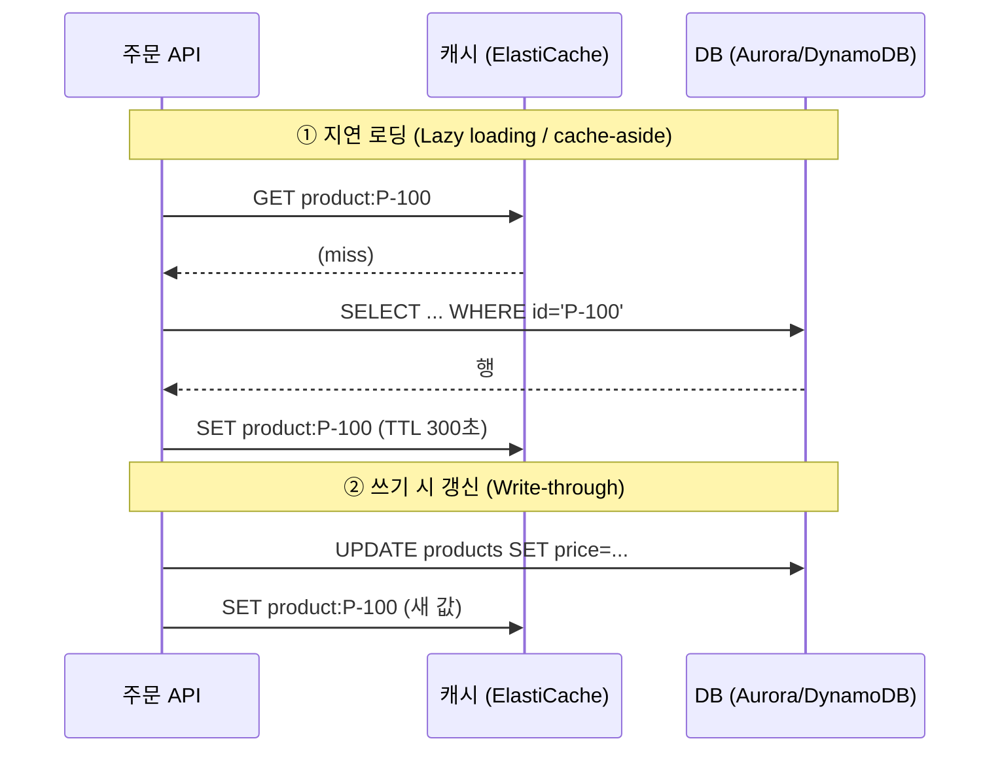

# M05-06. 캐시 — ElastiCache(Valkey/Redis OSS vs Memcached), DAX, 캐싱 전략
> 도메인: D2, D3 · 예상 시간: 45분 · 실습 등급: 🟡

## 왜 필요한가

TodayOrder 첫 화면의 "오늘의 인기 상품 20개"는 1초에 수천 번 요청되지만 내용은 5분에 한 번 바뀐다. 그때마다 DB를 때리는 건 낭비이고, 이벤트 날엔 DB가 먼저 쓰러진다. 로그인 세션도 API 서버 메모리에 두었더니 서버가 늘고 줄 때마다 사용자가 로그아웃된다. **자주 읽고 잘 안 바뀌는 데이터**와 **서버 밖에 둬야 하는 짧은 상태**를 위한 자리가 캐시다.

## 핵심 개념

### 캐싱 전략



| 전략 | 장점 | 단점 | 언제 |
|---|---|---|---|
| **지연 로딩(cache-aside)** | 실제로 읽히는 것만 캐시, 캐시가 죽어도 DB로 동작 | 첫 요청은 느림(miss), 값이 **오래될 수 있음** | 기본값. 읽기 많은 대부분의 데이터 |
| **쓰기 시 갱신(write-through)** | 캐시가 항상 최신 | 안 읽힐 데이터도 캐시(메모리 낭비), 쓰기 지연 증가 | 쓰고 바로 읽는 데이터 |
| **TTL** | 오래된 값이 언젠가 사라짐 | TTL 동안은 오래된 값 | 거의 항상 위 두 가지와 함께 |

캐시는 DB가 아니다. 노드가 재시작되거나 메모리가 차면(제거 정책) 데이터가 사라질 수 있다고 가정하고 설계한다.

### ElastiCache 엔진: Valkey / Redis OSS vs Memcached

**Amazon ElastiCache**는 관리형 인메모리 캐시다. 엔진은 **Valkey**(Redis OSS에서 갈라져 나온 오픈 소스, ElastiCache의 권장 엔진), **Redis OSS**, **Memcached** 중에서 고른다. Valkey와 Redis OSS는 같은 명령·프로토콜을 쓰고, AWS는 Valkey를 더 낮은 가격에 제공한다.

| | Valkey / Redis OSS | Memcached |
|---|---|---|
| 데이터 구조 | 문자열·해시·리스트·셋·**정렬 셋**·스트림·지리 공간 | 단순 키-값(문자열) |
| 복제·장애 조치 | **복제본 + 자동 장애 조치 + Multi-AZ** | 없음(노드가 죽으면 그 노드의 데이터 손실) |
| 영속성·백업 | 스냅샷 백업·복원 | 없음 |
| 확장 | 클러스터 모드로 샤딩(샤드 최대 수백 개), 복제본으로 읽기 확장 | 노드 추가로 수평 분산(클라이언트가 키를 나눔) |
| 스레드 | 주로 단일 스레드(엔진 버전에 따라 I/O 멀티스레드) | **멀티스레드** |
| 그 밖에 | Pub/Sub, Lua, 트랜잭션, 인증(AUTH/RBAC, IAM) | 단순함 |
| 고를 때 | 세션, 리더보드(정렬 셋), 고가용성 필요, 백업 필요 | 가장 단순한 캐시, 멀티스레드로 큰 노드 활용 |

배포 형태:
- **노드 기반**: 노드 유형(`cache.t4g.micro` 등)과 개수를 내가 정한다. Valkey/Redis OSS는 **복제 그룹**(기본 1 + 복제본 최대 5, 클러스터 모드면 샤드 여러 개), Memcached는 **클러스터**(노드 여러 개).
- **서버리스**: 노드를 고르지 않고 데이터 저장량·ECPU 상한만 정한다. 부하에 따라 자동 확장, 기본으로 여러 AZ에 복제.

### DAX — DynamoDB 전용 캐시

**DynamoDB Accelerator(DAX)** 는 DynamoDB 앞에 두는 **API 호환** 캐시다. 앱은 DynamoDB SDK 대신 DAX 클라이언트로 같은 `GetItem`/`Query`를 부르면 되고, 응답이 밀리초 → **마이크로초**로 줄어든다.

| | DAX | ElastiCache |
|---|---|---|
| 대상 | **DynamoDB만** | 어떤 데이터든(RDS 결과, API 응답, 세션…) |
| 코드 변경 | 클라이언트만 바꾸면 됨(같은 API) | 캐시 읽기/쓰기 로직을 직접 작성 |
| 캐시 방식 | 항목 캐시 + 쿼리 캐시, **write-through** | 앱이 정함 |
| 일관성 | 최종 일관 읽기만 캐시(강력 일관 읽기는 DynamoDB로 통과) | 앱이 정함 |
| 구성 | 기본 1 + 읽기 복제본 최대 10 (노드 3개 이상 권장, 여러 AZ) | 위 표 |

### 그 밖에

- **MemoryDB**: Redis/Valkey 호환이지만 **영속적인 주 데이터베이스**(트랜잭션 로그를 여러 AZ에 저장). "캐시가 아니라 인메모리 DB가 필요, 데이터 유실 불가"가 나오면 이것.
- 세션 저장소 후보: ElastiCache(빠름), DynamoDB(+ TTL, 서버리스). 둘 다 "API 서버를 무상태(stateless)로" 만들어 Auto Scaling(M03)과 잘 맞는다. 스티키 세션(ALB)은 서버 하나가 죽으면 그 세션이 사라진다.

## 직접 해 보기

[labs/lab09-elasticache-dax.sh](./labs/lab09-elasticache-dax.sh)

**1) Valkey 복제 그룹 (기본 1 + 복제본 1, Multi-AZ, 자동 장애 조치, 암호화)**

```bash
aws elasticache create-cache-subnet-group --cache-subnet-group-name todayorder-m05-cache-subnets \
  --cache-subnet-group-description "TodayOrder cache subnets" --subnet-ids "$SUBNET_A" "$SUBNET_B"
aws elasticache create-replication-group --replication-group-id todayorder-m05-sessions \
  --replication-group-description "TodayOrder session and product cache" \
  --engine valkey --cache-node-type cache.t4g.micro \
  --num-node-groups 1 --replicas-per-node-group 1 \
  --automatic-failover-enabled --multi-az-enabled \
  --cache-subnet-group-name todayorder-m05-cache-subnets --at-rest-encryption-enabled --transit-encryption-enabled
aws elasticache wait replication-group-available --replication-group-id todayorder-m05-sessions
```

```
{
    "Status": "creating",
    "Engine": "valkey",
    "AutomaticFailover": "enabled",
    "MultiAZ": "enabled",
    "Members": [
        "todayorder-m05-sessions-001",
        "todayorder-m05-sessions-002"
    ]
}
{
    "Status": "available",
    "ClusterMode": "disabled",
    "Primary": {
        "Address": "master.todayorder-m05-sessions.000001.us-east-1.cache.amazonaws.com",
        "Port": 6379
    },
    "Reader": {
        "Address": "replica.todayorder-m05-sessions.000001.us-east-1.cache.amazonaws.com",
        "Port": 6379
    },
    "Nodes": [
        {
            "Id": "todayorder-m05-sessions-001",
            "Role": "primary",
            "AZ": "us-east-1a"
        },
        {
            "Id": "todayorder-m05-sessions-002",
            "Role": "replica",
            "AZ": "us-east-1b"
        }
    ]
}
```

방금 본 것: 쓰기는 **기본(Primary) 엔드포인트**, 읽기는 **리더 엔드포인트**로. Aurora와 같은 모양이다. 노드는 서로 다른 AZ에 놓였다. 에뮬레이터가 돌려주는 이 주소는 실제 AWS 형식 이름(`*.cache.amazonaws.com`)이라 어디서도 해석되지 않는다. 접속할 수 없고, 접속을 시도하면 그 이름을 바깥 DNS에 묻게 되므로 실습은 접속하지 않는다([FIDELITY.md](../../docs/FIDELITY.md) 환경 메모) — 그래서 등급이 🟡다.

lab 스크립트는 `wait replication-group-available` 대신 같은 상태(`Status`가 `available`)를 1초 간격으로 확인한다([`scripts/lab-wait.sh`](../../scripts/lab-wait.sh)의 `wait_elasticache_replication_group_available`). CLI waiter는 15초 간격으로 조회하므로, 첫 조회가 생성 직후의 `creating`을 보면 에뮬레이터가 곧바로 `available`이 되어도 15초를 통째로 기다린다. 손으로 칠 때는 waiter로 충분하다.

**2) 장애 조치 테스트**

```bash
aws elasticache test-failover --replication-group-id todayorder-m05-sessions --node-group-id 0001
```

```
"modifying"
[
    {
        "Id": "todayorder-m05-sessions-002",
        "Role": "primary"
    },
    {
        "Id": "todayorder-m05-sessions-001",
        "Role": "replica"
    }
]
[
    "Replication group status changed from modifying to available",
    "Test Failover API called for node group 0001: failing over from primary node todayorder-m05-sessions-001 to replica node todayorder-m05-sessions-002"
]
```

방금 본 것: 복제본이 기본으로 승격되고 이벤트가 남는다(스크립트는 장애 조치 직전 시각 이후의 이벤트만 `--start-time`으로 본다. 복제 그룹이 남아 있어 다시 실행하면 001↔002 방향이 바뀐다. 이 시각은 호스트 시계로 계산하므로, 절전 뒤 에뮬레이터 VM 시계가 어긋나 있으면 이벤트 목록이 비어 보일 수 있다 — `scripts/clock-check.sh`로 확인). 기본 엔드포인트 이름은 그대로라 앱은 재연결만 한다.

**3) 잘못된 구성은 거부된다**

```
== 4. 잘못된 구성 ①: 복제본 0개로 자동 장애 조치?
aws: [ERROR]: An error occurred (InvalidParameterCombination) when calling the CreateReplicationGroup operation: AutomaticFailoverEnabled requires at least one replica in every node group (shard) to promote.
== 4. 잘못된 구성 ②: Memcached 로 복제 그룹?
aws: [ERROR]: An error occurred (InvalidParameterValue) when calling the CreateReplicationGroup operation: Invalid value memcached for Engine: a replication group must run one of redis | valkey.
```

방금 본 것: 장애 조치할 대상(복제본)이 없으면 자동 장애 조치도 없다. Memcached에는 복제 개념 자체가 없다. 시험의 "Memcached로 고가용성"은 함정이다.

**4) Memcached 클러스터 (노드 2개, 두 AZ)**

```
{
    "Status": "available",
    "ConfigEndpoint": {
        "Address": "todayorder-m05-mc.000004.cfg.us-east-1.cache.amazonaws.com",
        "Port": 11211
    },
    "Nodes": [
        {
            "Id": "0001",
            "AZ": "us-east-1a"
        },
        {
            "Id": "0002",
            "AZ": "us-east-1b"
        }
    ]
}
```

방금 본 것: **구성 엔드포인트(Configuration Endpoint)** 로 노드 목록을 자동 발견(Auto Discovery)하고, 클라이언트가 키를 해시해 노드에 나눠 담는다. 노드끼리 복제하지 않으므로 노드 하나가 죽으면 그 몫의 캐시가 사라진다(캐시라서 괜찮은 것).

**5) 서버리스 Valkey**

```bash
aws elasticache create-serverless-cache --serverless-cache-name todayorder-m05-serverless --engine valkey \
  --subnet-ids "$SUBNET_A" "$SUBNET_B" \
  --cache-usage-limits 'DataStorage={Maximum=5,Unit=GB},ECPUPerSecond={Maximum=5000}'
```

```
{
    "Status": "available",
    "Endpoint": {
        "Address": "todayorder-m05-serverless-000005.serverless.us-east-1.cache.amazonaws.com",
        "Port": 6379
    },
    "Reader": {
        "Address": "todayorder-m05-serverless-000005-ro.serverless.us-east-1.cache.amazonaws.com",
        "Port": 6379
    },
    "Limits": {
        "DataStorage": {
            "Maximum": 5,
            "Unit": "GB"
        },
        "ECPUPerSecond": {
            "Maximum": 5000
        }
    }
}
```

방금 본 것: 노드 유형·개수가 없다. 상한(비용 안전장치)만 정한다. 서버리스 캐시는 CLI waiter가 없어 스크립트가 상태를 폴링한다.

**6) DAX 클러스터**

```bash
aws dax create-cluster --cluster-name todayorder-m05-dax --node-type dax.t3.small --replication-factor 3 \
  --iam-role-arn arn:aws:iam::000000000000:role/todayorder-m05-dax-role \
  --sse-specification Enabled=true --cluster-endpoint-encryption-type TLS
```

```
-- (에뮬레이터 제약) DAX 서브넷 그룹은 어떤 서브넷을 줘도 거부된다
aws: [ERROR]: An error occurred (InvalidParameterValueException) when calling the CreateSubnetGroup operation: Some input subnets in :[subnet-00000000000000088, subnet-0000000000000008a] are invalid.
-- 서브넷 그룹 없이(기본 VPC) 클러스터 생성
{
    "Status": "creating",
    "TotalNodes": 3,
    "Endpoint": "daxs://todayorder-m05-dax.dax-clusters.us-east-1.amazonaws.com"
}
{
    "Status": "available",
    "ActiveNodes": 3,
    "Nodes": [
        {
            "Id": "todayorder-m05-dax-1",
            "AZ": "us-east-1a",
            "Status": "available"
        },
        {
            "Id": "todayorder-m05-dax-2",
            "AZ": "us-east-1b",
            "Status": "available"
        },
        {
            "Id": "todayorder-m05-dax-3",
            "AZ": "us-east-1c",
            "Status": "available"
        }
    ]
}
```

방금 본 것: DAX는 DynamoDB를 대신 호출하므로 **DynamoDB 권한을 가진 IAM 역할**(신뢰 주체 `dax.amazonaws.com`)이 필요하다. 노드 3개가 3개 AZ에 놓였다. TLS 엔드포인트라 주소가 `daxs://`다. 에뮬레이터에서는 DAX 서브넷 그룹 생성이 항상 실패해(실제 AWS에서는 VPC 서브넷으로 만든다) 기본 VPC로 만들었다.

**7) 정리 — 복제 그룹 삭제는 미구현**

```
aws: [ERROR]: An error occurred (NotImplemented) when calling the DeleteReplicationGroup operation: operation DeleteReplicationGroup is scaffolded but not implemented in this emulator
```

Memcached·서버리스·DAX는 지워지지만 복제 그룹은 지울 수 없어 남겨 둔다. 다시 실행하면 스크립트가 남아 있는 복제 그룹을 재사용하고, 에뮬레이터를 재시작(`scripts/emulator-reset.sh`)하면 사라진다.

## 실제 AWS에서는

- 엔드포인트에 실제 Valkey 서버가 있어, 같은 VPC의 EC2·Lambda에서 `valkey-cli -h <primary> --tls`로 접속해 `SET`/`GET`을 해 볼 수 있다(전송 암호화를 켰으면 TLS 필수). VPC 밖(내 PC)에서는 접속할 수 없다.
- 자동 장애 조치는 보통 수십 초~1분 정도 걸리고, 그동안 쓰기가 실패한다. 복제는 비동기라 장애 조치 직전의 쓰기 일부가 유실될 수 있다(캐시니까 괜찮게 설계한다).
- DAX도 VPC 안에서만 접근되며, DAX 전용 클라이언트 라이브러리가 필요하다.

> **실제 AWS에서 해 보려면** (🟡 실습)
> - 프리 티어: 2025-07-15 이전에 만든 계정(레거시 프리 티어)은 가입 후 12개월 동안 마이크로 캐시 노드 일정 시간이 무료였고, 이후 만든 계정은 크레딧을 쓰는 무료 플랜이다. 대상 노드 유형·시간은 바뀔 수 있으니 [AWS 프리 티어 페이지](https://aws.amazon.com/free/)에서 확인하자. 어느 쪽이든 복제 그룹(노드 2개)은 노드 시간이 2배로 든다. 서버리스 캐시·DAX를 무료로 쓸 수 있다고 가정하지 말자.
> - 과금 주의: 서버리스 캐시는 저장 데이터(GB-시간) + ECPU 요금, 최소 과금 저장량이 있다. DAX는 노드 시간 요금.
> - 정리: `aws elasticache delete-replication-group --replication-group-id <rg>`(실제 AWS에서는 동작) · `aws elasticache delete-serverless-cache --serverless-cache-name <s>` · `aws elasticache delete-cache-cluster --cache-cluster-id <mc>` · `aws dax delete-cluster --cluster-name <d>` → 서브넷 그룹·역할 삭제.

## 시험 포인트

- "DB 읽기 부하를 줄이고 응답을 빠르게, 자주 읽는 같은 데이터" → **ElastiCache**(또는 DynamoDB면 **DAX**).
- "DynamoDB 읽기를 마이크로초로, 코드 변경 최소" → **DAX**. "RDS 쿼리 결과 캐시" → ElastiCache(DAX는 DynamoDB 전용).
- 고가용성·복제·백업·정렬 셋(리더보드)·Pub/Sub → **Valkey/Redis OSS**. 가장 단순·멀티스레드·복제 불필요 → **Memcached**.
- 세션을 서버 밖에 → ElastiCache 또는 DynamoDB(TTL). 스티키 세션은 가용성에 약하다.
- 지연 로딩은 오래된 데이터 위험(TTL로 완화), write-through는 항상 최신이지만 메모리 낭비.
- "Redis 호환 + 영속적 주 DB" → **MemoryDB**.

## 스스로 확인

1. 인기 상품 목록을 지연 로딩으로 캐시했다. 관리자가 가격을 바꿨는데 화면에 5분 동안 옛 가격이 보인다. 두 가지 해결책은?
2. Memcached 클러스터의 노드 하나가 죽었다. 서비스는 어떻게 되나?
3. DynamoDB `GetItem`을 DAX로 바꿨더니 강력 일관 읽기 요청은 빨라지지 않았다. 왜?

<details><summary>답</summary>

1. ① 가격 변경 시 캐시도 갱신하거나 키를 지운다(write-through/무효화). ② TTL을 줄인다(비용은 늘어남).
2. 그 노드에 있던 키들이 캐시 miss가 되어 DB에서 다시 읽는다. 서비스는 계속되지만 DB 부하가 잠시 늘어난다. 복제·장애 조치는 없다.
3. DAX는 최종 일관 읽기만 캐시한다. 강력 일관 읽기는 DynamoDB로 그대로 전달된다.
</details>
