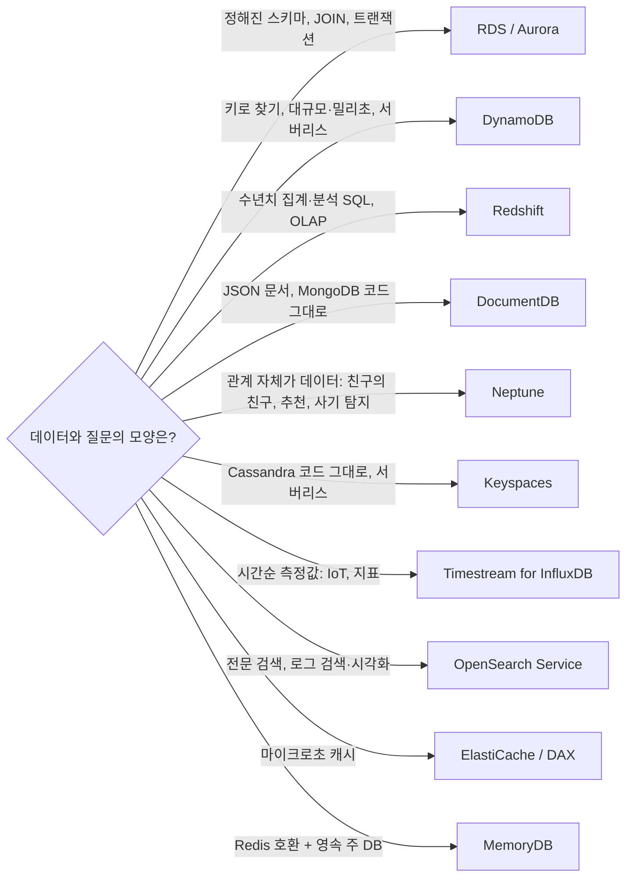

# M05-07. 목적별 DB 한눈에 — Redshift, DocumentDB, Neptune, Keyspaces, Timestream, OpenSearch
> 도메인: D3 · 예상 시간: 35분 · 실습 등급: 🟡

## 왜 필요한가

TodayOrder에 요구 사항이 쏟아진다. 경영진은 "지난 3년 주문을 지역·상품별로 집계한 대시보드", 마케팅은 "이 상품을 산 사람이 함께 산 상품 추천", 검색팀은 "오타가 나도 찾아지는 상품 검색", 물류팀은 "배송 차량의 GPS를 초 단위로 저장". 이걸 모두 Aurora 하나에 넣으면 어느 것도 잘 안 된다. AWS의 원칙은 **"일에 맞는 DB를 고른다(purpose-built)"** 이고, 시험은 요구 사항 한 줄을 읽고 이 중 하나를 고르게 한다.

## 핵심 개념

### 요구 사항 → DB 고르기



| 서비스 | 한 줄 정의 | 호환·쿼리 | 시험 키워드 |
|---|---|---|---|
| **Amazon Redshift** | 열(column) 기반 **데이터 웨어하우스**(OLAP). 대량 데이터를 SQL로 집계 | PostgreSQL 계열 SQL, **Redshift Spectrum**으로 S3 데이터도 조회, Serverless 옵션 | "페타바이트 분석", "BI 대시보드", "복잡한 집계 쿼리". OLTP(주문 저장)에는 쓰지 않는다 |
| **Amazon DocumentDB** | 관리형 **문서 DB** | **MongoDB 호환** API | "MongoDB 워크로드를 관리형으로 이전" |
| **Amazon Neptune** | 관리형 **그래프 DB** | Gremlin, openCypher, SPARQL | "소셜 관계", "추천", "사기 탐지", "지식 그래프" |
| **Amazon Keyspaces** | 서버리스 **Apache Cassandra 호환** DB | **CQL** | "Cassandra를 서버 관리 없이" |
| **Amazon Timestream** | **시계열** DB | for InfluxDB(관리형 InfluxDB) | "IoT 센서", "시간순 측정값", "운영 지표" |
| **Amazon OpenSearch Service** | 관리형 **검색·분석** 엔진(Elasticsearch에서 갈라져 나온 OpenSearch) | 검색 DSL, SQL, OpenSearch Dashboards | "전문(full-text) 검색", "로그 분석·시각화", DynamoDB 데이터에 검색 붙이기 |
| **Amazon MemoryDB** | Redis/Valkey 호환 **영속 인메모리 DB** | Redis 명령 | "마이크로초 읽기 + 데이터 유실 불가" |

> **Timestream 이름 주의**: Timestream에는 두 가지가 있다. 원래 서버리스 시계열 DB였던 **Timestream for LiveAnalytics는 2025-06-20부터 신규 고객을 받지 않는다**(기존 고객은 계속 사용 가능). AWS는 새 워크로드에 **Timestream for InfluxDB**를 권한다. 시험 문제에서 "Timestream"이 나오면 "시계열 데이터용 관리형 DB"로 읽으면 된다.
>
> **QLDB**(원장 DB)는 2025년에 지원이 종료되어 이 커리큘럼에서 다루지 않는다.

### 자주 나오는 조합

- **DynamoDB + OpenSearch**: 주문은 DynamoDB에, 상품 검색은 OpenSearch에(DynamoDB Streams·zero-ETL 통합으로 동기화).
- **Aurora → Redshift**: 운영 DB(OLTP)는 Aurora, 분석은 Redshift(zero-ETL 통합 또는 DMS, M11).
- **S3 + Athena vs Redshift**: 가끔·즉석 쿼리면 Athena(서버리스, 스캔한 만큼 과금, M11), 자주·복잡·빠른 대시보드면 Redshift.

## 직접 해 보기

[labs/lab10-purpose-built-tour.sh](./labs/lab10-purpose-built-tour.sh) — 세 서비스의 **구성 모양**만 확인한다(데이터를 넣고 질의하지는 않는다. 엔드포인트가 실제 엔진이 아니다).

**1) DocumentDB: 클러스터 + 인스턴스 (Aurora와 같은 모양)**

```bash
aws docdb create-db-cluster --db-cluster-identifier todayorder-m05-reviews --engine docdb \
  --master-username todayorder --master-user-password 'Lab-only-Passw0rd' --storage-encrypted
aws docdb create-db-instance --db-instance-identifier todayorder-m05-reviews-1 \
  --db-cluster-identifier todayorder-m05-reviews --engine docdb --db-instance-class db.t3.medium
```

<!-- external-host-ok: 에뮬레이터가 돌려준 AWS 형식 이름을 실행 출력 그대로 실었다. 실습은 이 이름에 접속하지 않는다 -->
```
{
    "Status": "available",
    "Version": "5.0.0",
    "Endpoint": "todayorder-m05-reviews.cluster-00000000002d.us-east-1.docdb.amazonaws.com",
    "ReaderEndpoint": "todayorder-m05-reviews.cluster-ro-00000000002d.us-east-1.docdb.amazonaws.com",
    "Port": 27017,
    "Members": [
        {
            "Id": "todayorder-m05-reviews-1",
            "Writer": true
        }
    ]
}
```

방금 본 것: 클러스터 엔드포인트·리더 엔드포인트·쓰기 멤버 — Aurora에서 본 구조와 같다(DocumentDB도 컴퓨트와 공유 스토리지를 분리한 구조다). 포트 **27017**은 MongoDB 기본 포트다. 앱은 MongoDB 드라이버로 붙는다.

**2) Keyspaces: CQL 스키마를 API로**

```bash
aws keyspaces create-keyspace --keyspace-name todayorder_m05
aws keyspaces create-table --keyspace-name todayorder_m05 --table-name order_events \
  --schema-definition 'allColumns=[{name=order_id,type=text},{name=event_time,type=timestamp},{name=status,type=text}],partitionKeys=[{name=order_id}],clusteringKeys=[{name=event_time,orderBy=DESC}]'
```

```
{
    "Status": "ACTIVE",
    "Capacity": "PAY_PER_REQUEST",
    "PartitionKey": [
        "order_id"
    ],
    "ClusteringKey": [
        {
            "name": "event_time",
            "orderBy": "DESC"
        }
    ]
}
```

방금 본 것: Cassandra의 **파티션 키 + 클러스터링 키**는 DynamoDB의 파티션 키 + 정렬 키와 같은 발상이다. 서버리스(온디맨드)라 노드가 없다. 실제로는 `cqlsh`나 Cassandra 드라이버로 `CREATE TABLE`/`SELECT`를 쓴다.

**3) Neptune: 그래프 DB 클러스터**

<!-- external-host-ok: 에뮬레이터가 돌려준 AWS 형식 이름을 실행 출력 그대로 실었다. 실습은 이 이름에 접속하지 않는다 -->
```
{
    "Status": "available",
    "Version": "1.4.8.0",
    "Endpoint": "todayorder-m05-recommend.cluster-00000000002x.us-east-1.neptune.amazonaws.com",
    "Port": 8182
}
```

방금 본 것: 포트 8182는 Neptune의 Gremlin/openCypher HTTP·WebSocket 엔드포인트 포트다. 실제로 쓰려면 클러스터에 인스턴스를 붙이고 같은 VPC 안에서 Gremlin 클라이언트로 접속한다.

이 실습은 구성까지만 하므로 🟡다. Redshift·OpenSearch·Timestream for InfluxDB도 에뮬레이터 API는 응답하지만(`aws redshift describe-clusters`, `aws opensearch list-domain-names`, `aws timestream-influxdb list-db-instances`) 이 모듈에서는 "고르는 법"까지만 다룬다. Redshift·OpenSearch는 M11(데이터 분석)에서 다시 나온다.

## 실제 AWS에서는

- 이 서비스들은 대부분 **VPC 안**에 만들어지고(Keyspaces는 퍼블릭 엔드포인트 + VPC 엔드포인트), 인스턴스·노드 시간 요금이 나온다.
- DocumentDB는 MongoDB "호환"이지 MongoDB 그 자체가 아니다. 지원하는 API·연산자 버전을 확인하고 옮긴다.
- 에뮬레이터에서는 `timestream-write`(LiveAnalytics) CLI가 내부 서비스 이름 충돌로 `AmbiguousService` 오류를 낸다. 위 설명대로 새 설계라면 InfluxDB 쪽을 본다.

> **실제 AWS에서 해 보려면** (🟡 실습)
> - 프리 티어: DocumentDB·Neptune은 신규 계정 무료 체험(기간·시간 한정)이 있었지만 조건이 자주 바뀐다 — 콘솔의 "Free trial" 표시를 확인하자. Keyspaces는 온디맨드라 소량이면 요금이 매우 작다.
> - 과금 주의: DocumentDB·Neptune은 인스턴스를 지워도 **클러스터 스토리지·백업**이 남으면 과금된다. 클러스터까지 지운다.
> - 정리: `aws docdb delete-db-instance --db-instance-identifier <i>` → `aws docdb delete-db-cluster --db-cluster-identifier <c> --skip-final-snapshot` · `aws neptune delete-db-cluster --db-cluster-identifier <c> --skip-final-snapshot` · `aws keyspaces delete-keyspace --keyspace-name <ks>`.

## 시험 포인트

- "OLAP·대규모 집계·BI" → **Redshift**(S3까지 → Spectrum). "OLTP·주문 저장" → RDS/Aurora/DynamoDB.
- "MongoDB" → **DocumentDB**. "Cassandra" → **Keyspaces**. "그래프·관계·추천·사기 탐지" → **Neptune**.
- "시계열·IoT 측정값" → **Timestream**(새 워크로드는 for InfluxDB).
- "전문 검색·로그 검색·대시보드" → **OpenSearch Service**.
- "Redis 호환 + 내구성 있는 주 DB" → **MemoryDB**, "캐시" → ElastiCache.
- 원장·변경 이력 검증(QLDB) 문제가 옛 자료에 보이면, 현재는 지원 종료된 서비스임을 기억하자.

## 스스로 확인

1. "지난 5년 주문 데이터(수십 TB)로 월별·지역별 매출 대시보드"에 Aurora 읽기 복제본을 쓰면 무엇이 아쉬운가? 무엇을 고르나?
2. "이 상품을 산 고객이 함께 산 상품"을 RDB로 구현하면 무엇이 어려운가?
3. 사내 MongoDB 기반 리뷰 서비스를 코드 변경 최소로 관리형으로 옮기려면?

<details><summary>답</summary>

1. 행 기반 OLTP 엔진이라 대량 집계가 느리고, 스토리지·비용도 분석에 맞지 않다. 열 기반 웨어하우스인 **Redshift**(또는 가끔이면 S3 + Athena)를 고른다.
2. 관계를 여러 단계 따라가는 질의가 JOIN 여러 번(재귀)이 되어 느리고 복잡하다. 관계를 1급 데이터로 다루는 **Neptune**이 맞다.
3. MongoDB 호환인 **DocumentDB**로 옮긴다(드라이버·코드 대부분 그대로).
</details>
