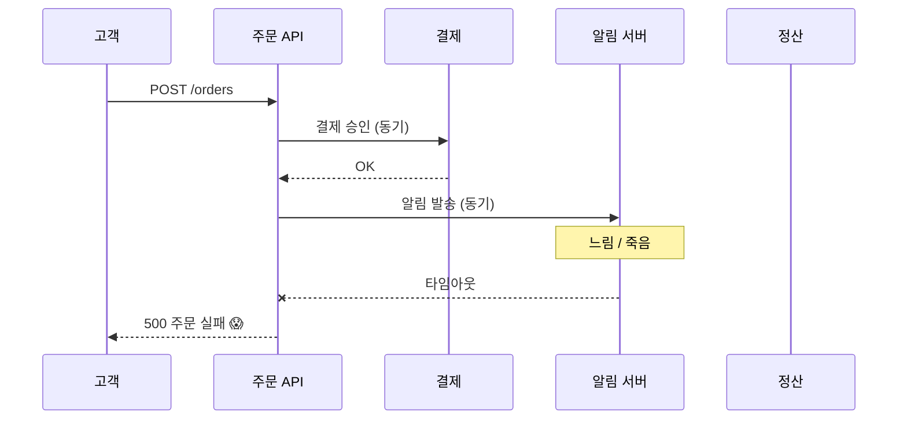
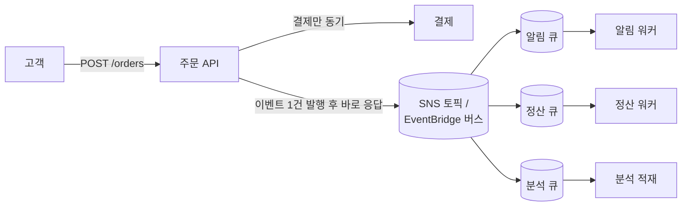

# M06-01. 왜 디커플링인가
> 도메인: D2 · 예상 시간: 30분 · 실습 등급: 🟢

## 왜 필요한가

TodayOrder의 주문 API는 지금 한 요청 안에서 모든 일을 한다. 주문을 DB에 저장하고 → 결제 대행사(PG)를 부르고 → 알림 서버에 카카오 알림톡을 요청하고 → 정산 시스템에 기록한 뒤에야 고객에게 "주문 완료"를 돌려준다. 지난주 알림 서버가 느려지자 주문 API 응답이 8초로 늘었고, 알림 서버가 죽은 10분 동안은 **주문 자체가 실패**했다. 알림은 몇 분 늦어도 되는 일인데 말이다. 이 모듈은 "꼭 지금 끝나야 하는 일"과 "나중에 해도 되는 일"을 떼어 내는(디커플링) 방법을 다룬다.

## 핵심 개념

### 강결합(tight coupling)이 장애를 퍼뜨리는 방식



동기 호출 사슬에서는 **가장 느린 하나가 전체 응답 시간**이 되고, **가장 약한 하나가 전체 가용성**이 된다. 서비스 4개가 각각 99.9%로 동작해도 모두 성공해야 하는 사슬의 가용성은 약 99.6%(0.999⁴)로 떨어진다.

### 디커플링: 중간에 "받아 두는 곳"을 둔다



주문 API는 "주문이 생겼다"는 **이벤트(event)** 하나만 남기고 바로 응답한다. 알림 워커가 죽어 있어도 메시지는 큐에 쌓여 있다가 워커가 살아나면 처리된다. 이것이 디커플링이 주는 세 가지다.

| 이득 | 뜻 | TodayOrder에서 |
|---|---|---|
| **장애 격리** | 소비자가 죽어도 생산자는 영향을 받지 않는다 | 알림 서버 장애 중에도 주문은 성공 |
| **버퍼링(완충)** | 생산 속도와 소비 속도가 달라도 큐가 흡수한다 | 점심시간 주문 폭주를 정산 워커가 자기 속도로 처리 |
| **팬아웃(fan-out)** | 하나의 이벤트를 여러 소비자가 각자 받는다 | 주문 생성 이벤트 → 알림·정산·분석 |

대가도 있다. 결과가 **나중에(최종적 일관성)** 반영되고, 메시지가 **두 번 올 수 있으며(멱등 처리 필요)**, 흐름이 눈에 덜 보인다(추적·DLQ 필요). 결제처럼 응답 전에 꼭 결과를 알아야 하는 일은 여전히 동기로 둔다.

### 이 모듈의 도구 지도

| 서비스 | 한 줄 정의 | 모델 | 레슨 |
|---|---|---|---|
| **SQS** (Simple Queue Service) | 메시지를 보관했다가 소비자가 꺼내 가는 **큐** | 1:1 (한 메시지는 한 소비자가 처리) · 풀(pull) | [02](./02-sqs.md) |
| **SNS** (Simple Notification Service) | 메시지를 구독자 모두에게 **밀어 주는** 토픽 | 1:N · 푸시(push) | [03](./03-sns-fanout.md) |
| **EventBridge** | 이벤트 내용을 **규칙(패턴)** 으로 골라 대상에 보내는 이벤트 버스 | 1:N, 내용 기반 라우팅 | [04](./04-eventbridge.md) |
| **Step Functions** | 여러 단계를 순서·분기·재시도와 함께 실행하는 **워크플로** | 오케스트레이션 | [05](./05-step-functions.md) |
| **Kinesis Data Streams** | 순서 있는 레코드를 보관하고 여러 소비자가 **다시 읽을 수 있는** 스트림 | 로그형, 재생 가능 | [06](./06-streaming.md) |

> 용어 하나: **오케스트레이션(orchestration)** 은 지휘자(Step Functions)가 각 단계를 직접 부르는 방식, **코레오그래피(choreography)** 는 각 서비스가 이벤트를 듣고 알아서 움직이는 방식(SNS·EventBridge)이다. 둘 다 디커플링이지만, 단계 순서와 실패 처리를 한눈에 보고 싶으면 오케스트레이션이 낫다.

## 직접 해 보기

[lab01-sqs-basics.sh](./labs/lab01-sqs-basics.sh)의 첫 두 단계가 "버퍼링"을 보여 준다. 소비자(워커)가 없는 상태에서 주문 3건을 큐에 넣는다.

```bash
bash curriculum/m06-integration-messaging/labs/lab01-sqs-basics.sh
```

```
== 0. 큐 만들기 (가시성 타임아웃 5초 — 관찰용으로 짧게)
https://sqs.us-east-1.amazonaws.com/000000000000/todayorder-orders
...
== 1. 워커가 멈춘 동안 주문 3건 도착 → 큐에 쌓인다
dcddb971-7c63-4690-8c27-15a3fb5942bb
0bd46c84-4d95-4a61-a5b0-528323b39df0
5298c1f8-2ac9-47c0-aaf7-b7cf013dddca
ApproximateNumberOfMessages=3
```

방금 본 것: `send-message`는 소비자가 있든 없든 성공하고 메시지 ID만 돌려준다. 생산자(주문 API)는 워커의 상태를 몰라도 된다 — 이것이 장애 격리다. 큐 URL이 `sqs.us-east-1.amazonaws.com`처럼 실제 AWS 모양이지만, CLI는 `AWS_ENDPOINT_URL`(에뮬레이터)로 요청을 보낸다. 나머지 단계는 다음 레슨에서 이어서 본다.

## 실제 AWS에서는

- 디커플링 자체는 설계 개념이라 에뮬레이터와 차이가 없다. 다만 실제 AWS에서는 큐에 쌓인 메시지 수(`ApproximateNumberOfMessagesVisible` 지표)를 CloudWatch 알람으로 보고 워커 수를 늘리는(Auto Scaling) 구성을 흔히 쓴다(M03·M10). 에뮬레이터에는 이런 자동 조정이 없다.

## 시험 포인트

- "한 구성 요소가 느려지거나 실패해도 주문 접수는 계속되어야 한다", "**느슨하게 결합(loosely coupled)**" → 사이에 **SQS** 를 둔다.
- "하나의 이벤트를 여러 시스템이 각자 처리" → **SNS 팬아웃(SNS → 여러 SQS)** 또는 **EventBridge 규칙 여러 개**.
- "트래픽 급증을 흡수(버퍼)해 백엔드(DB)를 보호" → **SQS** + 워커. 큐 길이 지표로 워커 Auto Scaling.
- "여러 단계, 순서, 재시도, 사람 승인 대기" → **Step Functions**.
- 디커플링하면 결과가 늦게 반영된다. "즉시 결과를 응답해야 한다"는 요구는 동기 호출로 남긴다.

## 스스로 확인

1. 주문 API가 알림 서버를 동기로 부를 때와 SQS에 넣을 때, 알림 서버 장애가 주문 성공률에 주는 영향은 각각 어떤가?
2. 결제 승인도 큐 뒤로 보내면 어떤 문제가 생기나?
3. 오케스트레이션과 코레오그래피 중, "주문 → 결제 → 배송 요청을 순서대로, 결제 실패 시 보상 처리"를 한눈에 관리하기 좋은 것은?

<details><summary>답</summary>

1. 동기: 알림 서버가 죽으면 주문도 실패한다(가용성이 곱해진다). SQS: 주문은 성공하고 알림은 큐에 쌓였다가 서버가 살아나면 처리된다.
2. 고객에게 "결제 성공/실패"를 즉시 알려 줄 수 없다. 재고 확보·이중 결제 방지도 복잡해진다. 응답 전에 결과가 필요한 일은 동기로 둔다.
3. 오케스트레이션(Step Functions). 단계와 실패 경로가 상태 머신 정의 한 곳에 보이고 실행 이력이 남는다.

</details>
