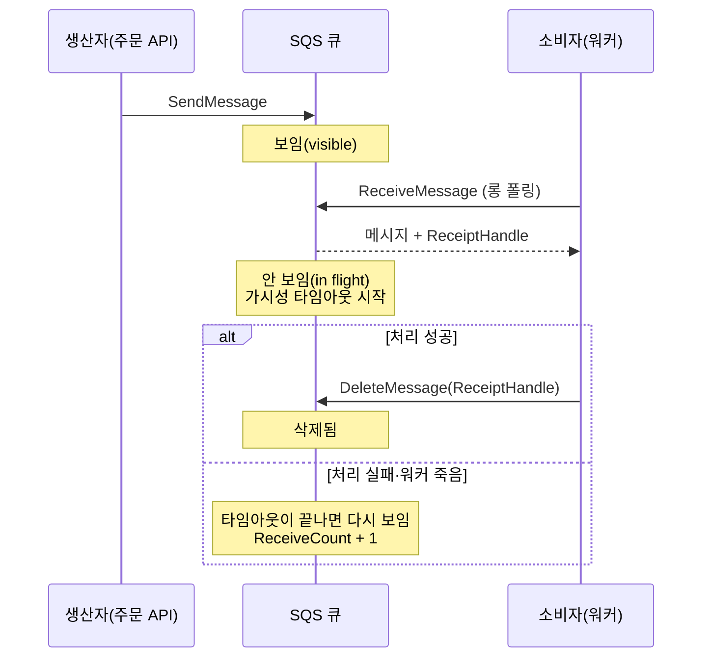
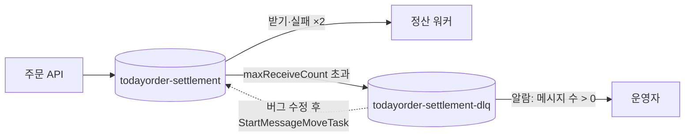

# M06-02. SQS — 표준 vs FIFO, 가시성 타임아웃, 롱 폴링, DLQ, 지연 큐
> 도메인: D2 · 예상 시간: 60분 · 실습 등급: 🟢

## 왜 필요한가

알림·정산을 주문 API에서 떼어 내기로 했다. 주문 API는 "정산해 주세요" 메시지를 큐에 넣고, 정산 워커는 큐에서 꺼내 처리한다. 그런데 바로 질문이 생긴다. 워커가 메시지를 꺼낸 직후 죽으면 그 주문은 사라지나? 버그 때문에 계속 실패하는 메시지 하나가 큐를 막으면? 같은 주문의 "결제됨"과 "취소됨"이 뒤바뀌어 처리되면? SQS의 핵심 설정들은 모두 이 질문들에 대한 답이다.

## 핵심 개념

### 메시지의 일생



SQS는 메시지를 **받는다고 지우지 않는다.** 받은 메시지는 **가시성 타임아웃(visibility timeout)** 동안 다른 소비자에게 안 보일 뿐이다. 소비자가 처리를 끝내고 `DeleteMessage`를 불러야 사라진다. 그래서 워커가 처리 중에 죽어도 메시지는 잃지 않는다 — 타임아웃 뒤에 다시 나타난다.

| 설정 | 기본값 | 범위 | 언제 조정하나 |
|---|---|---|---|
| 가시성 타임아웃 | 30초 | 0초 ~ 12시간 | 처리 시간보다 **길게**. 짧으면 처리 중인 메시지가 다시 보여 **중복 처리** |
| 메시지 보존 기간 | 4일 | 60초 ~ 14일 | 소비자가 오래 멈출 수 있으면 늘린다. DLQ는 원본보다 길게 |
| 수신 대기 시간(롱 폴링) | 0초(쇼트 폴링) | 0 ~ 20초 | 빈 응답·요청 수(=비용)를 줄이려면 1~20초 |
| 전송 지연(지연 큐) | 0초 | 0 ~ 15분 | "주문 10분 후 미결제면 취소 확인" 같은 지연 처리 |
| 메시지 크기 | 최대 1 MiB | | 더 크면 S3에 두고 참조만 보낸다(확장 클라이언트 라이브러리) |

(수치 출처: [SQS 메시지 할당량](https://docs.aws.amazon.com/AWSSimpleQueueService/latest/SQSDeveloperGuide/quotas-messages.html). 메시지 최대 크기는 2025년 8월 256 KiB → 1 MiB로 늘었다.)

- **쇼트 폴링 vs 롱 폴링**: 쇼트 폴링은 서버 일부만 보고 즉시 응답해서 메시지가 있어도 빈 응답이 올 수 있다. 롱 폴링(`WaitTimeSeconds` 1~20)은 메시지가 오거나 시간이 다 될 때까지 기다려, 빈 응답과 요청 비용을 줄인다. 시험에서는 거의 항상 **롱 폴링**이 정답이다.
- **`ChangeMessageVisibility`**: 처리 시간이 예상보다 길어지면 타임아웃을 늘리고(하트비트), 실패를 알고 있으면 0으로 바꿔 즉시 다른 워커에게 넘긴다.

### 표준 큐 vs FIFO 큐

| | 표준(Standard) | FIFO |
|---|---|---|
| 전달 보장 | **최소 한 번(at-least-once)** — 드물게 중복 | **정확히 한 번 처리**(중복 제거 기간 5분 안의 같은 중복 제거 ID는 버림) |
| 순서 | 최선 노력(best-effort) — 바뀔 수 있음 | **메시지 그룹(MessageGroupId) 안에서** 엄격한 순서 |
| 처리량 | 사실상 무제한 | 파티션당 API 동작별 초당 300건, 배치 사용 시 초당 3,000 메시지. **높은 처리량 모드**로 그 이상 |
| 이름 | 자유 | 반드시 `.fifo`로 끝남 |
| 전송 시 필수 | – | `MessageGroupId`. 중복 제거 ID(`MessageDeduplicationId`) 또는 `ContentBasedDeduplication=true` |

FIFO의 순서는 **그룹 단위**다. 주문 ID를 그룹으로 쓰면 "A 주문의 생성→결제→배송" 순서는 지키면서, 다른 주문들은 병렬로 처리된다. 한 그룹의 메시지가 처리 중(in flight)이면 그 그룹의 다음 메시지는 나오지 않는다 — 그래야 순서가 보장된다.

### DLQ(배달 못 한 편지 큐)와 재처리

버그나 잘못된 데이터 때문에 **매번 실패하는 메시지(독 메시지, poison message)** 는 영원히 다시 나타나 워커를 낭비한다. 원본 큐에 **재드라이브 정책(RedrivePolicy)** 을 걸면, `maxReceiveCount`번 넘게 받아 간 메시지를 **DLQ**로 옮긴다.



- DLQ는 원본과 같은 종류여야 한다(표준↔표준, FIFO↔FIFO), 같은 계정·리전.
- DLQ의 보존 기간은 원본보다 길게 둔다. (표준 큐에서는 메시지가 DLQ로 옮겨져도 원래 넣은 시각 기준으로 보존 기간이 계산된다.)
- 버그를 고친 뒤 **DLQ 재드라이브(`StartMessageMoveTask`)** 로 메시지를 원본 큐로 되돌린다.

## 직접 해 보기

### 1) 가시성 타임아웃·롱 폴링·지연 — [lab01-sqs-basics.sh](./labs/lab01-sqs-basics.sh)

```bash
bash curriculum/m06-integration-messaging/labs/lab01-sqs-basics.sh
```

```
== 0. 큐 만들기 (가시성 타임아웃 5초 — 관찰용으로 짧게)
https://sqs.us-east-1.amazonaws.com/000000000000/todayorder-orders
{
    "Attributes": {
        "ReceiveMessageWaitTimeSeconds": "0",
        "MaximumMessageSize": "1048576",
        "DelaySeconds": "0",
        "MessageRetentionPeriod": "345600",
        "VisibilityTimeout": "5"
    }
}
```

방금 본 것: 기본값이 위 표와 같다. 최대 크기 1,048,576바이트(1 MiB), 보존 345,600초(4일).

```
== 2. 한 건 받기 (아직 지우지 않음)
{
    "Body": "{\"orderId\":\"A-1001\",\"total\":12000}",
    "ReceiveCount": "1",
    "EventType": "order_created"
}
{
    "Attributes": {
        "ApproximateNumberOfMessagesNotVisible": "1",
        "ApproximateNumberOfMessages": "2"
    }
}
```

방금 본 것: 받은 1건은 사라진 게 아니라 **안 보임(NotVisible)** 으로 옮겨졌다. 메시지 속성(`eventType`)도 본문과 함께 왔다.

```
== 3. 나머지 2건을 받아 처리하고 지운다
처리: {"orderId":"A-1002","total":12000}
처리: {"orderId":"A-1003","total":12000}
== 4. 지우지 않은 첫 메시지: 가시성 타임아웃(5초)이 지나면 다시 보인다
다시 받음: ApproximateReceiveCount=2  (기다린 시간은 환경마다 다르므로 단언하지 않는다)
== 5. 처리 실패를 알리고 즉시 돌려놓기: change-message-visibility --visibility-timeout 0
곧바로 다시 받음: ApproximateReceiveCount=3 → 이번에는 처리 성공, 삭제
{
    "Attributes": {
        "ApproximateNumberOfMessagesNotVisible": "0",
        "ApproximateNumberOfMessages": "0"
    }
}
```

방금 본 것: 지우지 않은 A-1001이 타임아웃 뒤 다시 왔고 수신 횟수가 2가 됐다. "워커가 처리 중에 죽었다"와 똑같은 상황이다 — 메시지는 잃지 않았지만, **같은 주문이 두 번 처리될 수 있다**는 뜻이기도 하다. 그래서 소비자는 멱등(idempotent)해야 한다(아래 boto3 예제).

```
== 6. 롱 폴링: 빈 큐에서 --wait-time-seconds 3 은 메시지가 오거나 3초가 될 때까지 기다린다
받은 메시지 0건, 기다린 시간 약 3초
== 7. 지연 전송: --delay-seconds 3
9c8e4d73-cd4f-43e9-8ac7-180f99cb6433
보낸 직후 받은 메시지: 0건
나중에 받음: {"orderId":"A-1004","note":"delayed"}
LAB01 OK
```

### 2) DLQ와 재처리 — [lab02-sqs-dlq-redrive.sh](./labs/lab02-sqs-dlq-redrive.sh)

```
== 1. DLQ 를 먼저 만들고, 원본 큐에 RedrivePolicy(maxReceiveCount=2)를 건다
{
    "Attributes": {
        "RedrivePolicy": "{\"deadLetterTargetArn\":\"arn:aws:sqs:us-east-1:000000000000:todayorder-settlement-dlq\",\"maxReceiveCount\":2}",
        "VisibilityTimeout": "2"
    }
}
{
    "queueUrls": [
        "https://sqs.us-east-1.amazonaws.com/000000000000/todayorder-settlement"
    ]
}
== 2. 정산 워커가 처리하지 못하는 메시지(통화 코드 오류)를 보낸다
97c49667-5f63-424a-9e49-bd022a39783b
== 3. 워커: 받고 → 처리 실패 → 지우지 않음. 메시지가 원본 큐에서 사라질 때까지 반복
  수신 #1 → 처리 실패 (삭제하지 않음)
  수신 #2 → 처리 실패 (삭제하지 않음)
원본 큐 수신 횟수: 2
{
    "Attributes": {
        "ApproximateNumberOfMessages": "0",
        "ApproximateNumberOfMessagesNotVisible": "0"
    }
}
{
    "Attributes": {
        "ApproximateNumberOfMessages": "1"
    }
}
```

방금 본 것: `list-dead-letter-source-queues`로 "이 DLQ를 쓰는 원본 큐"를 거꾸로 찾을 수 있다. 두 번 실패한 뒤 세 번째로 받으려는 순간 메시지는 원본에서 사라지고 DLQ로 옮겨졌다. 이제 정산 워커는 막히지 않고 다른 주문을 처리한다.

```
== 4. DLQ 의 메시지 들여다보기 (원인 조사)
{
    "Body": "{\"orderId\":\"A-2001\",\"total\":5000,\"currency\":\"KRWW\"}",
    "ReceiveCount": "3"
}
== 5. 버그를 고쳤다고 치고, DLQ → 원본 큐로 재처리(redrive) 시작
TaskHandle 받음 (168자)
{
    "Status": "COMPLETED",
    "Moved": 1,
    "Destination": "arn:aws:sqs:us-east-1:000000000000:todayorder-settlement"
}
== 6. 고친 워커가 원본 큐에서 다시 받아 처리하고 지운다
처리 성공: {"orderId":"A-2001","total":5000,"currency":"KRWW"}
LAB02 OK
```

방금 본 것: DLQ에서 본 `ReceiveCount`는 누적된 근사값이다(이름 그대로 *Approximate*). 정확한 횟수에 기대지 말자. `StartMessageMoveTask`는 비동기 작업이라 `list-message-move-tasks`로 `COMPLETED`가 될 때까지 기다렸다.

### 3) FIFO 순서와 중복 제거 — [lab03-sqs-fifo.sh](./labs/lab03-sqs-fifo.sh)

```
== 2. MessageGroupId 없이 보내면?

aws: [ERROR]: An error occurred (MissingParameter) when calling the SendMessage operation: The request must contain the parameter MessageGroupId.
== 3. 주문 A-3001 의 상태 변경 3건 + 주문 B-3002 의 1건 (그룹 = 주문 ID)
ecffae16-5f65-4c73-b849-766e101c73e3	10000000000000000001
c2e86129-b518-4205-bcf3-b3d687335abe	10000000000000000002
992fa5ec-91b7-45a7-88e9-110a2fd62e5f	10000000000000000003
3b6056a9-baf7-4e7b-813f-ed5253055461	10000000000000000004
== 4. 네트워크 오류로 생산자가 'PAID' 를 한 번 더 보냈다 (같은 중복 제거 ID)
c2e86129-b518-4205-bcf3-b3d687335abe	10000000000000000002
큐에 있는 메시지 수: 4  (5번 보냈지만 중복 1건은 버려짐)
```

방금 본 것: FIFO 큐는 메시지마다 **시퀀스 번호**를 준다. 같은 중복 제거 ID로 다시 보내면 오류 없이 성공 응답이 오지만, **처음 메시지의 ID와 시퀀스 번호를 그대로** 돌려주고 새 메시지는 만들지 않는다. 생산자는 안심하고 재시도할 수 있다.

```
== 5. 그룹 A 의 첫 메시지를 받고 아직 지우지 않으면, 같은 그룹의 다음 메시지는 나오지 않는다
1번째 수신: A-3001 {"orderId":"A-3001","status":"CREATED"}
A 가 처리 중일 때 받은 것:
B-3002	{"orderId":"B-3002","status":"CREATED"}
그룹 A 의 첫 메시지 처리 완료 → 삭제
== 6. 그룹 A 의 나머지를 차례로 받아 처리하고 지운다
-- 처리를 끝낸 전체 순서 (5단계에서 처리한 2건 포함):
  {"orderId":"A-3001","status":"CREATED"}
  {"orderId":"B-3002","status":"CREATED"}
  {"orderId":"A-3001","status":"PAID"}
  {"orderId":"A-3001","status":"SHIPPED"}
주문 A-3001 상태 순서: CREATED PAID SHIPPED 
LAB03 OK
```

방금 본 것: 최대 10건을 요청했는데도 A 그룹의 `PAID`는 나오지 않았다. A의 `CREATED`가 처리 중이었기 때문이다. 다른 그룹(B)은 막히지 않았다. 그룹을 잘게 나눌수록 병렬성이 높아진다.

### 4) boto3 주문 워커 — [sdk/order_worker.py](./sdk/order_worker.py)

```bash
uv run python curriculum/m06-integration-messaging/sdk/order_worker.py
```

```
큐: https://sqs.us-east-1.amazonaws.com/000000000000/todayorder-sdk-orders
보냄: 5건, 실패 0건
  S-1: 처리 완료 (12000원)
  S-2: 처리 완료 (8000원)
  S-2: 이미 처리한 주문 → 건너뛰고 삭제 (멱등)
  S-3: 실패 #1 (지원하지 않는 통화: KRWW) → 삭제하지 않음
  S-4: 처리 완료 (30000원)
  S-3: 실패 #2 (지원하지 않는 통화: KRWW) → 삭제하지 않음
처리한 주문: ['S-1', 'S-2', 'S-4']  실패 횟수: 2
DLQ에 남은 독 메시지: {"orderId": "S-3", "total": 5000, "currency": "KRWW"}
정리 완료
SDK order_worker OK
```

방금 본 것: 실무 워커의 뼈대 — 롱 폴링 + 최대 10건 배치 수신 + 성공한 것만 `DeleteMessageBatch` + orderId 기반 멱등 처리 + 독 메시지는 DLQ로. 예제는 "처리한 주문 ID"를 메모리 집합에 두지만, 실제로는 워커가 여러 대이므로 DynamoDB 조건부 쓰기(`attribute_not_exists`, M05) 같은 공유 저장소에 둔다.

## 실제 AWS에서는

- 동작은 에뮬레이터와 같다(가시성 타임아웃, DLQ 이동, FIFO 순서·중복 제거 모두 재현됨). 다만 에뮬레이터에서 기다린 시간(가시성 타임아웃 재등장, 이동 작업 완료까지 걸린 시간)은 AWS의 특성이 아니다.
- 실제 AWS에서는 큐를 지우고 60초 안에 같은 이름으로 만들면 `QueueDeletedRecently`, `PurgeQueue`는 60초에 한 번만 된다. 에뮬레이터도 두 오류를 냈다(재생성 거부는 실행마다 들쭉날쭉했다). 실습 스크립트는 재생성을 재시도한다.
- SQS 요청은 매월 100만 건까지 프리 티어다. 롱 폴링은 빈 요청을 줄여 비용도 줄인다.

## 시험 포인트

- "메시지가 **두 번 처리**된다" → 가시성 타임아웃이 처리 시간보다 짧다 → **늘린다**(또는 `ChangeMessageVisibility`). 그래도 표준 큐는 중복 가능 → 소비자 멱등 처리.
- "빈 응답이 많고 비용이 높다" → **롱 폴링**(`ReceiveMessageWaitTimeSeconds` 1~20).
- "순서 보장 + 중복 없음" → **FIFO 큐**. 처리량이 부족하면 MessageGroupId를 다양하게, 배치, 높은 처리량 모드.
- "계속 실패하는 메시지가 처리를 막는다 / 실패 메시지를 따로 분석" → **DLQ**(maxReceiveCount). 수정 후 **DLQ 재드라이브**.
- "주문 후 일정 시간 뒤에 처리" → **지연 큐/DelaySeconds**(최대 15분). 더 길면 EventBridge Scheduler·Step Functions Wait.
- "1 MiB보다 큰 메시지" → 본문은 **S3**, 큐에는 참조(확장 클라이언트 라이브러리).

## 스스로 확인

1. 이미지 변환 작업이 보통 2분 걸리는데 큐의 가시성 타임아웃이 30초다. 무슨 일이 생기는가?
2. FIFO 큐에서 모든 메시지의 MessageGroupId를 `"orders"` 하나로 쓰면 어떤 문제가 있나?
3. DLQ에 메시지가 쌓인 걸 운영자가 빨리 알려면 무엇을 설정하나?

<details><summary>답</summary>

1. 30초 뒤 메시지가 다시 보여 다른 워커가 같은 작업을 시작한다(중복 처리·낭비). 가시성 타임아웃을 처리 시간보다 넉넉히(예: 3~5분) 늘리거나, 처리 중에 `ChangeMessageVisibility`로 연장한다.
2. 그룹이 하나뿐이라 큐 전체가 한 줄로 처리된다 — 병렬 처리가 불가능해 처리량이 크게 떨어진다. 순서가 필요한 단위(주문 ID, 고객 ID)를 그룹으로 쓴다.
3. DLQ의 `ApproximateNumberOfMessagesVisible` 지표에 CloudWatch 알람(> 0) → SNS 알림(M10).

</details>
