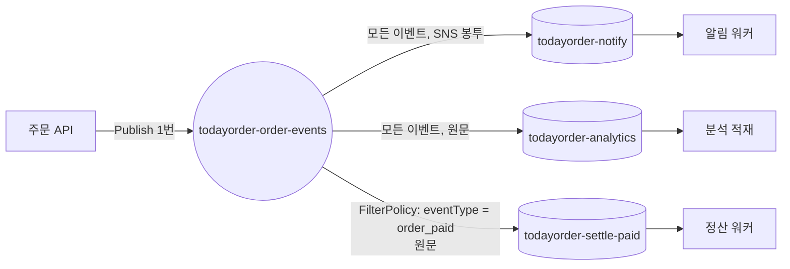

# M06-03. SNS — 토픽, 구독, 필터 정책, FIFO 토픽과 SNS+SQS 팬아웃
> 도메인: D2 · 예상 시간: 50분 · 실습 등급: 🟢

## 왜 필요한가

주문이 생기면 알림 워커, 정산 워커, 분석 적재가 **각자** 알아야 한다. 주문 API가 큐 세 개에 하나씩 넣으면, 내일 "포인트 적립" 워커가 생길 때마다 주문 API를 고쳐 배포해야 한다. 생산자는 "주문이 생겼다"는 사실만 한 곳에 알리고, 누가 듣는지는 몰라도 되게 만들고 싶다. 그게 **발행/구독(pub/sub)** 이고, AWS에서 가장 단순한 도구가 SNS다.

## 핵심 개념

- **토픽(topic)**: 메시지를 발행(publish)하는 이름 붙은 채널.
- **구독(subscription)**: "이 토픽의 메시지를 이 끝점(endpoint)으로 보내 줘". 프로토콜은 SQS, Lambda, HTTP/HTTPS, 이메일, SMS, 모바일 푸시, Data Firehose 등.
- SNS는 **푸시**다. (표준 토픽은) 메시지를 보관하지 않고 구독자에게 즉시 밀어 준다. 구독자가 받지 못하면 재시도하다가 버린다(구독에 DLQ를 달아 실패 메시지를 남길 수 있다). 그래서 소비자가 자기 속도로 처리하려면 **SNS 뒤에 SQS를 둔다** — 이게 **팬아웃(fan-out)** 패턴이다.



### 필터 정책과 원문 전달

| 구독 속성 | 하는 일 |
|---|---|
| `FilterPolicy` | 조건에 맞는 메시지만 이 구독으로 보낸다. 예: `{"eventType":["order_paid"]}`. 기본은 **메시지 속성**을 보고, `FilterPolicyScope=MessageBody`면 **본문 JSON**을 본다. 숫자 범위(`{"numeric":[">=",100]}`), 접두사, 존재 여부 등도 된다 |
| `RawMessageDelivery=true` | SNS 봉투(Type, MessageId, TopicArn, Message…) 없이 **원문 그대로** 큐에 넣는다. 소비자 코드가 단순해진다 |

필터 정책이 없으면 소비자마다 "이건 내 일이 아니네" 하고 버리는 코드를 짜야 하고, 불필요한 메시지만큼 SQS 요청 비용도 나간다.

### 가장 흔한 함정: 큐 정책 없이는 "조용히" 전달되지 않는다

SNS가 SQS 큐에 메시지를 넣으려면 **큐의 리소스 기반 정책**이 `sns.amazonaws.com`에게 `sqs:SendMessage`를 허용해야 한다(같은 계정이어도). 이 정책이 없으면 `Subscribe`도 `Publish`도 **성공**한다. 오류는 어디에도 안 난다. 메시지만 안 온다. 실습에서 먼저 이 실패를 겪어 보고 고친다.

```json
{
  "Effect": "Allow",
  "Principal": {"Service": "sns.amazonaws.com"},
  "Action": "sqs:SendMessage",
  "Resource": "arn:aws:sqs:us-east-1:000000000000:todayorder-notify",
  "Condition": {"ArnEquals": {"aws:SourceArn": "arn:aws:sns:us-east-1:000000000000:todayorder-order-events"}}
}
```

`Condition`의 `aws:SourceArn`은 "**이 토픽에서 온 것만**" 허용한다는 뜻이다. 빼면 아무 토픽이나 내 큐에 넣을 수 있게 된다(혼동된 대리인 문제, confused deputy).

### 표준 토픽 vs FIFO 토픽

| | 표준 토픽 | FIFO 토픽 |
|---|---|---|
| 순서 | 보장 안 함 | 메시지 그룹 안에서 순서 보장 |
| 중복 | 드물게 중복 가능 | 중복 제거(중복 제거 ID 또는 본문 기반) |
| 구독자 | SQS, Lambda, HTTP, 이메일, SMS, 푸시 등 | SQS 큐 중심(대표 구성은 FIFO 토픽 → FIFO 큐) |
| 이름 | 자유 | `.fifo`로 끝남 |
| 보관·재생 | 없음 | 선택: 토픽에 **아카이브 정책**(1~365일)을 켜면 구독이 지난 메시지를 **재생(replay)** 할 수 있다(추가 요금, [메시지 아카이브와 재생](https://docs.aws.amazon.com/sns/latest/dg/message-archiving-and-replay-topic-owner.html)) |

"순서가 중요한 팬아웃(예: 주문 상태 변경을 여러 시스템에 순서대로)" → **SNS FIFO → SQS FIFO**.

> 메시지 크기: 토픽의 기본 상한은 256 KiB다. 2026년 9월부터 토픽 속성 `MaximumMessageSize`를 256 KiB보다 크게(최대 1 MiB) 설정할 수 있는데, **조건이 있다** — 그 토픽의 구독은 **Amazon SQS·AWS Lambda·Amazon Data Firehose만**, 합계 **100개 이하**여야 한다(HTTP/S·이메일·SMS·모바일 푸시 구독이 있으면 설정이 거부된다). 상한은 본문 + 메시지 속성 합계로 검사한다([SNS 대용량 페이로드](https://docs.aws.amazon.com/sns/latest/dg/large-message-payloads.html)). 그보다 크면 본문은 S3에 두고 참조를 보낸다(확장 클라이언트 라이브러리).

## 직접 해 보기

[lab04-sns-fanout-filter.sh](./labs/lab04-sns-fanout-filter.sh)

```bash
bash curriculum/m06-integration-messaging/labs/lab04-sns-fanout-filter.sh
```

**1단계 — 조용한 실패.** 알림 큐는 정책 없이, 분석 큐(대조군)는 정책을 넣고 구독한 뒤 1건 발행한다.

```
== 1. 토픽과 큐 3개
arn:aws:sns:us-east-1:000000000000:todayorder-order-events
== 2. [조용한 실패] 알림 큐는 정책 없이, 분석 큐는 정책을 넣고 구독
arn:aws:sns:us-east-1:000000000000:todayorder-order-events:ca866674-5562-4098-8252-e499b7ca9bdd
arn:aws:sns:us-east-1:000000000000:todayorder-order-events:a46392f6-c5dd-4c1d-97fe-6c74b4ee1129
9b41bfe6-922c-4c78-acd5-1456762c8009
분석 큐(정책 있음): 1건   알림 큐(정책 없음): 0건
→ subscribe 도 publish 도 성공했는데 알림 큐에는 아무것도 없다. 오류는 어디에도 없었다.
```

방금 본 것: 구독 ARN도, 발행 메시지 ID도 정상으로 나왔다. 대조군(분석 큐)에는 도착했으니 SNS가 고장 난 것도 아니다. "도착하지 않음"은 오류가 아니라서 **기다려서 확인**할 수밖에 없다 — 그래서 실습은 대조군 도착을 기다린 뒤 알림 큐가 비어 있음을 확인했다. 실무에서 "SNS 붙였는데 큐에 아무것도 안 와요"의 원인 1순위가 이것이다.

**2단계 — 정책으로 고치고, 필터 정책 + 원문 전달 구독 추가.**

```
== 3. 알림 큐에 정책을 넣어 고치고, 정산 큐는 필터 정책 + 원문 전달로 구독
{
    "Version": "2012-10-17",
    "Statement": [
        {
            "Sid": "AllowOrderEventsTopic",
            "Effect": "Allow",
            "Principal": {
                "Service": "sns.amazonaws.com"
            },
            "Action": "sqs:SendMessage",
            "Resource": "arn:aws:sqs:us-east-1:000000000000:todayorder-notify",
            "Condition": {
                "ArnEquals": {
                    "aws:SourceArn": "arn:aws:sns:us-east-1:000000000000:todayorder-order-events"
                }
            }
        }
    ]
}
arn:aws:sns:us-east-1:000000000000:todayorder-order-events:792159a5-6754-414b-8b37-ff4c13c6cd82
== 4. 이벤트 2건 발행: order_created, order_paid
c301da0a-721a-484d-bdad-b3e0574ee52b
91e4e6e4-1840-4c6d-9d02-4e68f0287b93
알림 큐: 2건  분석 큐: 2건  정산 큐(order_paid 만): 1건
```

방금 본 것: 발행은 두 번, 큐 세 개에 총 5건. 정산 큐는 필터 덕분에 `order_paid` 1건만 받았다. 1단계에서 놓친 메시지는 정책을 넣은 뒤에도 오지 않았다(알림 큐 2건 = 4단계의 2건). SNS 표준 토픽은 메시지를 보관하지 않기 때문이다(FIFO 토픽은 아카이브 정책을 켜면 재생할 수 있다 — 위 표).

**3단계 — 봉투 vs 원문.**

```
== 5. 같은 이벤트가 큐마다 어떻게 보이나
-- 알림 큐 (SNS 봉투 JSON):
{
    "Type": "Notification",
    "MessageId": "c301da0a-721a-484d-bdad-b3e0574ee52b",
    "TopicArn": "arn:aws:sns:us-east-1:000000000000:todayorder-order-events",
    "Message": "{\"orderId\":\"A-4002\",\"total\":22000}",
    "Timestamp": "2026-11-12T12:09:05.5716Z",
    "MessageAttributes": {
        "eventType": {
            "Type": "String",
            "Value": "order_created"
        }
    },
    "UnsubscribeURL": "https://sns.us-east-1.amazonaws.com/?Action=Unsubscribe&SubscriptionArn=arn:aws:sns:us-east-1:000000000000:todayorder-order-events:ca866674-5562-4098-8252-e499b7ca9bdd"
}
-- 정산 큐 (원문 그대로):
{
    "Body": "{\"orderId\":\"A-4002\",\"total\":22000}",
    "eventType": "order_paid"
}
{
    "Raw": "true",
    "Endpoint": "arn:aws:sqs:us-east-1:000000000000:todayorder-analytics"
}
LAB04 OK
```

방금 본 것: 봉투 방식에서는 원래 주문 JSON이 `Message` 필드 안에 **문자열로 한 번 더** 들어 있어 소비자가 두 번 파싱해야 한다. 원문 전달이면 본문이 그대로이고, SNS 메시지 속성은 SQS 메시지 속성으로 옮겨진다.

## 실제 AWS에서는

- 에뮬레이터는 전달·필터 정책·원문 전달·FIFO, 그리고 "큐 정책이 없으면 전달 안 됨"까지 AWS처럼 동작했다. 실제 AWS에서는 이런 전달 실패를 구독의 CloudWatch 지표(`NumberOfNotificationsFailed`)와 전달 상태 로깅으로 확인할 수 있다. 에뮬레이터에서는 그런 지표를 확인하지 않았다.
- 큐가 SSE-KMS로 암호화돼 있으면 KMS 키 정책도 `sns.amazonaws.com`에 `kms:GenerateDataKey`·`kms:Decrypt`를 허용해야 한다(M09). 이것도 "조용한 실패"의 흔한 원인이다.
- SNS 발행은 매월 100만 건, SQS 요청도 매월 100만 건까지 프리 티어다.

## 시험 포인트

- "하나의 이벤트를 여러 큐/시스템에 동시에" → **SNS 팬아웃 → 여러 SQS**.
- "구독자마다 필요한 메시지만" → **구독 필터 정책**(소비자 쪽에서 거르는 것보다 비용·코드 모두 유리).
- "SNS → SQS 구독했는데 메시지가 안 온다" → **SQS 큐 정책**(`sns.amazonaws.com`, `sqs:SendMessage`, `aws:SourceArn`), 암호화 큐면 **KMS 키 정책**.
- "순서 + 중복 제거가 필요한 팬아웃" → **SNS FIFO 토픽 → SQS FIFO 큐**.
- SNS(표준 토픽)는 저장하지 않는다(푸시). 소비자가 느리거나 멈출 수 있으면 → 사이에 **SQS**. FIFO 토픽은 아카이브 정책으로 최대 365일 보관·재생할 수 있다.
- 이메일/SMS로 사람에게 알림 → SNS(대량 마케팅 이메일은 SES).

## 스스로 확인

1. 분석팀이 "주문 이벤트 중 금액 10만 원 이상만 받고 싶다"고 한다. 주문 JSON 본문에 `total`이 있고 메시지 속성에는 없다. 어떻게 구독하나?
2. SNS 대신 주문 API가 큐 세 개에 직접 `SendMessage`하면 무엇이 불편한가?
3. 실습 1단계에서 놓친 메시지를 나중에라도 받으려면 처음부터 어떻게 구성했어야 하나?

<details><summary>답</summary>

1. 구독 속성 `FilterPolicyScope=MessageBody`, `FilterPolicy={"total":[{"numeric":[">=",100000]}]}`. (속성 기반으로 하려면 생산자가 메시지 속성에 금액을 넣어야 한다.)
2. 소비자가 늘 때마다 생산자 코드를 고쳐야 하고(결합), 세 번 보내는 사이 일부만 성공하는 부분 실패도 직접 처리해야 한다.
3. 구독 전에 큐 정책을 먼저 넣는다(IaC로 큐·정책·구독을 함께 만든다). 전달 실패를 보존하려면 구독에 재드라이브 정책(DLQ)을 단다. 표준 토픽은 메시지를 보관하지 않으므로 지나간 메시지를 다시 받을 수는 없다(FIFO 토픽이라면 아카이브 정책을 미리 켜 두었을 때 재생할 수 있다).

</details>
