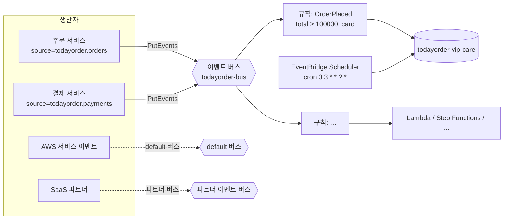

# M06-04. EventBridge — 버스, 규칙, 패턴, Scheduler, Pipes
> 도메인: D2 · 예상 시간: 45분 · 실습 등급: 🟢

## 왜 필요한가

CS팀이 "10만 원 이상 **카드** 주문은 VIP 케어 큐로 보내 달라"고 한다. SNS 필터 정책으로도 할 수 있지만, 요구가 계속 늘어난다 — 결제 서비스의 이벤트, 배송 서비스의 이벤트, 심지어 AWS 자체가 내는 이벤트(EC2 상태 변화, S3 객체 생성)와 SaaS(결제 대행사, 고객센터 툴)의 이벤트까지 한 곳에서 "내용을 보고" 골라 보내고 싶다. 매일 새벽 3시 정산 작업도 돌려야 한다. 이것이 EventBridge의 자리다.

## 핵심 개념



| 구성 요소 | 설명 |
|---|---|
| **이벤트 버스** | 이벤트가 모이는 곳. `default` 버스는 AWS 서비스 이벤트를 받는다. 앱 이벤트는 **사용자 지정 버스**, SaaS는 **파트너 이벤트 버스** |
| **이벤트** | 정해진 JSON 봉투: `source`, `detail-type`, `detail`(내 데이터), `time`, `account`, `region`… |
| **규칙(rule)** | **이벤트 패턴**과 일치하는 이벤트를 **대상(target)** 으로 보낸다. 규칙 하나에 대상 최대 5개 |
| **이벤트 패턴** | 이벤트와 같은 모양의 JSON. 값 목록은 OR, 필드끼리는 AND. 숫자 범위, 접두사, `anything-but`, 존재 여부 등 |
| **대상** | SQS, SNS, Lambda, Step Functions, Kinesis, API 대상(외부 HTTP) 등 20종 이상 |
| **아카이브·재생** | 버스의 이벤트를 보관했다가 나중에 다시 흘려보낸다(버그 수정 후 재처리) |
| **스키마 레지스트리** | 이벤트 구조를 수집·문서화하고 코드 바인딩을 생성 |
| **EventBridge Scheduler** | cron/rate/일회성(`at()`) 일정으로 대상을 호출하는 **별도 서비스**. 시간대 지정, 유연한 시간 창, 대규모 일정 |
| **EventBridge Pipes** | **소스 하나 → (필터·보강) → 대상 하나**를 코드 없이 연결. 예: SQS → Step Functions, DynamoDB Streams → EventBridge 버스 |

SQS·SNS와 마찬가지로, 규칙이 SQS 큐에 넣으려면 **큐 정책**이 `events.amazonaws.com`을 허용해야 한다(Lambda 대상이면 Lambda 리소스 정책). Scheduler·Pipes는 반대로 **내가 준 실행 역할**로 대상을 호출한다.

### SNS 필터 정책 vs EventBridge 규칙

| | SNS + 필터 정책 | EventBridge |
|---|---|---|
| 강점 | 단순, 높은 처리량, 팬아웃, 이메일·SMS·모바일 푸시 | 내용 기반 라우팅이 풍부, **AWS 서비스·SaaS 이벤트**, 아카이브·재생, 스키마, Scheduler·Pipes |
| 대상 | SQS, Lambda, HTTP, 이메일, SMS, 푸시, Firehose | 20종 이상의 AWS 서비스 + API 대상 |
| 시험 키워드 | "팬아웃", "알림" | "SaaS 이벤트", "AWS 서비스 이벤트에 반응", "이벤트 기반 아키텍처, 느슨한 결합, 많은 규칙", "일정(cron)" |

## 직접 해 보기

[lab05-eventbridge-rules.sh](./labs/lab05-eventbridge-rules.sh)

```bash
bash curriculum/m06-integration-messaging/labs/lab05-eventbridge-rules.sh
```

```
== 1. 사용자 지정 이벤트 버스와 대상 큐
arn:aws:events:us-east-1:000000000000:event-bus/todayorder-bus
== 2. 이벤트 패턴: 주문 서비스의 OrderPlaced 중 금액 10만 원 이상, 결제 수단이 card 인 것
{
  "source": ["todayorder.orders"],
  "detail-type": ["OrderPlaced"],
  "detail": {
    "total": [{"numeric": [">=", 100000]}],
    "payment": {"method": ["card"]}
  }
}
== 3. 규칙을 만들기 전에 test-event-pattern 으로 패턴을 시험
  {"orderId":"A-5001","total":250000,"payment":{"method":"card"}} → True
  {"orderId":"A-5002","total":9000,"payment":{"method":"card"}} → False
  {"orderId":"A-5003","total":300000,"payment":{"method":"bank"}} → False
```

방금 본 것: 패턴은 이벤트의 **일부 모양**만 적는다. 적지 않은 필드(`orderId`)는 아무 값이나 된다. `test-event-pattern`으로 규칙을 배포하기 전에 패턴을 단위 테스트할 수 있다.

```
== 4. 규칙 + 대상(SQS) 연결
arn:aws:events:us-east-1:000000000000:rule/todayorder-bus/todayorder-high-value-orders
0
== 5. 이벤트 4건 발행 (일치 1건 + 금액 미달 + 결제 수단 다름 + 다른 source)
{
    "FailedEntryCount": 0,
    "Entries": 4
}
== 6. 대상 큐에 무엇이 왔나
받은 이벤트 1건:
{
    "version": "0",
    "id": "18e74af9-941b-bed5-0000-000000000007",
    "detail-type": "OrderPlaced",
    "source": "todayorder.orders",
    "account": "000000000000",
    "time": "2026-11-12T12:10:12Z",
    "region": "us-east-1",
    "resources": [],
    "detail": {
        "orderId": "A-5001",
        "total": 250000,
        "payment": {
            "method": "card"
        }
    }
}
```

방금 본 것: 4건 모두 버스에 들어갔지만(`FailedEntryCount: 0`) 큐에는 패턴과 맞는 1건만 왔다. 큐에 도착한 것은 내가 보낸 `Detail`이 아니라 **EventBridge 봉투 전체**다. 대상 설정의 입력 변환(Input Transformer)으로 `detail`만 보내게 바꿀 수도 있다.

```
== 7. EventBridge Scheduler: 매일 새벽 정산 작업을 큐에 넣는 일정 (구성)
arn:aws:scheduler:us-east-1:000000000000:schedule/default/todayorder-daily-settlement
{
    "Expression": "cron(0 3 * * ? *)",
    "TZ": "Asia/Seoul",
    "State": "ENABLED",
    "Window": {
        "MaximumWindowInMinutes": 15,
        "Mode": "FLEXIBLE"
    }
}
LAB05 OK
```

방금 본 것: Scheduler는 대상(SQS)을 **실행 역할**(`scheduler.amazonaws.com`을 신뢰하고 `sqs:SendMessage`를 허용)로 호출한다. 시간대를 `Asia/Seoul`로 지정할 수 있고, "15분 안 아무 때나"(유연한 시간 창)로 부하를 분산할 수 있다. AWS cron 식은 6개 필드(분 시 일 월 요일 연도)이고 일·요일 중 하나는 `?`다.

## 실제 AWS에서는

- 규칙 패턴 매칭과 SQS 대상 전달은 에뮬레이터에서도 실제로 일어났다(🟢).
- **Scheduler의 발화 시각은 에뮬레이터가 지키지 않는다.** 저자가 `at(현재+10분)` 일회성 일정을 만들었더니 약 10초 만에 대상 큐에 메시지가 도착했다. 반면 위 실습의 `cron(0 3 * * ? *)` 일정은 20초 넘게 지켜봐도 발화하지 않았다. 그래서 실습은 일정의 **구성만** 확인하고 발화는 단언하지 않는다. 실제 AWS에서는 지정한 시각(유연한 시간 창이면 그 창 안)에 실행된다.
- 실제 AWS에서 해 보려면: 사용자 지정 이벤트 발행은 100만 건당 과금(소량이면 몇 원 수준), Scheduler도 호출 수 기준 과금이라 실습 몇 건은 거의 무료다(일정을 지우지 않으면 계속 발화하니 반드시 정리). 끝나면 `aws scheduler delete-schedule --name todayorder-daily-settlement`, `aws events remove-targets --rule todayorder-high-value-orders --event-bus-name todayorder-bus --ids vip-queue`, `aws events delete-rule ...`, `aws events delete-event-bus --name todayorder-bus`, `aws sqs delete-queue ...`.

## 시험 포인트

- "SaaS 애플리케이션(예: Zendesk, Datadog)의 이벤트에 반응" → **EventBridge 파트너 이벤트 버스**.
- "EC2 상태 변경·S3 객체 생성 등 **AWS 서비스 이벤트**로 자동화" → **EventBridge 규칙(default 버스)**.
- "정해진 시간에 Lambda/작업 실행(cron)" → **EventBridge Scheduler**(또는 예약 규칙). 서버에 cron을 두지 않는다.
- "이벤트 내용(필드 값·숫자 범위)으로 라우팅" → **EventBridge 이벤트 패턴**.
- "과거 이벤트를 다시 처리" → **아카이브 + 재생**.
- "SQS 메시지를 코드 없이 Step Functions로" → **EventBridge Pipes**.
- 규칙이 대상에 못 보낸다 → 대상의 **리소스 정책**(SQS 큐 정책, Lambda 권한) 확인.

## 스스로 확인

1. 이벤트 패턴 `{"detail": {"status": ["PAID", "SHIPPED"], "total": [{"numeric": [">", 0]}]}}`는 어떤 이벤트와 일치하나?
2. 매일 새벽 3시(한국 시간) 정산 작업을 실행하는 가장 운영 부담이 적은 방법은?
3. 규칙은 만들었고 `put-events`도 `FailedEntryCount: 0`인데 대상 큐에 아무것도 없다. 확인할 순서는?

<details><summary>답</summary>

1. `detail.status`가 PAID **또는** SHIPPED 이고, **그리고** `detail.total`이 0보다 큰 이벤트. (목록 안은 OR, 필드끼리는 AND)
2. EventBridge Scheduler에 `cron(0 3 * * ? *)` + 시간대 `Asia/Seoul`로 일정을 만들고 대상(Lambda·Step Functions·SQS)을 지정한다. 서버도 cron 데몬도 필요 없다.
3. ① 이벤트를 보낸 **버스**가 규칙의 버스와 같은가(기본 `default`로 보냈을 수 있다) ② `test-event-pattern`으로 패턴 일치 여부 ③ 대상 큐의 **큐 정책**이 `events.amazonaws.com`을 허용하는가(암호화 큐면 KMS 키 정책도).

</details>
