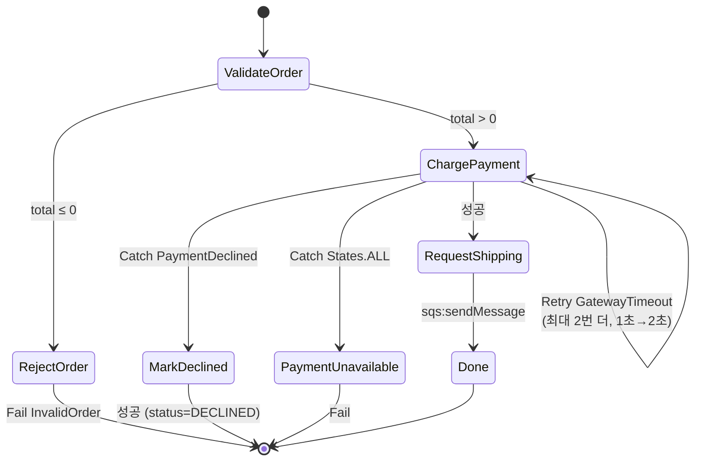

# M06-05. Step Functions — 표준 vs 익스프레스, 상태 유형, 오류 처리
> 도메인: D2 · 예상 시간: 60분 · 실습 등급: 🟢

## 왜 필요한가

TodayOrder의 주문 처리는 단계가 있다. 주문 검증 → 결제 → 배송 요청. 결제 대행사(PG)는 가끔 응답이 없어서 **잠깐 뒤 다시** 시도해야 하고, 카드 거절은 다시 해도 소용없으니 **바로 고객에게 알려야** 한다. 이 로직을 주문 API 코드 안의 `try/except`와 `sleep`으로 짜면, 서버가 재시작되는 순간 "어느 주문이 어디까지 갔는지"를 잃는다. Step Functions는 이 흐름을 **상태 머신(state machine)** 으로 선언하고, 실행 상태와 이력을 AWS가 대신 들고 있게 한다.

## 핵심 개념

워크플로는 **Amazon States Language(ASL)** 라는 JSON으로 정의한다. 각 단계가 **상태(state)** 다.

| 상태 유형 | 하는 일 |
|---|---|
| `Task` | 일을 한다: Lambda 호출, **AWS 서비스 직접 호출(SDK 통합 — SQS·DynamoDB·SNS 등 200개 이상 서비스)**, 활동(Activity) |
| `Choice` | 입력 값으로 분기 (`NumericGreaterThan`, `StringEquals` …) |
| `Pass` | 입력을 가공하거나 고정 값을 넣고 넘어감 |
| `Wait` | 지정 시간·시각까지 대기 |
| `Parallel` | 여러 분기를 동시에 실행하고 모두 끝나면 합침 |
| `Map` | 배열 원소마다 같은 단계 반복(분산 Map은 S3의 수백만 객체도) |
| `Succeed` / `Fail` | 성공/실패로 끝냄. `Fail`은 `Error`·`Cause`를 남긴다 |

### 오류 처리: Retry와 Catch



- **`Retry`**: 지정한 오류(`ErrorEquals`)가 나면 `IntervalSeconds`부터 `BackoffRate` 배씩 늘려 가며 `MaxAttempts`번 **더** 시도한다(지수 백오프). `MaxAttempts: 2`면 총 3번 실행된다.
- **`Catch`**: 재시도가 끝났거나 재시도 대상이 아닌 오류를 받아 **다른 상태로** 보낸다. 위에서부터 첫 번째로 맞는 것이 쓰인다. `States.ALL`은 모든 오류. `ResultPath`로 오류 정보를 입력에 덧붙일 수 있다.
- 오류 이름은 Lambda 예외의 **클래스 이름**(`errorType`)이 그대로 쓰인다. 그래서 일시 오류(`GatewayTimeout`)와 업무 오류(`PaymentDeclined`)를 **예외 클래스로 나눠 두면** 정의에서 다르게 다룰 수 있다.
- 미리 정의된 오류 이름: `States.ALL`, `States.TaskFailed`, `States.Timeout`, `States.Permissions` 등.

### 표준(Standard) vs 익스프레스(Express)

| | 표준 | 익스프레스 |
|---|---|---|
| 최대 실행 시간 | **1년** | **5분** |
| 실행 보장 | **정확히 한 번(exactly-once)** | 비동기: 최소 한 번 / 동기: 최대 한 번 |
| 요금 | 상태 전이 횟수 | 실행 횟수 + 시간 + 메모리 |
| 실행 이력 | Step Functions가 90일 보관, API로 조회 | 보관 안 함 — CloudWatch Logs로 |
| `.sync`(작업 완료 대기), `.waitForTaskToken`(콜백·사람 승인) | 지원 | **미지원** |
| 어울리는 일 | 결제·주문처럼 **멱등하지 않은**, 길고 감사(audit)가 필요한 흐름 | 초당 수천 건의 짧은 이벤트 처리, API 뒤 동기 처리 |

(출처: [워크플로 유형 선택](https://docs.aws.amazon.com/step-functions/latest/dg/choosing-workflow-type.html). 유형은 만든 뒤 바꿀 수 없다.)

### 실행 역할

상태 머신은 **실행 역할(IAM 역할)** 로 Lambda·SQS 등을 호출한다. 역할의 신뢰 정책은 `states.amazonaws.com`, 권한 정책에는 Task가 부르는 모든 동작(`lambda:InvokeFunction`, `sqs:SendMessage` …)이 있어야 한다. 빠지면 그 Task가 실패한다 — 에뮬레이터도 이를 실제로 검사한다.

## 직접 해 보기

[lab06-stepfunctions-order.sh](./labs/lab06-stepfunctions-order.sh)는 결제 Lambda([functions/payment.py](./functions/payment.py))와 배송 요청 큐를 만들고 위 다이어그램의 상태 머신을 배포한다. 결제 함수는 입력의 `paymentScenario`로 성공·거절(`PaymentDeclined`)·PG 장애(`GatewayTimeout`)를 흉내 낸다. (Lambda 자체는 M07에서 자세히 다룬다.)

```bash
bash curriculum/m06-integration-messaging/labs/lab06-stepfunctions-order.sh
```

**1) 권한이 빠진 실행 역할**

```
== 4. 정상 주문 → 배송 요청 단계에서 실패한다 (역할에 sqs:SendMessage 없음)
{
    "status": "FAILED",
    "error": "SQS.AmazonSQSException"
}
User: arn:aws:iam::000000000000:role/todayorder-sfn-order-role is not authorized to perform: sqs:SendMessage on resource: arn:aws:sqs:us-east-1:000000000000:tod
```

방금 본 것: 결제(Lambda 호출)까지는 성공했고, `sqs:sendMessage` Task에서 실행 역할 권한 부족으로 실패했다. 이 실패를 잡는 `Catch`가 없으니 실행 전체가 FAILED. (저자가 따로 확인한 바로는 `lambda:InvokeFunction`이 없는 역할도 `Lambda.AWSLambdaException`… `is not authorized to perform: lambda:InvokeFunction` 으로 실패했다.)

**2) 권한을 고친 정상 실행**

```
== 5. 역할에 sqs:SendMessage 추가 → 다시 실행하면 성공, 큐에 배송 요청이 들어온다
{
    "status": "SUCCEEDED",
    "error": null,
    "cause": null,
    "output": "{\"orderId\":\"A-6001\",\"total\":32000,\"paymentScenario\":\"ok\",\"payment\":{\"approvalNo\":\"AP-A6001\"}}"
}
배송 요청 큐: {"orderId":"A-6001","total":32000,"paymentScenario":"ok","payment":{"approvalNo":"AP-A6001"}}
```

방금 본 것: `ResultSelector`로 Lambda 응답에서 승인 번호만 골라 `ResultPath: $.payment`에 붙였다. 배송 요청 Task는 `ResultPath: null`이라 SQS 응답을 버리고 입력을 그대로 다음 상태로 넘겼다. **Lambda 없이** SQS에 직접 메시지를 넣었다는 점이 중요하다(SDK 서비스 통합 — 코드가 줄고, Lambda 비용도 없다).

**3) Choice → Fail**

```
== 6. 금액 0원 주문 → Choice 가 RejectOrder(Fail)로 보낸다
{
    "status": "FAILED",
    "error": "InvalidOrder",
    "cause": "total must be positive",
    "output": null
}
```

**4) Catch: 업무 오류는 재시도하지 않고 다른 길로**

```
== 7. 카드 거절 → 재시도 없이 Catch 가 MarkDeclined 로 보낸다 (업무 결과로 정상 종료)
SUCCEEDED
{"status": "DECLINED", "error": "PaymentDeclined"}
이벤트: ExecutionStarted ChoiceStateEntered ChoiceStateExited TaskStateEntered TaskScheduled TaskStarted TaskFailed TaskStateExited PassStateEntered PassStateExited ExecutionSucceeded
```

방금 본 것: `TaskFailed`가 **한 번**뿐이다. `Retry`는 `GatewayTimeout`에만 걸려 있으니 `PaymentDeclined`는 재시도 없이 바로 `Catch`로 갔다. 카드 거절은 시스템 장애가 아니라 업무 결과이므로 실행은 SUCCEEDED, 출력에 `status: DECLINED`와 오류 정보(`$.error`)가 남았다.

**5) Retry 후 Catch(States.ALL)**

```
== 8. PG 장애 → Retry 로 2번 더 시도(총 3번) 후 Catch(States.ALL) → PaymentUnavailable(Fail)
{
    "status": "FAILED",
    "error": "PaymentUnavailable",
    "cause": "payment gateway kept failing",
    "output": null
}
이벤트: ExecutionStarted ChoiceStateEntered ChoiceStateExited TaskStateEntered TaskScheduled TaskStarted TaskFailed TaskScheduled TaskStarted TaskFailed TaskScheduled TaskStarted TaskFailed TaskStateExited FailStateEntered ExecutionFailed
TaskFailed 이벤트 수(= 시도 횟수): 3
```

방금 본 것: `TaskScheduled → TaskStarted → TaskFailed`가 세 번 — 첫 시도 + `MaxAttempts: 2`번의 재시도. 그래도 실패하자 `Catch`의 `States.ALL`이 받아 `PaymentUnavailable`로 보냈다. (재시도 사이 대기 시간 1초→2초는 정의에 적은 값이고, 에뮬레이터에서 실제로 걸린 시간은 측정·단언하지 않았다.)

**6) 익스프레스 동기 실행**

```
== 9. EXPRESS 워크플로: 배송비 견적을 동기로 계산 (start-sync-execution)
arn:aws:states:us-east-1:000000000000:stateMachine:todayorder-shipping-quote
{
    "status": "SUCCEEDED",
    "output": "{\"shippingFee\":3000}"
}
72000원 주문의 견적: {"shippingFee":0}
LAB06 OK
```

방금 본 것: `start-sync-execution`은 실행이 끝날 때까지 기다렸다가 **결과를 바로 돌려준다**(익스프레스 전용). API Gateway 뒤에서 "요청 → 짧은 워크플로 → 응답"을 만들 때 쓴다. 표준 워크플로는 `start-execution` 후 상태를 조회(폴링)해야 했다.

## 실제 AWS에서는

- 상태 전이, Choice/Fail, Retry 횟수, Catch 경로, SQS 서비스 통합, 실행 역할 권한 검사가 모두 AWS와 같은 결과를 냈다. 실제 AWS에서는 콘솔의 그래프 보기로 실행 경로를 눈으로 볼 수 있다.
- 실제 AWS에서는 Lambda 호출 Task에 `Lambda.ServiceException`, `Lambda.TooManyRequestsException` 같은 일시 오류용 `Retry`를 기본으로 넣는 것이 권장 관행이다.
- 실제 AWS에서 해 보려면: 표준 워크플로는 매월 상태 전이 4,000건까지 프리 티어, Lambda도 매월 100만 요청까지 프리 티어라 이 실습 정도는 거의 무료다. 정리: `aws stepfunctions delete-state-machine --state-machine-arn <ARN>`(두 개), `aws lambda delete-function --function-name todayorder-payment`, `aws sqs delete-queue ...`, 역할의 인라인 정책·연결 정책 제거 후 `aws iam delete-role`.

## 시험 포인트

- "여러 서비스를 **순서대로** 호출, 분기·재시도·오류 처리, 상태 추적" → **Step Functions**.
- "**사람의 승인**을 기다렸다가 계속" → 표준 워크플로 + **`.waitForTaskToken`(콜백)**.
- "최대 1년 / 정확히 한 번 / 감사 이력" → **표준**. "초당 수만 건, 5분 이내, 비용 최소" → **익스프레스**.
- "일시적 오류는 재시도, 영구 오류는 다른 처리" → **Retry(지수 백오프) + Catch**.
- "Lambda 없이 DynamoDB·SQS·SNS 직접 호출" → **SDK 서비스 통합**(코드·비용 감소).
- "대량 S3 객체를 병렬 처리" → **분산 Map**.
- Step Functions가 다른 서비스를 못 부른다 → **실행 역할 권한**.

## 스스로 확인

1. `"Retry": [{"ErrorEquals": ["States.ALL"], "MaxAttempts": 3}]` 만 있고 Catch가 없는 Task에서 카드 거절이 나면 무슨 일이 생기나? 바람직한가?
2. 결제 승인을 처리하는 워크플로에 익스프레스(비동기)를 쓰면 어떤 위험이 있나?
3. Catch 목록에 `States.ALL`을 맨 위에, `PaymentDeclined`를 그 아래에 두면?

<details><summary>답</summary>

1. 카드 거절도 3번 더(총 4번) 결제를 시도한 뒤 실행이 FAILED가 된다. 거절은 다시 해도 같은 결과이고 고객 응답만 늦어지므로 바람직하지 않다. 일시 오류만 Retry하고 업무 오류는 Catch로 분리한다.
2. 비동기 익스프레스는 최소 한 번 실행이라 같은 실행이 두 번 돌 수 있다 → 이중 결제 위험. 멱등하지 않은 작업은 표준(정확히 한 번)을 쓰거나 결제 API에 멱등 키를 넣는다.
3. Catch는 위에서부터 첫 번째로 맞는 항목이 쓰이므로 모든 오류가 `States.ALL`로 가고 `PaymentDeclined` 항목은 절대 쓰이지 않는다. `States.ALL`은 맨 마지막에 둔다.

</details>
