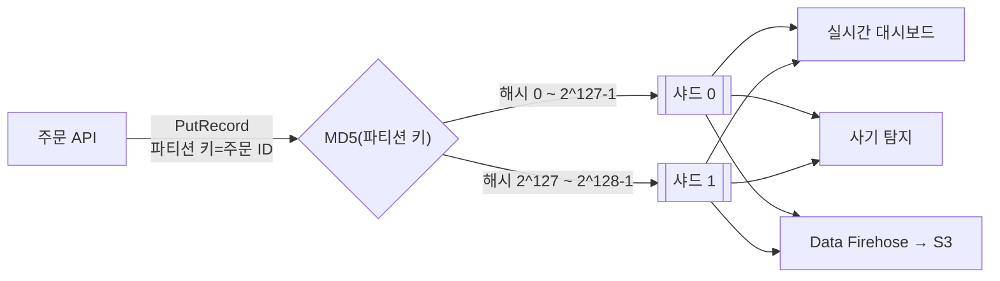

# M06-06. 스트리밍 — Kinesis Data Streams vs Amazon Data Firehose vs SQS, MSK, Amazon MQ, AppFlow
> 도메인: D2, D3 · 예상 시간: 50분 · 실습 등급: 🟢

## 왜 필요한가

마케팅팀이 "주문·클릭 이벤트를 실시간 대시보드에 띄우고, 같은 데이터를 데이터 레이크(S3)에도 쌓고, 사기 탐지 모델도 같은 데이터를 보게 해 달라"고 한다. 초당 수천 건이다. SQS에 넣으면 한 소비자가 꺼내 가는 순간 메시지가 사라지니, 세 팀이 같은 데이터를 보려면 큐를 세 개 만들어야 하고 "어제 데이터를 다시 돌려 보기"도 안 된다. 이럴 때 **스트림**을 쓴다. 스트림은 큐가 아니라 **순서 있는 로그**다 — 읽어도 지워지지 않고, 보존 기간 안이면 누구나 원하는 위치부터 다시 읽는다.

## 핵심 개념

### Kinesis Data Streams(KDS)



- **샤드(shard)**: 처리량 단위. 프로비저닝 모드에서 샤드 하나는 쓰기 초당 1 MB 또는 1,000 레코드, 읽기 초당 2 MB. 샤드를 늘리면(리샤딩) 처리량이 는다. **온디맨드 모드**는 샤드 수를 AWS가 자동 조정한다.
- **파티션 키**: 레코드를 어느 샤드에 넣을지 정한다. 키의 **MD5 해시(128비트)** 가 속한 해시 키 범위의 샤드로 간다. 같은 키 → 같은 샤드 → **그 샤드 안에서 순서 보장**. 키 종류가 적거나 한 키에 몰리면 한 샤드만 뜨거워진다(hot shard).
- **시퀀스 번호**: 샤드 안에서 증가하는 레코드 번호. 소비자는 "어디까지 읽었는지(체크포인트)"를 스스로 관리한다(KCL 라이브러리, Lambda 이벤트 소스 매핑이 대신 해 준다).
- **보존 기간**: 기본 24시간, 최대 365일. 그동안 **여러 소비자가 같은 데이터를 독립적으로, 몇 번이든** 읽는다. 소비자가 많으면 **향상된 팬아웃(enhanced fan-out)** 으로 소비자마다 샤드당 초당 2 MB 전용 읽기 처리량을 받는다.
- 레코드 최대 크기: 오랫동안 1 MiB였고, 2025년 10월부터 스트림 설정으로 최대 10 MiB까지 올릴 수 있다(기본값은 여전히 1 MiB, 샤드 처리량 한도는 그대로).

### Amazon Data Firehose(옛 이름 Kinesis Data Firehose)

"스트림 데이터를 **목적지에 적재**"하는 완전 관리형 배달 서비스. 샤드도 소비자 코드도 없다. 들어온 데이터를 버퍼링(크기·시간)했다가 **S3, Redshift, OpenSearch, Splunk, HTTP 엔드포인트, Apache Iceberg 테이블** 등에 쓴다. Lambda로 변환, Parquet/ORC 형식 변환, 압축이 된다. **데이터를 보관하지 않으므로 재생(replay)이 없고**, 버퍼링 때문에 "실시간"이 아니라 "**거의 실시간(near real-time)**" 이다. (Firehose → S3 실습은 M11에서 한다.)

### 무엇을 고를까

| | SQS | Kinesis Data Streams | Data Firehose | Amazon MSK | Amazon MQ |
|---|---|---|---|---|---|
| 모델 | 큐(작업 분배) | 로그형 스트림 | 적재 파이프 | 관리형 **Apache Kafka** | 관리형 **ActiveMQ / RabbitMQ** |
| 읽으면 | 삭제(소비자가 Delete) | 남음(보존 기간까지) | 목적지로 전달 | 남음 | 삭제 |
| 여러 소비자가 같은 데이터 | ✗ (SNS 팬아웃 필요) | ✓ | – | ✓ | 토픽이면 ✓ |
| 순서 | FIFO 큐의 그룹 단위 | 샤드(파티션 키) 단위 | – | 파티션 단위 | 큐 단위 |
| 재생 | ✗ | ✓ (보존 기간 안) | ✗ | ✓ | ✗ |
| 운영 부담 | 없음 | 샤드 관리(온디맨드면 적음) | 없음 | 브로커·파티션(Serverless 옵션 있음) | 브로커 인스턴스 |
| 언제 | 작업 분배, 디커플링 | 실시간 분석, 여러 소비자, 재생 | S3·Redshift·OpenSearch로 **적재만** | 이미 Kafka를 쓰거나 Kafka 생태계가 필요 | 기존 앱이 **JMS·AMQP·MQTT·STOMP** 등 표준 프로토콜 사용 — 코드 변경 없이 이전 |

**Amazon AppFlow**: Salesforce·SAP·Zendesk·Slack 같은 **SaaS 앱과 AWS(S3, Redshift 등) 사이의 데이터 이동**을 코드 없이 예약·이벤트 기반으로. "SaaS 데이터를 S3로 정기 수집" → AppFlow.

## 직접 해 보기

[lab07-kinesis-shards.sh](./labs/lab07-kinesis-shards.sh)

```bash
bash curriculum/m06-integration-messaging/labs/lab07-kinesis-shards.sh
```

```
== 1. 샤드 2개짜리 스트림 (프로비저닝 모드)
CREATING
{
    "Status": "ACTIVE",
    "OpenShards": 2,
    "RetentionHours": 24,
    "Mode": "PROVISIONED"
}
== 2. 샤드마다 맡은 해시 키 범위 (0 ~ 2^128-1 을 나눠 가진다)
----------------------------------------------------------------------------------------------------------------
|                                                  ListShards                                                  |
+------------------------------------------+-----------------------+-------------------------------------------+
|                    End                   |         Shard         |                   Start                   |
+------------------------------------------+-----------------------+-------------------------------------------+
|  170141183460469231731687303715884105727 |  shardId-000000000000 |  0                                        |
|  340282366920938463463374607431768211455 |  shardId-000000000001 |  170141183460469231731687303715884105728  |
+------------------------------------------+-----------------------+-------------------------------------------+
```

방금 본 것: 만든 직후는 `CREATING`, `aws kinesis wait stream-exists`로 기다린 뒤 `ACTIVE`. 보존 기간 기본 24시간. 해시 공간(0 ~ 2¹²⁸−1)을 두 샤드가 반씩 나눠 가졌다.

```
== 3. 같은 주문(파티션 키 A-7001)의 이벤트 3건 → 같은 샤드, 시퀀스 번호 증가
shardId-000000000001	491794485603278000001000000000000
shardId-000000000001	491794485603278000001000000000001
shardId-000000000001	491794485603278000001000000000002
== 4. 파티션 키의 MD5 해시로 샤드를 직접 계산해 보기
A-7001	shardId-000000000001
B-7002	shardId-000000000001
C-7003	shardId-000000000000
D-7004	shardId-000000000000
E-7005	shardId-000000000001
== 5. 여러 주문을 put-records 로 한 번에 → 실제 샤드가 계산과 같은가
B-7002	shardId-000000000001
C-7003	shardId-000000000000
D-7004	shardId-000000000000
E-7005	shardId-000000000001
계산한 샤드와 실제 샤드가 모두 같다
```

방금 본 것: 샤드 배정은 무작위가 아니라 **MD5(파티션 키)가 어느 범위에 속하나**로 정해진다. Python 몇 줄로 계산한 결과와 스트림의 실제 배정이 같았다. 그래서 "고객 등급"처럼 값이 몇 개 안 되는 키를 쓰면 샤드를 늘려도 몇 개에만 몰린다.

```
== 6. 소비자: 샤드마다 처음(TRIM_HORIZON)부터 읽는다
-- shardId-000000000000: 2건
   {"orderId":"C-7003","status":"CREATED"}
   {"orderId":"D-7004","status":"CREATED"}
-- shardId-000000000001: 5건
   {"orderId":"A-7001","status":"CREATED"}
   {"orderId":"A-7001","status":"PAID"}
   {"orderId":"A-7001","status":"SHIPPED"}
   {"orderId":"B-7002","status":"CREATED"}
   {"orderId":"E-7005","status":"CREATED"}
주문 A-7001 의 순서: CREATED PAID SHIPPED 
== 7. 두 번째 소비자(예: 분석팀)도 같은 데이터를 처음부터 다시 읽을 수 있다 — 읽어도 지워지지 않는다
두 번째로 읽은 A-7001 이벤트: 3건
LAB07 OK
```

방금 본 것: 소비자는 **샤드 이터레이터**(`TRIM_HORIZON` = 가장 오래된 것부터, `LATEST` = 지금부터, `AT_SEQUENCE_NUMBER` 등)로 읽을 위치를 고른다. 같은 주문은 한 샤드 안에서 순서대로 나왔고, 두 번째 소비자가 다시 읽어도 데이터는 그대로였다. SQS에서는 불가능한 일이다.

## 실제 AWS에서는

- 샤드 배정, 샤드 안 순서, 재독은 에뮬레이터에서도 AWS처럼 동작했다. 샤드 처리량 한도(초과 시 `ProvisionedThroughputExceededException`)는 에뮬레이터에서 확인하지 않았다.
- 실제 AWS에서 해 보려면: **KDS는 프리 티어가 없다.** 프로비저닝 모드는 샤드-시간당 과금이므로 실습 후 바로 지운다: `aws kinesis delete-stream --stream-name todayorder-order-stream`. 소량 실험이면 온디맨드 모드도 스트림-시간당 요금이 붙는다.

## 시험 포인트

- "실시간 처리, **여러 애플리케이션이 같은 데이터**를 각자 읽기, **재처리(재생)**" → **Kinesis Data Streams**.
- "스트리밍 데이터를 **S3/Redshift/OpenSearch에 적재**, 관리 최소, 거의 실시간, 형식 변환" → **Amazon Data Firehose**.
- "작업을 워커에게 분배, 디커플링" → **SQS**. (SQS는 재생·다중 소비자 불가)
- "특정 키(주문·기기)별 순서 보장 스트림" → KDS + 그 키를 **파티션 키**로. "한 샤드만 과부하" → 파티션 키의 카디널리티를 높인다.
- "처리량 증가" → 샤드 추가(리샤딩) 또는 **온디맨드 모드**. "소비자가 많아 읽기 부족" → **향상된 팬아웃**.
- "온프레미스 앱이 JMS/AMQP/MQTT로 메시지 브로커 사용, 코드 수정 최소로 이전" → **Amazon MQ**. "Kafka 그대로" → **MSK**.
- "Salesforce 같은 SaaS 데이터를 S3로 정기 수집" → **AppFlow**.

## 스스로 확인

1. 클릭 이벤트를 실시간 대시보드와 S3 데이터 레이크 양쪽에 보내야 한다. 관리 부담을 최소로 하는 조합은?
2. 파티션 키로 "결제 수단"(card, bank, point 3종)을 쓰고 샤드를 10개로 늘렸다. 처리량이 늘까?
3. SQS FIFO와 KDS 둘 다 "순서"를 보장한다. 차이를 한 문장으로.

<details><summary>답</summary>

1. KDS로 수집 → 대시보드 소비자(Lambda 등)가 읽고, 같은 스트림을 Firehose의 원본으로 연결해 S3에 적재. (S3 적재만 필요하면 Firehose 단독 — Direct PUT.)
2. 거의 늘지 않는다. 키가 3종뿐이라 해시 값도 3개 → 최대 3개 샤드만 쓰인다. 주문 ID처럼 다양한 키를 쓴다.
3. SQS FIFO는 그룹 안에서 순서대로 **한 소비자가 처리하고 지우는** 작업 큐이고, KDS는 샤드 안에서 순서대로 **보관되어 여러 소비자가 다시 읽을 수 있는** 로그다.

</details>
