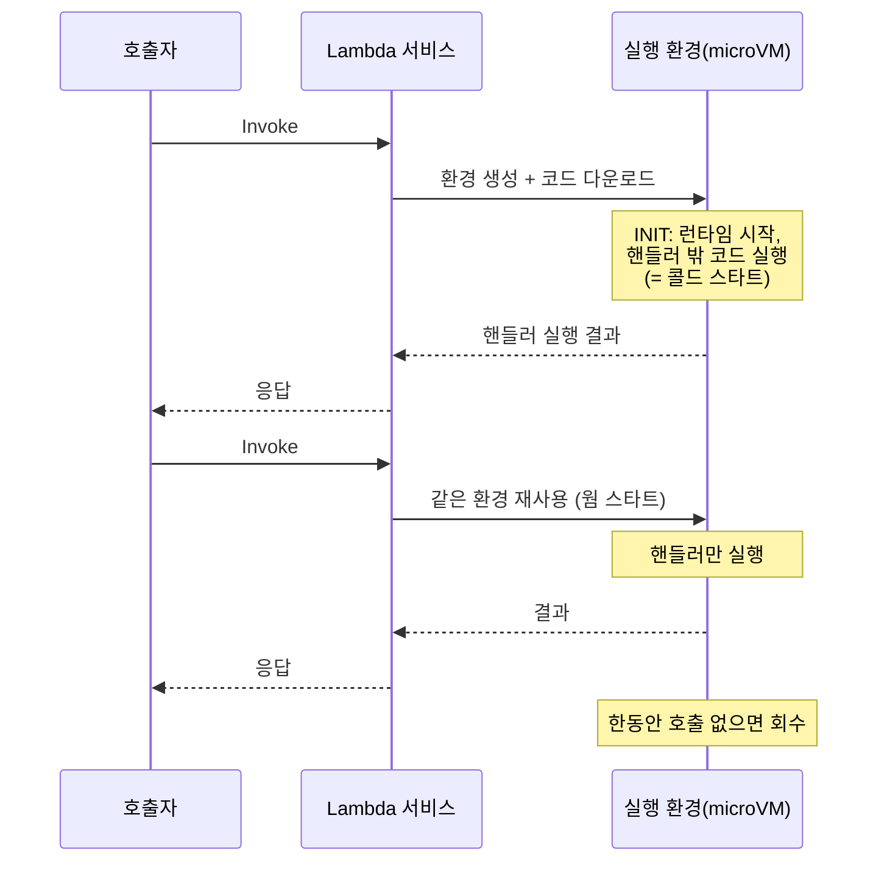

# M07-01. Lambda 실행 모델 — 콜드 스타트, 동시성, 타임아웃, 계층, 버전·별칭
> 도메인: D2, D3 · 예상 시간: 60분 · 실습 등급: 🟢

## 왜 필요한가

마케팅팀이 "주문 상태 조회" 같은 작은 기능을 하루에도 몇 개씩 요청한다. 기능마다 EC2를 띄우고, OS 패치하고, 트래픽이 없는 새벽에도 요금을 내는 건 낭비다. 반대로 이벤트 날 트래픽이 100배로 뛰면 서버를 미리 늘려 둬야 한다. **AWS Lambda**는 "코드(함수)만 올리면, 요청이 올 때 AWS가 실행 환경을 만들어 실행하고, 실행한 시간만큼만 과금"하는 서버리스 컴퓨트다. 대신 Lambda만의 규칙(최대 15분, 상태 없음, 콜드 스타트)을 알아야 제대로 고를 수 있다.

## 핵심 개념

### 실행 환경의 일생



- **콜드 스타트(cold start)**: 새 실행 환경을 만들 때의 추가 지연(코드 다운로드, 런타임·초기화 코드 실행). DB 연결·SDK 클라이언트는 **핸들러 밖**에서 만들어 재사용하는 것이 정석이다. 콜드 스타트를 줄이려면 **프로비저닝된 동시성(Provisioned Concurrency)** 으로 환경을 미리 데워 두거나, **SnapStart**(초기화된 환경의 스냅숏에서 재개 — Java 11+, Python 3.12+, .NET 8+ 관리형 런타임)를 쓴다.
- **INIT 단계도 과금된다**: 2025년 8월 1일부터 관리형 런타임 + zip 패키지 함수도 콜드 스타트의 INIT 시간이 청구 기간(Billed Duration)에 포함된다([AWS Compute Blog](https://aws.amazon.com/blogs/compute/aws-lambda-standardizes-billing-for-init-phase/)). 무거운 초기화 코드는 지연뿐 아니라 비용도 늘린다.
- **상태 없음(stateless)**: 다음 호출이 같은 환경으로 갈 보장이 없다. 상태는 DynamoDB·S3·ElastiCache에 둔다. `/tmp`(512 MB ~ 10,240 MB)는 임시 공간일 뿐이다.
- **동시성(concurrency)**: 동시에 실행 중인 환경 수. 계정·리전당 기본 1,000(증설 요청 가능). **예약 동시성(reserved)** 은 함수 하나가 쓸 몫을 떼어 두는 동시에 **상한**이 된다(다른 함수 보호, 하위 DB 보호). **프로비저닝된 동시성**은 콜드 스타트를 없애려고 미리 띄워 두는 것(유료).
- 한도를 넘으면 동기 호출은 **429 `TooManyRequestsException`(스로틀)**, 비동기·이벤트 소스는 Lambda가 재시도한다.

<!-- widget: lambda-concurrency -->

### 꼭 외울 한계값

| 항목 | 값 |
|---|---|
| 타임아웃 | 기본 3초, **최대 900초(15분)** |
| 메모리 | 128 MB ~ 10,240 MB (CPU는 메모리에 비례, 1,769 MB ≈ vCPU 1개) |
| `/tmp` | 512 MB ~ 10,240 MB |
| 페이로드 | 동기 요청·응답 각 6 MB, **비동기 1 MB** |
| 배포 패키지 | zip 50 MB(직접 업로드), 압축 해제 250 MB(계층 포함) / 컨테이너 이미지 10 GB |
| 계층(Layer) | 함수당 5개 |
| 환경 변수 | 합계 4 KB |
| 동시성 | 계정·리전당 기본 1,000 |

(출처: [Lambda 할당량](https://docs.aws.amazon.com/lambda/latest/dg/gettingstarted-limits.html). 비동기 페이로드는 예전 256 KB에서 1 MB로 늘었다 — 오래된 자료에 주의.)

"15분 넘게 걸리는 배치", "GPU", "장시간 연결 유지" → Lambda가 아니라 ECS/Fargate·Batch·EC2다.

### 버전과 별칭

- `$LATEST`: 계속 바뀌는 작업본.
- **버전(version)**: `PublishVersion`으로 그 순간의 **코드 + 구성(환경 변수·메모리 등)** 을 고정한 불변 스냅숏. 1, 2, 3…
- **별칭(alias)**: 버전을 가리키는 이름표(`live`, `staging`). 호출자는 별칭 ARN을 쓰고, 배포는 별칭이 가리키는 버전만 바꾼다. **가중치 라우팅**으로 v1 90% / v2 10% 같은 **카나리 배포**가 된다(CodeDeploy가 이것을 자동화).
- **계층(layer)**: 여러 함수가 공유하는 라이브러리·런타임을 따로 묶은 zip. 함수당 5개.

### 함수가 AWS를 호출할 때: 실행 역할

함수 코드에는 키가 없다. Lambda가 **실행 역할(execution role)** 을 맡아 임시 자격 증명을 함수 환경에 넣어 준다. 로그(`/aws/lambda/<함수>`)도 이 역할로 쓰므로, 역할에 CloudWatch Logs 권한(관리형 정책 `AWSLambdaBasicExecutionRole`)이 없으면 **로그 그룹 자체가 생기지 않는다**.

## 직접 해 보기

[lab01-lambda-basics.sh](./labs/lab01-lambda-basics.sh) — 함수 코드는 [functions/order_status.py](./functions/order_status.py).

```bash
bash curriculum/m07-serverless-containers/labs/lab01-lambda-basics.sh
```

**1) 만들기와 동기 호출**

```
== 2. 함수 만들기 (python3.12, 128MB, 타임아웃 3초 = 기본값)
{
    "State": "Pending",
    "Runtime": "python3.12",
    "Memory": 128,
    "Timeout": 3,
    "Handler": "order_status.handler"
}
Active
== 3. 동기 호출 (RequestResponse — 기본값)
{
    "StatusCode": 200,
    "ExecutedVersion": "$LATEST"
}
{"orderId": "A-1001", "status": "PAID", "appVersion": "dev", "functionVersion": "$LATEST", "remainingMs": 2934}
```

방금 본 것: 생성 직후는 `Pending`이라 `aws lambda wait function-active-v2`로 기다렸다. 동기 호출은 핸들러의 반환값을 그대로 돌려준다. `remainingMs`는 `context.get_remaining_time_in_millis()` — 타임아웃까지 남은 시간이다.

**2) 함수 오류는 "HTTP 오류"가 아니다**

```
== 4. 핸들러가 예외를 던지면? — HTTP 200 이지만 FunctionError 가 붙는다
{
    "StatusCode": 200,
    "FunctionError": "Unhandled",
    "ExecutedVersion": "$LATEST"
}
{"errorMessage":"orderId is required","errorType":"ValueError","requestId":"af2c061c-0137-47f9-8dd1-adc9787b7b9e","stackTrace":["  File \"/var/task/order_status.py\", line 23, in handler\n    raise ValueError(\"orderId is required\")\n"]}
== 5. 비동기 호출 (Event) → 202, DryRun → 204 (실행 없이 권한·파라미터만 확인)
{
    "StatusCode": 202
}
{
    "StatusCode": 204,
    "ExecutedVersion": "$LATEST"
}
```

방금 본 것: **Invoke API는 성공(200)했고 함수가 실패했다.** 호출 코드는 HTTP 상태가 아니라 `FunctionError` 필드를 봐야 한다(boto3 예제가 이것을 다룬다). `Event`는 큐에 넣고 바로 202, `DryRun`은 실행 없이 204.

**3) 구성과 15분 한도, 타임아웃**

```
-- 타임아웃 901초는 거부된다 (최대 900초 = 15분)

aws: [ERROR]: An error occurred (ValidationException) when calling the UpdateFunctionConfiguration operation: Value '901' at 'timeout' failed to satisfy constraint: Member must have value less than or equal to 900
== 7. 타임아웃(2초)보다 오래 걸리면? (3초 잠자기)
{
    "StatusCode": 200,
    "FunctionError": "Unhandled",
    "ExecutedVersion": "$LATEST"
}
{"errorMessage":"aaae5a86-51f9-4dbc-9395-c686dc2e660a Task timed out after 2.00 seconds","errorType":"Sandbox.Timedout","requestId":"aaae5a86-51f9-4dbc-9395-c686dc2e660a","stackTrace":[]}
```

**4) 버전·별칭·카나리**

```
== 8. 버전 발행: 지금 코드+구성을 v1 으로 고정 → APP_VERSION=2.0 으로 바꿔 v2 발행
---------------------------
| ListVersionsByFunction  |
+-------------+-----------+
| AppVersion  |  Version  |
+-------------+-----------+
|  2.0        |  $LATEST  |
|  1.0        |  1        |
|  2.0        |  2        |
+-------------+-----------+
== 9. 별칭 live → v1 (90%) + v2 (10%) — 카나리 배포
{
    "Alias": "live",
    "Version": "1",
    "Routing": {
        "AdditionalVersionWeights": {
            "2": 0.1
        }
    }
}
-- 별칭으로 10번 호출해 실행된 버전 세기 (비율은 단언하지 않는다)
   8 1
   2 2
-- 검증이 끝났다고 치고 live 를 v2 100% 로 승격
{
    "Alias": "live",
    "Version": "2"
}
{"orderId": "A-1006", "status": "PAID", "appVersion": "2.0", "functionVersion": "2", "remainingMs": 1901}
```

방금 본 것: 버전 1은 `APP_VERSION=1.0`을 그대로 간직한다 — 버전은 코드뿐 아니라 **구성까지** 고정한다. 별칭 가중치에 따라 실제로 두 버전이 섞여 실행됐다(10번 중 몇 번이 v2일지는 확률이므로 실행마다 다르다). 호출자는 `--qualifier live`만 알면 되고, 승격·롤백은 별칭만 바꾼다.

**5) 동시성과 로그**

```
== 10. 예약 동시성 5 — 이 함수가 계정 동시성을 최대 5까지만 쓰게 (다른 함수 보호)
{
    "ReservedConcurrentExecutions": 5
}
{
    "ConcurrentExecutions": 1000,
    "UnreservedConcurrentExecutions": 995
}
== 11. 로그: logs 권한이 없는 역할로 만든 함수는 로그 그룹이 생기지 않는다
todayorder-order-status 로그 그룹: 있음
todayorder-order-status-nolog 로그 그룹: 없음
-- todayorder-order-status 의 로그 한 토막 (START / print 출력 / END / REPORT):
START RequestId: 6861f745-789b-4993-a5c9-dd59db875e69 Version: $LATEST
{"msg": "request", "event": {"orderId": "A-1001"}}
END RequestId: 6861f745-789b-4993-a5c9-dd59db875e69
REPORT RequestId: 6861f745-789b-4993-a5c9-dd59db875e69
Duration: 82.17 ms
Billed Duration: 83 ms
Memory Size: 128 MB
LAB01 OK
```

방금 본 것: 5를 예약하자 나머지 함수들이 나눠 쓸 몫(`UnreservedConcurrentExecutions`)이 995로 줄었다. `print()`는 그대로 CloudWatch Logs로 간다 — 단, 역할에 권한이 있을 때만. "로그가 안 보여요"의 첫 번째 확인 대상은 실행 역할이다. `REPORT` 줄의 `Billed Duration`이 과금 기준(1 ms 단위)이다.

## 실제 AWS에서는

- **에뮬레이터의 함수 실행 환경은 AWS와 다르다.** 저자가 함수 안에서 직접 확인한 결과: Python은 CPython이 아니라 **RustPython**(`sys.version`이 `3.14.0.alpha … [RustPython 0.6.0 …]`)이고, `boto3`는 에뮬레이터가 넣어 준 **대체 모듈**(`/var/task/boto3`, `client`·`resource`·`Session`만 있음)이며, 환경 변수에 `AWS_ACCESS_KEY_ID`가 **없다**. 함수가 열 수 있는 네트워크는 에뮬레이터가 제공하는 서비스(sqs, events, dynamodb, logs, cloudwatch, s3, stepfunctions, secretsmanager 등)뿐이고, `socket.gethostname()`·`os.listdir()` 같은 호스트 접근도 막혀 있다. 그래서 순수 Python + boto3로 된 짧은 함수는 잘 돌지만, 네이티브 확장(예: `pydantic-core`)이나 외부 HTTP 호출이 있는 코드는 에뮬레이터에서 실행되지 않는다. 실제 AWS의 python3.12 런타임은 CPython에 실제 boto3가 들어 있다.
- **문제 해결 — `Could not connect to the endpoint URL`이 갑자기 나면**: 에뮬레이터 1.0.322는 Lambda를 호출할 때마다 메모리를 조금씩(측정상 호출당 수 MiB) 쌓아 두고 풀지 않는다. 실습을 여러 번 반복하면 컨테이너가 메모리 상한(기본 2 GiB)에 닿아 강제 종료(OOM)되고, 그 뒤 모든 명령이 이 오류를 낸다. `docker stats --no-stream aws-emulator-$EMULATOR_PORT`로 메모리를 보고, 높으면 `scripts/emulator-reset.sh`로 다시 시작한다(상태는 사라진다). 반복 실습이 아주 많다면 `EMULATOR_MEMORY=3g scripts/emulator-reset.sh`로 상한을 올려 다시 시작한다(M07을 시작할 때 한 번 reset해 두면 이 모듈 한 바퀴는 상한의 4분의 1 정도만 쓴다 — README "에뮬레이터 제약"). 실제 AWS와는 무관한 에뮬레이터 문제다.
- 콜드 스타트 지연, 동시성 스로틀(429), 프로비저닝된 동시성의 효과는 에뮬레이터에서 관찰하지 않았다. 에뮬레이터의 실행 시간(`Duration`)을 AWS 성능으로 해석하지 말자.
- 실제 AWS에서 해 보려면: Lambda는 매월 요청 100만 건 + 40만 GB-초가 프리 티어(상시)라 이 실습은 사실상 무료다. **프로비저닝된 동시성은 켜 두는 시간만큼 과금**되므로 실습 뒤 반드시 지운다. 정리: `aws lambda delete-function --function-name todayorder-order-status`(버전·별칭 함께 삭제), 로그 그룹 `aws logs delete-log-group --log-group-name /aws/lambda/todayorder-order-status`, 역할의 정책 분리 후 `aws iam delete-role`.

## 시험 포인트

- "15분 이상 걸리는 작업" → Lambda 불가. **ECS/Fargate, AWS Batch, Step Functions로 쪼개기**.
- "콜드 스타트 때문에 지연이 들쭉날쭉, 일정한 저지연 필요" → **프로비저닝된 동시성** 또는 **SnapStart**(Java·Python 3.12+·.NET 8+).
- "한 함수가 폭주해 다른 함수가 스로틀된다 / 하위 DB 연결 수 보호" → **예약 동시성**으로 상한.
- "새 버전을 일부 트래픽에만 먼저" → **별칭 + 가중치 라우팅**(CodeDeploy 카나리/선형).
- "여러 함수가 같은 라이브러리" → **계층(Layer)**. "큰 의존성(> 250 MB)" → **컨테이너 이미지(최대 10 GB)**.
- "Lambda가 DynamoDB/S3에 접근" → 키를 코드에 넣지 말고 **실행 역할**에 최소 권한.
- "Lambda 로그가 안 남는다" → 실행 역할에 **CloudWatch Logs 권한**.
- "CPU가 더 필요" → **메모리를 늘린다**(CPU가 비례).

## 스스로 확인

1. DB 연결을 핸들러 안에서 매번 만들던 함수를 핸들러 밖으로 옮겼더니 빨라졌다. 왜인가? 이때 주의할 점은?
2. `live` 별칭을 쓰는 API에서 v3 배포 후 오류가 늘었다. 가장 빠른 복구는?
3. 함수 A가 예약 동시성 100, 계정 한도가 1,000이다. 함수 A의 트래픽이 갑자기 500 동시 요청이 되면?

<details><summary>답</summary>

1. 실행 환경이 재사용(웜 스타트)될 때 연결을 다시 만들지 않기 때문이다. 다만 환경이 언제 재사용될지 보장이 없으므로 연결이 끊겼을 때 다시 맺는 코드가 필요하고, 동시성만큼 연결이 생기므로 RDS라면 RDS Proxy를 고려한다.
2. `live` 별칭을 이전 버전(v2)으로 되돌린다(`update-alias --function-version 2`). 코드 재배포가 필요 없다.
3. 최대 100개만 동시에 실행되고 나머지는 스로틀된다(동기 호출은 429, 비동기·이벤트 소스는 재시도). 예약 동시성은 보장인 동시에 상한이다.

</details>
