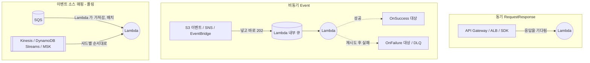

# M07-02. Lambda 트리거와 호출 유형 — 동기, 비동기, 이벤트 소스 매핑, 대상(destination)
> 도메인: D2 · 예상 시간: 50분 · 실습 등급: 🟢 (비동기 실패 대상 전달은 🟡)

## 왜 필요한가

M06에서 만든 정산 큐는 지금 EC2 위의 워커가 롱 폴링으로 소비한다. 큐가 비어 있는 새벽에도 서버 요금이 나가고, 주문이 몰리면 워커 수를 직접 늘려야 한다. "큐에 메시지가 오면 Lambda가 알아서 꺼내 처리하고, 많으면 알아서 여러 개가 돈다"면 워커 서버가 필요 없다. 그런데 Lambda를 "누가, 어떻게" 부르는지에 따라 재시도·오류 처리·권한이 완전히 달라진다. 이걸 모르면 "실패한 주문이 어디로 사라졌지?"를 겪게 된다.

## 핵심 개념

### 세 가지 호출 방식



| | 동기 | 비동기 | 이벤트 소스 매핑(ESM) |
|---|---|---|---|
| 누가 부르나 | 호출자가 직접 | 서비스가 Lambda 내부 큐에 넣음 | **Lambda 서비스가 소스를 폴링** |
| 대표 소스 | API Gateway, ALB, Cognito 트리거, SDK | S3, SNS, EventBridge, CloudWatch Logs | SQS, Kinesis, DynamoDB Streams, MSK, Amazon MQ, DocumentDB |
| 실패하면 | **호출자에게 오류** — 재시도는 호출자 몫 | Lambda가 **기본 2번 더 재시도**(최대 이벤트 나이까지), 그 뒤 **대상/DLQ** | SQS: 메시지가 큐에 남아 다시 보임 → 큐의 **DLQ**. 스트림: 성공하거나 만료될 때까지 그 샤드를 막음(분할·실패 대상 설정 가능) |
| 권한 | 호출자 → 함수: **리소스 기반 정책** (`lambda:InvokeFunction`) | 소스 서비스 → 함수: **리소스 기반 정책** (`add-permission`) | 함수의 **실행 역할**에 소스 읽기 권한 (`sqs:ReceiveMessage`, `DeleteMessage`, `GetQueueAttributes`) |

권한 방향을 헷갈리지 말자. **누가 Lambda를 부르나** = 함수의 리소스 기반 정책(`add-permission`). **Lambda가 무엇을 하나(무엇을 읽나)** = 실행 역할.

### SQS 이벤트 소스 매핑의 규칙

- 큐의 **가시성 타임아웃은 함수 타임아웃 이상**이어야 한다(더 짧으면 매핑 생성 자체가 거부된다). AWS는 **함수 타임아웃의 6배 이상**을 권장한다(재시도·배치 대기 여유).
- 배치(기본 10건)로 함수를 부른다. 함수가 성공하면 Lambda가 배치의 메시지를 **대신 지운다**. 함수가 예외를 던지면 배치 **전체**가 큐에 남는다.
- **부분 배치 응답(`ReportBatchItemFailures`)**: 함수가 `{"batchItemFailures": [{"itemIdentifier": <messageId>}]}`를 돌려주면 그 메시지만 남기고 나머지는 지운다. 성공한 메시지가 다시 처리되는 낭비를 막는다.
- 실패가 반복되는 메시지는 **큐의 재드라이브 정책 → DLQ**로 보낸다(M06-02). SQS 소스에서는 Lambda의 "실패 대상"이 아니라 **큐의 DLQ**를 쓴다.

### 비동기 호출의 대상(destination)

`PutFunctionEventInvokeConfig`로 비동기 호출 결과를 보낼 곳을 정한다: `OnSuccess`/`OnFailure` → SQS, SNS, Lambda, EventBridge 버스(실패는 S3도). 재시도 횟수(0~2)와 최대 이벤트 나이(60초~6시간)도 여기서. 함수 자체의 **DLQ**(`DeadLetterConfig`, SQS·SNS)는 예전 방식으로, 실패 이벤트만 담고 정보가 적다 — 새로 만든다면 **실패 대상**을 권장한다.

## 직접 해 보기

[lab02-lambda-sqs-esm.sh](./labs/lab02-lambda-sqs-esm.sh) — 함수 코드는 [functions/settlement_consumer.py](./functions/settlement_consumer.py).

```bash
bash curriculum/m07-serverless-containers/labs/lab02-lambda-sqs-esm.sh
```

**1) 가시성 타임아웃 규칙**

```
== 3. 큐 가시성 타임아웃(3초) < 함수 타임아웃(5초) 이면 매핑을 거부한다

aws: [ERROR]: An error occurred (InvalidParameterValueException) when calling the CreateEventSourceMapping operation: Queue visibility timeout: 3 seconds is less than Function timeout: 5 seconds

Additional error details:
Type: User
```

방금 본 것: 함수가 5초 동안 처리하는 사이 메시지가 다시 보이면 다른 호출이 같은 메시지를 또 처리한다. AWS는 이 설정 자체를 거부한다.

**2) 매핑을 만들고 메시지를 넣기만 한다**

```
== 4. 가시성 타임아웃을 10초로 늘리고 매핑 생성 (배치 10, 부분 배치 실패 보고 켬)
{
    "State": "Enabled",
    "BatchSize": 10,
    "Source": "arn:aws:sqs:us-east-1:000000000000:todayorder-settlement-jobs",
    "ResponseTypes": [
        "ReportBatchItemFailures"
    ]
}
== 5. 정산 작업 4건(그중 1건은 통화 코드 오류)을 큐에 넣는다 — 워커 코드는 없다, Lambda 가 가져간다
32759e80-91f3-47e8-a22c-3af1bdf03b99
85577236-daae-470a-9b60-55756d497d71
75cf703d-11c3-4f86-9e38-81449c1cf3cc
14f10ade-2876-42b8-8cb7-1eef2b3b0890
{
    "Attributes": {
        "ApproximateNumberOfMessagesNotVisible": "0",
        "ApproximateNumberOfMessages": "0"
    }
}
DLQ: {"orderId":"A-2103","total":5000,"currency":"KRWW"}
== 6. 함수 로그: 무엇을 처리했나
{"result": "settled", "orderId": "A-2101", "total": 12000}
{"result": "settled", "orderId": "A-2102", "total": 8000}
{"result": "failed", "orderId": "A-2103"}
{"result": "settled", "orderId": "A-2104", "total": 30000}
{"result": "failed", "orderId": "A-2103"}
```

방금 본 것: 우리는 `receive-message`도 `delete-message`도 부르지 않았다. 매핑이 큐를 폴링해 배치로 함수를 불렀고, 성공한 3건은 지워졌다. 실패한 A-2103만 `batchItemFailures`로 보고되어 큐에 남았다가 다시 처리(로그의 두 번째 `failed`)되고, `maxReceiveCount=2`를 넘자 DLQ로 갔다. 성공한 3건은 **다시 처리되지 않았다** — 부분 배치 응답 덕분이다.

**3) 매핑 끄기, 비동기 실패 대상 구성**

```
== 7. 매핑 일시 중지 (배포·장애 대응 때 소비를 멈추는 스위치)
Updating
Disabled
== 8. (구성만) 비동기 호출의 실패 대상: 재시도 0회, 실패하면 SQS 로
{
    "Retries": 0,
    "MaxAge": 3600,
    "OnFailure": "arn:aws:sqs:us-east-1:000000000000:todayorder-async-failures"
}
...
LAB02 OK
```

방금 본 것: 매핑을 끄면 메시지는 큐에 그대로 쌓인다(버퍼). 비동기 실패 대상은 구성은 저장되지만, 아래처럼 에뮬레이터에서는 전달이 일어나지 않는다.

## 실제 AWS에서는

저자가 에뮬레이터에서 따로 확인한 비동기·트리거 동작(실습 스크립트에는 단언하지 않음):

| 관찰 | 에뮬레이터 | 실제 AWS |
|---|---|---|
| 비동기 호출이 실패하면 재시도 | 3번 실행됨(로그 `START` 3회). `MaximumRetryAttempts=0`으로 설정해도 3번 | 기본 재시도 2번(총 3번), 설정한 횟수를 따른다 |
| 실패 대상(OnFailure→SQS), OnSuccess, 함수 DLQ | 90초 넘게 기다려도 **대상 큐에 아무것도 오지 않음** | 재시도가 끝나면 대상으로 이벤트 레코드가 전달됨 |
| S3 → Lambda 알림 | `add-permission` 없으면 알림 구성 저장 자체가 `InvalidArgument`(검증), 있으면 실제로 함수 실행 | 같음 |
| SNS → Lambda 구독 | `add-permission` 없으면 **오류 없이 함수가 실행되지 않음**, 넣으면 실행 | 같음(SNS가 전달 실패로 기록) |
| SQS 타임아웃 규칙, 부분 배치 응답, 큐 DLQ | 실제처럼 동작 | 같음 |

- 그래서 이 레슨의 ESM 실습은 🟢, 비동기 대상 전달은 🟡(구성만)이다.
- 실제 AWS에서 해 보려면: Lambda 프리 티어(매월 100만 요청), SQS 프리 티어(100만 요청) 범위라 거의 무료다. 단 **매핑을 켜 둔 SQS 소스는 비어 있어도 Lambda가 계속 롱 폴링 요청을 보낸다**(SQS 요청으로 집계). 정리: `aws lambda delete-event-source-mapping --uuid <UUID>`, `aws lambda delete-function --function-name todayorder-settlement-consumer`, 큐 2~3개 삭제, 역할 삭제.

## 시험 포인트

- "SQS 메시지를 Lambda로 처리" → **이벤트 소스 매핑**(폴링은 Lambda가). 가시성 타임아웃 ≥ 함수 타임아웃(권장 6배).
- "배치 중 일부만 실패하는데 전부 다시 처리된다" → **ReportBatchItemFailures(부분 배치 응답)**.
- "SQS 소스에서 계속 실패하는 메시지" → **SQS 큐의 DLQ**. "비동기 호출 실패 기록" → **OnFailure 대상**(또는 함수 DLQ).
- "비동기 호출 성공/실패 결과를 다른 서비스로 연결" → **Lambda 대상(destinations)**.
- "S3/SNS/EventBridge가 Lambda를 못 부른다" → 함수의 **리소스 기반 정책(`add-permission`)**. "Lambda가 SQS를 못 읽는다" → **실행 역할**.
- Kinesis/DynamoDB Streams 소스: 샤드당 순서 처리, 실패한 배치가 샤드를 막는다 → **배치 분할(BisectBatchOnFunctionError), 최대 재시도, 실패 대상** 설정.

## 스스로 확인

1. 함수 타임아웃이 60초인데 SQS 가시성 타임아웃이 30초다. 매핑을 만들 수 있나? 만들 수 있다면 무슨 문제가 생기나?
2. S3 업로드 이벤트로 도는 썸네일 함수가 가끔 실패한다. 실패한 이벤트를 나중에 분석하려면?
3. 10건 배치에서 1건만 실패했는데 10건이 모두 다시 처리된다. 무엇을 바꾸나?

<details><summary>답</summary>

1. 만들 수 없다(`InvalidParameterValueException`). 만들 수 있었다면 처리 중에 메시지가 다시 보여 중복 처리가 일어났을 것이다. 가시성 타임아웃을 360초(6배) 정도로 늘린다.
2. S3 → Lambda는 비동기 호출이다. 함수에 **OnFailure 대상**(SQS·SNS·EventBridge·S3)을 설정하거나 함수 DLQ를 단다. 재시도 횟수·최대 이벤트 나이도 조정할 수 있다.
3. 매핑에 `FunctionResponseTypes=ReportBatchItemFailures`를 켜고, 함수가 실패한 메시지 ID만 `batchItemFailures`로 돌려주게 한다.

</details>
