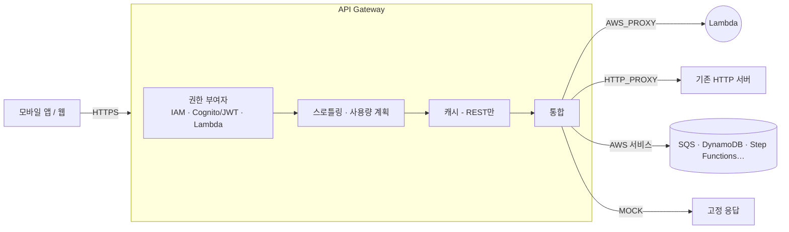

# M07-03. API Gateway — REST vs HTTP vs WebSocket, 스테이지, 스로틀링, 캐싱, 권한 부여자
> 도메인: D2, D3 · 예상 시간: 55분 · 실습 등급: 🟢

## 왜 필요한가

Lambda 함수는 HTTP 서버가 아니다. 모바일 앱이 `GET /orders/A-3001`을 부르면 누군가 HTTPS를 받아서, 인증을 확인하고, 초당 요청 수를 제한하고, 요청을 Lambda 이벤트로 바꿔 주고, 응답을 HTTP로 돌려줘야 한다. 이 "API 앞단"을 직접 만들면 Nginx·인증서·스케일링을 다 운영해야 한다. **Amazon API Gateway**는 이것을 관리형으로 해 준다.

## 핵심 개념



### 세 가지 API 유형

| | REST API | HTTP API | WebSocket API |
|---|---|---|---|
| 한 줄 요약 | 기능이 가장 많은 원조 | **더 싸고 단순**한 REST형 API | 양방향 실시간(채팅, 실시간 주문 현황) |
| 엔드포인트 유형 | 엣지 최적화 · 리전 · **프라이빗** | 리전 | 리전 |
| 인증 | IAM, Cognito 사용자 풀 권한 부여자, Lambda 권한 부여자, **리소스 정책** | IAM, **JWT 권한 부여자**(Cognito 등 OIDC), Lambda 권한 부여자 | IAM, Lambda 권한 부여자 |
| API 키·사용량 계획(고객별 스로틀·할당량) | ✓ | ✗ | ✗ |
| 캐싱 | ✓ | ✗ | ✗ |
| AWS WAF 직접 연결 | ✓ | ✗ | ✗ |
| 요청 검증·본문 변환·MOCK 통합 | ✓ | ✗ (파라미터 매핑만) | – |
| 배포 | 배포를 만들어 스테이지에 연결 | **자동 배포**(`$default` 스테이지) 가능 | 배포/스테이지 |

(비교 출처: [REST API와 HTTP API 중 선택](https://docs.aws.amazon.com/apigateway/latest/developerguide/http-api-vs-rest.html), WAF 연결 대상: [AWS WAF 개요](https://docs.aws.amazon.com/waf/latest/developerguide/waf-chapter.html) — API Gateway 중에는 REST API만 목록에 있다.) HTTP API·WebSocket API를 WAF로 보호하려면 앞에 **CloudFront 배포를 두고 그 배포에 WAF 웹 ACL을 연결**한다. 시험 요령: **"API 키·사용량 계획·캐싱·WAF·프라이빗 API·요청 검증"이 나오면 REST**, **"가장 저렴·낮은 지연·JWT/OIDC"면 HTTP API**, **"양방향·서버 푸시"면 WebSocket**.

### 스테이지, 스로틀링, 캐싱

- **스테이지(stage)**: API의 배포 스냅숏에 붙이는 이름(`dev`, `prod`). URL에 들어간다: `https://<apiId>.execute-api.<리전>.amazonaws.com/<stage>/<경로>`. 스테이지 변수로 스테이지마다 다른 Lambda 별칭을 가리키게 할 수 있다(`prod` → `live` 별칭).
- **스로틀링**: 계정·리전 단위 기본 한도(초당 10,000 요청, 버스트 5,000) 아래에서 스테이지·메서드별, (REST) 사용량 계획으로 **API 키별** 한도를 둔다. 넘으면 **429 Too Many Requests**. 하위 Lambda·DB를 보호하는 첫 방어선이다.
- **캐싱(REST)**: 스테이지에 캐시를 켜면 같은 요청은 백엔드를 부르지 않는다. 기본 TTL 300초(최대 3600초), 캐시 크기에 따라 시간당 과금.
- **통합 타임아웃**: REST는 기본 최대 29초(리전·프라이빗 API는 할당량 증설로 더 길게 가능), HTTP API는 최대 30초. 오래 걸리는 작업은 **비동기**(SQS·Step Functions에 넣고 202)로 바꾼다.

### 프록시 통합과 Lambda 권한

- **Lambda 프록시 통합(`AWS_PROXY`)**: HTTP 요청 전체(메서드, 경로, 헤더, 경로 파라미터, 본문)를 이벤트로 함수에 넘기고, 함수는 `{"statusCode", "headers", "body"}`를 돌려준다. REST는 페이로드 1.0, HTTP API는 기본 2.0(모양이 다르다).
- API Gateway가 함수를 부르려면 함수의 **리소스 기반 정책**에 `apigateway.amazonaws.com`의 `lambda:InvokeFunction`이 있어야 한다(`aws lambda add-permission`). `--source-arn arn:aws:execute-api:<리전>:<계정>:<apiId>/<stage>/<METHOD>/<경로>`로 **이 API의 이 경로에서만** 허용하는 것이 최소 권한이다.

## 직접 해 보기

[lab03-apigw-rest-http.sh](./labs/lab03-apigw-rest-http.sh) — 백엔드는 이벤트를 요약해 돌려주는 [functions/api_echo.py](./functions/api_echo.py).

에뮬레이터에서 API를 부르는 주소는 실제 AWS와 다르다:

| | 에뮬레이터 | 실제 AWS |
|---|---|---|
| REST (스테이지 `dev`) | `https://127.0.0.1:$EMULATOR_PORT/_aws/execute-api/<apiId>/dev/<경로>` | `https://<apiId>.execute-api.us-east-1.amazonaws.com/dev/<경로>` |
| HTTP API (`$default`) | `https://127.0.0.1:$EMULATOR_PORT/_aws/execute-api/<apiId>/<경로>` | `https://<apiId>.execute-api.us-east-1.amazonaws.com/<경로>` |

호출은 `curl --cacert "$AWS_CA_BUNDLE"`로 한다(에뮬레이터의 자체 인증서).

```bash
bash curriculum/m07-serverless-containers/labs/lab03-apigw-rest-http.sh
```

**1) REST API — MOCK 통합**

```
== 4. 배포 → 스테이지 dev
REST 기본 주소: https://127.0.0.1:9306/_aws/execute-api/srmuqurh02/dev   (실제 AWS: https://srmuqurh02.execute-api.us-east-1.amazonaws.com/dev)
{"status":"ok","service":"todayorder"}
[HTTP 200]
```

방금 본 것: REST API는 리소스(`/health`) → 메서드(`GET`) → 통합(MOCK) → 메서드 응답·통합 응답을 하나씩 만들고 **배포**해야 호출된다. 백엔드 없이 고정 응답을 내는 MOCK은 헬스 체크나 프런트엔드 개발용 가짜 API로 쓴다. (출력의 포트 9306은 저자 환경이다. 학습자 화면에는 내 `EMULATOR_PORT`, 기본 9297이 찍힌다.)

**2) REST API — Lambda 프록시와 권한**

```
== 5. Lambda 리소스 정책(add-permission) 없이 /orders/A-3001 호출
{"message":"Internal server error"}
[HTTP 500]
-- 에뮬레이터 로그에 남은 이유:
"reason":"the AWS_PROXY integration's function allows apigateway.amazonaws.com no lambda:InvokeFunction for this method, so no invocation was made"
== 6. add-permission: apigateway.amazonaws.com 이 이 API 의 GET /orders/* 에서만 함수를 호출하도록 허용
{
    "Sid": "rest-get-order",
    "Effect": "Allow",
    "Principal": {
        "Service": "apigateway.amazonaws.com"
    },
    "Action": "lambda:InvokeFunction",
    "Resource": "arn:aws:lambda:us-east-1:000000000000:function:todayorder-api-echo",
    "Condition": {
        "ArnLike": {
            "AWS:SourceArn": "arn:aws:execute-api:us-east-1:000000000000:srmuqurh02/*/GET/orders/*"
        }
    }
}
{"api": "REST API (payload 1.0)", "resource": "/orders/{orderId}", "method": "GET", "path": "/orders/A-3001", "stage": "dev", "pathParameters": {"orderId": "A-3001"}}
[HTTP 200]
```

방금 본 것: 권한이 없으면 클라이언트는 그냥 **500 Internal server error**만 본다. 원인은 API Gateway 쪽 로그에만 있다(실제 AWS에서는 실행 로그의 "Invalid permissions on Lambda function"). 에뮬레이터는 같은 이유를 컨테이너 로그(`docker logs aws-emulator-$EMULATOR_PORT`)에 남긴다 — 디버깅할 때 기억해 두자. 권한을 넣자 함수가 실행됐고, `{orderId}` 경로 파라미터가 `pathParameters`로 넘어왔다.

**3) 스테이지 스로틀링**

```
== 7. 스테이지 설정: 스로틀링(초당 100건, 버스트 200)
{
    "Rate": 100.0,
    "Burst": 200
}
```

**4) HTTP API — 같은 함수, 더 짧은 구성**

```
== 8. HTTP API: GET /orders/{orderId} → 같은 Lambda (페이로드 2.0), $default 스테이지 자동 배포
GET /orders/{orderId}
$default
https://127.0.0.1:9306/_aws/execute-api/6o9xe5f0aw
{"api": "HTTP API (payload 2.0)", "routeKey": "GET /orders/{orderId}", "method": "GET", "path": "/orders/A-3002", "pathParameters": {"orderId": "A-3002"}}
[HTTP 200]
-- 없는 경로
{"message":"Not Found"}
[HTTP 404]
LAB03 OK
```

방금 본 것: HTTP API는 "라우트(`GET /orders/{orderId}`) → 통합" 두 단계에 자동 배포 스테이지 하나로 끝난다. 이벤트에는 `routeKey`, `rawPath`가 있다(페이로드 2.0). 없는 경로는 API Gateway가 404로 막는다.

## 실제 AWS에서는

- **권한 검사가 API 유형마다 다르다(에뮬레이터 한정).** 저자 확인 결과, 에뮬레이터의 **REST API**는 Lambda 리소스 정책을 검사해 없으면 500을 냈지만, **HTTP API**는 `add-permission` 없이도 함수를 호출했다(FIDELITY의 "AddPermission 없이도 통과"는 HTTP API에 해당). 실제 AWS에서는 **둘 다** 권한이 필요하므로, 실습 스크립트는 HTTP API에도 `add-permission`을 넣는다. 에뮬레이터에서 통과했다고 실제 AWS에서 통과한다는 뜻이 아니다.
- 스로틀링 설정은 저장되지만, 에뮬레이터에서 실제로 429가 나는지는 확인하지 않았다. 캐싱·WAF·사용량 계획도 구성까지만 관찰 대상이다.
- 실제 AWS의 `ApiEndpoint`는 `https://<apiId>.execute-api.us-east-1.amazonaws.com`이고 AWS가 관리하는 공인 인증서를 쓴다. `--cacert`가 필요 없다.
- 실제 AWS에서 해 보려면: API Gateway는 Lambda·SQS처럼 "상시 무료(Always Free)" 항목이 아니다. 2025년 7월 15일 이후 만든 계정은 가입 크레딧으로, 그 전 계정은 (남아 있다면) 12개월 무료 혜택으로 충당된다. 실습 수준의 호출 수백 건은 몇 원 수준이지만, **REST 캐시는 켜 두는 시간만큼 과금**되므로 켜지 않는다. 정리: `aws apigateway delete-rest-api --rest-api-id <id>`, `aws apigatewayv2 delete-api --api-id <id>`, `aws lambda delete-function --function-name todayorder-api-echo`.

## 시험 포인트

- "API 키로 고객별 사용량 제한·할당량" → **REST API + 사용량 계획**.
- "가장 저렴하고 지연이 낮은 Lambda/HTTP 프록시 API, JWT(OIDC·Cognito) 인증" → **HTTP API**.
- "실시간 양방향(채팅·알림 푸시)" → **WebSocket API**.
- "VPC 안에서만 접근 가능한 API" → **REST 프라이빗 API + 인터페이스 VPC 엔드포인트**.
- "같은 GET 요청이 반복되어 백엔드 부하" → **REST API 캐싱**(또는 CloudFront).
- "급증 트래픽으로부터 백엔드 보호" → **스로틀링**(429). 비동기로 바꾸려면 API Gateway → **SQS 직접 통합**.
- "API Gateway → Lambda가 500, 함수 로그도 없다" → 함수의 **리소스 기반 정책(`add-permission`)**.
- "29초 넘는 처리" → 비동기 패턴(작업 접수 후 202 + 상태 조회 API, Step Functions).

## 스스로 확인

1. 외부 파트너사 3곳에 주문 조회 API를 열고, 회사마다 초당 요청 수와 월 호출량을 다르게 제한하고 싶다. 어떤 API 유형과 기능을 쓰나?
2. `aws lambda add-permission`의 `--source-arn`을 생략하면 무엇이 문제인가?
3. 프록시 통합에서 함수가 `{"orderId": "A-1"}`만 반환하면 어떻게 되나?

<details><summary>답</summary>

1. REST API + 파트너별 API 키 + 사용량 계획(스로틀·할당량). HTTP API에는 API 키·사용량 계획이 없다.
2. `apigateway.amazonaws.com`이라는 서비스 전체(다른 계정의 API 포함)가 이 함수를 부를 수 있게 된다. `--source-arn`으로 내 API·스테이지·메서드·경로로 좁힌다.
3. 프록시 응답 형식(`statusCode`, `body` 문자열)이 아니므로 REST API는 502(잘못된 Lambda 응답)를 낸다. HTTP API의 페이로드 2.0은 형식이 없으면 반환값을 JSON 본문·200으로 추론해 주지만, 명시적으로 형식을 맞추는 편이 안전하다.

</details>
