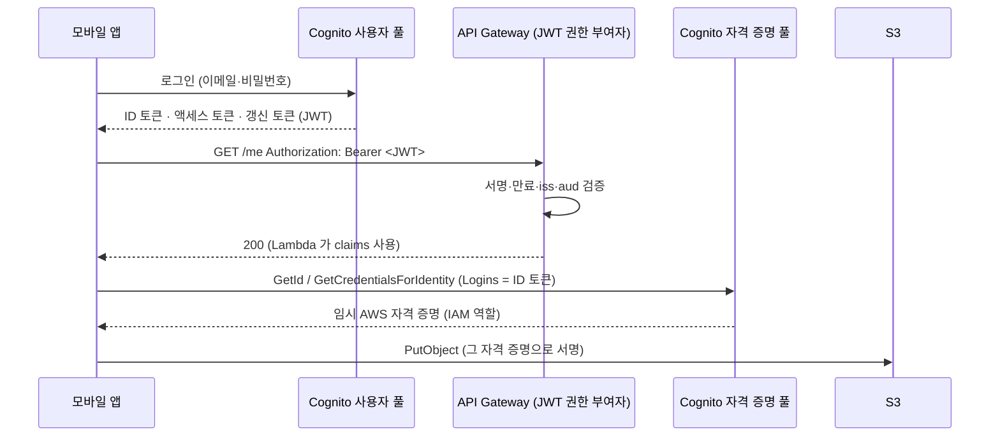

# M07-04. Cognito — 사용자 풀 vs 자격 증명 풀
> 도메인: D1, D2 · 예상 시간: 45분 · 실습 등급: 🟢

## 왜 필요한가

TodayOrder 앱에 회원 기능이 생긴다. 가입, 이메일 확인, 로그인, 비밀번호 재설정, 소셜 로그인, MFA… 이걸 직접 만들면 비밀번호 해시·토큰 서명·잠금 정책까지 보안 사고의 지뢰밭을 걷게 된다. 또 앱이 영수증 사진을 **S3에 직접** 올리게 하고 싶은데, 앱에 AWS 액세스 키를 넣을 수는 없다. 두 문제를 푸는 것이 **Amazon Cognito**의 두 부품, **사용자 풀**과 **자격 증명 풀**이다. 이름이 비슷해서 시험에서 단골로 헷갈리게 만드는 지점이다.

## 핵심 개념



| | **사용자 풀(User Pool)** | **자격 증명 풀(Identity Pool)** |
|---|---|---|
| 하는 일 | **인증(authentication)** — 사용자 디렉터리, 가입·로그인 | **AWS 권한 부여** — 로그인한(또는 게스트) 사용자에게 **임시 AWS 자격 증명** |
| 결과물 | **JWT** (ID·액세스·갱신 토큰) | **STS 임시 자격 증명**(액세스 키·비밀 키·세션 토큰), IAM 역할 기반 |
| 누가 소비 | 내 API(API Gateway 권한 부여자, ALB 인증, 백엔드) | AWS 서비스(S3, DynamoDB…)에 **앱이 직접** 요청 |
| 신원 소스 | 자체 디렉터리 + Google·Apple·Facebook·Amazon, SAML, OIDC 연동 | 사용자 풀, 소셜, SAML, OIDC, 개발자 인증, **비인증(게스트)** |
| 기능 | MFA, 비밀번호 정책, 이메일·SMS 확인, 관리형 로그인 UI, Lambda 트리거(가입 전 검증 등), 위협 방어 | 인증/비인증 역할, 역할 매핑, 정책 변수로 사용자별 접근 제한 |

한 문장 정리: **사용자 풀은 "누구냐"를 증명하는 토큰을 주고, 자격 증명 풀은 그 토큰을 "AWS 리소스에 대한 열쇠"로 바꿔 준다.**

### 토큰 세 가지

| 토큰 | 담긴 것 | 쓰임 |
|---|---|---|
| ID 토큰 | 사용자 속성(`email`, `sub`), `aud` = 앱 클라이언트 ID | 사용자 정보가 필요한 API 인증, 자격 증명 풀 로그인 |
| 액세스 토큰 | `scope`, `client_id`, 그룹 | API 권한(범위) 확인, 사용자 풀 API(`GetUser`) 호출 |
| 갱신 토큰 | (불투명) | 만료된 ID·액세스 토큰 재발급 |

JWT는 `헤더.페이로드.서명`이고 페이로드는 base64url일 뿐 **암호화되지 않는다** — 누구나 읽는다. 대신 **서명**으로 위조를 막는다. 검증하는 쪽(API Gateway JWT 권한 부여자 등)은 사용자 풀의 공개 키(JWKS)로 서명을, `iss`(발급자)·`aud`/`client_id`(대상)·`exp`(만료)를 확인한다.

### 자격 증명 풀의 정책 변수

자격 증명 풀 역할의 정책에 `${cognito-identity.amazonaws.com:sub}`를 쓰면 "**자기 폴더에만**" 같은 사용자별 제한을 정책 하나로 표현한다.

```json
{"Effect": "Allow", "Action": "s3:PutObject",
 "Resource": "arn:aws:s3:::todayorder-uploads/${cognito-identity.amazonaws.com:sub}/*"}
```

## 직접 해 보기

[lab07-cognito-jwt.sh](./labs/lab07-cognito-jwt.sh) — `/me` 함수는 [functions/whoami.py](./functions/whoami.py).

```bash
bash curriculum/m07-serverless-containers/labs/lab07-cognito-jwt.sh
```

**1) 가입·확인·로그인**

```
== 2. 가입 (SignUp) → 아직 미확인
{
    "UserConfirmed": false
}
-- 확인 전에 로그인하면:

aws: [ERROR]: An error occurred (UserNotConfirmedException) when calling the InitiateAuth operation: User is not confirmed.
== 3. 확인 (실제로는 이메일 코드로 confirm-sign-up. 실습은 관리자 API 로 대신)
-- 틀린 비밀번호:

aws: [ERROR]: An error occurred (NotAuthorizedException) when calling the InitiateAuth operation: Incorrect username or password.
== 4. 로그인 → 토큰 3종 (ID·액세스·갱신) — 토큰 값은 비밀이라 길이만 출력
{
  "AccessToken": "<732자>",
  "ExpiresIn": 3600,
  "TokenType": "Bearer",
  "RefreshToken": "<950자>",
  "IdToken": "<713자>"
}
```

방금 본 것: 가입 직후 사용자는 미확인 상태라 로그인할 수 없다(실제로는 이메일로 받은 코드를 `confirm-sign-up`에 넣는다). 틀린 비밀번호의 오류 메시지는 "사용자 이름 **또는** 비밀번호"라고 뭉뚱그린다 — 어느 쪽이 틀렸는지 알려 주면 계정 존재 여부가 새기 때문이다. 토큰 값은 비밀이라 길이만 찍었다. `TokenType`은 `Bearer` — HTTP 요청에 `Authorization: Bearer <토큰>`으로 싣는다는 뜻이다. 유효 기간(`ExpiresIn`) 3,600초.

**2) ID 토큰 들여다보기**

```
-- ID 토큰의 payload (서명된 JSON — 누구나 읽을 수 있으니 비밀을 넣지 않는다):
{
  "sub": "01eb421e-bd6c-4196-bc4d-da40e22ac10a",
  "iss": "https://127.0.0.1:9306/us-east-1_089ef7645",
  "aud": "b219cb05490f4a18b37e2f83f4",
  "cognito:username": "01eb421e-bd6c-4196-bc4d-da40e22ac10a",
  "token_use": "id",
  "auth_time": 1794487282,
  "iat": 1794487282,
  "exp": 1794490882,
  "jti": "cd42c47a-4e0b-48c5-a465-793de2405236",
  "origin_jti": "7caaa0dd-376c-420f-a68d-2f656e47f051",
  "email": "minji@example.com"
}
발급자(iss): https://127.0.0.1:9306/us-east-1_089ef7645   (실제 AWS: https://cognito-idp.us-east-1.amazonaws.com/us-east-1_089ef7645)
```

방금 본 것: `sub`는 사용자의 변하지 않는 고유 ID(이메일이 바뀌어도 그대로 — DB의 사용자 키로 쓴다), `aud`는 앱 클라이언트 ID, `exp - iat` = 3,600초. **`iss`가 에뮬레이터 주소**라는 점이 실제 AWS와 다르다.

**3) JWT 권한 부여자로 API 보호**

```
== 5. HTTP API 의 GET /me 를 JWT 권한 부여자(사용자 풀)로 보호
{
    "Route": "GET /me",
    "Auth": "JWT"
}
-- 토큰 없이:
{"message":"Unauthorized"}
[HTTP 401]
-- 위조 토큰:
{"message":"Unauthorized"}
[HTTP 401]
-- 로그인 ID 토큰:
{"sub": "01eb421e-bd6c-4196-bc4d-da40e22ac10a", "email": "minji@example.com", "token_use": "id"}
[HTTP 200]
```

방금 본 것: 검증은 **API Gateway가** 했다. 토큰 없음·위조 토큰은 함수까지 가지도 않고 401. 함수 코드는 토큰을 검증하지 않고 `event.requestContext.authorizer.jwt.claims`만 읽는다 — 인증 코드를 함수마다 복붙할 필요가 없다.

**4) 자격 증명 풀 — 토큰을 AWS 자격 증명으로**

```
== 6. 자격 증명 풀: 로그인한 사용자에게 임시 AWS 자격 증명 (예: 앱이 S3 에 직접 업로드)
IdentityId: us-east-1:f9d12c23-17bf-4a78-9641-04cb2ef96a47
{
    "IdentityId": "us-east-1:f9d12c23-17bf-4a78-9641-04cb2ef96a47",
    "HasAccessKey": true,
    "HasSessionToken": true,
    "Expiration": "2026-11-12T22:41:31.325328+09:00"
}
LAB07 OK
```

방금 본 것: ID 토큰을 `Logins`로 넘기자 자격 증명 풀이 **인증 역할**(신뢰 주체 `cognito-identity.amazonaws.com`, `sts:AssumeRoleWithWebIdentity`)의 임시 자격 증명을 줬다. 만료 시각이 있는 세션 토큰 포함 자격 증명이라, 앱에 영구 키를 넣지 않아도 된다. 역할 정책은 위의 정책 변수로 "자기 `sub` 폴더에만 업로드"를 허용한다.

boto3로 같은 흐름: [sdk/cognito_login.py](./sdk/cognito_login.py)

```
사용자 풀: us-east-1_e48686e94
가입: UserConfirmed=False
확인 전 로그인: UserNotConfirmedException
로그인: ExpiresIn=3600  토큰=['AccessToken', 'IdToken', 'RefreshToken']
ID 토큰: token_use=id email=sdk-user@example.com aud==클라이언트 ID? True
액세스 토큰: token_use=access client_id==클라이언트 ID? True
GetUser(액세스 토큰): [('email', 'sdk-user@example.com')]
갱신: 새 ID 토큰 받음=True, 갱신 토큰 재발급=False
틀린 비밀번호: NotAuthorizedException
정리 완료
SDK cognito_login OK
```

## 실제 AWS에서는

- 토큰 발급자(`iss`)는 `https://cognito-idp.<리전>.amazonaws.com/<풀 ID>`다. 에뮬레이터는 `https://127.0.0.1:<포트>/<풀 ID>`를 쓰고, JWT 권한 부여자도 그 값으로 검증한다(저자 확인: Issuer를 AWS 형식으로 넣으면 유효한 토큰도 401). 그래서 실습은 토큰의 `iss`를 읽어 설정한다. 실제 AWS 스크립트에서는 AWS 형식을 쓴다.
- ⚠️ **에뮬레이터에서 AWS 형식 Issuer를 시험해 보지 말 것.** JWT 권한 부여자는 Issuer 주소에서 서명 검증용 공개 키(JWKS)를 내려받으므로, 에뮬레이터가 실제 `cognito-idp.us-east-1.amazonaws.com`에 요청을 보낼 수 있다. 이 커리큘럼은 실제 AWS로 나가는 요청을 만들지 않는다.
- 실습은 이메일 확인을 `admin-confirm-sign-up`으로 건너뛰었다. 실제로는 이메일·SMS 발송(SES·SNS 연동, 발송 한도)이 따른다.
- 자격 증명 풀의 임시 자격 증명으로 S3에 실제 업로드하는 것은 이 실습에서 하지 않았다(M04·M01에서 다룬 S3 정책 평가 한계 때문에 의미 있는 시연이 어렵다).
- 실제 AWS에서 해 보려면: Cognito 사용자 풀은 월간 활성 사용자(MAU) 기준 과금이고 소규모는 무료 범위에 든다(요금제 Lite/Essentials/Plus에 따라 다름 — 콘솔에서 확인). SMS MFA는 별도 과금. 정리: `aws cognito-idp delete-user-pool --user-pool-id <id>`, `aws cognito-identity delete-identity-pool --identity-pool-id <id>`, API·함수·역할 삭제.

## 시험 포인트

- "웹·모바일 앱에 가입·로그인·MFA·소셜 로그인" → **Cognito 사용자 풀**.
- "모바일 앱이 S3/DynamoDB에 **직접** 접근할 임시 AWS 자격 증명" / "게스트(비인증) 접근" → **Cognito 자격 증명 풀**.
- "API Gateway에서 Cognito 로그인 사용자만 허용" → REST: **Cognito 사용자 풀 권한 부여자**, HTTP API: **JWT 권한 부여자**.
- "ALB 뒤 웹 앱에 로그인 붙이기" → **ALB 인증 액션 + Cognito 사용자 풀**(코드 수정 최소).
- "사용자마다 자기 S3 폴더만" → 자격 증명 풀 역할 정책의 **`${cognito-identity.amazonaws.com:sub}`**.
- "회사 직원(사내 AD/SAML)이 AWS 콘솔에 로그인" → Cognito가 아니라 **IAM Identity Center**(M01).

## 스스로 확인

1. 앱이 사용자 풀에서 받은 ID 토큰으로 S3 `PutObject`를 직접 호출했더니 실패했다. 왜이고, 무엇이 더 필요한가?
2. JWT 페이로드에 "회원 등급: VIP"를 넣으면 클라이언트가 이 값을 바꿔 VIP 기능을 쓸 수 있나?
3. 사내 직원 300명이 회사 SAML IdP로 AWS 콘솔과 여러 계정에 로그인해야 한다. Cognito를 쓰나?

<details><summary>답</summary>

1. JWT는 AWS 서명(SigV4)용 자격 증명이 아니다. 자격 증명 풀로 ID 토큰을 임시 AWS 자격 증명으로 바꾸고, 그 역할 정책이 해당 S3 경로의 `PutObject`를 허용해야 한다(또는 백엔드가 미리 서명된 URL을 발급).
2. 읽을 수는 있지만 바꾸면 서명이 맞지 않아 검증하는 쪽(API Gateway·백엔드)에서 거부된다. 단, 검증을 안 하는 코드라면 뚫린다 — 토큰은 반드시 서명·만료·발급자·대상을 검증해서 쓴다.
3. 아니다. 직원의 AWS 계정 접근은 **IAM Identity Center**(SAML 연동, 권한 세트)가 맞다. Cognito는 내 애플리케이션의 최종 사용자(고객)용이다.

</details>
