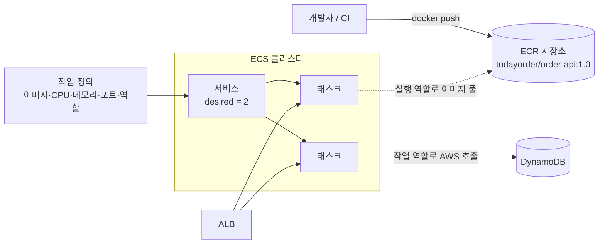

# M07-05. 컨테이너 — ECR, ECS(작업 정의·서비스), EC2 vs Fargate, EKS, App Runner, 하이브리드
> 도메인: D2, D3 · 예상 시간: 55분 · 실습 등급: 🟡

## 왜 필요한가

주문 API 본체는 Spring Boot로 짠 큰 애플리케이션이다. 기동에 20초가 걸리고, 요청 처리 중 외부 PG와 긴 연결을 유지하고, 의존 라이브러리가 수백 MB다 — Lambda에 맞지 않는다. 그렇다고 EC2에 직접 JDK를 깔고 배포 스크립트를 관리하고 싶지도 않다. 개발 PC에서 돌던 그대로 **컨테이너 이미지**로 묶어서, AWS가 "항상 2개를 띄워 두고 죽으면 다시 띄워" 주면 좋겠다. 그게 ECR + ECS다.

## 핵심 개념



| 용어 | 뜻 | 비유 없이 한 줄로 |
|---|---|---|
| **ECR** | 관리형 컨테이너 이미지 저장소(레지스트리) | 사설 Docker Hub. 푸시 시 취약점 스캔, 태그 불변, 수명 주기 정책 |
| **작업 정의(task definition)** | 컨테이너 실행 명세(JSON) | 이미지, CPU·메모리, 포트, 환경 변수, 로그 설정, **역할 2개**. 고칠 때마다 리비전 증가 |
| **태스크(task)** | 작업 정의로 띄운 실행 단위(컨테이너 1개 이상) | `docker run` 한 번 |
| **서비스(service)** | 태스크를 **원하는 개수(desired count)** 만큼 유지 | 죽으면 다시 띄우고, ALB 대상 그룹에 등록하고, 롤링 배포 |
| **클러스터** | 태스크가 놓이는 논리 묶음 | 용량 공급자(Fargate, Fargate Spot, EC2 ASG)를 가진다 |

### 역할 두 개를 구분하자

- **작업 실행 역할(task execution role)**: **ECS 에이전트**가 쓴다 — ECR에서 이미지 풀, CloudWatch Logs로 로그 전송, Secrets Manager에서 비밀 주입. 관리형 정책 `AmazonECSTaskExecutionRolePolicy`.
- **작업 역할(task role)**: **컨테이너 안의 앱 코드**가 쓴다 — DynamoDB·S3 호출 등. Lambda의 실행 역할에 해당.

### 시작 유형: EC2 vs Fargate

| | EC2 시작 유형 | Fargate |
|---|---|---|
| 서버 관리 | 내가 EC2(컨테이너 인스턴스)를 띄우고 패치·스케일 | **서버 없음** — 태스크마다 CPU·메모리만 지정 |
| 과금 | EC2 인스턴스 시간(빈 공간도 과금) | 태스크의 vCPU·메모리·시간 |
| 잘 맞는 경우 | GPU, 특수 인스턴스, 매우 큰 지속 워크로드(RI/Savings Plans로 단가↓), 호스트 수준 제어 | 운영 부담 최소, 들쭉날쭉한 워크로드, 작은 팀 |
| 네트워크 | bridge/host/awsvpc | **awsvpc만** — 태스크마다 ENI·프라이빗 IP·보안 그룹 |

Fargate Spot은 중단될 수 있는 대신 저렴하다(배치·내결함성 워크로드).

### 그 밖의 선택지 한눈에

| 서비스 | 언제 |
|---|---|
| **EKS** | 쿠버네티스가 표준인 조직, 기존 K8s 매니페스트·도구(Helm) 그대로, 멀티클라우드 이식성. 컨트롤 플레인을 AWS가 관리, 노드는 EC2·Fargate |
| **App Runner** | 소스 코드나 이미지만 주면 HTTPS 엔드포인트·오토스케일까지 끝 — 웹 앱·API를 가장 간단히. ⚠️ **2026년 4월 30일부터 신규 고객에게 닫혔다**(기존 고객은 계속 사용, 새 기능 없음). AWS는 대안으로 **Amazon ECS Express Mode**(이미지와 IAM 역할 2개만 주면 Fargate 서비스·ALB·오토스케일링을 한 번에 구성, 추가 요금 없음)를 권장한다([App Runner 가용성 변경](https://docs.aws.amazon.com/apprunner/latest/dg/apprunner-availability-change.html)) |
| **ECS Anywhere / EKS Anywhere** | **온프레미스 서버**에서 ECS/EKS로 관리되는 컨테이너 실행(규정·지연 때문에 데이터 센터에 남아야 할 때) |
| **EKS Distro** | EKS가 쓰는 쿠버네티스 배포판 자체(직접 운영) |
| Lambda 컨테이너 이미지 | Lambda 실행 모델(최대 15분)은 그대로, 패키징만 컨테이너(최대 10 GB) |

## 직접 해 보기

[lab06-ecr-ecs.sh](./labs/lab06-ecr-ecs.sh)

> ⚠️ 이 실습의 태스크 이미지는 `registry.todayorder.invalid/...` 이다. 에뮬레이터는 태스크를 시작할 때 이미지를 **실제로 내려받으려** 해서, ECR 주소(`000000000000.dkr.ecr.us-east-1.amazonaws.com/...`)를 주면 에뮬레이터 컨테이너가 그 **실제 AWS 호스트로 연결을 시도**한다(저자가 관찰: `dial tcp ...:443: i/o timeout`). 이 커리큘럼은 실제 AWS에 아무 요청도 보내지 않으므로, 절대 해석되지 않는 예약 도메인 `.invalid`(RFC 2606)를 쓴다. 실제 AWS라면 ECR 저장소 URI를 쓴다.

```bash
bash curriculum/m07-serverless-containers/labs/lab06-ecr-ecs.sh
```

**1) ECR 저장소**

```
== 1. ECR 저장소: 푸시할 때 취약점 스캔, 태그 불변(같은 태그 덮어쓰기 금지)
{
    "Uri": "000000000000.dkr.ecr.us-east-1.amazonaws.com/todayorder/order-api",
    "ScanOnPush": true,
    "Mutability": "IMMUTABLE"
}
-- 수명 주기 정책: 태그 없는 이미지는 14일 뒤 삭제
todayorder/order-api
-- docker login 에 쓰는 인증 토큰 (값은 출력하지 않는다)
{
    "Endpoint": "https://127.0.0.1:9306",
    "HasToken": true
}
0
```

방금 본 것: 저장소 URI는 `<계정>.dkr.ecr.<리전>.amazonaws.com/<이름>` 형식이다. `IMMUTABLE`이면 `1.0` 태그를 다른 이미지로 덮어쓸 수 없어 "어제 배포한 1.0과 오늘의 1.0이 다르다" 사고를 막는다. 실제로는 `aws ecr get-login-password | docker login --username AWS --password-stdin <URI>` 후 `docker push`한다(실습은 이미지를 푸시하지 않는다 — 이미지 수 0).

**2) 클러스터·작업 정의·서비스**

```
== 4. 클러스터 (Fargate 용량 공급자)
{
    "Name": "todayorder-cluster",
    "Status": "ACTIVE",
    "Providers": [
        "FARGATE",
        "FARGATE_SPOT"
    ]
}
== 5. 작업 정의 (Fargate: 0.25 vCPU, 512 MiB, awsvpc)
{
    "Family": "todayorder-order-api",
    "Revision": 1,
    "Cpu": "256",
    "Memory": "512",
    "Network": "awsvpc",
    "Compat": [
        "FARGATE"
    ]
}
== 6. 서비스: 태스크 2개를 항상 유지
{
    "Name": "todayorder-order-api-svc",
    "Status": "ACTIVE",
    "Desired": 2,
    "LaunchType": "FARGATE"
}
```

방금 본 것: Fargate 작업 정의는 CPU를 단위(256 = 0.25 vCPU)로, 메모리를 MiB로 지정하고 네트워크 모드는 `awsvpc`여야 한다. 서비스·`run-task`는 서브넷과 보안 그룹(태스크 ENI용)을 요구한다.

**3) 태스크는 왜 STOPPED가 되나**

```
== 7. 단발성 태스크(run-task) 하나를 띄우고 상태를 끝까지 따라간다
  lastStatus: PROVISIONING
  lastStatus: PENDING
  lastStatus: STOPPED
{
    "lastStatus": "STOPPED",
    "desiredStatus": "STOPPED",
    "stopCode": "TaskFailedToStart"
}
stoppedReason: CannotPullContainerError: failed to resolve ref registry.todayorder.invalid/todayorder/order-api:1.0: failed to do request: Get "https://registry.todayorder.invalid/v2/": dial tcp regis
== 8. 서비스가 띄운 태스크도 같은 이유로 멈춘다 — 서비스의 STOPPED 태스크 하나 확인
{
    "group": "service:todayorder-order-api-svc",
    "lastStatus": "STOPPED",
    "stopCode": "TaskFailedToStart"
}
stoppedReason: CannotPullContainerError: failed to resolve ref registry.todayord
{
    "Desired": 2,
    "Running": 0
}
== 9. 정리: 서비스 desired 0 → 삭제
0
DRAINING
LAB06 OK
```

방금 본 것: 태스크 수명 주기 `PROVISIONING → PENDING → (RUNNING) → STOPPED`를 따라갔다. 이미지를 받을 수 없으니 `CannotPullContainerError`로 시작에 실패했다. 서비스가 띄운 태스크(`group: service:…`)도 같은 이유로 멈췄고, 서비스는 `Running 0`인 채로 desired 2를 맞추려 계속 새 태스크를 시도한다. **실제 AWS에서도 똑같은 오류**가 흔하다 — 원인 1순위는 ① 이미지 URI·태그 오타 ② 작업 실행 역할에 ECR 권한 없음 ③ 프라이빗 서브넷에서 ECR에 닿을 경로 없음(NAT 게이트웨이 또는 ECR·S3 VPC 엔드포인트 필요, M02).

## 실제 AWS에서는

- 에뮬레이터에서는 이미지 레지스트리에 닿을 수 없으므로 태스크가 **항상** `STOPPED`(🟡)다. ECR에 이미지를 푸시하는 실습도 하지 않았다. 실제 AWS에서는 이미지가 있으면 `RUNNING`이 되고, 서비스는 ALB 대상 그룹에 태스크 IP를 등록하고, 헬스 체크에 실패한 태스크를 교체한다.
- 서비스 자동 조정(Application Auto Scaling의 대상 추적: CPU 50% 유지 등)과 롤링/블루·그린(CodeDeploy) 배포는 에뮬레이터에서 다루지 않는다.
- 실제 AWS에서 해 보려면: **Fargate·ECR은 상시 무료 항목이 아니다**(ECR은 프라이빗 저장소 저장 공간 일부만 무료 범위). 0.25 vCPU/0.5 GB 태스크 하나를 한 시간 돌리면 수십 원 수준이지만, **서비스를 지우지 않으면 desired 수만큼 계속 과금**된다. 프라이빗 서브넷이면 NAT 게이트웨이 요금(시간당)도 붙는다. 정리: `aws ecs update-service --desired-count 0` → `aws ecs delete-service` → `aws ecs delete-cluster` → `aws ecr delete-repository --force` → 작업 정의 `deregister-task-definition`.

## 시험 포인트

- "서버(인스턴스) 관리 없이 컨테이너 실행" → **Fargate**. "GPU·특정 인스턴스 유형·호스트 제어 / 대규모 상시 워크로드 비용 최적화" → **EC2 시작 유형**.
- "컨테이너 앱이 S3/DynamoDB에 접근" → **작업 역할(task role)**. "이미지 풀·로그 전송·비밀 주입 실패" → **작업 실행 역할**.
- "쿠버네티스 표준, 기존 매니페스트 이전" → **EKS**. "코드/이미지만으로 가장 빨리 웹 서비스" → **App Runner**(SAA-C03 시험 범위에 있으므로 이 답을 알아 둔다. 실무 신규 도입이라면 App Runner는 신규 고객에게 닫혔으니 **ECS Express Mode**).
- "온프레미스에서 AWS 관리형으로 컨테이너" → **ECS Anywhere / EKS Anywhere**.
- "태스크마다 보안 그룹" → **awsvpc 네트워크 모드**(Fargate는 필수).
- "같은 태그의 이미지가 바뀌는 것 방지" → ECR **태그 불변성**. "푸시할 때 취약점 검사" → **스캔(scan on push / Inspector 향상된 스캔)**.
- "프라이빗 서브넷 Fargate가 이미지를 못 받는다" → **NAT GW 또는 ECR(api, dkr)·S3 게이트웨이 VPC 엔드포인트**.

## 스스로 확인

1. Fargate 태스크의 앱이 DynamoDB에 `AccessDenied`를 받는다. 작업 실행 역할에 DynamoDB 권한을 줬는데도 그렇다. 왜인가?
2. 15분 넘게 걸리는 주문 정산 배치를 매일 밤 실행해야 한다. Lambda와 ECS 중 무엇이 맞고, 무엇으로 일정을 거나?
3. ECS 서비스의 desired count를 2로 두면 무엇이 보장되고, 무엇은 보장되지 않나?

<details><summary>답</summary>

1. 앱 코드가 쓰는 자격 증명은 **작업 역할(task role)** 이다. 작업 실행 역할은 ECS 에이전트(이미지 풀·로그)용이다. 작업 역할에 권한을 주고 작업 정의에 `taskRoleArn`을 넣는다.
2. Lambda는 최대 15분이라 불가. ECS(Fargate) 태스크를 **EventBridge Scheduler**(또는 예약 규칙)로 `RunTask`한다. AWS Batch도 후보다.
3. 태스크가 멈추면 서비스가 새 태스크를 띄워 2개를 맞추려 한다(자가 치유). 트래픽에 따라 개수를 바꾸는 것은 아니다 — 그건 서비스 자동 조정(Application Auto Scaling)을 따로 설정해야 한다.

</details>
